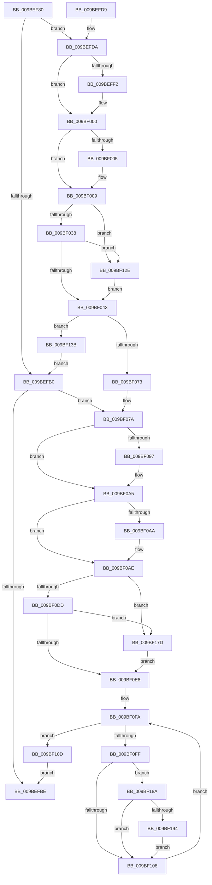

# EtwpRealtimeUpdateConsumers

- RVA: `0x009BEF80`–`0x009BF1A8` (길이 `552` bytes)
- VA: `0x00000001409BEF80`
- 실행 섹션: `PAGE`
- PDB 이름 있음: `예`; PDB Function 태그: `아니요`
- unwind 정보 RVA: `0x0009F3B4`
- 디코드: `134`개 명령, `552/552` bytes 표시
- 미해석 바이트: `0` (있으면 어셈블리에 `.byte`로 보존)

> 이 문서는 커널 이미지의 기계어와 PDB 기호를 분석해 생성했습니다. 4번과 5번은 함수 원형과 자료형을 바이너리 사용 방식에서 추정한 C 해석이며 원본 소스 복구 결과는 아닙니다.

## 1. Dependencies

- 직접 호출 지점: **10**; 고유 호출 대상: **5**
- 직접 호출자로 확인된 함수: **1**
- RIP 상대 이미지 참조: **0**

### Outgoing calls
- `0x009BEFE2` → [KeAbPreAcquire](../../text/21/KeAbPreAcquire_function_00210230.md) (function, `0x00210230`)
- `0x009BEFFB` → [ExfAcquirePushLockExclusiveEx](../../text/20/ExfAcquirePushLockExclusiveEx_function_0020FC90.md) (function, `0x0020FC90`)
- `0x009BF046` → [KeAbPostRelease](../../text/2E/KeAbPostRelease_function_002E1600.md) (function, `0x002E1600`)
- `0x009BF087` → [KeAbPreAcquire](../../text/21/KeAbPreAcquire_function_00210230.md) (function, `0x00210230`)
- `0x009BF0A0` → [ExfAcquirePushLockExclusiveEx](../../text/20/ExfAcquirePushLockExclusiveEx_function_0020FC90.md) (function, `0x0020FC90`)
- `0x009BF0EB` → [KeAbPostRelease](../../text/2E/KeAbPostRelease_function_002E1600.md) (function, `0x002E1600`)
- `0x009BF124` → [KeSetEvent](../../text/33/KeSetEvent_function_0033F310.md) (function, `0x0033F310`)
- `0x009BF131` → [ExfReleasePushLock](../../text/26/ExfReleasePushLock_function_002638D0.md) (function, `0x002638D0`)
- `0x009BF173` → [KeSetEvent](../../text/33/KeSetEvent_function_0033F310.md) (function, `0x0033F310`)
- `0x009BF180` → [ExfReleasePushLock](../../text/26/ExfReleasePushLock_function_002638D0.md) (function, `0x002638D0`)

### Direct callers
- [EtwpLogger](EtwpLogger_function_009BE310.md) at `0x009BE5BF`

### Static image references
- 디코드된 RIP-relative 메모리 참조가 없습니다.

## 2. Other-region calls and transfers

- 다른 실행 섹션으로 향하는 call: **10**
  - `0x009BEFE2` → [KeAbPreAcquire](../../text/21/KeAbPreAcquire_function_00210230.md) (`PAGE` → `.text`)
  - `0x009BEFFB` → [ExfAcquirePushLockExclusiveEx](../../text/20/ExfAcquirePushLockExclusiveEx_function_0020FC90.md) (`PAGE` → `.text`)
  - `0x009BF046` → [KeAbPostRelease](../../text/2E/KeAbPostRelease_function_002E1600.md) (`PAGE` → `.text`)
  - `0x009BF087` → [KeAbPreAcquire](../../text/21/KeAbPreAcquire_function_00210230.md) (`PAGE` → `.text`)
  - `0x009BF0A0` → [ExfAcquirePushLockExclusiveEx](../../text/20/ExfAcquirePushLockExclusiveEx_function_0020FC90.md) (`PAGE` → `.text`)
  - `0x009BF0EB` → [KeAbPostRelease](../../text/2E/KeAbPostRelease_function_002E1600.md) (`PAGE` → `.text`)
  - `0x009BF124` → [KeSetEvent](../../text/33/KeSetEvent_function_0033F310.md) (`PAGE` → `.text`)
  - `0x009BF131` → [ExfReleasePushLock](../../text/26/ExfReleasePushLock_function_002638D0.md) (`PAGE` → `.text`)
  - `0x009BF173` → [KeSetEvent](../../text/33/KeSetEvent_function_0033F310.md) (`PAGE` → `.text`)
  - `0x009BF180` → [ExfReleasePushLock](../../text/26/ExfReleasePushLock_function_002638D0.md) (`PAGE` → `.text`)
- 별도 외부 분기/꼬리 이동을 확인하지 못했습니다.

## 3. Assembly (complete function range)

```asm
009BEF80  48 8B C4                        mov rax, rsp
009BEF83  48 89 58 08                     mov qword ptr [rax + 8], rbx
009BEF87  48 89 68 10                     mov qword ptr [rax + 0x10], rbp
009BEF8B  48 89 70 18                     mov qword ptr [rax + 0x18], rsi
009BEF8F  48 89 78 20                     mov qword ptr [rax + 0x20], rdi
009BEF93  41 56                           push r14
009BEF95  48 83 EC 20                     sub rsp, 0x20
009BEF99  8B 81 38 03 00 00               mov eax, dword ptr [rcx + 0x338]
009BEF9F  48 8D B9 B0 02 00 00            lea rdi, [rcx + 0x2b0]
009BEFA6  45 33 F6                        xor r14d, r14d
009BEFA9  48 8B D9                        mov rbx, rcx
009BEFAC  A8 20                           test al, 0x20
009BEFAE  75 2A                           jne 0x1409befda
009BEFB0  8B 83 38 03 00 00               mov eax, dword ptr [rbx + 0x338]
009BEFB6  A8 10                           test al, 0x10
009BEFB8  0F 85 BC 00 00 00               jne 0x1409bf07a
009BEFBE  48 8B 5C 24 30                  mov rbx, qword ptr [rsp + 0x30]
009BEFC3  48 8B 6C 24 38                  mov rbp, qword ptr [rsp + 0x38]
009BEFC8  48 8B 74 24 40                  mov rsi, qword ptr [rsp + 0x40]
009BEFCD  48 8B 7C 24 48                  mov rdi, qword ptr [rsp + 0x48]
009BEFD2  48 83 C4 20                     add rsp, 0x20
009BEFD6  41 5E                           pop r14
009BEFD8  C3                              ret
009BEFD9  CC                              int3
009BEFDA  45 33 C0                        xor r8d, r8d
009BEFDD  33 D2                           xor edx, edx
009BEFDF  48 8B CF                        mov rcx, rdi
009BEFE2  E8 49 12 85 FF                  call 0x140210230
009BEFE7  F0 48 0F BA 2F 00               lock bts qword ptr [rdi], 0
009BEFED  48 8B F0                        mov rsi, rax
009BEFF0  73 0E                           jae 0x1409bf000
009BEFF2  4C 8B C7                        mov r8, rdi
009BEFF5  48 8B D0                        mov rdx, rax
009BEFF8  48 8B CF                        mov rcx, rdi
009BEFFB  E8 90 0C 85 FF                  call 0x14020fc90
009BF000  48 85 F6                        test rsi, rsi
009BF003  74 04                           je 0x1409bf009
009BF005  C6 46 0A 01                     mov byte ptr [rsi + 0xa], 1
009BF009  48 8B B3 60 01 00 00            mov rsi, qword ptr [rbx + 0x160]
009BF010  4C 89 B3 60 01 00 00            mov qword ptr [rbx + 0x160], r14
009BF017  0F 0D 0F                        prefetchw byte ptr [rdi]
009BF01A  48 8B 07                        mov rax, qword ptr [rdi]
009BF01D  48 8B C8                        mov rcx, rax
009BF020  48 83 E1 F0                     and rcx, 0xfffffffffffffff0
009BF024  48 83 F9 10                     cmp rcx, 0x10
009BF028  48 8D 50 F0                     lea rdx, [rax - 0x10]
009BF02C  49 0F 46 D6                     cmovbe rdx, r14
009BF030  A8 02                           test al, 2
009BF032  0F 85 F6 00 00 00               jne 0x1409bf12e
009BF038  F0 48 0F B1 17                  lock cmpxchg qword ptr [rdi], rdx
009BF03D  0F 85 EB 00 00 00               jne 0x1409bf12e
009BF043  48 8B CF                        mov rcx, rdi
009BF046  E8 B5 25 92 FF                  call 0x1402e1600
009BF04B  48 8B 46 28                     mov rax, qword ptr [rsi + 0x28]
009BF04F  4C 89 76 28                     mov qword ptr [rsi + 0x28], r14
009BF053  0F 10 83 B0 01 00 00            movups xmm0, xmmword ptr [rbx + 0x1b0]
009BF05A  F3 0F 7F 40 50                  movdqu xmmword ptr [rax + 0x50], xmm0
009BF05F  48 8D 83 48 01 00 00            lea rax, [rbx + 0x148]
009BF066  48 8B 48 08                     mov rcx, qword ptr [rax + 8]
009BF06A  48 39 01                        cmp qword ptr [rcx], rax
009BF06D  0F 84 C8 00 00 00               je 0x1409bf13b
009BF073  B9 03 00 00 00                  mov ecx, 3
009BF078  CD 29                           int 0x29
009BF07A  45 33 C0                        xor r8d, r8d
009BF07D  33 D2                           xor edx, edx
009BF07F  48 8B CF                        mov rcx, rdi
009BF082  BD 96 02 00 C0                  mov ebp, 0xc0000296
009BF087  E8 A4 11 85 FF                  call 0x140210230
009BF08C  F0 48 0F BA 2F 00               lock bts qword ptr [rdi], 0
009BF092  48 8B F0                        mov rsi, rax
009BF095  73 0E                           jae 0x1409bf0a5
009BF097  4C 8B C7                        mov r8, rdi
009BF09A  48 8B D0                        mov rdx, rax
009BF09D  48 8B CF                        mov rcx, rdi
009BF0A0  E8 EB 0B 85 FF                  call 0x14020fc90
009BF0A5  48 85 F6                        test rsi, rsi
009BF0A8  74 04                           je 0x1409bf0ae
009BF0AA  C6 46 0A 01                     mov byte ptr [rsi + 0xa], 1
009BF0AE  48 8B B3 60 01 00 00            mov rsi, qword ptr [rbx + 0x160]
009BF0B5  4C 89 B3 60 01 00 00            mov qword ptr [rbx + 0x160], r14
009BF0BC  0F 0D 0F                        prefetchw byte ptr [rdi]
009BF0BF  48 8B 07                        mov rax, qword ptr [rdi]
009BF0C2  48 8B C8                        mov rcx, rax
009BF0C5  48 83 E1 F0                     and rcx, 0xfffffffffffffff0
009BF0C9  48 83 F9 10                     cmp rcx, 0x10
009BF0CD  48 8D 50 F0                     lea rdx, [rax - 0x10]
009BF0D1  49 0F 46 D6                     cmovbe rdx, r14
009BF0D5  A8 02                           test al, 2
009BF0D7  0F 85 A0 00 00 00               jne 0x1409bf17d
009BF0DD  F0 48 0F B1 17                  lock cmpxchg qword ptr [rdi], rdx
009BF0E2  0F 85 95 00 00 00               jne 0x1409bf17d
009BF0E8  48 8B CF                        mov rcx, rdi
009BF0EB  E8 10 25 92 FF                  call 0x1402e1600
009BF0F0  48 8D 93 48 01 00 00            lea rdx, [rbx + 0x148]
009BF0F7  48 8B 0A                        mov rcx, qword ptr [rdx]
009BF0FA  48 3B CA                        cmp rcx, rdx
009BF0FD  74 0E                           je 0x1409bf10d
009BF0FF  48 3B F1                        cmp rsi, rcx
009BF102  0F 84 82 00 00 00               je 0x1409bf18a
009BF108  48 8B 09                        mov rcx, qword ptr [rcx]
009BF10B  EB ED                           jmp 0x1409bf0fa
009BF10D  89 6B 28                        mov dword ptr [rbx + 0x28], ebp
009BF110  F0 83 A3 38 03 00 00 EF         lock and dword ptr [rbx + 0x338], 0xffffffef
009BF118  48 8D 8B C8 01 00 00            lea rcx, [rbx + 0x1c8]
009BF11F  45 33 C0                        xor r8d, r8d
009BF122  33 D2                           xor edx, edx
009BF124  E8 E7 01 98 FF                  call 0x14033f310
009BF129  E9 90 FE FF FF                  jmp 0x1409befbe
009BF12E  48 8B CF                        mov rcx, rdi
009BF131  E8 9A 47 8A FF                  call 0x1402638d0
009BF136  E9 08 FF FF FF                  jmp 0x1409bf043
009BF13B  48 89 06                        mov qword ptr [rsi], rax
009BF13E  48 89 4E 08                     mov qword ptr [rsi + 8], rcx
009BF142  48 89 31                        mov qword ptr [rcx], rsi
009BF145  48 89 70 08                     mov qword ptr [rax + 8], rsi
009BF149  FF 83 58 01 00 00               inc dword ptr [rbx + 0x158]
009BF14F  80 66 5A F7                     and byte ptr [rsi + 0x5a], 0xf7
009BF153  F0 83 8B 38 03 00 00 40         lock or dword ptr [rbx + 0x338], 0x40
009BF15B  44 89 73 28                     mov dword ptr [rbx + 0x28], r14d
009BF15F  F0 83 A3 38 03 00 00 DF         lock and dword ptr [rbx + 0x338], 0xffffffdf
009BF167  48 8D 8B C8 01 00 00            lea rcx, [rbx + 0x1c8]
009BF16E  45 33 C0                        xor r8d, r8d
009BF171  33 D2                           xor edx, edx
009BF173  E8 98 01 98 FF                  call 0x14033f310
009BF178  E9 33 FE FF FF                  jmp 0x1409befb0
009BF17D  48 8B CF                        mov rcx, rdi
009BF180  E8 4B 47 8A FF                  call 0x1402638d0
009BF185  E9 5E FF FF FF                  jmp 0x1409bf0e8
009BF18A  F6 46 5A 01                     test byte ptr [rsi + 0x5a], 1
009BF18E  0F 85 74 FF FF FF               jne 0x1409bf108
009BF194  F0 83 8B 38 03 00 00 04         lock or dword ptr [rbx + 0x338], 4
009BF19C  80 4E 5A 01                     or byte ptr [rsi + 0x5a], 1
009BF1A0  41 8B EE                        mov ebp, r14d
009BF1A3  E9 60 FF FF FF                  jmp 0x1409bf108
```

## 4. C-style interpretation (structured pseudocode)

```c
__int64 __fastcall EtwpRealtimeUpdateConsumers(__int64 a1, int a2, int a3)
{
    __int64 result;
    __int64 v_r14;
    __int64 v_rsp;
    unsigned __int64 v_stack_p10;
    unsigned __int64 v_stack_p18;
    unsigned __int64 v_stack_p20;
    unsigned __int64 v_stack_p8;

    *(unsigned __int64 *)(v_rsp + 8) = v_rbx;
    *(unsigned __int64 *)(v_rsp + 16) = v_rbp;
    *(unsigned __int64 *)(v_rsp + 24) = v_rsi;
    *(unsigned __int64 *)(v_rsp + 32) = v_rdi;
    v_rsp = (v_rsp) - (32);
    v_r14 = 0;
    if ((((unsigned __int8)((unsigned int)(*(unsigned int *)(a1 + 824)))) & (32)) != 0) goto loc_009BEFDA;
loc_009BEFB0:
    if ((((unsigned __int8)((unsigned int)(*(unsigned int *)(a1 + 824)))) & (16)) != 0) goto loc_009BF07A;
loc_009BEFBE:
    v_rsp = (v_rsp) + (32);
    return (unsigned int)(*(unsigned int *)(a1 + 824));
loc_009BEFDA:
    a3 = 0;
    a2 = 0;
    result = KeAbPreAcquire(v_stack_p20, a2, a3, a4);
    if (!(condition_is_above_or_equal)) {
        a3 = v_stack_p20;
        a2 = result;
        a1 = v_stack_p20;
        result = ExfAcquirePushLockExclusiveEx(a1, a2, a3, a4);
    }
    if (result != 0) {
        *(unsigned __int8 *)(result + 10) = 1;
    }
    *(unsigned __int64 *)(v_stack_p8 + 352) = 0;
    a1 = (*(unsigned __int64 *)(v_stack_p20)) & (-16);
    a2 = *(unsigned __int64 *)(v_stack_p20) - 16;
    if (a1 <= 16) { a2 = 0; }
    if ((((unsigned __int8)(*(unsigned __int64 *)(v_stack_p20))) & (2)) != 0) goto loc_009BF12E;
    if ((((unsigned __int8)(*(unsigned __int64 *)(v_stack_p20))) & (2)) != 0) goto loc_009BF12E;
loc_009BF043:
    result = KeAbPostRelease(v_stack_p20, a2, a3, a4);
    *(unsigned __int64 *)(*(unsigned __int64 *)(v_stack_p8 + 352) + 40) = 0;
    *(unsigned __int64 *)(*(unsigned __int64 *)(*(unsigned __int64 *)(v_stack_p8 + 352) + 40) + 80) = v_xmm0;
    if ((*(unsigned __int64 *)(*(unsigned __int64 *)(v_stack_p8 + 328 + 8))) == (v_stack_p8 + 328)) goto loc_009BF13B;
loc_009BF07A:
    a3 = 0;
    a2 = 0;
    result = KeAbPreAcquire(v_stack_p20, a2, a3, a4);
    if (!(condition_is_above_or_equal)) {
        a3 = v_stack_p20;
        a2 = result;
        a1 = v_stack_p20;
        result = ExfAcquirePushLockExclusiveEx(a1, a2, a3, a4);
    }
    if (result != 0) {
        *(unsigned __int8 *)(result + 10) = 1;
    }
    *(unsigned __int64 *)(v_stack_p8 + 352) = 0;
    a1 = (*(unsigned __int64 *)(v_stack_p20)) & (-16);
    a2 = *(unsigned __int64 *)(v_stack_p20) - 16;
    if (a1 <= 16) { a2 = 0; }
    if ((((unsigned __int8)(*(unsigned __int64 *)(v_stack_p20))) & (2)) != 0) goto loc_009BF17D;
    if ((((unsigned __int8)(*(unsigned __int64 *)(v_stack_p20))) & (2)) != 0) goto loc_009BF17D;
loc_009BF0E8:
    result = KeAbPostRelease(v_stack_p20, a2, a3, a4);
loc_009BF0FA:
    if ((*(unsigned __int64 *)(v_stack_p8 + 328)) == (v_stack_p8 + 328)) goto loc_009BF10D;
    if ((*(unsigned __int64 *)(v_stack_p8 + 352)) == (*(unsigned __int64 *)(v_stack_p8 + 328))) goto loc_009BF18A;
loc_009BF108:
    goto loc_009BF0FA;
loc_009BF10D:
    *(unsigned int *)(v_stack_p8 + 40) = (unsigned int)((unsigned int)(0xC0000296ULL));
    a3 = 0;
    a2 = 0;
    result = KeSetEvent(v_stack_p8 + 456, a2, a3, a4);
    goto loc_009BEFBE;
loc_009BF12E:
    result = ExfReleasePushLock(v_stack_p20, a2, a3, a4);
    goto loc_009BF043;
loc_009BF13B:
    *(unsigned __int64 *)(*(unsigned __int64 *)(v_stack_p8 + 352)) = result;
    *(unsigned __int64 *)(*(unsigned __int64 *)(v_stack_p8 + 352) + 8) = v_stack_p20;
    *(unsigned __int64 *)(v_stack_p20) = *(unsigned __int64 *)(v_stack_p8 + 352);
    *(unsigned __int64 *)(result + 8) = *(unsigned __int64 *)(v_stack_p8 + 352);
    *(unsigned int *)(v_stack_p8 + 40) = 0;
    a3 = 0;
    a2 = 0;
    result = KeSetEvent(v_stack_p8 + 456, a2, a3, a4);
    goto loc_009BEFB0;
loc_009BF17D:
    result = ExfReleasePushLock(v_stack_p20, a2, a3, a4);
    goto loc_009BF0E8;
loc_009BF18A:
    if (((*(unsigned __int8 *)(*(unsigned __int64 *)(v_stack_p8 + 352) + 90)) & (1)) != 0) goto loc_009BF108;
    goto loc_009BF108;
}
```

## 5. (Beta) C Style

```c
int64_t EtwpRealtimeUpdateConsumers(void *Arg1, int32_t Arg2, int32_t Arg3)
{
    uint8_t *arg1 = (uint8_t *)Arg1;

    int64_t result;
    int64_t local_r14;
    int64_t local_rsp;
    uint64_t v_stack_p10;
    uint64_t v_stack_p18;
    uint64_t v_stack_p20;
    uint64_t v_stack_p8;

    *(uint64_t *)(local_rsp + 0x8) = local_rbx;
    *(uint64_t *)(local_rsp + 0x10) = local_rbp;
    *(uint64_t *)(local_rsp + 0x18) = local_rsi;
    *(uint64_t *)(local_rsp + 0x20) = local_rdi;
    local_rsp = (local_rsp) - (32);
    local_r14 = 0;
    if ((((uint8_t)((uint32_t)(*(uint32_t *)(arg1 + 0x338)))) & (32)) != 0) goto loc_009BEFDA;
loc_009BEFB0:
    if ((((uint8_t)((uint32_t)(*(uint32_t *)(arg1 + 0x338)))) & (16)) != 0) goto loc_009BF07A;
loc_009BEFBE:
    local_rsp = (local_rsp) + (32);
    return (uint32_t)(*(uint32_t *)(arg1 + 0x338));
loc_009BEFDA:
    Arg3 = 0;
    Arg2 = 0;
    result = KeAbPreAcquire(v_stack_p20, Arg2, Arg3, a4);
    if (!(condition_is_above_or_equal)) {
        Arg3 = v_stack_p20;
        Arg2 = result;
        Arg1 = v_stack_p20;
        result = ExfAcquirePushLockExclusiveEx(Arg1, Arg2, Arg3, a4);
    }
    if (result != 0) {
        *(uint8_t *)(result + 0xA) = 1;
    }
    *(uint64_t *)(v_stack_p8 + 0x160) = 0;
    Arg1 = (*(uint64_t *)(v_stack_p20)) & (-16);
    Arg2 = *(uint64_t *)(v_stack_p20) - 16;
    if (Arg1 <= 16) { Arg2 = 0; }
    if ((((uint8_t)(*(uint64_t *)(v_stack_p20))) & (2)) != 0) goto loc_009BF12E;
    if ((((uint8_t)(*(uint64_t *)(v_stack_p20))) & (2)) != 0) goto loc_009BF12E;
loc_009BF043:
    result = KeAbPostRelease(v_stack_p20, Arg2, Arg3, a4);
    *(uint64_t *)(*(uint64_t *)(v_stack_p8 + 0x160) + 0x28) = 0;
    *(uint64_t *)(*(uint64_t *)(*(uint64_t *)(v_stack_p8 + 0x160) + 0x28) + 0x50) = v_xmm0;
    if ((*(uint64_t *)(*(uint64_t *)(v_stack_p8 + 0x148 + 0x8))) == (v_stack_p8 + 328)) goto loc_009BF13B;
loc_009BF07A:
    Arg3 = 0;
    Arg2 = 0;
    result = KeAbPreAcquire(v_stack_p20, Arg2, Arg3, a4);
    if (!(condition_is_above_or_equal)) {
        Arg3 = v_stack_p20;
        Arg2 = result;
        Arg1 = v_stack_p20;
        result = ExfAcquirePushLockExclusiveEx(Arg1, Arg2, Arg3, a4);
    }
    if (result != 0) {
        *(uint8_t *)(result + 0xA) = 1;
    }
    *(uint64_t *)(v_stack_p8 + 0x160) = 0;
    Arg1 = (*(uint64_t *)(v_stack_p20)) & (-16);
    Arg2 = *(uint64_t *)(v_stack_p20) - 16;
    if (Arg1 <= 16) { Arg2 = 0; }
    if ((((uint8_t)(*(uint64_t *)(v_stack_p20))) & (2)) != 0) goto loc_009BF17D;
    if ((((uint8_t)(*(uint64_t *)(v_stack_p20))) & (2)) != 0) goto loc_009BF17D;
loc_009BF0E8:
    result = KeAbPostRelease(v_stack_p20, Arg2, Arg3, a4);
loc_009BF0FA:
    if ((*(uint64_t *)(v_stack_p8 + 0x148)) == (v_stack_p8 + 328)) goto loc_009BF10D;
    if ((*(uint64_t *)(v_stack_p8 + 0x160)) == (*(uint64_t *)(v_stack_p8 + 0x148))) goto loc_009BF18A;
loc_009BF108:
    goto loc_009BF0FA;
loc_009BF10D:
    *(uint32_t *)(v_stack_p8 + 0x28) = (uint32_t)((uint32_t)(0xC0000296ULL));
    Arg3 = 0;
    Arg2 = 0;
    result = KeSetEvent(v_stack_p8 + 456, Arg2, Arg3, a4);
    goto loc_009BEFBE;
loc_009BF12E:
    result = ExfReleasePushLock(v_stack_p20, Arg2, Arg3, a4);
    goto loc_009BF043;
loc_009BF13B:
    *(uint64_t *)(*(uint64_t *)(v_stack_p8 + 0x160)) = result;
    *(uint64_t *)(*(uint64_t *)(v_stack_p8 + 0x160) + 0x8) = v_stack_p20;
    *(uint64_t *)(v_stack_p20) = *(uint64_t *)(v_stack_p8 + 0x160);
    *(uint64_t *)(result + 0x8) = *(uint64_t *)(v_stack_p8 + 0x160);
    *(uint32_t *)(v_stack_p8 + 0x28) = 0;
    Arg3 = 0;
    Arg2 = 0;
    result = KeSetEvent(v_stack_p8 + 456, Arg2, Arg3, a4);
    goto loc_009BEFB0;
loc_009BF17D:
    result = ExfReleasePushLock(v_stack_p20, Arg2, Arg3, a4);
    goto loc_009BF0E8;
loc_009BF18A:
    if (((*(uint8_t *)(*(uint64_t *)(v_stack_p8 + 0x160) + 0x5A)) & (1)) != 0) goto loc_009BF108;
    goto loc_009BF108;
}
```

### 관측된 메모리 오프셋

구조체 형식이 확인되지 않은 접근은 인자 기준의 오프셋으로만 기록했습니다.

| 기준 인자 | 오프셋 표현 | 폭 (bit) | 접근 |
|---|---:|---:|---|
| `Arg1` | `+ 0x0` | `8` | `R` |
| `Arg1` | `+ 0x0` | `64` | `R` |
| `Arg1` | `+ 0x0` | `64` | `R/W` |
| `Arg1` | `+ 0x8` | `64` | `R` |
| `Arg1` | `+ 0x8` | `64` | `W` |
| `Arg1` | `+ 0x28` | `32` | `W` |
| `Arg1` | `+ 0x148` | `64` | `R` |
| `Arg1` | `+ 0x158` | `32` | `R/W` |
| `Arg1` | `+ 0x160` | `64` | `R` |
| `Arg1` | `+ 0x160` | `64` | `W` |
| `Arg1` | `+ 0x1B0` | `128` | `R` |
| `Arg1` | `+ 0x1C8` | `64` | `R` |
| `Arg1` | `+ 0x2B0` | `64` | `R` |
| `Arg1` | `+ 0x338` | `32` | `R` |
| `Arg1` | `+ 0x338` | `32` | `R/W` |

## 6. Execution-region graph

[열기: 2D/3D 그래프와 함수 탐색 컨트롤 패널](../../../control-panel.html?section=page&rva=0x009BEF80&view=graph)

- 2D 그래프는 위에서 아래로 흐르고, 3D 그래프는 빈 공간을 드래그해 회전합니다. Shift+드래그는 이동, 휠은 확대·축소, 함수 노드 선택은 대상 보고서 이동입니다.

### Static fallback


