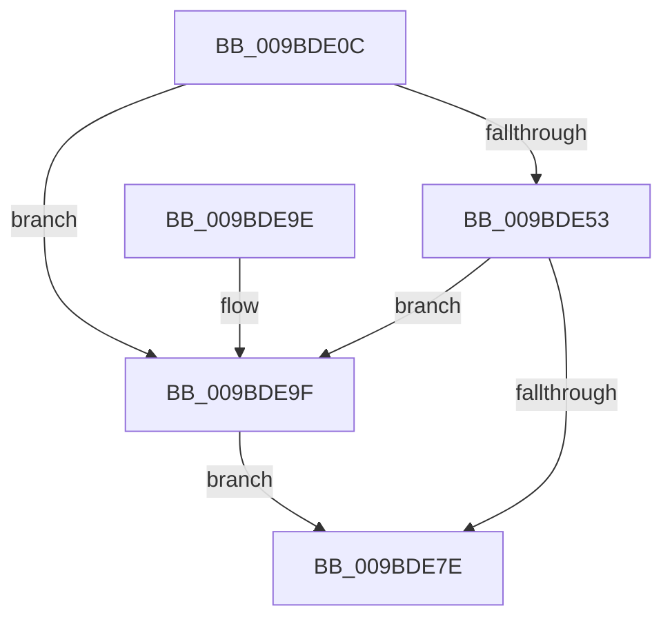

# EtwpRealtimeZeroTruncateLogfile

- RVA: `0x009BDE0C`–`0x009BDEB7` (길이 `171` bytes)
- VA: `0x00000001409BDE0C`
- 실행 섹션: `PAGE`
- PDB 이름 있음: `예`; PDB Function 태그: `아니요`
- unwind 정보 RVA: `0x0009F2C8`
- 디코드: `40`개 명령, `171/171` bytes 표시
- 미해석 바이트: `0` (있으면 어셈블리에 `.byte`로 보존)

> 이 문서는 커널 이미지의 기계어와 PDB 기호를 분석해 생성했습니다. 4번과 5번은 함수 원형과 자료형을 바이너리 사용 방식에서 추정한 C 해석이며 원본 소스 복구 결과는 아닙니다.

## 1. Dependencies

- 직접 호출 지점: **3**; 고유 호출 대상: **2**
- 직접 호출자로 확인된 함수: **2**
- RIP 상대 이미지 참조: **0**

### Outgoing calls
- `0x009BDE4A` → [ZwSetInformationFile](../../text/6A/ZwSetInformationFile_function_006AD5B0.md) (function, `0x006AD5B0`)
- `0x009BDE75` → [ZwSetInformationFile](../../text/6A/ZwSetInformationFile_function_006AD5B0.md) (function, `0x006AD5B0`)
- `0x009BDEA6` → [ZwClose](../../text/6A/ZwClose_function_006AD2B0.md) (function, `0x006AD2B0`)

### Direct callers
- [EtwpRealtimeFlushSavedBuffers](EtwpRealtimeFlushSavedBuffers_function_009BF1B0.md) at `0x009BF317`
- [EtwpRealtimeFlushSavedBuffers](EtwpRealtimeFlushSavedBuffers_function_009BF1B0.md) at `0x009BF33B`
- [sub_00B2EA5E](../B2/Unknown_function_00B2EA5E.md) at `0x00B2EABA`

### Static image references
- 디코드된 RIP-relative 메모리 참조가 없습니다.

## 2. Other-region calls and transfers

- 다른 실행 섹션으로 향하는 call: **3**
  - `0x009BDE4A` → [ZwSetInformationFile](../../text/6A/ZwSetInformationFile_function_006AD5B0.md) (`PAGE` → `.text`)
  - `0x009BDE75` → [ZwSetInformationFile](../../text/6A/ZwSetInformationFile_function_006AD5B0.md) (`PAGE` → `.text`)
  - `0x009BDEA6` → [ZwClose](../../text/6A/ZwClose_function_006AD2B0.md) (`PAGE` → `.text`)
- 별도 외부 분기/꼬리 이동을 확인하지 못했습니다.

## 3. Assembly (complete function range)

```asm
009BDE0C  48 8B C4                        mov rax, rsp
009BDE0F  48 89 58 18                     mov qword ptr [rax + 0x18], rbx
009BDE13  57                              push rdi
009BDE14  48 83 EC 40                     sub rsp, 0x40
009BDE18  48 83 60 08 00                  and qword ptr [rax + 8], 0
009BDE1D  4C 8D 40 10                     lea r8, [rax + 0x10]
009BDE21  BF 48 00 00 00                  mov edi, 0x48
009BDE26  C7 40 D8 14 00 00 00            mov dword ptr [rax - 0x28], 0x14
009BDE2D  48 8B D9                        mov rbx, rcx
009BDE30  48 89 78 10                     mov qword ptr [rax + 0x10], rdi
009BDE34  48 8B 89 68 01 00 00            mov rcx, qword ptr [rcx + 0x168]
009BDE3B  48 8D 50 E8                     lea rdx, [rax - 0x18]
009BDE3F  0F 57 C0                        xorps xmm0, xmm0
009BDE42  44 8D 4F C0                     lea r9d, [rdi - 0x40]
009BDE46  0F 11 40 E8                     movups xmmword ptr [rax - 0x18], xmm0
009BDE4A  E8 61 F7 CE FF                  call 0x1406ad5b0
009BDE4F  85 C0                           test eax, eax
009BDE51  78 4C                           js 0x1409bde9f
009BDE53  48 8B 8B 68 01 00 00            mov rcx, qword ptr [rbx + 0x168]
009BDE5A  44 8D 4F C0                     lea r9d, [rdi - 0x40]
009BDE5E  4C 8D 44 24 50                  lea r8, [rsp + 0x50]
009BDE63  48 89 7C 24 50                  mov qword ptr [rsp + 0x50], rdi
009BDE68  48 8D 54 24 30                  lea rdx, [rsp + 0x30]
009BDE6D  C7 44 24 20 13 00 00 00         mov dword ptr [rsp + 0x20], 0x13
009BDE75  E8 36 F7 CE FF                  call 0x1406ad5b0
009BDE7A  85 C0                           test eax, eax
009BDE7C  78 21                           js 0x1409bde9f
009BDE7E  48 89 BB 90 01 00 00            mov qword ptr [rbx + 0x190], rdi
009BDE85  48 89 BB 88 01 00 00            mov qword ptr [rbx + 0x188], rdi
009BDE8C  48 89 BB 80 01 00 00            mov qword ptr [rbx + 0x180], rdi
009BDE93  48 8B 5C 24 60                  mov rbx, qword ptr [rsp + 0x60]
009BDE98  48 83 C4 40                     add rsp, 0x40
009BDE9C  5F                              pop rdi
009BDE9D  C3                              ret
009BDE9E  CC                              int3
009BDE9F  48 8B 8B 68 01 00 00            mov rcx, qword ptr [rbx + 0x168]
009BDEA6  E8 05 F4 CE FF                  call 0x1406ad2b0
009BDEAB  48 83 A3 68 01 00 00 00         and qword ptr [rbx + 0x168], 0
009BDEB3  33 FF                           xor edi, edi
009BDEB5  EB C7                           jmp 0x1409bde7e
```

## 4. C-style interpretation (structured pseudocode)

```c
__int64 __fastcall EtwpRealtimeZeroTruncateLogfile(__int64 a1)
{
    __int64 result;
    __int64 v_rdi;
    __int64 v_rsp;
    unsigned __int64 v_stack_m18;
    unsigned int v_stack_m28;
    unsigned __int64 v_stack_p18;
    unsigned __int64 v_stack_p8;

    *(unsigned __int64 *)(v_rsp + 24) = v_rbx;
    v_rsp = (v_rsp) - (64);
    *(unsigned int *)(v_rsp - 40) = 20;
    *(unsigned __int64 *)(v_rsp + 16) = 72;
    *(unsigned __int64 *)(v_rsp - 24) = v_xmm0;
    result = ZwSetInformationFile(*(unsigned __int64 *)(a1 + 360), v_rsp - 24, v_rsp + 16, 72 - 64);
    if (sign_flag) goto loc_009BDE9F;
    v_stack_p8 = 72;
    v_stack_m28 = 19;
    result = ZwSetInformationFile(*(unsigned __int64 *)(a1 + 360), v_stack_m18, v_stack_p8, 72 - 64);
    if (sign_flag) goto loc_009BDE9F;
loc_009BDE7E:
    *(unsigned __int64 *)(a1 + 400) = 72;
    *(unsigned __int64 *)(a1 + 392) = 72;
    *(unsigned __int64 *)(a1 + 384) = 72;
    v_rsp = (v_rsp) + (64);
    return result;
loc_009BDE9F:
    result = ZwClose(*(unsigned __int64 *)(v_stack_p18 + 360), v_stack_m18, v_stack_p8, 72 - 64);
    v_rdi = 0;
    goto loc_009BDE7E;
}
```

## 5. (Beta) C Style

```c
int64_t EtwpRealtimeZeroTruncateLogfile(void *Arg1)
{
    uint8_t *arg1 = (uint8_t *)Arg1;

    int64_t result;
    int64_t local_rdi;
    int64_t local_rsp;
    uint64_t v_stack_m18;
    uint32_t v_stack_m28;
    uint64_t v_stack_p18;
    uint64_t v_stack_p8;

    *(uint64_t *)(local_rsp + 0x18) = local_rbx;
    local_rsp = (local_rsp) - (64);
    *(uint32_t *)(local_rsp - 0x28) = 20;
    *(uint64_t *)(local_rsp + 0x10) = 72;
    *(uint64_t *)(local_rsp - 0x18) = v_xmm0;
    result = ZwSetInformationFile(*(uint64_t *)(arg1 + 0x168), local_rsp - 24, local_rsp + 16, 72 - 64);
    if (sign_flag) goto loc_009BDE9F;
    v_stack_p8 = 72;
    v_stack_m28 = 19;
    result = ZwSetInformationFile(*(uint64_t *)(arg1 + 0x168), v_stack_m18, v_stack_p8, 72 - 64);
    if (sign_flag) goto loc_009BDE9F;
loc_009BDE7E:
    *(uint64_t *)(arg1 + 0x190) = 72;
    *(uint64_t *)(arg1 + 0x188) = 72;
    *(uint64_t *)(arg1 + 0x180) = 72;
    local_rsp = (local_rsp) + (64);
    return result;
loc_009BDE9F:
    result = ZwClose(*(uint64_t *)(v_stack_p18 + 0x168), v_stack_m18, v_stack_p8, 72 - 64);
    local_rdi = 0;
    goto loc_009BDE7E;
}
```

### 관측된 메모리 오프셋

구조체 형식이 확인되지 않은 접근은 인자 기준의 오프셋으로만 기록했습니다.

| 기준 인자 | 오프셋 표현 | 폭 (bit) | 접근 |
|---|---:|---:|---|
| `Arg1` | `+ 0x168` | `64` | `R` |
| `Arg1` | `+ 0x168` | `64` | `R/W` |
| `Arg1` | `+ 0x180` | `64` | `W` |
| `Arg1` | `+ 0x188` | `64` | `W` |
| `Arg1` | `+ 0x190` | `64` | `W` |

## 6. Execution-region graph

[열기: 2D/3D 그래프와 함수 탐색 컨트롤 패널](../../../control-panel.html?section=page&rva=0x009BDE0C&view=graph)

- 2D 그래프는 위에서 아래로 흐르고, 3D 그래프는 빈 공간을 드래그해 회전합니다. Shift+드래그는 이동, 휠은 확대·축소, 함수 노드 선택은 대상 보고서 이동입니다.

### Static fallback


