# EtwpStopLoggerInstance

- RVA: `0x009BEB94`–`0x009BEF7A` (길이 `998` bytes)
- VA: `0x00000001409BEB94`
- 실행 섹션: `PAGE`
- PDB 이름 있음: `예`; PDB Function 태그: `아니요`
- unwind 정보 RVA: `0x0009F388`
- 디코드: `224`개 명령, `998/998` bytes 표시
- 미해석 바이트: `0` (있으면 어셈블리에 `.byte`로 보존)

> 이 문서는 커널 이미지의 기계어와 PDB 기호를 분석해 생성했습니다. 4번과 5번은 함수 원형과 자료형을 바이너리 사용 방식에서 추정한 C 해석이며 원본 소스 복구 결과는 아닙니다.

## 1. Dependencies

- 직접 호출 지점: **17**; 고유 호출 대상: **17**
- 직접 호출자로 확인된 함수: **3**
- RIP 상대 이미지 참조: **8**

### Outgoing calls
- `0x009BEC08` → [tlgKeywordOn](../../text/42/tlgKeywordOn_function_0042EAA0.md) (function, `0x0042EAA0`)
- `0x009BED5E` → [tlgWriteTransfer_EtwWriteTransfer](../../text/42/tlgWriteTransfer_EtwWriteTransfer_function_004260E0.md) (function, `0x004260E0`)
- `0x009BED71` → [EtwpUpdateLoggerGroupMasks](../A6/EtwpUpdateLoggerGroupMasks_function_00A67490.md) (function, `0x00A67490`)
- `0x009BED85` → [EtwpDisableTraceProviders](../A2/EtwpDisableTraceProviders_function_00A22680.md) (function, `0x00A22680`)
- `0x009BEDDC` → [KeAbPreAcquire](../../text/21/KeAbPreAcquire_function_00210230.md) (function, `0x00210230`)
- `0x009BEDF5` → [ExfAcquirePushLockExclusiveEx](../../text/20/ExfAcquirePushLockExclusiveEx_function_0020FC90.md) (function, `0x0020FC90`)
- `0x009BEE6B` → [ExfReleasePushLock](../../text/26/ExfReleasePushLock_function_002638D0.md) (function, `0x002638D0`)
- `0x009BEE73` → [KeAbPostRelease](../../text/2E/KeAbPostRelease_function_002E1600.md) (function, `0x002E1600`)
- `0x009BEE78` → [KeLeaveCriticalRegion](../../text/25/KeLeaveCriticalRegion_function_0025D8B0.md) (function, `0x0025D8B0`)
- `0x009BEE9C` → [EtwpLogPmcCounterRundown](../A9/EtwpLogPmcCounterRundown_function_00A95790.md) (function, `0x00A95790`)
- `0x009BEEBA` → [EtwpStackRundown](../../text/3F/EtwpStackRundown_function_003FC8B4.md) (function, `0x003FC8B4`)
- `0x009BEEEA` → [ExCancelTimer](../../text/3A/ExCancelTimer_function_003A01A0.md) (function, `0x003A01A0`)
- `0x009BEF03` → [KeGetEffectiveIrql](../../text/2F/KeGetEffectiveIrql_function_002F8030.md) (function, `0x002F8030`)
- `0x009BEF18` → [KeSetEvent](../../text/33/KeSetEvent_function_0033F310.md) (function, `0x0033F310`)
- `0x009BEF36` → [KeInsertQueueDpc](../../text/20/KeInsertQueueDpc_function_00207C50.md) (function, `0x00207C50`)
- `0x009BEF45` → [EtwpSendSessionNotification](EtwpSendSessionNotification_function_009BFE28.md) (function, `0x009BFE28`)
- `0x009BEF53` → [_security_check_cookie](../../text/6A/_security_check_cookie_function_006AC640.md) (function, `0x006AC640`)

### Direct callers
- [EtwpStopTrace](EtwpStopTrace_function_009BCE84.md) at `0x009BD057`
- [EtwpStopTrace](EtwpStopTrace_function_009BCE84.md) at `0x009BD0AD`
- [EtwpLogger](EtwpLogger_function_009BE310.md) at `0x009BE5B2`
- [EtwpStartLogger](../A9/EtwpStartLogger_function_00A99D80.md) at `0x00A9ADA1`

### Static image references
- `0x009BEBB7` → RVA `0x00E0A740` (`.data`; read)
- `0x009BEBEA` → RVA `0x00E09168` (`.data`; read)
- `0x009BEC23` → RVA `0x00053CEC` (`.rdata`; read)
- `0x009BEC9D` → RVA `0x00E28F94` (`.data`; read)
- `0x009BECB0` → RVA `0x00E28F98` (`.data`; read)
- `0x009BECC3` → RVA `0x00E28F9C` (`.data`; read)
- `0x009BECD6` → RVA `0x00E28FA0` (`.data`; read)
- `0x009BECE9` → RVA `0x00E28FA4` (`.data`; read)

## 2. Other-region calls and transfers

- 다른 실행 섹션으로 향하는 call: **13**
  - `0x009BEC08` → [tlgKeywordOn](../../text/42/tlgKeywordOn_function_0042EAA0.md) (`PAGE` → `.text`)
  - `0x009BED5E` → [tlgWriteTransfer_EtwWriteTransfer](../../text/42/tlgWriteTransfer_EtwWriteTransfer_function_004260E0.md) (`PAGE` → `.text`)
  - `0x009BEDDC` → [KeAbPreAcquire](../../text/21/KeAbPreAcquire_function_00210230.md) (`PAGE` → `.text`)
  - `0x009BEDF5` → [ExfAcquirePushLockExclusiveEx](../../text/20/ExfAcquirePushLockExclusiveEx_function_0020FC90.md) (`PAGE` → `.text`)
  - `0x009BEE6B` → [ExfReleasePushLock](../../text/26/ExfReleasePushLock_function_002638D0.md) (`PAGE` → `.text`)
  - `0x009BEE73` → [KeAbPostRelease](../../text/2E/KeAbPostRelease_function_002E1600.md) (`PAGE` → `.text`)
  - `0x009BEE78` → [KeLeaveCriticalRegion](../../text/25/KeLeaveCriticalRegion_function_0025D8B0.md) (`PAGE` → `.text`)
  - `0x009BEEBA` → [EtwpStackRundown](../../text/3F/EtwpStackRundown_function_003FC8B4.md) (`PAGE` → `.text`)
  - `0x009BEEEA` → [ExCancelTimer](../../text/3A/ExCancelTimer_function_003A01A0.md) (`PAGE` → `.text`)
  - `0x009BEF03` → [KeGetEffectiveIrql](../../text/2F/KeGetEffectiveIrql_function_002F8030.md) (`PAGE` → `.text`)
  - `0x009BEF18` → [KeSetEvent](../../text/33/KeSetEvent_function_0033F310.md) (`PAGE` → `.text`)
  - `0x009BEF36` → [KeInsertQueueDpc](../../text/20/KeInsertQueueDpc_function_00207C50.md) (`PAGE` → `.text`)
  - `0x009BEF53` → [_security_check_cookie](../../text/6A/_security_check_cookie_function_006AC640.md) (`PAGE` → `.text`)
- 별도 외부 분기/꼬리 이동을 확인하지 못했습니다.

## 3. Assembly (complete function range)

```asm
009BEB94  48 8B C4                        mov rax, rsp
009BEB97  48 89 58 10                     mov qword ptr [rax + 0x10], rbx
009BEB9B  48 89 70 18                     mov qword ptr [rax + 0x18], rsi
009BEB9F  48 89 78 20                     mov qword ptr [rax + 0x20], rdi
009BEBA3  55                              push rbp
009BEBA4  41 54                           push r12
009BEBA6  41 55                           push r13
009BEBA8  41 56                           push r14
009BEBAA  41 57                           push r15
009BEBAC  48 8D 68 98                     lea rbp, [rax - 0x68]
009BEBB0  48 81 EC 40 01 00 00            sub rsp, 0x140
009BEBB7  48 8B 05 82 BB 44 00            mov rax, qword ptr [rip + 0x44bb82]
009BEBBE  48 33 C4                        xor rax, rsp
009BEBC1  48 89 45 30                     mov qword ptr [rbp + 0x30], rax
009BEBC5  48 8B B1 50 05 00 00            mov rsi, qword ptr [rcx + 0x550]
009BEBCC  48 8B D9                        mov rbx, rcx
009BEBCF  F0 83 89 30 03 00 00 40         lock or dword ptr [rcx + 0x330], 0x40
009BEBD7  44 8B 81 00 04 00 00            mov r8d, dword ptr [rcx + 0x400]
009BEBDE  45 33 F6                        xor r14d, r14d
009BEBE1  45 85 C0                        test r8d, r8d
009BEBE4  0F 8E 79 01 00 00               jle 0x1409bed63
009BEBEA  83 3D 77 A5 44 00 05            cmp dword ptr [rip + 0x44a577], 5
009BEBF1  0F 86 6C 01 00 00               jbe 0x1409bed63
009BEBF7  48 BA 00 00 00 00 00 20 00 00   movabs rdx, 0x200000000000
009BEC01  48 8D 0D 60 A5 44 00            lea rcx, [rip + 0x44a560]
009BEC08  E8 93 FE A6 FF                  call 0x14042eaa0
009BEC0D  84 C0                           test al, al
009BEC0F  0F 84 4E 01 00 00               je 0x1409bed63
009BEC15  48 8D 44 24 58                  lea rax, [rsp + 0x58]
009BEC1A  44 89 44 24 30                  mov dword ptr [rsp + 0x30], r8d
009BEC1F  48 89 45 80                     mov qword ptr [rbp - 0x80], rax
009BEC23  48 8D 15 C2 50 69 FF            lea rdx, [rip - 0x96af3e]
009BEC2A  48 8D 44 24 30                  lea rax, [rsp + 0x30]
009BEC2F  48 C7 44 24 58 00 00 00 01      mov qword ptr [rsp + 0x58], 0x1000000
009BEC38  48 89 45 90                     mov qword ptr [rbp - 0x70], rax
009BEC3C  48 8D 0D 25 A5 44 00            lea rcx, [rip + 0x44a525]
009BEC43  8B 83 E8 03 00 00               mov eax, dword ptr [rbx + 0x3e8]
009BEC49  45 33 C9                        xor r9d, r9d
009BEC4C  89 44 24 34                     mov dword ptr [rsp + 0x34], eax
009BEC50  45 33 C0                        xor r8d, r8d
009BEC53  48 8D 44 24 34                  lea rax, [rsp + 0x34]
009BEC58  48 C7 45 88 08 00 00 00         mov qword ptr [rbp - 0x78], 8
009BEC60  48 89 45 A0                     mov qword ptr [rbp - 0x60], rax
009BEC64  8B 83 EC 03 00 00               mov eax, dword ptr [rbx + 0x3ec]
009BEC6A  89 44 24 38                     mov dword ptr [rsp + 0x38], eax
009BEC6E  48 8D 44 24 38                  lea rax, [rsp + 0x38]
009BEC73  48 89 45 B0                     mov qword ptr [rbp - 0x50], rax
009BEC77  8B 83 F4 03 00 00               mov eax, dword ptr [rbx + 0x3f4]
009BEC7D  89 44 24 3C                     mov dword ptr [rsp + 0x3c], eax
009BEC81  48 8D 44 24 3C                  lea rax, [rsp + 0x3c]
009BEC86  48 89 45 C0                     mov qword ptr [rbp - 0x40], rax
009BEC8A  8B 83 04 04 00 00               mov eax, dword ptr [rbx + 0x404]
009BEC90  89 44 24 40                     mov dword ptr [rsp + 0x40], eax
009BEC94  48 8D 44 24 40                  lea rax, [rsp + 0x40]
009BEC99  48 89 45 D0                     mov qword ptr [rbp - 0x30], rax
009BEC9D  8B 05 F1 A2 46 00               mov eax, dword ptr [rip + 0x46a2f1]
009BECA3  89 44 24 44                     mov dword ptr [rsp + 0x44], eax
009BECA7  48 8D 44 24 44                  lea rax, [rsp + 0x44]
009BECAC  48 89 45 E0                     mov qword ptr [rbp - 0x20], rax
009BECB0  8B 05 E2 A2 46 00               mov eax, dword ptr [rip + 0x46a2e2]
009BECB6  89 44 24 48                     mov dword ptr [rsp + 0x48], eax
009BECBA  48 8D 44 24 48                  lea rax, [rsp + 0x48]
009BECBF  48 89 45 F0                     mov qword ptr [rbp - 0x10], rax
009BECC3  8B 05 D3 A2 46 00               mov eax, dword ptr [rip + 0x46a2d3]
009BECC9  89 44 24 4C                     mov dword ptr [rsp + 0x4c], eax
009BECCD  48 8D 44 24 4C                  lea rax, [rsp + 0x4c]
009BECD2  48 89 45 00                     mov qword ptr [rbp], rax
009BECD6  8B 05 C4 A2 46 00               mov eax, dword ptr [rip + 0x46a2c4]
009BECDC  89 44 24 50                     mov dword ptr [rsp + 0x50], eax
009BECE0  48 8D 44 24 50                  lea rax, [rsp + 0x50]
009BECE5  48 89 45 10                     mov qword ptr [rbp + 0x10], rax
009BECE9  8B 05 B5 A2 46 00               mov eax, dword ptr [rip + 0x46a2b5]
009BECEF  89 44 24 54                     mov dword ptr [rsp + 0x54], eax
009BECF3  48 8D 44 24 54                  lea rax, [rsp + 0x54]
009BECF8  48 89 45 20                     mov qword ptr [rbp + 0x20], rax
009BECFC  48 8D 44 24 60                  lea rax, [rsp + 0x60]
009BED01  48 89 44 24 28                  mov qword ptr [rsp + 0x28], rax
009BED06  C7 44 24 20 0D 00 00 00         mov dword ptr [rsp + 0x20], 0xd
009BED0E  48 C7 45 98 04 00 00 00         mov qword ptr [rbp - 0x68], 4
009BED16  48 C7 45 A8 04 00 00 00         mov qword ptr [rbp - 0x58], 4
009BED1E  48 C7 45 B8 04 00 00 00         mov qword ptr [rbp - 0x48], 4
009BED26  48 C7 45 C8 04 00 00 00         mov qword ptr [rbp - 0x38], 4
009BED2E  48 C7 45 D8 04 00 00 00         mov qword ptr [rbp - 0x28], 4
009BED36  48 C7 45 E8 04 00 00 00         mov qword ptr [rbp - 0x18], 4
009BED3E  48 C7 45 F8 04 00 00 00         mov qword ptr [rbp - 8], 4
009BED46  48 C7 45 08 04 00 00 00         mov qword ptr [rbp + 8], 4
009BED4E  48 C7 45 18 04 00 00 00         mov qword ptr [rbp + 0x18], 4
009BED56  48 C7 45 28 04 00 00 00         mov qword ptr [rbp + 0x28], 4
009BED5E  E8 7D 73 A6 FF                  call 0x1404260e0
009BED63  F7 43 0C 00 00 00 02            test dword ptr [rbx + 0xc], 0x2000000
009BED6A  74 0A                           je 0x1409bed76
009BED6C  33 D2                           xor edx, edx
009BED6E  48 8B CB                        mov rcx, rbx
009BED71  E8 1A 87 0A 00                  call 0x140a67490
009BED76  8B 83 30 03 00 00               mov eax, dword ptr [rbx + 0x330]
009BED7C  A8 20                           test al, 0x20
009BED7E  75 0A                           jne 0x1409bed8a
009BED80  8B 13                           mov edx, dword ptr [rbx]
009BED82  48 8B CE                        mov rcx, rsi
009BED85  E8 F6 38 06 00                  call 0x140a22680
009BED8A  F7 83 30 03 00 00 00 40 00 00   test dword ptr [rbx + 0x330], 0x4000
009BED94  0F 84 E8 00 00 00               je 0x1409bee82
009BED9A  41 83 FE 10                     cmp r14d, 0x10
009BED9E  0F 83 DB 00 00 00               jae 0x1409bee7f
009BEDA4  45 8B E6                        mov r12d, r14d
009BEDA7  4E 8D 2C 66                     lea r13, [rsi + r12*2]
009BEDAB  41 0F B7 85 D0 10 00 00         movzx eax, word ptr [r13 + 0x10d0]
009BEDB3  3B 03                           cmp eax, dword ptr [rbx]
009BEDB5  74 05                           je 0x1409bedbc
009BEDB7  41 FF C6                        inc r14d
009BEDBA  EB DE                           jmp 0x1409bed9a
009BEDBC  65 48 8B 04 25 88 01 00 00      mov rax, qword ptr gs:[0x188]
009BEDC5  48 8D BE B0 02 00 00            lea rdi, [rsi + 0x2b0]
009BEDCC  45 33 C0                        xor r8d, r8d
009BEDCF  33 D2                           xor edx, edx
009BEDD1  48 8B CF                        mov rcx, rdi
009BEDD4  66 FF 88 E4 01 00 00            dec word ptr [rax + 0x1e4]
009BEDDB  90                              nop
009BEDDC  E8 4F 14 85 FF                  call 0x140210230
009BEDE1  F0 48 0F BA 2F 00               lock bts qword ptr [rdi], 0
009BEDE7  4C 8B F8                        mov r15, rax
009BEDEA  73 0E                           jae 0x1409bedfa
009BEDEC  4C 8B C7                        mov r8, rdi
009BEDEF  48 8B D0                        mov rdx, rax
009BEDF2  48 8B CF                        mov rcx, rdi
009BEDF5  E8 96 0E 85 FF                  call 0x14020fc90
009BEDFA  4D 85 FF                        test r15, r15
009BEDFD  74 05                           je 0x1409bee04
009BEDFF  41 C6 47 0A 01                  mov byte ptr [r15 + 0xa], 1
009BEE04  0F B7 8E F0 10 00 00            movzx ecx, word ptr [rsi + 0x10f0]
009BEE0B  0F 57 C0                        xorps xmm0, xmm0
009BEE0E  49 C1 E4 05                     shl r12, 5
009BEE12  41 0F B6 C6                     movzx eax, r14b
009BEE16  0F B3 C1                        btr ecx, eax
009BEE19  66 89 8E F0 10 00 00            mov word ptr [rsi + 0x10f0], cx
009BEE20  45 33 F6                        xor r14d, r14d
009BEE23  41 0F 11 84 34 98 00 00 00      movups xmmword ptr [r12 + rsi + 0x98], xmm0
009BEE2C  41 0F 11 84 34 A8 00 00 00      movups xmmword ptr [r12 + rsi + 0xa8], xmm0
009BEE35  66 45 89 B5 D0 10 00 00         mov word ptr [r13 + 0x10d0], r14w
009BEE3D  4C 89 B6 B8 02 00 00            mov qword ptr [rsi + 0x2b8], r14
009BEE44  0F 0D 0F                        prefetchw byte ptr [rdi]
009BEE47  48 8B 07                        mov rax, qword ptr [rdi]
009BEE4A  48 8B C8                        mov rcx, rax
009BEE4D  48 83 E1 F0                     and rcx, 0xfffffffffffffff0
009BEE51  48 83 F9 10                     cmp rcx, 0x10
009BEE55  48 8D 50 F0                     lea rdx, [rax - 0x10]
009BEE59  49 0F 46 D6                     cmovbe rdx, r14
009BEE5D  A8 02                           test al, 2
009BEE5F  75 07                           jne 0x1409bee68
009BEE61  F0 48 0F B1 17                  lock cmpxchg qword ptr [rdi], rdx
009BEE66  74 08                           je 0x1409bee70
009BEE68  48 8B CF                        mov rcx, rdi
009BEE6B  E8 60 4A 8A FF                  call 0x1402638d0
009BEE70  48 8B CF                        mov rcx, rdi
009BEE73  E8 88 27 92 FF                  call 0x1402e1600
009BEE78  E8 33 EA 89 FF                  call 0x14025d8b0
009BEE7D  EB 03                           jmp 0x1409bee82
009BEE7F  45 33 F6                        xor r14d, r14d
009BEE82  F7 43 0C 00 04 00 00            test dword ptr [rbx + 0xc], 0x400
009BEE89  75 34                           jne 0x1409beebf
009BEE8B  F7 83 30 03 00 00 00 08 00 00   test dword ptr [rbx + 0x330], 0x800
009BEE95  74 0A                           je 0x1409beea1
009BEE97  8B 13                           mov edx, dword ptr [rbx]
009BEE99  48 8B CB                        mov rcx, rbx
009BEE9C  E8 EF 68 0D 00                  call 0x140a95790
009BEEA1  F7 83 30 03 00 00 00 00 00 01   test dword ptr [rbx + 0x330], 0x1000000
009BEEAB  74 12                           je 0x1409beebf
009BEEAD  44 8B 03                        mov r8d, dword ptr [rbx]
009BEEB0  48 8B D6                        mov rdx, rsi
009BEEB3  48 8B 8B 20 04 00 00            mov rcx, qword ptr [rbx + 0x420]
009BEEBA  E8 F5 D9 A3 FF                  call 0x1403fc8b4
009BEEBF  41 8B C6                        mov eax, r14d
009BEEC2  87 83 40 01 00 00               xchg dword ptr [rbx + 0x140], eax
009BEEC8  85 C0                           test eax, eax
009BEECA  75 07                           jne 0x1409beed3
009BEECC  B8 25 00 00 80                  mov eax, 0x80000025
009BEED1  EB 79                           jmp 0x1409bef4c
009BEED3  48 8B 83 40 05 00 00            mov rax, qword ptr [rbx + 0x540]
009BEEDA  48 85 C0                        test rax, rax
009BEEDD  74 10                           je 0x1409beeef
009BEEDF  48 8B 48 08                     mov rcx, qword ptr [rax + 8]
009BEEE3  48 85 C9                        test rcx, rcx
009BEEE6  74 07                           je 0x1409beeef
009BEEE8  33 D2                           xor edx, edx
009BEEEA  E8 B1 12 9E FF                  call 0x1403a01a0
009BEEEF  8B 0B                           mov ecx, dword ptr [rbx]
009BEEF1  48 8B D3                        mov rdx, rbx
009BEEF4  48 8B 86 C8 02 00 00            mov rax, qword ptr [rsi + 0x2c8]
009BEEFB  48 83 CA 01                     or rdx, 1
009BEEFF  48 89 14 C8                     mov qword ptr [rax + rcx*8], rdx
009BEF03  E8 28 91 93 FF                  call 0x1402f8030
009BEF08  3C 02                           cmp al, 2
009BEF0A  77 13                           ja 0x1409bef1f
009BEF0C  48 8D 8B E0 01 00 00            lea rcx, [rbx + 0x1e0]
009BEF13  45 33 C0                        xor r8d, r8d
009BEF16  33 D2                           xor edx, edx
009BEF18  E8 F3 03 98 FF                  call 0x14033f310
009BEF1D  EB 1C                           jmp 0x1409bef3b
009BEF1F  F0 0F BA AB 38 03 00 00 08      lock bts dword ptr [rbx + 0x338], 8
009BEF28  72 11                           jb 0x1409bef3b
009BEF2A  48 8D 8B 38 02 00 00            lea rcx, [rbx + 0x238]
009BEF31  45 33 C0                        xor r8d, r8d
009BEF34  33 D2                           xor edx, edx
009BEF36  E8 15 8D 84 FF                  call 0x140207c50
009BEF3B  45 33 C0                        xor r8d, r8d
009BEF3E  48 8B CB                        mov rcx, rbx
009BEF41  41 8D 50 02                     lea edx, [r8 + 2]
009BEF45  E8 DE 0E 00 00                  call 0x1409bfe28
009BEF4A  33 C0                           xor eax, eax
009BEF4C  48 8B 4D 30                     mov rcx, qword ptr [rbp + 0x30]
009BEF50  48 33 CC                        xor rcx, rsp
009BEF53  E8 E8 D6 CE FF                  call 0x1406ac640
009BEF58  4C 8D 9C 24 40 01 00 00         lea r11, [rsp + 0x140]
009BEF60  49 8B 5B 38                     mov rbx, qword ptr [r11 + 0x38]
009BEF64  49 8B 73 40                     mov rsi, qword ptr [r11 + 0x40]
009BEF68  49 8B 7B 48                     mov rdi, qword ptr [r11 + 0x48]
009BEF6C  49 8B E3                        mov rsp, r11
009BEF6F  41 5F                           pop r15
009BEF71  41 5E                           pop r14
009BEF73  41 5D                           pop r13
009BEF75  41 5C                           pop r12
009BEF77  5D                              pop rbp
009BEF78  C3                              ret
009BEF79  CC                              int3
```

## 4. C-style interpretation (structured pseudocode)

```c
__int64 __fastcall EtwpStopLoggerInstance(__int64 a1, __int64 a2, __int64 a3, int a4)
{
    __int64 result;
    __int64 v_r12;
    __int64 v_r14;
    __int64 v_rsp;
    unsigned __int64 v_stack_m108;
    unsigned __int64 v_stack_m110;
    unsigned int v_stack_m114;
    unsigned int v_stack_m118;
    unsigned int v_stack_m11C;
    unsigned int v_stack_m120;
    unsigned int v_stack_m124;
    unsigned int v_stack_m128;
    unsigned int v_stack_m12C;
    unsigned int v_stack_m130;
    unsigned int v_stack_m134;
    unsigned int v_stack_m138;
    unsigned __int64 v_stack_m140;
    unsigned int v_stack_m148;
    unsigned __int64 v_stack_m28;

    *(unsigned __int64 *)(v_rsp + 16) = v_rbx;
    *(unsigned __int64 *)(v_rsp + 24) = v_rsi;
    *(unsigned __int64 *)(v_rsp + 32) = v_rdi;
    v_rsp = (v_rsp) - (320);
    result = (*(unsigned __int64 *)(v_rip + 4504450)) ^ (v_rsp);
    *(unsigned __int64 *)(v_rsp - 104 + 48) = result;
    v_r14 = 0;
    if (condition_is_less_or_equal) goto loc_009BED63;
    if ((*(unsigned int *)(v_rip + 4498807)) <= 5) goto loc_009BED63;
    result = tlgKeywordOn(v_rip + 4498784, a2, (unsigned int)(*(unsigned int *)(a1 + 1024)), a4);
    if ((unsigned __int8)(result) != 0) {
        result = v_stack_m110;
        v_stack_m138 = (unsigned int)((unsigned int)(*(unsigned int *)(a1 + 1024)));
        *(unsigned __int64 *)(v_rsp - 104 - 128) = result;
        a2 = v_rip - 9875262;
        result = v_stack_m138;
        v_stack_m110 = 0x1000000ULL;
        *(unsigned __int64 *)(v_rsp - 104 - 112) = result;
        a1 = v_rip + 4498725;
        result = *(unsigned int *)(a1 + 1000);
        a4 = 0;
        v_stack_m134 = (unsigned int)(result);
        a3 = 0;
        result = v_stack_m134;
        *(unsigned __int64 *)(v_rsp - 104 - 120) = 8;
        *(unsigned __int64 *)(v_rsp - 104 - 96) = result;
        result = *(unsigned int *)(a1 + 1004);
        v_stack_m130 = (unsigned int)(result);
        result = v_stack_m130;
        *(unsigned __int64 *)(v_rsp - 104 - 80) = result;
        result = *(unsigned int *)(a1 + 1012);
        v_stack_m12C = (unsigned int)(result);
        result = v_stack_m12C;
        *(unsigned __int64 *)(v_rsp - 104 - 64) = result;
        result = *(unsigned int *)(a1 + 1028);
        v_stack_m128 = (unsigned int)(result);
        result = v_stack_m128;
        *(unsigned __int64 *)(v_rsp - 104 - 48) = result;
        result = *(unsigned int *)(v_rip + 4629233);
        v_stack_m124 = (unsigned int)(result);
        result = v_stack_m124;
        *(unsigned __int64 *)(v_rsp - 104 - 32) = result;
        result = *(unsigned int *)(v_rip + 4629218);
        v_stack_m120 = (unsigned int)(result);
        result = v_stack_m120;
        *(unsigned __int64 *)(v_rsp - 104 - 16) = result;
        result = *(unsigned int *)(v_rip + 4629203);
        v_stack_m11C = (unsigned int)(result);
        result = v_stack_m11C;
        *(unsigned __int64 *)(v_rsp - 104) = result;
        result = *(unsigned int *)(v_rip + 4629188);
        v_stack_m118 = (unsigned int)(result);
        result = v_stack_m118;
        *(unsigned __int64 *)(v_rsp - 104 + 16) = result;
        result = *(unsigned int *)(v_rip + 4629173);
        v_stack_m114 = (unsigned int)(result);
        result = v_stack_m114;
        *(unsigned __int64 *)(v_rsp - 104 + 32) = result;
        result = v_stack_m108;
        v_stack_m140 = result;
        v_stack_m148 = 13;
        *(unsigned __int64 *)(v_rsp - 104 - 104) = 4;
        *(unsigned __int64 *)(v_rsp - 104 - 88) = 4;
        *(unsigned __int64 *)(v_rsp - 104 - 72) = 4;
        *(unsigned __int64 *)(v_rsp - 104 - 56) = 4;
        *(unsigned __int64 *)(v_rsp - 104 - 40) = 4;
        *(unsigned __int64 *)(v_rsp - 104 - 24) = 4;
        *(unsigned __int64 *)(v_rsp - 104 - 8) = 4;
        *(unsigned __int64 *)(v_rsp - 104 + 8) = 4;
        *(unsigned __int64 *)(v_rsp - 104 + 24) = 4;
        *(unsigned __int64 *)(v_rsp - 104 + 40) = 4;
        result = tlgWriteTransfer_EtwWriteTransfer(a1, a2, a3, a4);
    }
    if (((*(unsigned int *)(a1 + 12)) & (0x2000000ULL)) != 0) {
        a2 = 0;
        a1 = a1;
        result = EtwpUpdateLoggerGroupMasks(a1, a2, a3, a4);
    }
    result = (unsigned int)(*(unsigned int *)(a1 + 816));
    if ((((unsigned __int8)((unsigned int)(*(unsigned int *)(a1 + 816)))) & (32)) == 0) {
        a2 = *(unsigned int *)(a1);
        a1 = *(unsigned __int64 *)(a1 + 1360);
        result = EtwpDisableTraceProviders(a1, a2, a3, a4);
    }
    if (((*(unsigned int *)(a1 + 816)) & (0x4000ULL)) == 0) goto loc_009BEE82;
loc_009BED9A:
    if (0 >= 16) goto loc_009BEE7F;
    if (((unsigned int)(*(unsigned __int16 *)(*(unsigned __int64 *)(a1 + 1360) + 0 * 2 + 4304))) == (*(unsigned int *)(a1))) goto loc_009BEDBC;
    v_r14 = (unsigned int)((v_r14) + 1);
    goto loc_009BED9A;
loc_009BEDBC:
    a3 = 0;
    a2 = 0;
    result = KeAbPreAcquire(*(unsigned __int64 *)(a1 + 1360) + 688, a2, a3, a4);
    if (!(condition_is_above_or_equal)) {
        a3 = *(unsigned __int64 *)(a1 + 1360) + 688;
        a2 = result;
        a1 = *(unsigned __int64 *)(a1 + 1360) + 688;
        result = ExfAcquirePushLockExclusiveEx(a1, a2, a3, a4);
    }
    if (result != 0) {
        *(unsigned __int8 *)(result + 10) = 1;
    }
    v_r12 = (0) << (5);
    *(unsigned __int16 *)(*(unsigned __int64 *)(a1 + 1360) + 4336) = (unsigned __int16)(*(unsigned __int16 *)(*(unsigned __int64 *)(a1 + 1360) + 4336));
    v_r14 = 0;
    *(unsigned __int64 *)(v_r12 + *(unsigned __int64 *)(a1 + 1360) * 1 + 152) = v_xmm0;
    *(unsigned __int64 *)(v_r12 + *(unsigned __int64 *)(a1 + 1360) * 1 + 168) = v_xmm0;
    *(unsigned __int16 *)(*(unsigned __int64 *)(a1 + 1360) + 0 * 2 + 4304) = 0;
    *(unsigned __int64 *)(*(unsigned __int64 *)(a1 + 1360) + 696) = 0;
    a1 = (*(unsigned __int64 *)(*(unsigned __int64 *)(a1 + 1360) + 688)) & (-16);
    a2 = *(unsigned __int64 *)(*(unsigned __int64 *)(a1 + 1360) + 688) - 16;
    if (a1 <= 16) { a2 = 0; }
    if ((((unsigned __int8)(*(unsigned __int64 *)(*(unsigned __int64 *)(a1 + 1360) + 688))) & (2)) != 0) goto loc_009BEE68;
    result = *(unsigned __int64 *)(*(unsigned __int64 *)(a1 + 1360) + 688);
    if ((((unsigned __int8)(*(unsigned __int64 *)(*(unsigned __int64 *)(a1 + 1360) + 688))) & (2)) != 0) {
        a1 = *(unsigned __int64 *)(a1 + 1360) + 688;
        result = ExfReleasePushLock(a1, a2, a3, a4);
    }
    result = KeAbPostRelease(*(unsigned __int64 *)(a1 + 1360) + 688, a2, a3, a4);
    result = KeLeaveCriticalRegion(*(unsigned __int64 *)(a1 + 1360) + 688, a2, a3, a4);
    goto loc_009BEE82;
loc_009BEE7F:
    v_r14 = 0;
loc_009BEE82:
    if (((*(unsigned int *)(a1 + 12)) & (0x400ULL)) != 0) goto loc_009BEEBF;
    if (((*(unsigned int *)(a1 + 816)) & (0x800ULL)) != 0) {
        a2 = *(unsigned int *)(a1);
        a1 = a1;
        result = EtwpLogPmcCounterRundown(a1, a2, a3, a4);
    }
    if (((*(unsigned int *)(a1 + 816)) & (0x1000000ULL)) != 0) {
        a3 = *(unsigned int *)(a1);
        a2 = *(unsigned __int64 *)(a1 + 1360);
        a1 = *(unsigned __int64 *)(a1 + 1056);
        result = EtwpStackRundown(a1, a2, a3, a4);
    }
    if (0 != 0) goto loc_009BEED3;
    goto loc_009BEF4C;
loc_009BEED3:
    if (*(unsigned __int64 *)(a1 + 1344) == 0) goto loc_009BEEEF;
    result = *(unsigned __int64 *)(a1 + 1344);
    if (*(unsigned __int64 *)(*(unsigned __int64 *)(a1 + 1344) + 8) != 0) {
        a2 = 0;
        result = ExCancelTimer(*(unsigned __int64 *)(*(unsigned __int64 *)(a1 + 1344) + 8), a2, a3, a4);
    }
    a2 = (a1) | (1);
    *(unsigned __int64 *)(*(unsigned __int64 *)(*(unsigned __int64 *)(a1 + 1360) + 712) + (unsigned int)(*(unsigned int *)(a1)) * 8) = a2;
    result = KeGetEffectiveIrql((unsigned int)(*(unsigned int *)(a1)), a2, a3, a4);
    if (((unsigned __int8)(result)) > 2) goto loc_009BEF1F;
    a3 = 0;
    a2 = 0;
    result = KeSetEvent(a1 + 480, a2, a3, a4);
    goto loc_009BEF3B;
loc_009BEF1F:
    if (!(condition_is_below)) {
        a1 = a1 + 568;
        a3 = 0;
        a2 = 0;
        result = KeInsertQueueDpc(a1, a2, a3, a4);
    }
    a3 = 0;
    result = EtwpSendSessionNotification(a1, a3 + 2, a3, a4);
    result = 0;
loc_009BEF4C:
    a1 = (*(unsigned __int64 *)(v_rsp - 104 + 48)) ^ (v_rsp);
    result = _security_check_cookie(a1, a3 + 2, a3, a4);
    return result;
}
```

## 5. (Beta) C Style

```c
int64_t EtwpStopLoggerInstance(void *Arg1, int64_t Arg2, int64_t Arg3, int32_t Arg4)
{
    uint8_t *arg1 = (uint8_t *)Arg1;

    int64_t result;
    int64_t local_r12;
    int64_t local_r14;
    int64_t local_rsp;
    uint64_t v_stack_m108;
    uint64_t v_stack_m110;
    uint32_t v_stack_m114;
    uint32_t v_stack_m118;
    uint32_t v_stack_m11C;
    uint32_t v_stack_m120;
    uint32_t v_stack_m124;
    uint32_t v_stack_m128;
    uint32_t v_stack_m12C;
    uint32_t v_stack_m130;
    uint32_t v_stack_m134;
    uint32_t v_stack_m138;
    uint64_t v_stack_m140;
    uint32_t v_stack_m148;
    uint64_t v_stack_m28;

    *(uint64_t *)(local_rsp + 0x10) = local_rbx;
    *(uint64_t *)(local_rsp + 0x18) = local_rsi;
    *(uint64_t *)(local_rsp + 0x20) = local_rdi;
    local_rsp = (local_rsp) - (320);
    result = (*(uint64_t *)(v_rip + 0x44BB82)) ^ (local_rsp);
    *(uint64_t *)(local_rsp - 0x68 + 0x30) = result;
    local_r14 = 0;
    if (condition_is_less_or_equal) goto loc_009BED63;
    if ((*(uint32_t *)(v_rip + 0x44A577)) <= 5) goto loc_009BED63;
    result = tlgKeywordOn(v_rip + 4498784, Arg2, (uint32_t)(*(uint32_t *)(arg1 + 0x400)), Arg4);
    if ((uint8_t)(result) != 0) {
        result = v_stack_m110;
        v_stack_m138 = (uint32_t)((uint32_t)(*(uint32_t *)(arg1 + 0x400)));
        *(uint64_t *)(local_rsp - 0x68 - 0x80) = result;
        Arg2 = v_rip - 9875262;
        result = v_stack_m138;
        v_stack_m110 = 0x1000000ULL;
        *(uint64_t *)(local_rsp - 0x68 - 0x70) = result;
        Arg1 = v_rip + 4498725;
        result = *(uint32_t *)(arg1 + 0x3E8);
        Arg4 = 0;
        v_stack_m134 = (uint32_t)(result);
        Arg3 = 0;
        result = v_stack_m134;
        *(uint64_t *)(local_rsp - 0x68 - 0x78) = 8;
        *(uint64_t *)(local_rsp - 0x68 - 0x60) = result;
        result = *(uint32_t *)(arg1 + 0x3EC);
        v_stack_m130 = (uint32_t)(result);
        result = v_stack_m130;
        *(uint64_t *)(local_rsp - 0x68 - 0x50) = result;
        result = *(uint32_t *)(arg1 + 0x3F4);
        v_stack_m12C = (uint32_t)(result);
        result = v_stack_m12C;
        *(uint64_t *)(local_rsp - 0x68 - 0x40) = result;
        result = *(uint32_t *)(arg1 + 0x404);
        v_stack_m128 = (uint32_t)(result);
        result = v_stack_m128;
        *(uint64_t *)(local_rsp - 0x68 - 0x30) = result;
        result = *(uint32_t *)(v_rip + 0x46A2F1);
        v_stack_m124 = (uint32_t)(result);
        result = v_stack_m124;
        *(uint64_t *)(local_rsp - 0x68 - 0x20) = result;
        result = *(uint32_t *)(v_rip + 0x46A2E2);
        v_stack_m120 = (uint32_t)(result);
        result = v_stack_m120;
        *(uint64_t *)(local_rsp - 0x68 - 0x10) = result;
        result = *(uint32_t *)(v_rip + 0x46A2D3);
        v_stack_m11C = (uint32_t)(result);
        result = v_stack_m11C;
        *(uint64_t *)(local_rsp - 0x68) = result;
        result = *(uint32_t *)(v_rip + 0x46A2C4);
        v_stack_m118 = (uint32_t)(result);
        result = v_stack_m118;
        *(uint64_t *)(local_rsp - 0x68 + 0x10) = result;
        result = *(uint32_t *)(v_rip + 0x46A2B5);
        v_stack_m114 = (uint32_t)(result);
        result = v_stack_m114;
        *(uint64_t *)(local_rsp - 0x68 + 0x20) = result;
        result = v_stack_m108;
        v_stack_m140 = result;
        v_stack_m148 = 13;
        *(uint64_t *)(local_rsp - 0x68 - 0x68) = 4;
        *(uint64_t *)(local_rsp - 0x68 - 0x58) = 4;
        *(uint64_t *)(local_rsp - 0x68 - 0x48) = 4;
        *(uint64_t *)(local_rsp - 0x68 - 0x38) = 4;
        *(uint64_t *)(local_rsp - 0x68 - 0x28) = 4;
        *(uint64_t *)(local_rsp - 0x68 - 0x18) = 4;
        *(uint64_t *)(local_rsp - 0x68 - 0x8) = 4;
        *(uint64_t *)(local_rsp - 0x68 + 0x8) = 4;
        *(uint64_t *)(local_rsp - 0x68 + 0x18) = 4;
        *(uint64_t *)(local_rsp - 0x68 + 0x28) = 4;
        result = tlgWriteTransfer_EtwWriteTransfer(Arg1, Arg2, Arg3, Arg4);
    }
    if (((*(uint32_t *)(arg1 + 0xC)) & (0x2000000ULL)) != 0) {
        Arg2 = 0;
        Arg1 = Arg1;
        result = EtwpUpdateLoggerGroupMasks(Arg1, Arg2, Arg3, Arg4);
    }
    result = (uint32_t)(*(uint32_t *)(arg1 + 0x330));
    if ((((uint8_t)((uint32_t)(*(uint32_t *)(arg1 + 0x330)))) & (32)) == 0) {
        Arg2 = *(uint32_t *)(arg1);
        Arg1 = *(uint64_t *)(arg1 + 0x550);
        result = EtwpDisableTraceProviders(Arg1, Arg2, Arg3, Arg4);
    }
    if (((*(uint32_t *)(arg1 + 0x330)) & (0x4000ULL)) == 0) goto loc_009BEE82;
loc_009BED9A:
    if (0 >= 16) goto loc_009BEE7F;
    if (((uint32_t)(*(uint16_t *)(*(uint64_t *)(arg1 + 0x550) + 0x0 * 2 + 0x10D0))) == (*(uint32_t *)(arg1))) goto loc_009BEDBC;
    local_r14 = (uint32_t)((local_r14) + 1);
    goto loc_009BED9A;
loc_009BEDBC:
    Arg3 = 0;
    Arg2 = 0;
    result = KeAbPreAcquire(*(uint64_t *)(arg1 + 0x550) + 688, Arg2, Arg3, Arg4);
    if (!(condition_is_above_or_equal)) {
        Arg3 = *(uint64_t *)(arg1 + 0x550) + 688;
        Arg2 = result;
        Arg1 = *(uint64_t *)(arg1 + 0x550) + 688;
        result = ExfAcquirePushLockExclusiveEx(Arg1, Arg2, Arg3, Arg4);
    }
    if (result != 0) {
        *(uint8_t *)(result + 0xA) = 1;
    }
    local_r12 = (0) << (5);
    *(uint16_t *)(*(uint64_t *)(arg1 + 0x550) + 0x10F0) = (uint16_t)(*(uint16_t *)(*(uint64_t *)(arg1 + 0x550) + 0x10F0));
    local_r14 = 0;
    *(uint64_t *)(local_r12 + *(uint64_t *)(arg1 + 0x550) * 1 + 0x98) = v_xmm0;
    *(uint64_t *)(local_r12 + *(uint64_t *)(arg1 + 0x550) * 1 + 0xA8) = v_xmm0;
    *(uint16_t *)(*(uint64_t *)(arg1 + 0x550) + 0x0 * 2 + 0x10D0) = 0;
    *(uint64_t *)(*(uint64_t *)(arg1 + 0x550) + 0x2B8) = 0;
    Arg1 = (*(uint64_t *)(*(uint64_t *)(arg1 + 0x550) + 0x2B0)) & (-16);
    Arg2 = *(uint64_t *)(*(uint64_t *)(arg1 + 0x550) + 0x2B0) - 16;
    if (Arg1 <= 16) { Arg2 = 0; }
    if ((((uint8_t)(*(uint64_t *)(*(uint64_t *)(arg1 + 0x550) + 0x2B0))) & (2)) != 0) goto loc_009BEE68;
    result = *(uint64_t *)(*(uint64_t *)(arg1 + 0x550) + 0x2B0);
    if ((((uint8_t)(*(uint64_t *)(*(uint64_t *)(arg1 + 0x550) + 0x2B0))) & (2)) != 0) {
        Arg1 = *(uint64_t *)(arg1 + 0x550) + 688;
        result = ExfReleasePushLock(Arg1, Arg2, Arg3, Arg4);
    }
    result = KeAbPostRelease(*(uint64_t *)(arg1 + 0x550) + 688, Arg2, Arg3, Arg4);
    result = KeLeaveCriticalRegion(*(uint64_t *)(arg1 + 0x550) + 688, Arg2, Arg3, Arg4);
    goto loc_009BEE82;
loc_009BEE7F:
    local_r14 = 0;
loc_009BEE82:
    if (((*(uint32_t *)(arg1 + 0xC)) & (0x400ULL)) != 0) goto loc_009BEEBF;
    if (((*(uint32_t *)(arg1 + 0x330)) & (0x800ULL)) != 0) {
        Arg2 = *(uint32_t *)(arg1);
        Arg1 = Arg1;
        result = EtwpLogPmcCounterRundown(Arg1, Arg2, Arg3, Arg4);
    }
    if (((*(uint32_t *)(arg1 + 0x330)) & (0x1000000ULL)) != 0) {
        Arg3 = *(uint32_t *)(arg1);
        Arg2 = *(uint64_t *)(arg1 + 0x550);
        Arg1 = *(uint64_t *)(arg1 + 0x420);
        result = EtwpStackRundown(Arg1, Arg2, Arg3, Arg4);
    }
    if (0 != 0) goto loc_009BEED3;
    goto loc_009BEF4C;
loc_009BEED3:
    if (*(uint64_t *)(arg1 + 0x540) == 0) goto loc_009BEEEF;
    result = *(uint64_t *)(arg1 + 0x540);
    if (*(uint64_t *)(*(uint64_t *)(arg1 + 0x540) + 0x8) != 0) {
        Arg2 = 0;
        result = ExCancelTimer(*(uint64_t *)(*(uint64_t *)(arg1 + 0x540) + 0x8), Arg2, Arg3, Arg4);
    }
    Arg2 = (Arg1) | (1);
    *(uint64_t *)(*(uint64_t *)(*(uint64_t *)(arg1 + 0x550) + 0x2C8) + (uint32_t)(*(uint32_t *)(arg1)) * 8) = Arg2;
    result = KeGetEffectiveIrql((uint32_t)(*(uint32_t *)(arg1)), Arg2, Arg3, Arg4);
    if (((uint8_t)(result)) > 2) goto loc_009BEF1F;
    Arg3 = 0;
    Arg2 = 0;
    result = KeSetEvent(Arg1 + 480, Arg2, Arg3, Arg4);
    goto loc_009BEF3B;
loc_009BEF1F:
    if (!(condition_is_below)) {
        Arg1 = Arg1 + 568;
        Arg3 = 0;
        Arg2 = 0;
        result = KeInsertQueueDpc(Arg1, Arg2, Arg3, Arg4);
    }
    Arg3 = 0;
    result = EtwpSendSessionNotification(Arg1, Arg3 + 2, Arg3, Arg4);
    result = 0;
loc_009BEF4C:
    Arg1 = (*(uint64_t *)(local_rsp - 0x68 + 0x30)) ^ (local_rsp);
    result = _security_check_cookie(Arg1, Arg3 + 2, Arg3, Arg4);
    return result;
}
```

### 관측된 메모리 오프셋

구조체 형식이 확인되지 않은 접근은 인자 기준의 오프셋으로만 기록했습니다.

| 기준 인자 | 오프셋 표현 | 폭 (bit) | 접근 |
|---|---:|---:|---|
| `Arg1` | `+ 0x0` | `32` | `R` |
| `Arg1` | `+ 0xC` | `32` | `R` |
| `Arg1` | `+ 0x140` | `32` | `R/W` |
| `Arg1` | `+ 0x1E0` | `64` | `R` |
| `Arg1` | `+ 0x238` | `64` | `R` |
| `Arg1` | `+ 0x330` | `32` | `R` |
| `Arg1` | `+ 0x330` | `32` | `R/W` |
| `Arg1` | `+ 0x338` | `32` | `R/W` |
| `Arg1` | `+ 0x3E8` | `32` | `R` |
| `Arg1` | `+ 0x3EC` | `32` | `R` |
| `Arg1` | `+ 0x3F4` | `32` | `R` |
| `Arg1` | `+ 0x400` | `32` | `R` |
| `Arg1` | `+ 0x404` | `32` | `R` |
| `Arg1` | `+ 0x420` | `64` | `R` |
| `Arg1` | `+ 0x540` | `64` | `R` |
| `Arg1` | `+ 0x550` | `64` | `R` |

## 6. Execution-region graph

[열기: 2D/3D 그래프와 함수 탐색 컨트롤 패널](../../../control-panel.html?section=page&rva=0x009BEB94&view=graph)

- 2D 그래프는 위에서 아래로 흐르고, 3D 그래프는 빈 공간을 드래그해 회전합니다. Shift+드래그는 이동, 휠은 확대·축소, 함수 노드 선택은 대상 보고서 이동입니다.

### Static fallback

```mermaid
flowchart TD
  bb_009BEB94[BB_009BEB94]
  bb_009BEBEA[BB_009BEBEA]
  bb_009BEBF7[BB_009BEBF7]
  bb_009BEC15[BB_009BEC15]
  bb_009BED63[BB_009BED63]
  bb_009BED6C[BB_009BED6C]
  bb_009BED76[BB_009BED76]
  bb_009BED80[BB_009BED80]
  bb_009BED8A[BB_009BED8A]
  bb_009BED9A[BB_009BED9A]
  bb_009BEDA4[BB_009BEDA4]
  bb_009BEDB7[BB_009BEDB7]
  bb_009BEDBC[BB_009BEDBC]
  bb_009BEDEC[BB_009BEDEC]
  bb_009BEDFA[BB_009BEDFA]
  bb_009BEDFF[BB_009BEDFF]
  bb_009BEE04[BB_009BEE04]
  bb_009BEE61[BB_009BEE61]
  bb_009BEE68[BB_009BEE68]
  bb_009BEE70[BB_009BEE70]
  bb_009BEE7F[BB_009BEE7F]
  bb_009BEE82[BB_009BEE82]
  bb_009BEE8B[BB_009BEE8B]
  bb_009BEE97[BB_009BEE97]
  bb_009BEEA1[BB_009BEEA1]
  bb_009BEEAD[BB_009BEEAD]
  bb_009BEEBF[BB_009BEEBF]
  bb_009BEECC[BB_009BEECC]
  bb_009BEED3[BB_009BEED3]
  bb_009BEEDF[BB_009BEEDF]
  bb_009BEEE8[BB_009BEEE8]
  bb_009BEEEF[BB_009BEEEF]
  bb_009BEF0C[BB_009BEF0C]
  bb_009BEF1F[BB_009BEF1F]
  bb_009BEF2A[BB_009BEF2A]
  bb_009BEF3B[BB_009BEF3B]
  bb_009BEF4C[BB_009BEF4C]
  bb_009BEF79[BB_009BEF79]
  bb_009BEB94 -->|branch| bb_009BED63
  bb_009BEB94 -->|fallthrough| bb_009BEBEA
  bb_009BEBEA -->|branch| bb_009BED63
  bb_009BEBEA -->|fallthrough| bb_009BEBF7
  bb_009BEBF7 -->|branch| bb_009BED63
  bb_009BEBF7 -->|fallthrough| bb_009BEC15
  bb_009BEC15 -->|flow| bb_009BED63
  bb_009BED63 -->|branch| bb_009BED76
  bb_009BED63 -->|fallthrough| bb_009BED6C
  bb_009BED6C -->|flow| bb_009BED76
  bb_009BED76 -->|branch| bb_009BED8A
  bb_009BED76 -->|fallthrough| bb_009BED80
  bb_009BED80 -->|flow| bb_009BED8A
  bb_009BED8A -->|branch| bb_009BEE82
  bb_009BED8A -->|fallthrough| bb_009BED9A
  bb_009BED9A -->|branch| bb_009BEE7F
  bb_009BED9A -->|fallthrough| bb_009BEDA4
  bb_009BEDA4 -->|branch| bb_009BEDBC
  bb_009BEDA4 -->|fallthrough| bb_009BEDB7
  bb_009BEDB7 -->|branch| bb_009BED9A
  bb_009BEDBC -->|branch| bb_009BEDFA
  bb_009BEDBC -->|fallthrough| bb_009BEDEC
  bb_009BEDEC -->|flow| bb_009BEDFA
  bb_009BEDFA -->|branch| bb_009BEE04
  bb_009BEDFA -->|fallthrough| bb_009BEDFF
  bb_009BEDFF -->|flow| bb_009BEE04
  bb_009BEE04 -->|branch| bb_009BEE68
  bb_009BEE04 -->|fallthrough| bb_009BEE61
  bb_009BEE61 -->|branch| bb_009BEE70
  bb_009BEE61 -->|fallthrough| bb_009BEE68
  bb_009BEE68 -->|flow| bb_009BEE70
  bb_009BEE70 -->|branch| bb_009BEE82
  bb_009BEE7F -->|flow| bb_009BEE82
  bb_009BEE82 -->|branch| bb_009BEEBF
  bb_009BEE82 -->|fallthrough| bb_009BEE8B
  bb_009BEE8B -->|branch| bb_009BEEA1
  bb_009BEE8B -->|fallthrough| bb_009BEE97
  bb_009BEE97 -->|flow| bb_009BEEA1
  bb_009BEEA1 -->|branch| bb_009BEEBF
  bb_009BEEA1 -->|fallthrough| bb_009BEEAD
  bb_009BEEAD -->|flow| bb_009BEEBF
  bb_009BEEBF -->|branch| bb_009BEED3
  bb_009BEEBF -->|fallthrough| bb_009BEECC
  bb_009BEECC -->|branch| bb_009BEF4C
  bb_009BEED3 -->|branch| bb_009BEEEF
  bb_009BEED3 -->|fallthrough| bb_009BEEDF
  bb_009BEEDF -->|branch| bb_009BEEEF
  bb_009BEEDF -->|fallthrough| bb_009BEEE8
  bb_009BEEE8 -->|flow| bb_009BEEEF
  bb_009BEEEF -->|branch| bb_009BEF1F
  bb_009BEEEF -->|fallthrough| bb_009BEF0C
  bb_009BEF0C -->|branch| bb_009BEF3B
  bb_009BEF1F -->|branch| bb_009BEF3B
  bb_009BEF1F -->|fallthrough| bb_009BEF2A
  bb_009BEF2A -->|flow| bb_009BEF3B
  bb_009BEF3B -->|flow| bb_009BEF4C
```


