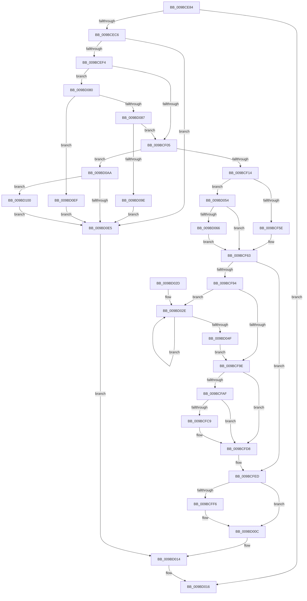

# EtwpStopTrace

- RVA: `0x009BCE84`–`0x009BD117` (길이 `659` bytes)
- VA: `0x00000001409BCE84`
- 실행 섹션: `PAGE`
- PDB 이름 있음: `예`; PDB Function 태그: `아니요`
- unwind 정보 RVA: `0x0009F1A8`
- 디코드: `168`개 명령, `659/659` bytes 표시
- 미해석 바이트: `0` (있으면 어셈블리에 `.byte`로 보존)

> 이 문서는 커널 이미지의 기계어와 PDB 기호를 분석해 생성했습니다. 4번과 5번은 함수 원형과 자료형을 바이너리 사용 방식에서 추정한 C 해석이며 원본 소스 복구 결과는 아닙니다.

## 1. Dependencies

- 직접 호출 지점: **26**; 고유 호출 대상: **17**
- 직접 호출자로 확인된 함수: **3**
- RIP 상대 이미지 참조: **3**

### Outgoing calls
- `0x009BCEB9` → [EtwpValidateLoggerInfo](../8B/EtwpValidateLoggerInfo_function_008BF9B0.md) (function, `0x008BF9B0`)
- `0x009BCEE5` → [EtwpAcquireLoggerContext](../93/EtwpAcquireLoggerContext_function_009326AC.md) (function, `0x009326AC`)
- `0x009BCF2A` → [ObReferenceObjectByPointer](../../text/43/ObReferenceObjectByPointer_function_00438D00.md) (function, `0x00438D00`)
- `0x009BCF39` → [KeResetEvent](../../text/24/KeResetEvent_function_00248350.md) (function, `0x00248350`)
- `0x009BCF51` → [ExAcquireRundownProtectionCacheAwareEx](../../text/41/ExAcquireRundownProtectionCacheAwareEx_function_00411F50.md) (function, `0x00411F50`)
- `0x009BCF6C` → [KeReleaseMutex](../../text/39/KeReleaseMutex_function_00396810.md) (function, `0x00396810`)
- `0x009BCF8B` → [ExReleaseRundownProtectionCacheAwareEx](../../text/25/ExReleaseRundownProtectionCacheAwareEx_function_0025F050.md) (function, `0x0025F050`)
- `0x009BCFA4` → [EtwpGetLoggerInfoFromContext](../8B/EtwpGetLoggerInfoFromContext_function_008BEF90.md) (function, `0x008BEF90`)
- `0x009BCFC0` → [EtwEventEnabled](../../text/39/EtwEventEnabled_function_00392450.md) (function, `0x00392450`)
- `0x009BCFD3` → [EtwpEventWriteTemplateSession](EtwpEventWriteTemplateSession_function_009BD120.md) (function, `0x009BD120`)
- `0x009BCFE8` → [ExReleaseRundownProtectionCacheAwareEx](../../text/25/ExReleaseRundownProtectionCacheAwareEx_function_0025F050.md) (function, `0x0025F050`)
- `0x009BCFED` → [KeLeaveCriticalRegion](../../text/25/KeLeaveCriticalRegion_function_0025D8B0.md) (function, `0x0025D8B0`)
- `0x009BD007` → [KeWaitForSingleObject](../../text/20/KeWaitForSingleObject_function_0020E6B0.md) (function, `0x0020E6B0`)
- `0x009BD00F` → [ObfDereferenceObject](../../text/2F/ObfDereferenceObject_function_002F9350.md) (function, `0x002F9350`)
- `0x009BD043` → [KeWaitForSingleObject](../../text/20/KeWaitForSingleObject_function_0020E6B0.md) (function, `0x0020E6B0`)
- `0x009BD057` → [EtwpStopLoggerInstance](EtwpStopLoggerInstance_function_009BEB94.md) (function, `0x009BEB94`)
- `0x009BD076` → [ExReleaseRundownProtectionCacheAwareEx](../../text/25/ExReleaseRundownProtectionCacheAwareEx_function_0025F050.md) (function, `0x0025F050`)
- `0x009BD08F` → [EtwpCheckLoggerControlAccess](../8C/EtwpCheckLoggerControlAccess_function_008C0AE0.md) (function, `0x008C0AE0`)
- `0x009BD0A3` → [EtwpReleaseLoggerContext](../A0/EtwpReleaseLoggerContext_function_00A04160.md) (function, `0x00A04160`)
- `0x009BD0AD` → [EtwpStopLoggerInstance](EtwpStopLoggerInstance_function_009BEB94.md) (function, `0x009BEB94`)
- `0x009BD0BD` → [KeReleaseMutex](../../text/39/KeReleaseMutex_function_00396810.md) (function, `0x00396810`)
- `0x009BD0DC` → [ExReleaseRundownProtectionCacheAwareEx](../../text/25/ExReleaseRundownProtectionCacheAwareEx_function_0025F050.md) (function, `0x0025F050`)
- `0x009BD0E5` → [KeLeaveCriticalRegion](../../text/25/KeLeaveCriticalRegion_function_0025D8B0.md) (function, `0x0025D8B0`)
- `0x009BD0F4` → [EtwpReleaseLoggerContext](../A0/EtwpReleaseLoggerContext_function_00A04160.md) (function, `0x00A04160`)
- `0x009BD106` → [EtwpGetLoggerInfoFromContext](../8B/EtwpGetLoggerInfoFromContext_function_008BEF90.md) (function, `0x008BEF90`)
- `0x009BD110` → [EtwpFreeLoggerContext](../9C/EtwpFreeLoggerContext_function_009C1688.md) (function, `0x009C1688`)

### Direct callers
- [EtwShutdown](../7B/EtwShutdown_function_007B50B0.md) at `0x007B51D2`
- [EtwWmitraceWorker](../7B/EtwWmitraceWorker_function_007BBD3C.md) at `0x007BBF32`
- [NtTraceControl](../A9/NtTraceControl_function_00A9ED40.md) at `0x00A9F0B9`

### Static image references
- `0x009BCF1B` → RVA `0x00FC6AC8` (`ALMOSTRO`; read)
- `0x009BCFAF` → RVA `0x00EFF840` (`.data`; read)
- `0x009BCFB6` → RVA `0x00013D68` (`.rdata`; read)

## 2. Other-region calls and transfers

- 다른 실행 섹션으로 향하는 call: **15**
  - `0x009BCF2A` → [ObReferenceObjectByPointer](../../text/43/ObReferenceObjectByPointer_function_00438D00.md) (`PAGE` → `.text`)
  - `0x009BCF39` → [KeResetEvent](../../text/24/KeResetEvent_function_00248350.md) (`PAGE` → `.text`)
  - `0x009BCF51` → [ExAcquireRundownProtectionCacheAwareEx](../../text/41/ExAcquireRundownProtectionCacheAwareEx_function_00411F50.md) (`PAGE` → `.text`)
  - `0x009BCF6C` → [KeReleaseMutex](../../text/39/KeReleaseMutex_function_00396810.md) (`PAGE` → `.text`)
  - `0x009BCF8B` → [ExReleaseRundownProtectionCacheAwareEx](../../text/25/ExReleaseRundownProtectionCacheAwareEx_function_0025F050.md) (`PAGE` → `.text`)
  - `0x009BCFC0` → [EtwEventEnabled](../../text/39/EtwEventEnabled_function_00392450.md) (`PAGE` → `.text`)
  - `0x009BCFE8` → [ExReleaseRundownProtectionCacheAwareEx](../../text/25/ExReleaseRundownProtectionCacheAwareEx_function_0025F050.md) (`PAGE` → `.text`)
  - `0x009BCFED` → [KeLeaveCriticalRegion](../../text/25/KeLeaveCriticalRegion_function_0025D8B0.md) (`PAGE` → `.text`)
  - `0x009BD007` → [KeWaitForSingleObject](../../text/20/KeWaitForSingleObject_function_0020E6B0.md) (`PAGE` → `.text`)
  - `0x009BD00F` → [ObfDereferenceObject](../../text/2F/ObfDereferenceObject_function_002F9350.md) (`PAGE` → `.text`)
  - `0x009BD043` → [KeWaitForSingleObject](../../text/20/KeWaitForSingleObject_function_0020E6B0.md) (`PAGE` → `.text`)
  - `0x009BD076` → [ExReleaseRundownProtectionCacheAwareEx](../../text/25/ExReleaseRundownProtectionCacheAwareEx_function_0025F050.md) (`PAGE` → `.text`)
  - `0x009BD0BD` → [KeReleaseMutex](../../text/39/KeReleaseMutex_function_00396810.md) (`PAGE` → `.text`)
  - `0x009BD0DC` → [ExReleaseRundownProtectionCacheAwareEx](../../text/25/ExReleaseRundownProtectionCacheAwareEx_function_0025F050.md) (`PAGE` → `.text`)
  - `0x009BD0E5` → [KeLeaveCriticalRegion](../../text/25/KeLeaveCriticalRegion_function_0025D8B0.md) (`PAGE` → `.text`)
- 별도 외부 분기/꼬리 이동을 확인하지 못했습니다.

## 3. Assembly (complete function range)

```asm
009BCE84  48 8B C4                        mov rax, rsp
009BCE87  48 89 58 08                     mov qword ptr [rax + 8], rbx
009BCE8B  48 89 68 10                     mov qword ptr [rax + 0x10], rbp
009BCE8F  56                              push rsi
009BCE90  57                              push rdi
009BCE91  41 54                           push r12
009BCE93  41 56                           push r14
009BCE95  41 57                           push r15
009BCE97  48 83 EC 40                     sub rsp, 0x40
009BCE9B  48 83 60 20 00                  and qword ptr [rax + 0x20], 0
009BCEA0  48 8B F2                        mov rsi, rdx
009BCEA3  83 CA FF                        or edx, 0xffffffff
009BCEA6  C7 40 C8 00 6C CA 88            mov dword ptr [rax - 0x38], 0x88ca6c00
009BCEAD  48 8B E9                        mov rbp, rcx
009BCEB0  89 50 CC                        mov dword ptr [rax - 0x34], edx
009BCEB3  48 8B CE                        mov rcx, rsi
009BCEB6  45 8A F0                        mov r14b, r8b
009BCEB9  E8 F2 2A F0 FF                  call 0x1408bf9b0
009BCEBE  85 C0                           test eax, eax
009BCEC0  0F 88 50 01 00 00               js 0x1409bd016
009BCEC6  65 48 8B 04 25 88 01 00 00      mov rax, qword ptr gs:[0x188]
009BCECF  4C 8D 84 24 88 00 00 00         lea r8, [rsp + 0x88]
009BCED7  48 8B CD                        mov rcx, rbp
009BCEDA  66 01 90 E4 01 00 00            add word ptr [rax + 0x1e4], dx
009BCEE1  48 8B D6                        mov rdx, rsi
009BCEE4  90                              nop
009BCEE5  E8 C2 57 F7 FF                  call 0x1409326ac
009BCEEA  8B F8                           mov edi, eax
009BCEEC  85 C0                           test eax, eax
009BCEEE  0F 88 F1 01 00 00               js 0x1409bd0e5
009BCEF4  48 8B 9C 24 88 00 00 00         mov rbx, qword ptr [rsp + 0x88]
009BCEFC  45 84 F6                        test r14b, r14b
009BCEFF  0F 84 7B 01 00 00               je 0x1409bd080
009BCF05  F7 43 0C 00 04 00 00            test dword ptr [rbx + 0xc], 0x400
009BCF0C  8B 3B                           mov edi, dword ptr [rbx]
009BCF0E  0F 85 96 01 00 00               jne 0x1409bd0aa
009BCF14  4C 8B 73 20                     mov r14, qword ptr [rbx + 0x20]
009BCF18  45 33 C9                        xor r9d, r9d
009BCF1B  4C 8B 05 A6 9B 60 00            mov r8, qword ptr [rip + 0x609ba6]
009BCF22  49 8B CE                        mov rcx, r14
009BCF25  BA 00 00 10 00                  mov edx, 0x100000
009BCF2A  E8 D1 BD A7 FF                  call 0x140438d00
009BCF2F  4C 8D A3 C8 01 00 00            lea r12, [rbx + 0x1c8]
009BCF36  49 8B CC                        mov rcx, r12
009BCF39  E8 12 B4 88 FF                  call 0x140248350
009BCF3E  48 8B 8D C0 02 00 00            mov rcx, qword ptr [rbp + 0x2c0]
009BCF45  BA 01 00 00 00                  mov edx, 1
009BCF4A  44 8B FF                        mov r15d, edi
009BCF4D  48 8B 0C F9                     mov rcx, qword ptr [rcx + rdi*8]
009BCF51  E8 FA 4F A5 FF                  call 0x140411f50
009BCF56  84 C0                           test al, al
009BCF58  0F 85 F6 00 00 00               jne 0x1409bd054
009BCF5E  BF 25 00 00 80                  mov edi, 0x80000025
009BCF63  48 8D 8B 78 02 00 00            lea rcx, [rbx + 0x278]
009BCF6A  33 D2                           xor edx, edx
009BCF6C  E8 9F 98 9D FF                  call 0x140396810
009BCF71  48 8B 83 50 05 00 00            mov rax, qword ptr [rbx + 0x550]
009BCF78  BA 01 00 00 00                  mov edx, 1
009BCF7D  44 8B 03                        mov r8d, dword ptr [rbx]
009BCF80  48 8B 88 C0 02 00 00            mov rcx, qword ptr [rax + 0x2c0]
009BCF87  4A 8B 0C C1                     mov rcx, qword ptr [rcx + r8*8]
009BCF8B  E8 C0 20 8A FF                  call 0x14025f050
009BCF90  85 FF                           test edi, edi
009BCF92  78 59                           js 0x1409bcfed
009BCF94  83 7B 28 00                     cmp dword ptr [rbx + 0x28], 0
009BCF98  0F 8D 90 00 00 00               jge 0x1409bd02e
009BCF9E  48 8B D3                        mov rdx, rbx
009BCFA1  48 8B CE                        mov rcx, rsi
009BCFA4  E8 E7 1F F0 FF                  call 0x1408bef90
009BCFA9  8B F8                           mov edi, eax
009BCFAB  85 C0                           test eax, eax
009BCFAD  78 29                           js 0x1409bcfd8
009BCFAF  48 8B 0D 8A 28 54 00            mov rcx, qword ptr [rip + 0x54288a]
009BCFB6  48 8D 15 AB 6D 65 FF            lea rdx, [rip - 0x9a9255]
009BCFBD  8B 7B 28                        mov edi, dword ptr [rbx + 0x28]
009BCFC0  E8 8B 54 9D FF                  call 0x140392450
009BCFC5  84 C0                           test al, al
009BCFC7  74 0F                           je 0x1409bcfd8
009BCFC9  4C 8B C3                        mov r8, rbx
009BCFCC  48 8D 15 95 6D 65 FF            lea rdx, [rip - 0x9a926b]
009BCFD3  E8 48 01 00 00                  call 0x1409bd120
009BCFD8  48 8B 8D C0 02 00 00            mov rcx, qword ptr [rbp + 0x2c0]
009BCFDF  BA 01 00 00 00                  mov edx, 1
009BCFE4  4A 8B 0C F9                     mov rcx, qword ptr [rcx + r15*8]
009BCFE8  E8 63 20 8A FF                  call 0x14025f050
009BCFED  E8 BE 08 8A FF                  call 0x14025d8b0
009BCFF2  85 FF                           test edi, edi
009BCFF4  78 16                           js 0x1409bd00c
009BCFF6  48 83 64 24 20 00               and qword ptr [rsp + 0x20], 0
009BCFFC  45 33 C9                        xor r9d, r9d
009BCFFF  45 33 C0                        xor r8d, r8d
009BD002  33 D2                           xor edx, edx
009BD004  49 8B CE                        mov rcx, r14
009BD007  E8 A4 16 85 FF                  call 0x14020e6b0
009BD00C  49 8B CE                        mov rcx, r14
009BD00F  E8 3C C3 93 FF                  call 0x1402f9350
009BD014  8B C7                           mov eax, edi
009BD016  48 8B 5C 24 70                  mov rbx, qword ptr [rsp + 0x70]
009BD01B  48 8B 6C 24 78                  mov rbp, qword ptr [rsp + 0x78]
009BD020  48 83 C4 40                     add rsp, 0x40
009BD024  41 5F                           pop r15
009BD026  41 5E                           pop r14
009BD028  41 5C                           pop r12
009BD02A  5F                              pop rdi
009BD02B  5E                              pop rsi
009BD02C  C3                              ret
009BD02D  CC                              int3
009BD02E  48 8D 44 24 30                  lea rax, [rsp + 0x30]
009BD033  45 33 C9                        xor r9d, r9d
009BD036  45 33 C0                        xor r8d, r8d
009BD039  48 89 44 24 20                  mov qword ptr [rsp + 0x20], rax
009BD03E  33 D2                           xor edx, edx
009BD040  49 8B CC                        mov rcx, r12
009BD043  E8 68 16 85 FF                  call 0x14020e6b0
009BD048  3D 02 01 00 00                  cmp eax, 0x102
009BD04D  74 DF                           je 0x1409bd02e
009BD04F  E9 4A FF FF FF                  jmp 0x1409bcf9e
009BD054  48 8B CB                        mov rcx, rbx
009BD057  E8 38 1B 00 00                  call 0x1409beb94
009BD05C  8B F8                           mov edi, eax
009BD05E  85 C0                           test eax, eax
009BD060  0F 89 FD FE FF FF               jns 0x1409bcf63
009BD066  48 8B 8D C0 02 00 00            mov rcx, qword ptr [rbp + 0x2c0]
009BD06D  BA 01 00 00 00                  mov edx, 1
009BD072  4A 8B 0C F9                     mov rcx, qword ptr [rcx + r15*8]
009BD076  E8 D5 1F 8A FF                  call 0x14025f050
009BD07B  E9 E3 FE FF FF                  jmp 0x1409bcf63
009BD080  8B 43 0C                        mov eax, dword ptr [rbx + 0xc]
009BD083  A8 40                           test al, 0x40
009BD085  75 68                           jne 0x1409bd0ef
009BD087  48 8B D3                        mov rdx, rbx
009BD08A  B9 80 00 00 00                  mov ecx, 0x80
009BD08F  E8 4C 3A F0 FF                  call 0x1408c0ae0
009BD094  8B F8                           mov edi, eax
009BD096  85 C0                           test eax, eax
009BD098  0F 89 67 FE FF FF               jns 0x1409bcf05
009BD09E  B2 01                           mov dl, 1
009BD0A0  48 8B CB                        mov rcx, rbx
009BD0A3  E8 B8 70 04 00                  call 0x140a04160
009BD0A8  EB 3B                           jmp 0x1409bd0e5
009BD0AA  48 8B CB                        mov rcx, rbx
009BD0AD  E8 E2 1A 00 00                  call 0x1409beb94
009BD0B2  48 8D 8B 78 02 00 00            lea rcx, [rbx + 0x278]
009BD0B9  33 D2                           xor edx, edx
009BD0BB  8B F8                           mov edi, eax
009BD0BD  E8 4E 97 9D FF                  call 0x140396810
009BD0C2  48 8B 83 50 05 00 00            mov rax, qword ptr [rbx + 0x550]
009BD0C9  BA 01 00 00 00                  mov edx, 1
009BD0CE  44 8B 03                        mov r8d, dword ptr [rbx]
009BD0D1  48 8B 88 C0 02 00 00            mov rcx, qword ptr [rax + 0x2c0]
009BD0D8  4A 8B 0C C1                     mov rcx, qword ptr [rcx + r8*8]
009BD0DC  E8 6F 1F 8A FF                  call 0x14025f050
009BD0E1  85 FF                           test edi, edi
009BD0E3  79 1B                           jns 0x1409bd100
009BD0E5  E8 C6 07 8A FF                  call 0x14025d8b0
009BD0EA  E9 25 FF FF FF                  jmp 0x1409bd014
009BD0EF  B2 01                           mov dl, 1
009BD0F1  48 8B CB                        mov rcx, rbx
009BD0F4  E8 67 70 04 00                  call 0x140a04160
009BD0F9  BF 21 01 00 C0                  mov edi, 0xc0000121
009BD0FE  EB E5                           jmp 0x1409bd0e5
009BD100  48 8B D3                        mov rdx, rbx
009BD103  48 8B CE                        mov rcx, rsi
009BD106  E8 85 1E F0 FF                  call 0x1408bef90
009BD10B  48 8B CB                        mov rcx, rbx
009BD10E  8B F8                           mov edi, eax
009BD110  E8 73 45 00 00                  call 0x1409c1688
009BD115  EB CE                           jmp 0x1409bd0e5
```

## 4. C-style interpretation (structured pseudocode)

```c
__int64 __fastcall EtwpStopTrace(__int64 a1, __int64 a2, unsigned __int8 a3, int a4)
{
    __int64 result;
    __int64 v_rsp;
    unsigned __int64 v_stack_m48;
    unsigned __int64 v_stack_p10;
    unsigned __int64 v_stack_p20;
    unsigned __int64 v_stack_p30;
    unsigned __int64 v_stack_p8;

    *(unsigned __int64 *)(v_rsp + 8) = v_rbx;
    *(unsigned __int64 *)(v_rsp + 16) = v_rbp;
    v_rsp = (v_rsp) - (64);
    a2 = (unsigned int)((a2) | (0xFFFFFFFFULL));
    *(unsigned int *)(v_rsp - 56) = 0x88CA6C00ULL;
    *(unsigned int *)(v_rsp - 52) = (unsigned int)(a2);
    result = EtwpValidateLoggerInfo(a2, a2, a3, a4);
    if (sign_flag) goto loc_009BD016;
    result = EtwpAcquireLoggerContext(a1, a2, v_stack_p20, a4);
    if (sign_flag) goto loc_009BD0E5;
    if (a3 == 0) goto loc_009BD080;
loc_009BCF05:
    if (((*(unsigned int *)(v_stack_p20 + 12)) & (0x400ULL)) != 0) goto loc_009BD0AA;
    a4 = 0;
    result = ObReferenceObjectByPointer(*(unsigned __int64 *)(v_stack_p20 + 32), (unsigned int)(0x100000ULL), *(unsigned __int64 *)(v_rip + 6331302), a4);
    result = KeResetEvent(v_stack_p20 + 456, (unsigned int)(0x100000ULL), *(unsigned __int64 *)(v_rip + 6331302), a4);
    result = ExAcquireRundownProtectionCacheAwareEx(*(unsigned __int64 *)(*(unsigned __int64 *)(a1 + 704) + (unsigned int)(*(unsigned int *)(v_stack_p20)) * 8), 1, *(unsigned __int64 *)(v_rip + 6331302), a4);
    if ((unsigned __int8)(result) != 0) goto loc_009BD054;
loc_009BCF63:
    a2 = 0;
    result = KeReleaseMutex(v_stack_p20 + 632, a2, *(unsigned __int64 *)(v_rip + 6331302), a4);
    result = ExReleaseRundownProtectionCacheAwareEx(*(unsigned __int64 *)(*(unsigned __int64 *)(*(unsigned __int64 *)(v_stack_p20 + 1360) + 704) + (unsigned int)(*(unsigned int *)(v_stack_p20)) * 8), 1, (unsigned int)(*(unsigned int *)(v_stack_p20)), a4);
    if (sign_flag) goto loc_009BCFED;
    if ((*(unsigned int *)(v_stack_p20 + 40)) >= 0) goto loc_009BD02E;
loc_009BCF9E:
    result = EtwpGetLoggerInfoFromContext(0, v_stack_p20, (unsigned int)(*(unsigned int *)(v_stack_p20)), a4);
    if (sign_flag) goto loc_009BCFD8;
    result = EtwEventEnabled(*(unsigned __int64 *)(v_rip + 5515402), v_rip - 10130005, (unsigned int)(*(unsigned int *)(v_stack_p20)), a4);
    if ((unsigned __int8)(result) != 0) {
        a3 = v_stack_p20;
        a2 = v_rip - 10130027;
        result = EtwpEventWriteTemplateSession(*(unsigned __int64 *)(v_rip + 5515402), a2, a3, a4);
    }
    result = ExReleaseRundownProtectionCacheAwareEx(*(unsigned __int64 *)(*(unsigned __int64 *)(a1 + 704) + (unsigned int)((unsigned int)((unsigned int)(*(unsigned int *)(v_stack_p20)))) * 8), 1, a3, a4);
loc_009BCFED:
    result = KeLeaveCriticalRegion(*(unsigned __int64 *)(*(unsigned __int64 *)(a1 + 704) + (unsigned int)((unsigned int)((unsigned int)(*(unsigned int *)(v_stack_p20)))) * 8), 1, a3, a4);
    if (!(sign_flag)) {
        a4 = 0;
        a3 = 0;
        a2 = 0;
        a1 = *(unsigned __int64 *)(v_stack_p20 + 32);
        result = KeWaitForSingleObject(a1, a2, a3, a4);
    }
    result = ObfDereferenceObject(*(unsigned __int64 *)(v_stack_p20 + 32), a2, a3, a4);
loc_009BD014:
loc_009BD016:
    v_rsp = (v_rsp) + (64);
    return (unsigned int)((unsigned int)((unsigned int)(*(unsigned int *)(v_stack_p20 + 40))));
loc_009BD02E:
    a4 = 0;
    a3 = 0;
    v_stack_p20 = v_stack_p30;
    a2 = 0;
    result = KeWaitForSingleObject(v_stack_p20 + 456, a2, a3, a4);
    if (((unsigned int)(result)) == 258) goto loc_009BD02E;
    goto loc_009BCF9E;
loc_009BD054:
    result = EtwpStopLoggerInstance(v_stack_p8, a2, a3, a4);
    if (!sign_flag) goto loc_009BCF63;
    result = ExReleaseRundownProtectionCacheAwareEx(*(unsigned __int64 *)(*(unsigned __int64 *)(v_stack_p10 + 704) + (unsigned int)((unsigned int)((unsigned int)(*(unsigned int *)(v_stack_p20)))) * 8), 1, a3, a4);
    goto loc_009BCF63;
loc_009BD080:
    if ((((unsigned __int8)((unsigned int)(*(unsigned int *)(v_stack_p8 + 12)))) & (64)) != 0) goto loc_009BD0EF;
    result = EtwpCheckLoggerControlAccess(128, v_stack_p8, a3, a4);
    if (!sign_flag) goto loc_009BCF05;
    result = EtwpReleaseLoggerContext(v_stack_p8, 1, a3, a4);
    goto loc_009BD0E5;
loc_009BD0AA:
    result = EtwpStopLoggerInstance(v_stack_p8, 1, a3, a4);
    a2 = 0;
    result = KeReleaseMutex(v_stack_p8 + 632, a2, a3, a4);
    result = ExReleaseRundownProtectionCacheAwareEx(*(unsigned __int64 *)(*(unsigned __int64 *)(*(unsigned __int64 *)(v_stack_p8 + 1360) + 704) + (unsigned int)(*(unsigned int *)(v_stack_p8)) * 8), 1, (unsigned int)(*(unsigned int *)(v_stack_p8)), a4);
    if (!sign_flag) goto loc_009BD100;
loc_009BD0E5:
    result = KeLeaveCriticalRegion(*(unsigned __int64 *)(*(unsigned __int64 *)(*(unsigned __int64 *)(v_stack_p8 + 1360) + 704) + (unsigned int)(*(unsigned int *)(v_stack_p8)) * 8), 1, (unsigned int)(*(unsigned int *)(v_stack_p8)), a4);
    goto loc_009BD014;
loc_009BD0EF:
    result = EtwpReleaseLoggerContext(v_stack_p8, 1, (unsigned int)(*(unsigned int *)(v_stack_p8)), a4);
    goto loc_009BD0E5;
loc_009BD100:
    result = EtwpGetLoggerInfoFromContext(0, v_stack_p8, (unsigned int)(*(unsigned int *)(v_stack_p8)), a4);
    result = EtwpFreeLoggerContext(v_stack_p8, v_stack_p8, (unsigned int)(*(unsigned int *)(v_stack_p8)), a4);
    goto loc_009BD0E5;
}
```

## 5. (Beta) C Style

```c
int64_t EtwpStopTrace(void *Arg1, int64_t Arg2, uint8_t Arg3, int32_t Arg4)
{
    uint8_t *arg1 = (uint8_t *)Arg1;

    int64_t result;
    int64_t local_rsp;
    uint64_t v_stack_m48;
    uint64_t v_stack_p10;
    uint64_t v_stack_p20;
    uint64_t v_stack_p30;
    uint64_t v_stack_p8;

    *(uint64_t *)(local_rsp + 0x8) = local_rbx;
    *(uint64_t *)(local_rsp + 0x10) = local_rbp;
    local_rsp = (local_rsp) - (64);
    Arg2 = (uint32_t)((Arg2) | (0xFFFFFFFFULL));
    *(uint32_t *)(local_rsp - 0x38) = 0x88CA6C00ULL;
    *(uint32_t *)(local_rsp - 0x34) = (uint32_t)(Arg2);
    result = EtwpValidateLoggerInfo(Arg2, Arg2, Arg3, Arg4);
    if (sign_flag) goto loc_009BD016;
    result = EtwpAcquireLoggerContext(Arg1, Arg2, v_stack_p20, Arg4);
    if (sign_flag) goto loc_009BD0E5;
    if (Arg3 == 0) goto loc_009BD080;
loc_009BCF05:
    if (((*(uint32_t *)(v_stack_p20 + 0xC)) & (0x400ULL)) != 0) goto loc_009BD0AA;
    Arg4 = 0;
    result = ObReferenceObjectByPointer(*(uint64_t *)(v_stack_p20 + 0x20), (uint32_t)(0x100000ULL), *(uint64_t *)(v_rip + 0x609BA6), Arg4);
    result = KeResetEvent(v_stack_p20 + 456, (uint32_t)(0x100000ULL), *(uint64_t *)(v_rip + 0x609BA6), Arg4);
    result = ExAcquireRundownProtectionCacheAwareEx(*(uint64_t *)(*(uint64_t *)(arg1 + 0x2C0) + (uint32_t)(*(uint32_t *)(v_stack_p20)) * 8), 1, *(uint64_t *)(v_rip + 0x609BA6), Arg4);
    if ((uint8_t)(result) != 0) goto loc_009BD054;
loc_009BCF63:
    Arg2 = 0;
    result = KeReleaseMutex(v_stack_p20 + 632, Arg2, *(uint64_t *)(v_rip + 0x609BA6), Arg4);
    result = ExReleaseRundownProtectionCacheAwareEx(*(uint64_t *)(*(uint64_t *)(*(uint64_t *)(v_stack_p20 + 0x550) + 0x2C0) + (uint32_t)(*(uint32_t *)(v_stack_p20)) * 8), 1, (uint32_t)(*(uint32_t *)(v_stack_p20)), Arg4);
    if (sign_flag) goto loc_009BCFED;
    if ((*(uint32_t *)(v_stack_p20 + 0x28)) >= 0) goto loc_009BD02E;
loc_009BCF9E:
    result = EtwpGetLoggerInfoFromContext(0, v_stack_p20, (uint32_t)(*(uint32_t *)(v_stack_p20)), Arg4);
    if (sign_flag) goto loc_009BCFD8;
    result = EtwEventEnabled(*(uint64_t *)(v_rip + 0x54288A), v_rip - 10130005, (uint32_t)(*(uint32_t *)(v_stack_p20)), Arg4);
    if ((uint8_t)(result) != 0) {
        Arg3 = v_stack_p20;
        Arg2 = v_rip - 10130027;
        result = EtwpEventWriteTemplateSession(*(uint64_t *)(v_rip + 0x54288A), Arg2, Arg3, Arg4);
    }
    result = ExReleaseRundownProtectionCacheAwareEx(*(uint64_t *)(*(uint64_t *)(arg1 + 0x2C0) + (uint32_t)((uint32_t)((uint32_t)(*(uint32_t *)(v_stack_p20)))) * 8), 1, Arg3, Arg4);
loc_009BCFED:
    result = KeLeaveCriticalRegion(*(uint64_t *)(*(uint64_t *)(arg1 + 0x2C0) + (uint32_t)((uint32_t)((uint32_t)(*(uint32_t *)(v_stack_p20)))) * 8), 1, Arg3, Arg4);
    if (!(sign_flag)) {
        Arg4 = 0;
        Arg3 = 0;
        Arg2 = 0;
        Arg1 = *(uint64_t *)(v_stack_p20 + 0x20);
        result = KeWaitForSingleObject(Arg1, Arg2, Arg3, Arg4);
    }
    result = ObfDereferenceObject(*(uint64_t *)(v_stack_p20 + 0x20), Arg2, Arg3, Arg4);
loc_009BD014:
loc_009BD016:
    local_rsp = (local_rsp) + (64);
    return (uint32_t)((uint32_t)((uint32_t)(*(uint32_t *)(v_stack_p20 + 0x28))));
loc_009BD02E:
    Arg4 = 0;
    Arg3 = 0;
    v_stack_p20 = v_stack_p30;
    Arg2 = 0;
    result = KeWaitForSingleObject(v_stack_p20 + 456, Arg2, Arg3, Arg4);
    if (((uint32_t)(result)) == 258) goto loc_009BD02E;
    goto loc_009BCF9E;
loc_009BD054:
    result = EtwpStopLoggerInstance(v_stack_p8, Arg2, Arg3, Arg4);
    if (!sign_flag) goto loc_009BCF63;
    result = ExReleaseRundownProtectionCacheAwareEx(*(uint64_t *)(*(uint64_t *)(v_stack_p10 + 0x2C0) + (uint32_t)((uint32_t)((uint32_t)(*(uint32_t *)(v_stack_p20)))) * 8), 1, Arg3, Arg4);
    goto loc_009BCF63;
loc_009BD080:
    if ((((uint8_t)((uint32_t)(*(uint32_t *)(v_stack_p8 + 0xC)))) & (64)) != 0) goto loc_009BD0EF;
    result = EtwpCheckLoggerControlAccess(128, v_stack_p8, Arg3, Arg4);
    if (!sign_flag) goto loc_009BCF05;
    result = EtwpReleaseLoggerContext(v_stack_p8, 1, Arg3, Arg4);
    goto loc_009BD0E5;
loc_009BD0AA:
    result = EtwpStopLoggerInstance(v_stack_p8, 1, Arg3, Arg4);
    Arg2 = 0;
    result = KeReleaseMutex(v_stack_p8 + 632, Arg2, Arg3, Arg4);
    result = ExReleaseRundownProtectionCacheAwareEx(*(uint64_t *)(*(uint64_t *)(*(uint64_t *)(v_stack_p8 + 0x550) + 0x2C0) + (uint32_t)(*(uint32_t *)(v_stack_p8)) * 8), 1, (uint32_t)(*(uint32_t *)(v_stack_p8)), Arg4);
    if (!sign_flag) goto loc_009BD100;
loc_009BD0E5:
    result = KeLeaveCriticalRegion(*(uint64_t *)(*(uint64_t *)(*(uint64_t *)(v_stack_p8 + 0x550) + 0x2C0) + (uint32_t)(*(uint32_t *)(v_stack_p8)) * 8), 1, (uint32_t)(*(uint32_t *)(v_stack_p8)), Arg4);
    goto loc_009BD014;
loc_009BD0EF:
    result = EtwpReleaseLoggerContext(v_stack_p8, 1, (uint32_t)(*(uint32_t *)(v_stack_p8)), Arg4);
    goto loc_009BD0E5;
loc_009BD100:
    result = EtwpGetLoggerInfoFromContext(0, v_stack_p8, (uint32_t)(*(uint32_t *)(v_stack_p8)), Arg4);
    result = EtwpFreeLoggerContext(v_stack_p8, v_stack_p8, (uint32_t)(*(uint32_t *)(v_stack_p8)), Arg4);
    goto loc_009BD0E5;
}
```

### 관측된 메모리 오프셋

구조체 형식이 확인되지 않은 접근은 인자 기준의 오프셋으로만 기록했습니다.

| 기준 인자 | 오프셋 표현 | 폭 (bit) | 접근 |
|---|---:|---:|---|
| `Arg1` | `+ 0x2C0` | `64` | `R` |

## 6. Execution-region graph

[열기: 2D/3D 그래프와 함수 탐색 컨트롤 패널](../../../control-panel.html?section=page&rva=0x009BCE84&view=graph)

- 2D 그래프는 위에서 아래로 흐르고, 3D 그래프는 빈 공간을 드래그해 회전합니다. Shift+드래그는 이동, 휠은 확대·축소, 함수 노드 선택은 대상 보고서 이동입니다.

### Static fallback


