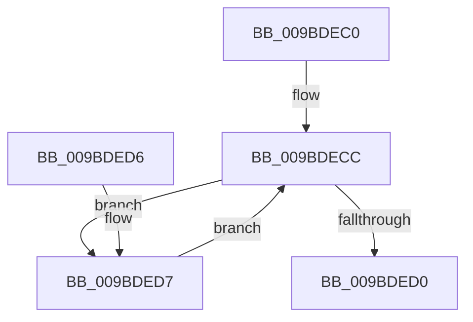

# EtwpWaitForBufferReferenceCount

- RVA: `0x009BDEC0`–`0x009BDEEC` (길이 `44` bytes)
- VA: `0x00000001409BDEC0`
- 실행 섹션: `PAGE`
- PDB 이름 있음: `예`; PDB Function 태그: `아니요`
- unwind 정보 RVA: `0x0008C670`
- 디코드: `16`개 명령, `44/44` bytes 표시
- 미해석 바이트: `0` (있으면 어셈블리에 `.byte`로 보존)

> 이 문서는 커널 이미지의 기계어와 PDB 기호를 분석해 생성했습니다. 4번과 5번은 함수 원형과 자료형을 바이너리 사용 방식에서 추정한 C 해석이며 원본 소스 복구 결과는 아닙니다.

## 1. Dependencies

- 직접 호출 지점: **1**; 고유 호출 대상: **1**
- 직접 호출자로 확인된 함수: **4**
- RIP 상대 이미지 참조: **1**

### Outgoing calls
- `0x009BDEE2` → [KeDelayExecutionThread](../../text/20/KeDelayExecutionThread_function_00209550.md) (function, `0x00209550`)

### Direct callers
- [EtwpCompressPendingBuffers](../../text/65/EtwpCompressPendingBuffers_function_00653140.md) at `0x006531BA`
- [EtwpBufferingModeFlush](EtwpBufferingModeFlush_function_009BD8F4.md) at `0x009BDB44`
- [EtwpFlushActiveBuffers](EtwpFlushActiveBuffers_function_009BDEF4.md) at `0x009BE064`
- [sub_00B2E69A](../B2/Unknown_function_00B2E69A.md) at `0x00B2E7A6`
- [sub_00B2E69A](../B2/Unknown_function_00B2E69A.md) at `0x00B2E894`

### Static image references
- `0x009BDED7` → RVA `0x00013DC8` (`.rdata`; read)

## 2. Other-region calls and transfers

- 다른 실행 섹션으로 향하는 call: **1**
  - `0x009BDEE2` → [KeDelayExecutionThread](../../text/20/KeDelayExecutionThread_function_00209550.md) (`PAGE` → `.text`)
- 별도 외부 분기/꼬리 이동을 확인하지 못했습니다.

## 3. Assembly (complete function range)

```asm
009BDEC0  40 53                           push rbx
009BDEC2  48 83 EC 20                     sub rsp, 0x20
009BDEC6  8B 41 0C                        mov eax, dword ptr [rcx + 0xc]
009BDEC9  48 8B D9                        mov rbx, rcx
009BDECC  85 C0                           test eax, eax
009BDECE  75 07                           jne 0x1409bded7
009BDED0  48 83 C4 20                     add rsp, 0x20
009BDED4  5B                              pop rbx
009BDED5  C3                              ret
009BDED6  CC                              int3
009BDED7  4C 8D 05 EA 5E 65 FF            lea r8, [rip - 0x9aa116]
009BDEDE  33 D2                           xor edx, edx
009BDEE0  33 C9                           xor ecx, ecx
009BDEE2  E8 69 B6 84 FF                  call 0x140209550
009BDEE7  8B 43 0C                        mov eax, dword ptr [rbx + 0xc]
009BDEEA  EB E0                           jmp 0x1409bdecc
```

## 4. C-style interpretation (structured pseudocode)

```c
__int64 __fastcall EtwpWaitForBufferReferenceCount(__int64 a1, int a2)
{
    __int64 result;
    __int64 v_rsp;

    v_rsp = (v_rsp) - (32);
loc_009BDECC:
    if ((unsigned int)((unsigned int)(*(unsigned int *)(a1 + 12))) != 0) goto loc_009BDED7;
    v_rsp = (v_rsp) + (32);
    return (unsigned int)(*(unsigned int *)(a1 + 12));
loc_009BDED7:
    a2 = 0;
    a1 = 0;
    result = KeDelayExecutionThread(a1, a2, v_rip - 10133782, a4);
    goto loc_009BDECC;
}
```

## 5. (Beta) C Style

```c
int64_t EtwpWaitForBufferReferenceCount(void *Arg1, int32_t Arg2)
{
    uint8_t *arg1 = (uint8_t *)Arg1;

    int64_t result;
    int64_t local_rsp;

    local_rsp = (local_rsp) - (32);
loc_009BDECC:
    if ((uint32_t)((uint32_t)(*(uint32_t *)(arg1 + 0xC))) != 0) goto loc_009BDED7;
    local_rsp = (local_rsp) + (32);
    return (uint32_t)(*(uint32_t *)(arg1 + 0xC));
loc_009BDED7:
    Arg2 = 0;
    Arg1 = 0;
    result = KeDelayExecutionThread(Arg1, Arg2, v_rip - 10133782, a4);
    goto loc_009BDECC;
}
```

### 관측된 메모리 오프셋

구조체 형식이 확인되지 않은 접근은 인자 기준의 오프셋으로만 기록했습니다.

| 기준 인자 | 오프셋 표현 | 폭 (bit) | 접근 |
|---|---:|---:|---|
| `Arg1` | `+ 0xC` | `32` | `R` |

## 6. Execution-region graph

[열기: 2D/3D 그래프와 함수 탐색 컨트롤 패널](../../../control-panel.html?section=page&rva=0x009BDEC0&view=graph)

- 2D 그래프는 위에서 아래로 흐르고, 3D 그래프는 빈 공간을 드래그해 회전합니다. Shift+드래그는 이동, 휠은 확대·축소, 함수 노드 선택은 대상 보고서 이동입니다.

### Static fallback


