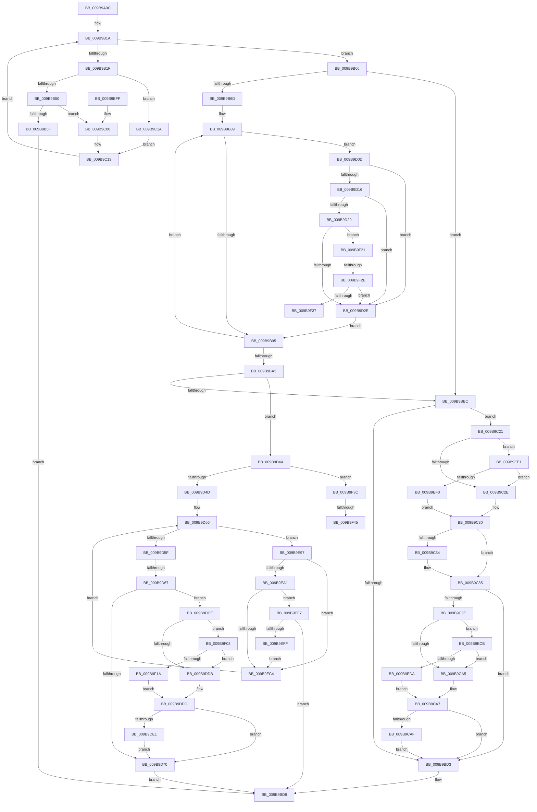

# HvAnalyzeLogFiles

- RVA: `0x009B9A9C`–`0x009B9F54` (길이 `1,208` bytes)
- VA: `0x00000001409B9A9C`
- 실행 섹션: `PAGE`
- PDB 이름 있음: `예`; PDB Function 태그: `예`
- unwind 정보 RVA: `0x0009EA64`
- 디코드: `282`개 명령, `1,208/1,208` bytes 표시
- 미해석 바이트: `0` (있으면 어셈블리에 `.byte`로 보존)

> 이 문서는 커널 이미지의 기계어와 PDB 기호를 분석해 생성했습니다. 4번과 5번은 함수 원형과 자료형을 바이너리 사용 방식에서 추정한 C 해석이며 원본 소스 복구 결과는 아닙니다.

## 1. Dependencies

- 직접 호출 지점: **12**; 고유 호출 대상: **11**
- 직접 호출자로 확인된 함수: **2**
- RIP 상대 이미지 참조: **7**

### Outgoing calls
- `0x009B9AFF` → [memset](../../text/6C/memset_function_006C6C40.md) (function, `0x006C6C40`)
- `0x009B9B41` → [guard_dispatch_icall](../../text/6B/guard_dispatch_icall_function_006BAAD0.md) (function, `0x006BAAD0`)
- `0x009B9B52` → [HvpIsReadErrorTransient](HvpIsReadErrorTransient_function_009BA0D8.md) (function, `0x009BA0D8`)
- `0x009B9BDF` → [_security_check_cookie](../../text/6A/_security_check_cookie_function_006AC640.md) (function, `0x006AC640`)
- `0x009B9C0A` → [HvpLogUnreadableLog](HvpLogUnreadableLog_function_009BA1E0.md) (function, `0x009BA1E0`)
- `0x009B9C73` → [tlgWriteTransfer_EtwWriteTransfer](../../text/42/tlgWriteTransfer_EtwWriteTransfer_function_004260E0.md) (function, `0x004260E0`)
- `0x009B9D03` → [tlgWriteAgg](../../text/2F/tlgWriteAgg_function_002F0F7C.md) (function, `0x002F0F7C`)
- `0x009B9D36` → [HvpLogInvalidLogHeader](HvpLogInvalidLogHeader_function_009BA3E8.md) (function, `0x009BA3E8`)
- `0x009B9D79` → [HvpDetermineLogFileApplicationOrder](HvpDetermineLogFileApplicationOrder_function_009BA694.md) (function, `0x009BA694`)
- `0x009B9D83` → [HvpDetermineResultingLoggingState](HvpDetermineResultingLoggingState_function_009BA5D0.md) (function, `0x009BA5D0`)
- `0x009B9E8D` → [tlgWriteTransfer_EtwWriteTransfer](../../text/42/tlgWriteTransfer_EtwWriteTransfer_function_004260E0.md) (function, `0x004260E0`)
- `0x009B9EB2` → [HvpAnalyzeSingleLogFile](HvpAnalyzeSingleLogFile_function_009BA7E4.md) (function, `0x009BA7E4`)

### Direct callers
- [HvRecoverFlushProtocolStateFromFiles](../7E/HvRecoverFlushProtocolStateFromFiles_function_007EF224.md) at `0x007EF3F8`
- [HvLoadHive](HvLoadHive_function_009B8138.md) at `0x009B8560`

### Static image references
- `0x009B9AB8` → RVA `0x00E0A740` (`.data`; read)
- `0x009B9BBC` → RVA `0x00E09F58` (`.data`; read)
- `0x009B9BC7` → RVA `0x00E09F70` (`.data`; read)
- `0x009B9C21` → RVA `0x00E09F68` (`.data`; read)
- `0x009B9C41` → RVA `0x00057941` (`.rdata`; read)
- `0x009B9CBC` → RVA `0x000578F7` (`.rdata`; read)
- `0x009B9DEE` → RVA `0x00057868` (`.rdata`; read)

## 2. Other-region calls and transfers

- 다른 실행 섹션으로 향하는 call: **6**
  - `0x009B9AFF` → [memset](../../text/6C/memset_function_006C6C40.md) (`PAGE` → `.text`)
  - `0x009B9B41` → [guard_dispatch_icall](../../text/6B/guard_dispatch_icall_function_006BAAD0.md) (`PAGE` → `.text`)
  - `0x009B9BDF` → [_security_check_cookie](../../text/6A/_security_check_cookie_function_006AC640.md) (`PAGE` → `.text`)
  - `0x009B9C73` → [tlgWriteTransfer_EtwWriteTransfer](../../text/42/tlgWriteTransfer_EtwWriteTransfer_function_004260E0.md) (`PAGE` → `.text`)
  - `0x009B9D03` → [tlgWriteAgg](../../text/2F/tlgWriteAgg_function_002F0F7C.md) (`PAGE` → `.text`)
  - `0x009B9E8D` → [tlgWriteTransfer_EtwWriteTransfer](../../text/42/tlgWriteTransfer_EtwWriteTransfer_function_004260E0.md) (`PAGE` → `.text`)
- call이 아닌 외부 분기/꼬리 이동: **5**
  - `0x009B9D61` → [sub_00B2E3D0 + 0xF4](../B2/Unknown_function_00B2E3D0.md) (`tail-transfer`)
  - `0x009B9F28` → [sub_00B2E3D0](../B2/Unknown_function_00B2E3D0.md) (`tail-transfer`)
  - `0x009B9F37` → [sub_00B2E3D0](../B2/Unknown_function_00B2E3D0.md) (`tail-transfer`)
  - `0x009B9F3F` → [sub_00B2E3D0 + 0x61](../B2/Unknown_function_00B2E3D0.md) (`tail-transfer`)
  - `0x009B9F4F` → [sub_00B2E3D0 + 0x7D](../B2/Unknown_function_00B2E3D0.md) (`tail-transfer`)

## 3. Assembly (complete function range)

```asm
009B9A9C  48 89 5C 24 18                  mov qword ptr [rsp + 0x18], rbx
009B9AA1  55                              push rbp
009B9AA2  56                              push rsi
009B9AA3  57                              push rdi
009B9AA4  41 54                           push r12
009B9AA6  41 55                           push r13
009B9AA8  41 56                           push r14
009B9AAA  41 57                           push r15
009B9AAC  48 8D 6C 24 B0                  lea rbp, [rsp - 0x50]
009B9AB1  48 81 EC 50 01 00 00            sub rsp, 0x150
009B9AB8  48 8B 05 81 0C 45 00            mov rax, qword ptr [rip + 0x450c81]
009B9ABF  48 33 C4                        xor rax, rsp
009B9AC2  48 89 45 40                     mov qword ptr [rbp + 0x40], rax
009B9AC6  4C 8B BD B8 00 00 00            mov r15, qword ptr [rbp + 0xb8]
009B9ACD  49 8B F9                        mov rdi, r9
009B9AD0  4C 8B AD C0 00 00 00            mov r13, qword ptr [rbp + 0xc0]
009B9AD7  89 54 24 34                     mov dword ptr [rsp + 0x34], edx
009B9ADB  33 D2                           xor edx, edx
009B9ADD  44 88 44 24 30                  mov byte ptr [rsp + 0x30], r8b
009B9AE2  48 89 4C 24 60                  mov qword ptr [rsp + 0x60], rcx
009B9AE7  48 8D 4C 24 74                  lea rcx, [rsp + 0x74]
009B9AEC  4C 89 4C 24 40                  mov qword ptr [rsp + 0x40], r9
009B9AF1  44 8D 42 58                     lea r8d, [rdx + 0x58]
009B9AF5  4C 89 7C 24 58                  mov qword ptr [rsp + 0x58], r15
009B9AFA  4C 89 6C 24 38                  mov qword ptr [rsp + 0x38], r13
009B9AFF  E8 3C D1 D0 FF                  call 0x1406c6c40
009B9B04  44 8B A5 B0 00 00 00            mov r12d, dword ptr [rbp + 0xb0]
009B9B0B  0F 57 C0                        xorps xmm0, xmm0
009B9B0E  0F 11 44 24 48                  movups xmmword ptr [rsp + 0x48], xmm0
009B9B13  44 89 64 24 70                  mov dword ptr [rsp + 0x70], r12d
009B9B18  33 DB                           xor ebx, ebx
009B9B1A  41 3B DC                        cmp ebx, r12d
009B9B1D  73 47                           jae 0x1409b9b66
009B9B1F  48 8D 34 5B                     lea rsi, [rbx + rbx*2]
009B9B23  33 D2                           xor edx, edx
009B9B25  48 8B 44 F7 08                  mov rax, qword ptr [rdi + rsi*8 + 8]
009B9B2A  4C 8D 74 24 48                  lea r14, [rsp + 0x48]
009B9B2F  48 8B 4C F7 10                  mov rcx, qword ptr [rdi + rsi*8 + 0x10]
009B9B34  4D 8D 34 DE                     lea r14, [r14 + rbx*8]
009B9B38  4D 8B CE                        mov r9, r14
009B9B3B  41 B8 00 02 00 00               mov r8d, 0x200
009B9B41  E8 8A 0F D0 FF                  call 0x1406baad0
009B9B46  8B F8                           mov edi, eax
009B9B48  85 C0                           test eax, eax
009B9B4A  0F 89 CA 00 00 00               jns 0x1409b9c1a
009B9B50  8B C8                           mov ecx, eax
009B9B52  E8 81 05 00 00                  call 0x1409ba0d8
009B9B57  84 C0                           test al, al
009B9B59  0F 84 A1 00 00 00               je 0x1409b9c00
009B9B5F  B8 4D 01 00 C0                  mov eax, 0xc000014d
009B9B64  EB 72                           jmp 0x1409b9bd8
009B9B66  33 FF                           xor edi, edi
009B9B68  45 85 E4                        test r12d, r12d
009B9B6B  74 4F                           je 0x1409b9bbc
009B9B6D  48 8B 74 24 40                  mov rsi, qword ptr [rsp + 0x40]
009B9B72  48 8D 5C 24 48                  lea rbx, [rsp + 0x48]
009B9B77  44 8B 7C 24 34                  mov r15d, dword ptr [rsp + 0x34]
009B9B7C  4D 8B F4                        mov r14, r12
009B9B7F  4C 8B 64 24 60                  mov r12, qword ptr [rsp + 0x60]
009B9B84  44 8A 6C 24 30                  mov r13b, byte ptr [rsp + 0x30]
009B9B89  4C 8B 0B                        mov r9, qword ptr [rbx]
009B9B8C  4D 85 C9                        test r9, r9
009B9B8F  0F 85 78 01 00 00               jne 0x1409b9d0d
009B9B95  48 83 C6 18                     add rsi, 0x18
009B9B99  48 83 C3 08                     add rbx, 8
009B9B9D  49 83 EE 01                     sub r14, 1
009B9BA1  75 E6                           jne 0x1409b9b89
009B9BA3  4C 8B 7C 24 58                  mov r15, qword ptr [rsp + 0x58]
009B9BA8  4C 8B 6C 24 38                  mov r13, qword ptr [rsp + 0x38]
009B9BAD  44 8B A5 B0 00 00 00            mov r12d, dword ptr [rbp + 0xb0]
009B9BB4  85 FF                           test edi, edi
009B9BB6  0F 85 88 01 00 00               jne 0x1409b9d44
009B9BBC  8B 15 96 03 45 00               mov edx, dword ptr [rip + 0x450396]
009B9BC2  BB 00 00 00 01                  mov ebx, 0x1000000
009B9BC7  48 8B 0D A2 03 45 00            mov rcx, qword ptr [rip + 0x4503a2]
009B9BCE  83 FA 05                        cmp edx, 5
009B9BD1  77 4E                           ja 0x1409b9c21
009B9BD3  B8 4C 01 00 C0                  mov eax, 0xc000014c
009B9BD8  48 8B 4D 40                     mov rcx, qword ptr [rbp + 0x40]
009B9BDC  48 33 CC                        xor rcx, rsp
009B9BDF  E8 5C 2A CF FF                  call 0x1406ac640
009B9BE4  48 8B 9C 24 A0 01 00 00         mov rbx, qword ptr [rsp + 0x1a0]
009B9BEC  48 81 C4 50 01 00 00            add rsp, 0x150
009B9BF3  41 5F                           pop r15
009B9BF5  41 5E                           pop r14
009B9BF7  41 5D                           pop r13
009B9BF9  41 5C                           pop r12
009B9BFB  5F                              pop rdi
009B9BFC  5E                              pop rsi
009B9BFD  5D                              pop rbp
009B9BFE  C3                              ret
009B9BFF  CC                              int3
009B9C00  8B D7                           mov edx, edi
009B9C02  48 8B 7C 24 40                  mov rdi, qword ptr [rsp + 0x40]
009B9C07  8B 0C F7                        mov ecx, dword ptr [rdi + rsi*8]
009B9C0A  E8 D1 05 00 00                  call 0x1409ba1e0
009B9C0F  49 83 26 00                     and qword ptr [r14], 0
009B9C13  FF C3                           inc ebx
009B9C15  E9 00 FF FF FF                  jmp 0x1409b9b1a
009B9C1A  48 8B 7C 24 40                  mov rdi, qword ptr [rsp + 0x40]
009B9C1F  EB F2                           jmp 0x1409b9c13
009B9C21  F6 05 40 03 45 00 08            test byte ptr [rip + 0x450340], 8
009B9C28  0F 85 B3 02 00 00               jne 0x1409b9ee1
009B9C2E  32 C0                           xor al, al
009B9C30  84 C0                           test al, al
009B9C32  74 51                           je 0x1409b9c85
009B9C34  83 65 9C 00                     and dword ptr [rbp - 0x64], 0
009B9C38  48 8D 44 24 38                  lea rax, [rsp + 0x38]
009B9C3D  48 89 45 90                     mov qword ptr [rbp - 0x70], rax
009B9C41  48 8D 15 F9 DC 69 FF            lea rdx, [rip - 0x962307]
009B9C48  48 8D 44 24 70                  lea rax, [rsp + 0x70]
009B9C4D  48 89 5C 24 38                  mov qword ptr [rsp + 0x38], rbx
009B9C52  48 89 44 24 28                  mov qword ptr [rsp + 0x28], rax
009B9C57  48 8D 0D FA 02 45 00            lea rcx, [rip + 0x4502fa]
009B9C5E  45 33 C9                        xor r9d, r9d
009B9C61  C7 44 24 20 03 00 00 00         mov dword ptr [rsp + 0x20], 3
009B9C69  45 33 C0                        xor r8d, r8d
009B9C6C  C7 45 98 08 00 00 00            mov dword ptr [rbp - 0x68], 8
009B9C73  E8 68 C4 A6 FF                  call 0x1404260e0
009B9C78  48 8B 0D F1 02 45 00            mov rcx, qword ptr [rip + 0x4502f1]
009B9C7F  8B 15 D3 02 45 00               mov edx, dword ptr [rip + 0x4502d3]
009B9C85  83 FA 05                        cmp edx, 5
009B9C88  0F 86 45 FF FF FF               jbe 0x1409b9bd3
009B9C8E  48 BA 08 00 00 00 00 40 00 00   movabs rdx, 0x400000000008
009B9C98  48 85 15 C9 02 45 00            test qword ptr [rip + 0x4502c9], rdx
009B9C9F  0F 85 26 02 00 00               jne 0x1409b9ecb
009B9CA5  32 C0                           xor al, al
009B9CA7  84 C0                           test al, al
009B9CA9  0F 84 24 FF FF FF               je 0x1409b9bd3
009B9CAF  83 65 9C 00                     and dword ptr [rbp - 0x64], 0
009B9CB3  48 8D 44 24 38                  lea rax, [rsp + 0x38]
009B9CB8  83 65 AC 00                     and dword ptr [rbp - 0x54], 0
009B9CBC  48 8D 15 34 DC 69 FF            lea rdx, [rip - 0x9623cc]
009B9CC3  48 89 45 90                     mov qword ptr [rbp - 0x70], rax
009B9CC7  48 8D 0D 8A 02 45 00            lea rcx, [rip + 0x45028a]
009B9CCE  48 8D 44 24 58                  lea rax, [rsp + 0x58]
009B9CD3  48 C7 44 24 38 01 00 00 00      mov qword ptr [rsp + 0x38], 1
009B9CDC  48 89 45 A0                     mov qword ptr [rbp - 0x60], rax
009B9CE0  41 B9 04 00 00 00               mov r9d, 4
009B9CE6  48 8D 44 24 70                  lea rax, [rsp + 0x70]
009B9CEB  C7 45 98 08 00 00 00            mov dword ptr [rbp - 0x68], 8
009B9CF2  48 89 44 24 20                  mov qword ptr [rsp + 0x20], rax
009B9CF7  48 89 5C 24 58                  mov qword ptr [rsp + 0x58], rbx
009B9CFC  C7 45 A8 08 00 00 00            mov dword ptr [rbp - 0x58], 8
009B9D03  E8 74 72 93 FF                  call 0x1402f0f7c
009B9D08  E9 C6 FE FF FF                  jmp 0x1409b9bd3
009B9D0D  41 81 39 72 65 67 66            cmp dword ptr [r9], 0x66676572
009B9D14  75 18                           jne 0x1409b9d2e
009B9D16  45 8B 51 04                     mov r10d, dword ptr [r9 + 4]
009B9D1A  45 3B 51 08                     cmp r10d, dword ptr [r9 + 8]
009B9D1E  75 0E                           jne 0x1409b9d2e
009B9D20  49 8B 04 24                     mov rax, qword ptr [r12]
009B9D24  49 39 41 0C                     cmp qword ptr [r9 + 0xc], rax
009B9D28  0F 84 F3 01 00 00               je 0x1409b9f21
009B9D2E  8B 16                           mov edx, dword ptr [rsi]
009B9D30  4D 8B C1                        mov r8, r9
009B9D33  49 8B CC                        mov rcx, r12
009B9D36  E8 AD 06 00 00                  call 0x1409ba3e8
009B9D3B  48 83 23 00                     and qword ptr [rbx], 0
009B9D3F  E9 51 FE FF FF                  jmp 0x1409b9b95
009B9D44  4D 85 ED                        test r13, r13
009B9D47  0F 85 EF 01 00 00               jne 0x1409b9f3c
009B9D4D  4C 8B 74 24 40                  mov r14, qword ptr [rsp + 0x40]
009B9D52  33 FF                           xor edi, edi
009B9D54  33 DB                           xor ebx, ebx
009B9D56  41 3B DC                        cmp ebx, r12d
009B9D59  0F 82 38 01 00 00               jb 0x1409b9e97
009B9D5F  85 FF                           test edi, edi
009B9D61  0F 84 5D 47 17 00               je 0x140b2e4c4
009B9D67  83 3D EA 01 45 00 05            cmp dword ptr [rip + 0x4501ea], 5
009B9D6E  77 5E                           ja 0x1409b9dce
009B9D70  8A 54 24 30                     mov dl, byte ptr [rsp + 0x30]
009B9D74  48 8D 4C 24 70                  lea rcx, [rsp + 0x70]
009B9D79  E8 16 09 00 00                  call 0x1409ba694
009B9D7E  48 8D 4C 24 70                  lea rcx, [rsp + 0x70]
009B9D83  E8 48 08 00 00                  call 0x1409ba5d0
009B9D88  0F 28 44 24 70                  movaps xmm0, xmmword ptr [rsp + 0x70]
009B9D8D  0F 28 4D 80                     movaps xmm1, xmmword ptr [rbp - 0x80]
009B9D91  8B 45 C8                        mov eax, dword ptr [rbp - 0x38]
009B9D94  41 0F 29 07                     movaps xmmword ptr [r15], xmm0
009B9D98  0F 28 45 90                     movaps xmm0, xmmword ptr [rbp - 0x70]
009B9D9C  41 0F 29 4F 10                  movaps xmmword ptr [r15 + 0x10], xmm1
009B9DA1  0F 28 4D A0                     movaps xmm1, xmmword ptr [rbp - 0x60]
009B9DA5  41 0F 29 47 20                  movaps xmmword ptr [r15 + 0x20], xmm0
009B9DAA  0F 28 45 B0                     movaps xmm0, xmmword ptr [rbp - 0x50]
009B9DAE  41 0F 29 4F 30                  movaps xmmword ptr [r15 + 0x30], xmm1
009B9DB3  F2 0F 10 4D C0                  movsd xmm1, qword ptr [rbp - 0x40]
009B9DB8  41 0F 29 47 40                  movaps xmmword ptr [r15 + 0x40], xmm0
009B9DBD  F2 41 0F 11 4F 50               movsd qword ptr [r15 + 0x50], xmm1
009B9DC3  41 89 47 58                     mov dword ptr [r15 + 0x58], eax
009B9DC7  33 C0                           xor eax, eax
009B9DC9  E9 0A FE FF FF                  jmp 0x1409b9bd8
009B9DCE  F6 05 93 01 45 00 08            test byte ptr [rip + 0x450193], 8
009B9DD5  0F 85 28 01 00 00               jne 0x1409b9f03
009B9DDB  32 C0                           xor al, al
009B9DDD  84 C0                           test al, al
009B9DDF  74 8F                           je 0x1409b9d70
009B9DE1  83 65 FC 00                     and dword ptr [rbp - 4], 0
009B9DE5  48 8D 44 24 31                  lea rax, [rsp + 0x31]
009B9DEA  83 65 0C 00                     and dword ptr [rbp + 0xc], 0
009B9DEE  48 8D 15 73 DA 69 FF            lea rdx, [rip - 0x96258d]
009B9DF5  83 65 1C 00                     and dword ptr [rbp + 0x1c], 0
009B9DF9  48 8D 0D 58 01 45 00            lea rcx, [rip + 0x450158]
009B9E00  83 65 2C 00                     and dword ptr [rbp + 0x2c], 0
009B9E04  45 33 C9                        xor r9d, r9d
009B9E07  83 65 3C 00                     and dword ptr [rbp + 0x3c], 0
009B9E0B  45 33 C0                        xor r8d, r8d
009B9E0E  48 89 45 F0                     mov qword ptr [rbp - 0x10], rax
009B9E12  8A 44 24 78                     mov al, byte ptr [rsp + 0x78]
009B9E16  88 44 24 32                     mov byte ptr [rsp + 0x32], al
009B9E1A  48 8D 44 24 32                  lea rax, [rsp + 0x32]
009B9E1F  48 89 45 00                     mov qword ptr [rbp], rax
009B9E23  8A 45 90                        mov al, byte ptr [rbp - 0x70]
009B9E26  88 44 24 33                     mov byte ptr [rsp + 0x33], al
009B9E2A  48 8D 44 24 33                  lea rax, [rsp + 0x33]
009B9E2F  48 89 45 10                     mov qword ptr [rbp + 0x10], rax
009B9E33  8B 44 24 7C                     mov eax, dword ptr [rsp + 0x7c]
009B9E37  89 44 24 34                     mov dword ptr [rsp + 0x34], eax
009B9E3B  48 8D 44 24 34                  lea rax, [rsp + 0x34]
009B9E40  48 89 45 20                     mov qword ptr [rbp + 0x20], rax
009B9E44  8B 45 94                        mov eax, dword ptr [rbp - 0x6c]
009B9E47  89 44 24 40                     mov dword ptr [rsp + 0x40], eax
009B9E4B  48 8D 44 24 40                  lea rax, [rsp + 0x40]
009B9E50  48 89 45 30                     mov qword ptr [rbp + 0x30], rax
009B9E54  48 8D 45 D0                     lea rax, [rbp - 0x30]
009B9E58  48 89 44 24 28                  mov qword ptr [rsp + 0x28], rax
009B9E5D  C7 44 24 20 07 00 00 00         mov dword ptr [rsp + 0x20], 7
009B9E65  40 88 7C 24 31                  mov byte ptr [rsp + 0x31], dil
009B9E6A  C7 45 F8 01 00 00 00            mov dword ptr [rbp - 8], 1
009B9E71  C7 45 08 01 00 00 00            mov dword ptr [rbp + 8], 1
009B9E78  C7 45 18 01 00 00 00            mov dword ptr [rbp + 0x18], 1
009B9E7F  C7 45 28 04 00 00 00            mov dword ptr [rbp + 0x28], 4
009B9E86  C7 45 38 04 00 00 00            mov dword ptr [rbp + 0x38], 4
009B9E8D  E8 4E C2 A6 FF                  call 0x1404260e0
009B9E92  E9 D9 FE FF FF                  jmp 0x1409b9d70
009B9E97  48 8B 54 DC 48                  mov rdx, qword ptr [rsp + rbx*8 + 0x48]
009B9E9C  48 85 D2                        test rdx, rdx
009B9E9F  74 23                           je 0x1409b9ec4
009B9EA1  48 8D 04 5B                     lea rax, [rbx + rbx*2]
009B9EA5  4C 8D 44 24 74                  lea r8, [rsp + 0x74]
009B9EAA  4D 8D 04 C0                     lea r8, [r8 + rax*8]
009B9EAE  49 8D 0C C6                     lea rcx, [r14 + rax*8]
009B9EB2  E8 2D 09 00 00                  call 0x1409ba7e4
009B9EB7  48 83 64 DC 48 00               and qword ptr [rsp + rbx*8 + 0x48], 0
009B9EBD  3D 22 00 00 80                  cmp eax, 0x80000022
009B9EC2  75 33                           jne 0x1409b9ef7
009B9EC4  FF C3                           inc ebx
009B9EC6  E9 8B FE FF FF                  jmp 0x1409b9d56
009B9ECB  48 8B C1                        mov rax, rcx
009B9ECE  48 23 C2                        and rax, rdx
009B9ED1  48 3B C1                        cmp rax, rcx
009B9ED4  0F 85 CB FD FF FF               jne 0x1409b9ca5
009B9EDA  B0 01                           mov al, 1
009B9EDC  E9 C6 FD FF FF                  jmp 0x1409b9ca7
009B9EE1  48 8B C1                        mov rax, rcx
009B9EE4  83 E0 08                        and eax, 8
009B9EE7  48 3B C1                        cmp rax, rcx
009B9EEA  0F 85 3E FD FF FF               jne 0x1409b9c2e
009B9EF0  B0 01                           mov al, 1
009B9EF2  E9 39 FD FF FF                  jmp 0x1409b9c30
009B9EF7  85 C0                           test eax, eax
009B9EF9  0F 88 D9 FC FF FF               js 0x1409b9bd8
009B9EFF  FF C7                           inc edi
009B9F01  EB C1                           jmp 0x1409b9ec4
009B9F03  48 8B 05 66 00 45 00            mov rax, qword ptr [rip + 0x450066]
009B9F0A  83 E0 08                        and eax, 8
009B9F0D  48 3B 05 5C 00 45 00            cmp rax, qword ptr [rip + 0x45005c]
009B9F14  0F 85 C1 FE FF FF               jne 0x1409b9ddb
009B9F1A  B0 01                           mov al, 1
009B9F1C  E9 BC FE FF FF                  jmp 0x1409b9ddd
009B9F21  41 8B 41 1C                     mov eax, dword ptr [r9 + 0x1c]
009B9F25  83 F8 06                        cmp eax, 6
009B9F28  0F 84 A2 44 17 00               je 0x140b2e3d0
009B9F2E  83 F8 01                        cmp eax, 1
009B9F31  0F 85 F7 FD FF FF               jne 0x1409b9d2e
009B9F37  E9 94 44 17 00                  jmp 0x140b2e3d0
009B9F3C  83 FF 01                        cmp edi, 1
009B9F3F  0F 85 EC 44 17 00               jne 0x140b2e431
009B9F45  33 C9                           xor ecx, ecx
009B9F47  48 39 4C 24 48                  cmp qword ptr [rsp + 0x48], rcx
009B9F4C  0F 94 C1                        sete cl
009B9F4F  E9 F9 44 17 00                  jmp 0x140b2e44d
```

## 4. C-style interpretation (structured pseudocode)

```c
__int64 __fastcall HvAnalyzeLogFiles(__int64 a1, int a2, unsigned __int8 a3, __int64 a4, unsigned int a5, __int64 a6, __int64 a7)
{
    __int64 result;
    __int64 v_r14;
    __int64 v_rbx;
    __int64 v_rdi;
    __int64 v_rsi;
    __int64 v_rsp;
    unsigned __int64 v_stack_m108;
    unsigned __int64 v_stack_m114;
    unsigned int v_stack_m118;
    unsigned __int64 v_stack_m128;
    unsigned __int64 v_stack_m130;
    unsigned __int64 v_stack_m140;
    unsigned __int64 v_stack_m148;
    unsigned __int64 v_stack_m150;
    unsigned int v_stack_m154;
    unsigned __int8 v_stack_m158;
    unsigned __int64 v_stack_m48;
    unsigned int v_stack_m4C;
    unsigned int v_stack_m50;
    unsigned __int64 v_stack_m58;
    unsigned int v_stack_m5C;
    unsigned int v_stack_m60;
    unsigned __int64 v_stack_m68;
    unsigned int v_stack_m6C;
    unsigned int v_stack_m70;
    unsigned __int64 v_stack_m78;
    unsigned int v_stack_m7C;
    unsigned int v_stack_m80;
    unsigned __int64 v_stack_m88;
    unsigned int v_stack_m8C;
    unsigned int v_stack_m90;
    unsigned __int64 v_stack_m98;
    unsigned __int64 v_stack_mB8;
    unsigned int v_stack_mC0;
    unsigned __int64 v_stack_mC8;
    unsigned __int64 v_stack_mD8;
    unsigned int v_stack_mDC;
    unsigned int v_stack_mE0;
    unsigned __int64 v_stack_mE8;
    unsigned int v_stack_mEC;
    unsigned int v_stack_mF0;
    unsigned int v_stack_mF4;
    unsigned __int64 v_stack_mF8;
    unsigned __int64 v_stack_p18;
    unsigned int v_stack_p20;
    unsigned __int64 v_stack_p28;
    unsigned __int8 v_stack_p30;
    unsigned __int64 v_stack_p31;
    unsigned __int8 v_stack_p32;
    unsigned __int8 v_stack_p33;
    unsigned int v_stack_p34;
    unsigned __int64 v_stack_p38;
    unsigned __int64 v_stack_p40;
    unsigned __int64 v_stack_p48;
    unsigned __int64 v_stack_p58;
    unsigned __int64 v_stack_p70;
    unsigned __int64 v_stack_p74;
    unsigned __int8 v_stack_p78;
    unsigned int v_stack_p7C;

    v_stack_p18 = v_rbx;
    v_rsp = (v_rsp) - (336);
    result = (*(unsigned __int64 *)(v_rip + 4525185)) ^ (v_rsp);
    v_stack_m48 = result;
    v_stack_m154 = a2;
    a2 = 0;
    v_stack_m158 = a3;
    v_stack_m128 = a1;
    v_stack_m148 = a4;
    v_stack_m130 = a6;
    v_stack_m150 = a7;
    result = memset(v_stack_m114, a2, a2 + 88, a4);
    v_stack_m140 = v_xmm0;
    v_stack_m118 = (unsigned int)((unsigned int)(a5));
    v_rbx = 0;
loc_009B9B1A:
    if (0 >= ((unsigned int)((unsigned int)(a5)))) goto loc_009B9B66;
    a2 = 0;
    result = guard_dispatch_icall(*(unsigned __int64 *)(a4 + v_rbx + v_rbx * 2 * 8 + 16), a2, 512, v_stack_m140 + v_rbx * 8);
    if (!sign_flag) goto loc_009B9C1A;
    result = HvpIsReadErrorTransient((unsigned int)((unsigned int)(result)), a2, 512, v_stack_m140 + v_rbx * 8);
    if ((unsigned __int8)(result) == 0) goto loc_009B9C00;
    goto loc_009B9BD8;
loc_009B9B66:
    v_rdi = 0;
    if ((unsigned int)((unsigned int)(a5)) == 0) goto loc_009B9BBC;
loc_009B9B89:
    if (*(unsigned __int64 *)(v_stack_m140) != 0) goto loc_009B9D0D;
loc_009B9B95:
    v_rsi = (v_stack_m148) + (24);
    v_rbx = (v_stack_m140) + (8);
    v_r14 = ((unsigned int)(a5)) - (1);
    if (condition_is_not_equal) goto loc_009B9B89;
    if (0 != 0) goto loc_009B9D44;
loc_009B9BBC:
    if (((unsigned int)((unsigned int)(*(unsigned int *)(v_rip + 4522902)))) > 5) goto loc_009B9C21;
loc_009B9BD3:
loc_009B9BD8:
    a1 = (v_stack_m48) ^ (v_rsp);
    result = _security_check_cookie(a1, (unsigned int)(*(unsigned int *)(v_rip + 4522902)), 512, *(unsigned __int64 *)(v_stack_m140));
    v_rsp = (v_rsp) + (336);
    return result;
loc_009B9C00:
    result = HvpLogUnreadableLog((unsigned int)(*(unsigned int *)(v_stack_p40 + v_rsi * 8)), 0, 512, *(unsigned __int64 *)(v_stack_m140));
loc_009B9C13:
    v_rbx = (unsigned int)((v_stack_p18) + 1);
    goto loc_009B9B1A;
loc_009B9C1A:
    goto loc_009B9C13;
loc_009B9C21:
    if (((*(unsigned __int8 *)(v_rip + 4522816)) & (8)) != 0) goto loc_009B9EE1;
loc_009B9C2E:
    result = 0;
loc_009B9C30:
    if (0 != 0) {
        result = v_stack_p38;
        v_stack_mF8 = result;
        a2 = v_rip - 9839367;
        result = v_stack_p70;
        v_stack_p38 = v_rbx;
        v_stack_p28 = result;
        a1 = v_rip + 4522746;
        a4 = 0;
        v_stack_p20 = 3;
        a3 = 0;
        v_stack_mF0 = 8;
        result = tlgWriteTransfer_EtwWriteTransfer(a1, a2, a3, a4);
        a1 = *(unsigned __int64 *)(v_rip + 4522737);
        a2 = *(unsigned int *)(v_rip + 4522707);
    }
    if (a2 <= 5) goto loc_009B9BD3;
    if (((*(unsigned __int64 *)(v_rip + 4522697)) & (a2)) != 0) goto loc_009B9ECB;
loc_009B9CA5:
    result = 0;
loc_009B9CA7:
    if (0 == 0) goto loc_009B9BD3;
    v_stack_mF8 = v_stack_p38;
    v_stack_p38 = 1;
    v_stack_mE8 = v_stack_p58;
    v_stack_mF0 = 8;
    v_stack_p20 = v_stack_p70;
    v_stack_p58 = v_rbx;
    v_stack_mE0 = 8;
    result = tlgWriteAgg(v_rip + 4522634, v_rip - 9839564, a3, 4);
    goto loc_009B9BD3;
loc_009B9D0D:
    if ((*(unsigned int *)(4)) != 0x66676572ULL) goto loc_009B9D2E;
    if (((unsigned int)((unsigned int)(*(unsigned int *)(4 + 4)))) != (*(unsigned int *)(4 + 8))) goto loc_009B9D2E;
    if ((*(unsigned __int64 *)(4 + 12)) == (*(unsigned __int64 *)((unsigned int)(a5)))) goto loc_009B9F21;
loc_009B9D2E:
    result = HvpLogInvalidLogHeader((unsigned int)(a5), (unsigned int)(*(unsigned int *)(v_rsi)), 4, 4);
    goto loc_009B9B95;
loc_009B9D44:
    if (v_stack_m150 != 0) goto loc_009B9F3C;
    v_rdi = 0;
    v_rbx = 0;
loc_009B9D56:
    if (0 < ((unsigned int)((unsigned int)(a5)))) goto loc_009B9E97;
    if ((*(unsigned int *)(v_rip + 4522474)) > 5) goto loc_009B9DCE;
loc_009B9D70:
    result = HvpDetermineLogFileApplicationOrder(v_stack_p70, v_stack_p30, 4, 4);
    result = HvpDetermineResultingLoggingState(v_stack_p70, v_stack_p30, 4, 4);
    *(unsigned __int64 *)(v_stack_m130) = v_xmm0;
    *(unsigned __int64 *)(v_stack_m130 + 16) = v_xmm1;
    *(unsigned __int64 *)(v_stack_m130 + 32) = v_xmm0;
    *(unsigned __int64 *)(v_stack_m130 + 48) = v_xmm1;
    *(unsigned __int64 *)(v_stack_m130 + 64) = v_xmm0;
    *(unsigned __int64 *)(v_stack_m130 + 80) = v_xmm1;
    *(unsigned int *)(v_stack_m130 + 88) = (unsigned int)((unsigned int)(v_stack_mC0));
    result = 0;
    goto loc_009B9BD8;
loc_009B9DCE:
    if (((*(unsigned __int8 *)(v_rip + 4522387)) & (8)) != 0) goto loc_009B9F03;
loc_009B9DDB:
    result = 0;
loc_009B9DDD:
    if (0 == 0) goto loc_009B9D70;
    a4 = 0;
    a3 = 0;
    v_stack_m98 = v_stack_p31;
    v_stack_p32 = (unsigned __int8)(v_stack_p78);
    v_stack_m88 = v_stack_p32;
    v_stack_p33 = (unsigned __int8)(v_stack_mF8);
    v_stack_m78 = v_stack_p33;
    v_stack_p34 = (unsigned int)((unsigned int)(v_stack_p7C));
    v_stack_m68 = v_stack_p34;
    v_stack_p40 = (unsigned int)((unsigned int)(v_stack_mF4));
    v_stack_m58 = v_stack_p40;
    v_stack_p28 = v_stack_mB8;
    v_stack_p20 = 7;
    v_stack_p31 = 0;
    v_stack_m90 = 1;
    v_stack_m80 = 1;
    v_stack_m70 = 1;
    v_stack_m60 = 4;
    v_stack_m50 = 4;
    result = tlgWriteTransfer_EtwWriteTransfer(v_rip + 4522328, v_rip - 9840013, a3, a4);
    goto loc_009B9D70;
loc_009B9E97:
    if (*(unsigned __int64 *)(v_rsp + v_rbx * 8 + 72) == 0) goto loc_009B9EC4;
    result = HvpAnalyzeSingleLogFile(v_stack_p40 + v_rbx + v_rbx * 2 * 8, *(unsigned __int64 *)(v_rsp + v_rbx * 8 + 72), v_stack_p74 + v_rbx + v_rbx * 2 * 8, a4);
    if (((unsigned int)(result)) != 0x80000022ULL) goto loc_009B9EF7;
loc_009B9EC4:
    v_rbx = (unsigned int)((v_rbx) + 1);
    goto loc_009B9D56;
loc_009B9ECB:
    result = (v_stack_p40 + v_rbx + v_rbx * 2 * 8) & (*(unsigned __int64 *)(v_rsp + v_rbx * 8 + 72));
    if (result != (v_stack_p40 + v_rbx + v_rbx * 2 * 8)) goto loc_009B9CA5;
    goto loc_009B9CA7;
loc_009B9EE1:
    result = (unsigned int)((v_stack_p40 + v_rbx + v_rbx * 2 * 8) & (8));
    if (result != (v_stack_p40 + v_rbx + v_rbx * 2 * 8)) goto loc_009B9C2E;
    goto loc_009B9C30;
loc_009B9EF7:
    if (sign_flag) goto loc_009B9BD8;
    v_rdi = (unsigned int)((v_rdi) + 1);
    goto loc_009B9EC4;
loc_009B9F03:
    result = (unsigned int)((*(unsigned __int64 *)(v_rip + 4522086)) & (8));
    if (result != (*(unsigned __int64 *)(v_rip + 4522076))) goto loc_009B9DDB;
    goto loc_009B9DDD;
loc_009B9F21:
    if (((unsigned int)((unsigned int)(*(unsigned int *)(a4 + 28)))) != 1) goto loc_009B9D2E;
loc_009B9F3C:
    a1 = 0;
    a1 = (v_stack_p48 == 0) ? 1 : 0;
}
```

## 5. (Beta) C Style

```c
int64_t HvAnalyzeLogFiles(int64_t Arg1, int32_t Arg2, uint8_t Arg3, int64_t Arg4, uint32_t Arg5, int64_t Arg6, int64_t Arg7)
{
    int64_t result;
    int64_t local_r14;
    int64_t local_rbx;
    int64_t local_rdi;
    int64_t local_rsi;
    int64_t local_rsp;
    uint64_t v_stack_m108;
    uint64_t v_stack_m114;
    uint32_t v_stack_m118;
    uint64_t v_stack_m128;
    uint64_t v_stack_m130;
    uint64_t v_stack_m140;
    uint64_t v_stack_m148;
    uint64_t v_stack_m150;
    uint32_t v_stack_m154;
    uint8_t v_stack_m158;
    uint64_t v_stack_m48;
    uint32_t v_stack_m4C;
    uint32_t v_stack_m50;
    uint64_t v_stack_m58;
    uint32_t v_stack_m5C;
    uint32_t v_stack_m60;
    uint64_t v_stack_m68;
    uint32_t v_stack_m6C;
    uint32_t v_stack_m70;
    uint64_t v_stack_m78;
    uint32_t v_stack_m7C;
    uint32_t v_stack_m80;
    uint64_t v_stack_m88;
    uint32_t v_stack_m8C;
    uint32_t v_stack_m90;
    uint64_t v_stack_m98;
    uint64_t v_stack_mB8;
    uint32_t v_stack_mC0;
    uint64_t v_stack_mC8;
    uint64_t v_stack_mD8;
    uint32_t v_stack_mDC;
    uint32_t v_stack_mE0;
    uint64_t v_stack_mE8;
    uint32_t v_stack_mEC;
    uint32_t v_stack_mF0;
    uint32_t v_stack_mF4;
    uint64_t v_stack_mF8;
    uint64_t v_stack_p18;
    uint32_t v_stack_p20;
    uint64_t v_stack_p28;
    uint8_t v_stack_p30;
    uint64_t v_stack_p31;
    uint8_t v_stack_p32;
    uint8_t v_stack_p33;
    uint32_t v_stack_p34;
    uint64_t v_stack_p38;
    uint64_t v_stack_p40;
    uint64_t v_stack_p48;
    uint64_t v_stack_p58;
    uint64_t v_stack_p70;
    uint64_t v_stack_p74;
    uint8_t v_stack_p78;
    uint32_t v_stack_p7C;

    v_stack_p18 = local_rbx;
    local_rsp = (local_rsp) - (336);
    result = (*(uint64_t *)(v_rip + 0x450C81)) ^ (local_rsp);
    v_stack_m48 = result;
    v_stack_m154 = Arg2;
    Arg2 = 0;
    v_stack_m158 = Arg3;
    v_stack_m128 = Arg1;
    v_stack_m148 = Arg4;
    v_stack_m130 = Arg6;
    v_stack_m150 = Arg7;
    result = memset(v_stack_m114, Arg2, Arg2 + 88, Arg4);
    v_stack_m140 = v_xmm0;
    v_stack_m118 = (uint32_t)((uint32_t)(Arg5));
    local_rbx = 0;
loc_009B9B1A:
    if (0 >= ((uint32_t)((uint32_t)(Arg5)))) goto loc_009B9B66;
    Arg2 = 0;
    result = guard_dispatch_icall(*(uint64_t *)(Arg4 + local_rbx + local_rbx * 2 * 8 + 0x10), Arg2, 512, v_stack_m140 + local_rbx * 8);
    if (!sign_flag) goto loc_009B9C1A;
    result = HvpIsReadErrorTransient((uint32_t)((uint32_t)(result)), Arg2, 512, v_stack_m140 + local_rbx * 8);
    if ((uint8_t)(result) == 0) goto loc_009B9C00;
    goto loc_009B9BD8;
loc_009B9B66:
    local_rdi = 0;
    if ((uint32_t)((uint32_t)(Arg5)) == 0) goto loc_009B9BBC;
loc_009B9B89:
    if (*(uint64_t *)(v_stack_m140) != 0) goto loc_009B9D0D;
loc_009B9B95:
    local_rsi = (v_stack_m148) + (24);
    local_rbx = (v_stack_m140) + (8);
    local_r14 = ((uint32_t)(Arg5)) - (1);
    if (condition_is_not_equal) goto loc_009B9B89;
    if (0 != 0) goto loc_009B9D44;
loc_009B9BBC:
    if (((uint32_t)((uint32_t)(*(uint32_t *)(v_rip + 0x450396)))) > 5) goto loc_009B9C21;
loc_009B9BD3:
loc_009B9BD8:
    Arg1 = (v_stack_m48) ^ (local_rsp);
    result = _security_check_cookie(Arg1, (uint32_t)(*(uint32_t *)(v_rip + 0x450396)), 512, *(uint64_t *)(v_stack_m140));
    local_rsp = (local_rsp) + (336);
    return result;
loc_009B9C00:
    result = HvpLogUnreadableLog((uint32_t)(*(uint32_t *)(v_stack_p40 + local_rsi * 8)), 0, 512, *(uint64_t *)(v_stack_m140));
loc_009B9C13:
    local_rbx = (uint32_t)((v_stack_p18) + 1);
    goto loc_009B9B1A;
loc_009B9C1A:
    goto loc_009B9C13;
loc_009B9C21:
    if (((*(uint8_t *)(v_rip + 0x450340)) & (8)) != 0) goto loc_009B9EE1;
loc_009B9C2E:
    result = 0;
loc_009B9C30:
    if (0 != 0) {
        result = v_stack_p38;
        v_stack_mF8 = result;
        Arg2 = v_rip - 9839367;
        result = v_stack_p70;
        v_stack_p38 = local_rbx;
        v_stack_p28 = result;
        Arg1 = v_rip + 4522746;
        Arg4 = 0;
        v_stack_p20 = 3;
        Arg3 = 0;
        v_stack_mF0 = 8;
        result = tlgWriteTransfer_EtwWriteTransfer(Arg1, Arg2, Arg3, Arg4);
        Arg1 = *(uint64_t *)(v_rip + 0x4502F1);
        Arg2 = *(uint32_t *)(v_rip + 0x4502D3);
    }
    if (Arg2 <= 5) goto loc_009B9BD3;
    if (((*(uint64_t *)(v_rip + 0x4502C9)) & (Arg2)) != 0) goto loc_009B9ECB;
loc_009B9CA5:
    result = 0;
loc_009B9CA7:
    if (0 == 0) goto loc_009B9BD3;
    v_stack_mF8 = v_stack_p38;
    v_stack_p38 = 1;
    v_stack_mE8 = v_stack_p58;
    v_stack_mF0 = 8;
    v_stack_p20 = v_stack_p70;
    v_stack_p58 = local_rbx;
    v_stack_mE0 = 8;
    result = tlgWriteAgg(v_rip + 4522634, v_rip - 9839564, Arg3, 4);
    goto loc_009B9BD3;
loc_009B9D0D:
    if ((*(uint32_t *)(4)) != 0x66676572ULL) goto loc_009B9D2E;
    if (((uint32_t)((uint32_t)(*(uint32_t *)(4 + 0x4)))) != (*(uint32_t *)(4 + 0x8))) goto loc_009B9D2E;
    if ((*(uint64_t *)(4 + 0xC)) == (*(uint64_t *)((uint32_t)(Arg5)))) goto loc_009B9F21;
loc_009B9D2E:
    result = HvpLogInvalidLogHeader((uint32_t)(Arg5), (uint32_t)(*(uint32_t *)(local_rsi)), 4, 4);
    goto loc_009B9B95;
loc_009B9D44:
    if (v_stack_m150 != 0) goto loc_009B9F3C;
    local_rdi = 0;
    local_rbx = 0;
loc_009B9D56:
    if (0 < ((uint32_t)((uint32_t)(Arg5)))) goto loc_009B9E97;
    if ((*(uint32_t *)(v_rip + 0x4501EA)) > 5) goto loc_009B9DCE;
loc_009B9D70:
    result = HvpDetermineLogFileApplicationOrder(v_stack_p70, v_stack_p30, 4, 4);
    result = HvpDetermineResultingLoggingState(v_stack_p70, v_stack_p30, 4, 4);
    *(uint64_t *)(v_stack_m130) = v_xmm0;
    *(uint64_t *)(v_stack_m130 + 0x10) = v_xmm1;
    *(uint64_t *)(v_stack_m130 + 0x20) = v_xmm0;
    *(uint64_t *)(v_stack_m130 + 0x30) = v_xmm1;
    *(uint64_t *)(v_stack_m130 + 0x40) = v_xmm0;
    *(uint64_t *)(v_stack_m130 + 0x50) = v_xmm1;
    *(uint32_t *)(v_stack_m130 + 0x58) = (uint32_t)((uint32_t)(v_stack_mC0));
    result = 0;
    goto loc_009B9BD8;
loc_009B9DCE:
    if (((*(uint8_t *)(v_rip + 0x450193)) & (8)) != 0) goto loc_009B9F03;
loc_009B9DDB:
    result = 0;
loc_009B9DDD:
    if (0 == 0) goto loc_009B9D70;
    Arg4 = 0;
    Arg3 = 0;
    v_stack_m98 = v_stack_p31;
    v_stack_p32 = (uint8_t)(v_stack_p78);
    v_stack_m88 = v_stack_p32;
    v_stack_p33 = (uint8_t)(v_stack_mF8);
    v_stack_m78 = v_stack_p33;
    v_stack_p34 = (uint32_t)((uint32_t)(v_stack_p7C));
    v_stack_m68 = v_stack_p34;
    v_stack_p40 = (uint32_t)((uint32_t)(v_stack_mF4));
    v_stack_m58 = v_stack_p40;
    v_stack_p28 = v_stack_mB8;
    v_stack_p20 = 7;
    v_stack_p31 = 0;
    v_stack_m90 = 1;
    v_stack_m80 = 1;
    v_stack_m70 = 1;
    v_stack_m60 = 4;
    v_stack_m50 = 4;
    result = tlgWriteTransfer_EtwWriteTransfer(v_rip + 4522328, v_rip - 9840013, Arg3, Arg4);
    goto loc_009B9D70;
loc_009B9E97:
    if (*(uint64_t *)(local_rsp + local_rbx * 8 + 0x48) == 0) goto loc_009B9EC4;
    result = HvpAnalyzeSingleLogFile(v_stack_p40 + local_rbx + local_rbx * 2 * 8, *(uint64_t *)(local_rsp + local_rbx * 8 + 0x48), v_stack_p74 + local_rbx + local_rbx * 2 * 8, Arg4);
    if (((uint32_t)(result)) != 0x80000022ULL) goto loc_009B9EF7;
loc_009B9EC4:
    local_rbx = (uint32_t)((local_rbx) + 1);
    goto loc_009B9D56;
loc_009B9ECB:
    result = (v_stack_p40 + local_rbx + local_rbx * 2 * 8) & (*(uint64_t *)(local_rsp + local_rbx * 8 + 0x48));
    if (result != (v_stack_p40 + local_rbx + local_rbx * 2 * 8)) goto loc_009B9CA5;
    goto loc_009B9CA7;
loc_009B9EE1:
    result = (uint32_t)((v_stack_p40 + local_rbx + local_rbx * 2 * 8) & (8));
    if (result != (v_stack_p40 + local_rbx + local_rbx * 2 * 8)) goto loc_009B9C2E;
    goto loc_009B9C30;
loc_009B9EF7:
    if (sign_flag) goto loc_009B9BD8;
    local_rdi = (uint32_t)((local_rdi) + 1);
    goto loc_009B9EC4;
loc_009B9F03:
    result = (uint32_t)((*(uint64_t *)(v_rip + 0x450066)) & (8));
    if (result != (*(uint64_t *)(v_rip + 0x45005C))) goto loc_009B9DDB;
    goto loc_009B9DDD;
loc_009B9F21:
    if (((uint32_t)((uint32_t)(*(uint32_t *)(Arg4 + 0x1C)))) != 1) goto loc_009B9D2E;
loc_009B9F3C:
    Arg1 = 0;
    Arg1 = (v_stack_p48 == 0) ? 1 : 0;
}
```

## 6. Execution-region graph

[열기: 2D/3D 그래프와 함수 탐색 컨트롤 패널](../../../control-panel.html?section=page&rva=0x009B9A9C&view=graph)

- 2D 그래프는 위에서 아래로 흐르고, 3D 그래프는 빈 공간을 드래그해 회전합니다. Shift+드래그는 이동, 휠은 확대·축소, 함수 노드 선택은 대상 보고서 이동입니다.

### Static fallback


