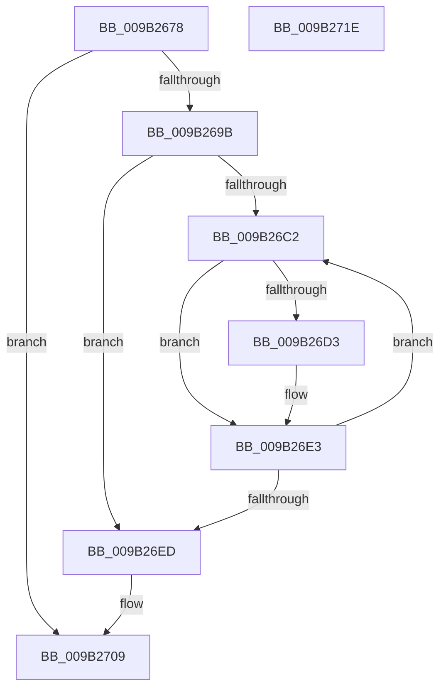

# HvFreeDirtyData

- RVA: `0x009B2678`–`0x009B271F` (길이 `167` bytes)
- VA: `0x00000001409B2678`
- 실행 섹션: `PAGE`
- PDB 이름 있음: `예`; PDB Function 태그: `아니요`
- unwind 정보 RVA: `0x0005C954`
- 디코드: `42`개 명령, `167/167` bytes 표시
- 미해석 바이트: `0` (있으면 어셈블리에 `.byte`로 보존)

> 이 문서는 커널 이미지의 기계어와 PDB 기호를 분석해 생성했습니다. 4번과 5번은 함수 원형과 자료형을 바이너리 사용 방식에서 추정한 C 해석이며 원본 소스 복구 결과는 아닙니다.

## 1. Dependencies

- 직접 호출 지점: **3**; 고유 호출 대상: **1**
- 직접 호출자로 확인된 함수: **3**
- RIP 상대 이미지 참조: **0**

### Outgoing calls
- `0x009B269D` → [ExFreePoolWithTag](../../poolcode/B8/ExFreePoolWithTag_function_00B82870.md) (function, `0x00B82870`)
- `0x009B26D5` → [ExFreePoolWithTag](../../poolcode/B8/ExFreePoolWithTag_function_00B82870.md) (function, `0x00B82870`)
- `0x009B26F2` → [ExFreePoolWithTag](../../poolcode/B8/ExFreePoolWithTag_function_00B82870.md) (function, `0x00B82870`)

### Direct callers
- [CmpDeleteHive](../86/CmpDeleteHive_function_0086450C.md) at `0x00864558`
- [CmpFlushHive](CmpFlushHive_function_009B3DC0.md) at `0x009B43DF`
- [CmpFlushHive](CmpFlushHive_function_009B3DC0.md) at `0x009B46BD`
- [HvFoldBackDirtyData](../A4/HvFoldBackDirtyData_function_00A463B8.md) at `0x00A463DD`

### Static image references
- 디코드된 RIP-relative 메모리 참조가 없습니다.

## 2. Other-region calls and transfers

- 다른 실행 섹션으로 향하는 call: **3**
  - `0x009B269D` → [ExFreePoolWithTag](../../poolcode/B8/ExFreePoolWithTag_function_00B82870.md) (`PAGE` → `POOLCODE`)
  - `0x009B26D5` → [ExFreePoolWithTag](../../poolcode/B8/ExFreePoolWithTag_function_00B82870.md) (`PAGE` → `POOLCODE`)
  - `0x009B26F2` → [ExFreePoolWithTag](../../poolcode/B8/ExFreePoolWithTag_function_00B82870.md) (`PAGE` → `POOLCODE`)
- 별도 외부 분기/꼬리 이동을 확인하지 못했습니다.

## 3. Assembly (complete function range)

```asm
009B2678  48 89 5C 24 08                  mov qword ptr [rsp + 8], rbx
009B267D  48 89 6C 24 10                  mov qword ptr [rsp + 0x10], rbp
009B2682  48 89 74 24 18                  mov qword ptr [rsp + 0x18], rsi
009B2687  57                              push rdi
009B2688  48 83 EC 20                     sub rsp, 0x20
009B268C  48 8B D9                        mov rbx, rcx
009B268F  48 8B 89 A0 06 00 00            mov rcx, qword ptr [rcx + 0x6a0]
009B2696  48 85 C9                        test rcx, rcx
009B2699  74 6E                           je 0x1409b2709
009B269B  33 D2                           xor edx, edx
009B269D  E8 CE 01 1D 00                  call 0x140b82870
009B26A2  83 A3 98 06 00 00 00            and dword ptr [rbx + 0x698], 0
009B26A9  48 8D BB B0 06 00 00            lea rdi, [rbx + 0x6b0]
009B26B0  48 83 A3 A0 06 00 00 00         and qword ptr [rbx + 0x6a0], 0
009B26B8  33 F6                           xor esi, esi
009B26BA  39 B3 B8 06 00 00               cmp dword ptr [rbx + 0x6b8], esi
009B26C0  76 2B                           jbe 0x1409b26ed
009B26C2  48 8B 07                        mov rax, qword ptr [rdi]
009B26C5  48 8D 2C 76                     lea rbp, [rsi + rsi*2]
009B26C9  48 8B 4C E8 08                  mov rcx, qword ptr [rax + rbp*8 + 8]
009B26CE  48 85 C9                        test rcx, rcx
009B26D1  74 10                           je 0x1409b26e3
009B26D3  33 D2                           xor edx, edx
009B26D5  E8 96 01 1D 00                  call 0x140b82870
009B26DA  48 8B 07                        mov rax, qword ptr [rdi]
009B26DD  48 83 64 E8 08 00               and qword ptr [rax + rbp*8 + 8], 0
009B26E3  FF C6                           inc esi
009B26E5  3B B3 B8 06 00 00               cmp esi, dword ptr [rbx + 0x6b8]
009B26EB  72 D5                           jb 0x1409b26c2
009B26ED  48 8B 0F                        mov rcx, qword ptr [rdi]
009B26F0  33 D2                           xor edx, edx
009B26F2  E8 79 01 1D 00                  call 0x140b82870
009B26F7  48 83 27 00                     and qword ptr [rdi], 0
009B26FB  83 A3 B8 06 00 00 00            and dword ptr [rbx + 0x6b8], 0
009B2702  83 A3 BC 06 00 00 00            and dword ptr [rbx + 0x6bc], 0
009B2709  48 8B 5C 24 30                  mov rbx, qword ptr [rsp + 0x30]
009B270E  48 8B 6C 24 38                  mov rbp, qword ptr [rsp + 0x38]
009B2713  48 8B 74 24 40                  mov rsi, qword ptr [rsp + 0x40]
009B2718  48 83 C4 20                     add rsp, 0x20
009B271C  5F                              pop rdi
009B271D  C3                              ret
009B271E  CC                              int3
```

## 4. C-style interpretation (structured pseudocode)

```c
__int64 __fastcall HvFreeDirtyData(__int64 a1, int a2)
{
    __int64 result;
    __int64 v_rsi;
    __int64 v_rsp;
    unsigned __int64 v_stack_p10;
    unsigned __int64 v_stack_p18;
    unsigned __int64 v_stack_p8;

    v_stack_p8 = v_rbx;
    v_stack_p10 = v_rbp;
    v_stack_p18 = v_rsi;
    v_rsp = (v_rsp) - (32);
    if (*(unsigned __int64 *)(a1 + 1696) == 0) goto loc_009B2709;
    a2 = 0;
    result = ExFreePoolWithTag(*(unsigned __int64 *)(a1 + 1696), a2, a3, a4);
    v_rsi = 0;
    if ((*(unsigned int *)(a1 + 1720)) <= 0) goto loc_009B26ED;
loc_009B26C2:
    result = *(unsigned __int64 *)(a1 + 1712);
    if (*(unsigned __int64 *)(*(unsigned __int64 *)(a1 + 1712) + v_rsi + v_rsi * 2 * 8 + 8) != 0) {
        a2 = 0;
        result = ExFreePoolWithTag(*(unsigned __int64 *)(*(unsigned __int64 *)(a1 + 1712) + v_rsi + v_rsi * 2 * 8 + 8), a2, a3, a4);
        result = *(unsigned __int64 *)(a1 + 1712);
    }
    v_rsi = (unsigned int)((v_rsi) + 1);
    if (((unsigned int)(v_rsi)) < (*(unsigned int *)(a1 + 1720))) goto loc_009B26C2;
loc_009B26ED:
    a2 = 0;
    result = ExFreePoolWithTag(*(unsigned __int64 *)(a1 + 1712), a2, a3, a4);
loc_009B2709:
    v_rsp = (v_rsp) + (32);
    return result;
}
```

## 5. (Beta) C Style

```c
int64_t HvFreeDirtyData(void *Arg1, int32_t Arg2)
{
    uint8_t *arg1 = (uint8_t *)Arg1;

    int64_t result;
    int64_t local_rsi;
    int64_t local_rsp;
    uint64_t v_stack_p10;
    uint64_t v_stack_p18;
    uint64_t v_stack_p8;

    v_stack_p8 = local_rbx;
    v_stack_p10 = local_rbp;
    v_stack_p18 = local_rsi;
    local_rsp = (local_rsp) - (32);
    if (*(uint64_t *)(arg1 + 0x6A0) == 0) goto loc_009B2709;
    Arg2 = 0;
    result = ExFreePoolWithTag(*(uint64_t *)(arg1 + 0x6A0), Arg2, a3, a4);
    local_rsi = 0;
    if ((*(uint32_t *)(arg1 + 0x6B8)) <= 0) goto loc_009B26ED;
loc_009B26C2:
    result = *(uint64_t *)(arg1 + 0x6B0);
    if (*(uint64_t *)(*(uint64_t *)(arg1 + 0x6B0) + local_rsi + local_rsi * 2 * 8 + 0x8) != 0) {
        Arg2 = 0;
        result = ExFreePoolWithTag(*(uint64_t *)(*(uint64_t *)(arg1 + 0x6B0) + local_rsi + local_rsi * 2 * 8 + 0x8), Arg2, a3, a4);
        result = *(uint64_t *)(arg1 + 0x6B0);
    }
    local_rsi = (uint32_t)((local_rsi) + 1);
    if (((uint32_t)(local_rsi)) < (*(uint32_t *)(arg1 + 0x6B8))) goto loc_009B26C2;
loc_009B26ED:
    Arg2 = 0;
    result = ExFreePoolWithTag(*(uint64_t *)(arg1 + 0x6B0), Arg2, a3, a4);
loc_009B2709:
    local_rsp = (local_rsp) + (32);
    return result;
}
```

### 관측된 메모리 오프셋

구조체 형식이 확인되지 않은 접근은 인자 기준의 오프셋으로만 기록했습니다.

| 기준 인자 | 오프셋 표현 | 폭 (bit) | 접근 |
|---|---:|---:|---|
| `Arg1` | `+ 0x0` | `64` | `R` |
| `Arg1` | `+ 0x0` | `64` | `R/W` |
| `Arg1` | `+ 0x698` | `32` | `R/W` |
| `Arg1` | `+ 0x6A0` | `64` | `R` |
| `Arg1` | `+ 0x6A0` | `64` | `R/W` |
| `Arg1` | `+ 0x6B0` | `64` | `R` |
| `Arg1` | `+ 0x6B8` | `32` | `R` |
| `Arg1` | `+ 0x6B8` | `32` | `R/W` |
| `Arg1` | `+ 0x6BC` | `32` | `R/W` |

## 6. Execution-region graph

[열기: 2D/3D 그래프와 함수 탐색 컨트롤 패널](../../../control-panel.html?section=page&rva=0x009B2678&view=graph)

- 2D 그래프는 위에서 아래로 흐르고, 3D 그래프는 빈 공간을 드래그해 회전합니다. Shift+드래그는 이동, 휠은 확대·축소, 함수 노드 선택은 대상 보고서 이동입니다.

### Static fallback


