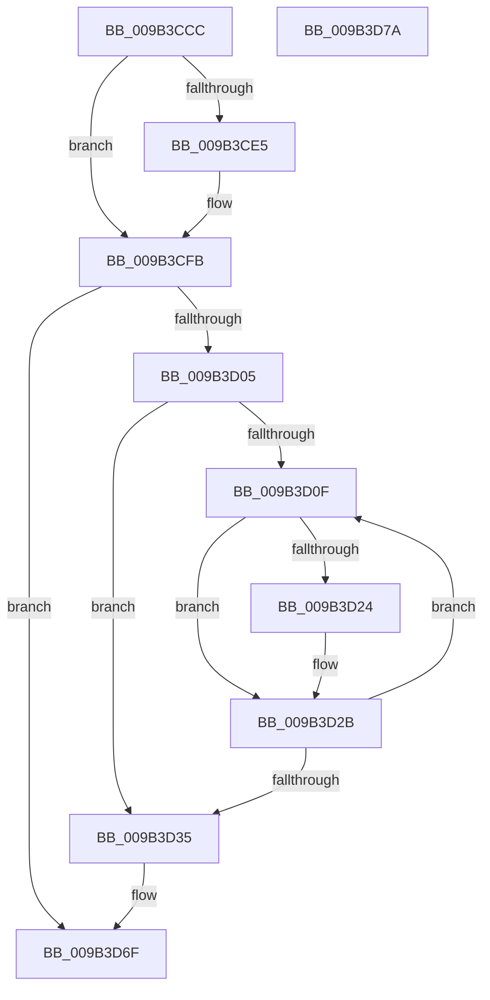

# HvFreeUnreconciledData

- RVA: `0x009B3CCC`–`0x009B3D7B` (길이 `175` bytes)
- VA: `0x00000001409B3CCC`
- 실행 섹션: `PAGE`
- PDB 이름 있음: `예`; PDB Function 태그: `아니요`
- unwind 정보 RVA: `0x0005CAAC`
- 디코드: `41`개 명령, `175/175` bytes 표시
- 미해석 바이트: `0` (있으면 어셈블리에 `.byte`로 보존)

> 이 문서는 커널 이미지의 기계어와 PDB 기호를 분석해 생성했습니다. 4번과 5번은 함수 원형과 자료형을 바이너리 사용 방식에서 추정한 C 해석이며 원본 소스 복구 결과는 아닙니다.

## 1. Dependencies

- 직접 호출 지점: **4**; 고유 호출 대상: **1**
- 직접 호출자로 확인된 함수: **2**
- RIP 상대 이미지 참조: **0**

### Outgoing calls
- `0x009B3CE7` → [ExFreePoolWithTag](../../poolcode/B8/ExFreePoolWithTag_function_00B82870.md) (function, `0x00B82870`)
- `0x009B3D26` → [ExFreePoolWithTag](../../poolcode/B8/ExFreePoolWithTag_function_00B82870.md) (function, `0x00B82870`)
- `0x009B3D3E` → [ExFreePoolWithTag](../../poolcode/B8/ExFreePoolWithTag_function_00B82870.md) (function, `0x00B82870`)
- `0x009B3D4C` → [ExFreePoolWithTag](../../poolcode/B8/ExFreePoolWithTag_function_00B82870.md) (function, `0x00B82870`)

### Direct callers
- [CmpFlushHive](CmpFlushHive_function_009B3DC0.md) at `0x009B439C`
- [CmpFlushHive](CmpFlushHive_function_009B3DC0.md) at `0x009B462B`
- [HvFoldBackUnreconciledData](../AC/HvFoldBackUnreconciledData_function_00AC27A8.md) at `0x00AC27E7`

### Static image references
- 디코드된 RIP-relative 메모리 참조가 없습니다.

## 2. Other-region calls and transfers

- 다른 실행 섹션으로 향하는 call: **4**
  - `0x009B3CE7` → [ExFreePoolWithTag](../../poolcode/B8/ExFreePoolWithTag_function_00B82870.md) (`PAGE` → `POOLCODE`)
  - `0x009B3D26` → [ExFreePoolWithTag](../../poolcode/B8/ExFreePoolWithTag_function_00B82870.md) (`PAGE` → `POOLCODE`)
  - `0x009B3D3E` → [ExFreePoolWithTag](../../poolcode/B8/ExFreePoolWithTag_function_00B82870.md) (`PAGE` → `POOLCODE`)
  - `0x009B3D4C` → [ExFreePoolWithTag](../../poolcode/B8/ExFreePoolWithTag_function_00B82870.md) (`PAGE` → `POOLCODE`)
- 별도 외부 분기/꼬리 이동을 확인하지 못했습니다.

## 3. Assembly (complete function range)

```asm
009B3CCC  48 89 5C 24 08                  mov qword ptr [rsp + 8], rbx
009B3CD1  57                              push rdi
009B3CD2  48 83 EC 20                     sub rsp, 0x20
009B3CD6  48 8B D9                        mov rbx, rcx
009B3CD9  48 8B 89 F0 06 00 00            mov rcx, qword ptr [rcx + 0x6f0]
009B3CE0  48 85 C9                        test rcx, rcx
009B3CE3  74 16                           je 0x1409b3cfb
009B3CE5  33 D2                           xor edx, edx
009B3CE7  E8 84 EB 1C 00                  call 0x140b82870
009B3CEC  48 83 A3 F0 06 00 00 00         and qword ptr [rbx + 0x6f0], 0
009B3CF4  C6 83 C4 06 00 00 00            mov byte ptr [rbx + 0x6c4], 0
009B3CFB  48 83 BB D0 06 00 00 00         cmp qword ptr [rbx + 0x6d0], 0
009B3D03  74 6A                           je 0x1409b3d6f
009B3D05  33 FF                           xor edi, edi
009B3D07  39 BB E8 06 00 00               cmp dword ptr [rbx + 0x6e8], edi
009B3D0D  76 26                           jbe 0x1409b3d35
009B3D0F  48 8B 83 E0 06 00 00            mov rax, qword ptr [rbx + 0x6e0]
009B3D16  48 8D 0C 7F                     lea rcx, [rdi + rdi*2]
009B3D1A  48 8B 4C C8 08                  mov rcx, qword ptr [rax + rcx*8 + 8]
009B3D1F  48 85 C9                        test rcx, rcx
009B3D22  74 07                           je 0x1409b3d2b
009B3D24  33 D2                           xor edx, edx
009B3D26  E8 45 EB 1C 00                  call 0x140b82870
009B3D2B  FF C7                           inc edi
009B3D2D  3B BB E8 06 00 00               cmp edi, dword ptr [rbx + 0x6e8]
009B3D33  72 DA                           jb 0x1409b3d0f
009B3D35  48 8B 8B E0 06 00 00            mov rcx, qword ptr [rbx + 0x6e0]
009B3D3C  33 D2                           xor edx, edx
009B3D3E  E8 2D EB 1C 00                  call 0x140b82870
009B3D43  48 8B 8B D0 06 00 00            mov rcx, qword ptr [rbx + 0x6d0]
009B3D4A  33 D2                           xor edx, edx
009B3D4C  E8 1F EB 1C 00                  call 0x140b82870
009B3D51  48 83 A3 E0 06 00 00 00         and qword ptr [rbx + 0x6e0], 0
009B3D59  83 A3 E8 06 00 00 00            and dword ptr [rbx + 0x6e8], 0
009B3D60  83 A3 C8 06 00 00 00            and dword ptr [rbx + 0x6c8], 0
009B3D67  48 83 A3 D0 06 00 00 00         and qword ptr [rbx + 0x6d0], 0
009B3D6F  48 8B 5C 24 30                  mov rbx, qword ptr [rsp + 0x30]
009B3D74  48 83 C4 20                     add rsp, 0x20
009B3D78  5F                              pop rdi
009B3D79  C3                              ret
009B3D7A  CC                              int3
```

## 4. C-style interpretation (structured pseudocode)

```c
__int64 __fastcall HvFreeUnreconciledData(__int64 a1, int a2)
{
    __int64 result;
    __int64 v_rdi;
    __int64 v_rsp;
    unsigned __int64 v_stack_p8;

    v_stack_p8 = v_rbx;
    v_rsp = (v_rsp) - (32);
    if (*(unsigned __int64 *)(a1 + 1776) != 0) {
        a2 = 0;
        result = ExFreePoolWithTag(*(unsigned __int64 *)(a1 + 1776), a2, a3, a4);
        *(unsigned __int8 *)(a1 + 1732) = 0;
    }
    if ((*(unsigned __int64 *)(a1 + 1744)) == 0) goto loc_009B3D6F;
    v_rdi = 0;
    if ((*(unsigned int *)(a1 + 1768)) <= 0) goto loc_009B3D35;
loc_009B3D0F:
    result = *(unsigned __int64 *)(a1 + 1760);
    if (*(unsigned __int64 *)(*(unsigned __int64 *)(a1 + 1760) + v_rdi + v_rdi * 2 * 8 + 8) != 0) {
        a2 = 0;
        result = ExFreePoolWithTag(*(unsigned __int64 *)(*(unsigned __int64 *)(a1 + 1760) + v_rdi + v_rdi * 2 * 8 + 8), a2, a3, a4);
    }
    v_rdi = (unsigned int)((v_rdi) + 1);
    if (((unsigned int)(v_rdi)) < (*(unsigned int *)(a1 + 1768))) goto loc_009B3D0F;
loc_009B3D35:
    a2 = 0;
    result = ExFreePoolWithTag(*(unsigned __int64 *)(a1 + 1760), a2, a3, a4);
    a2 = 0;
    result = ExFreePoolWithTag(*(unsigned __int64 *)(a1 + 1744), a2, a3, a4);
loc_009B3D6F:
    v_rsp = (v_rsp) + (32);
    return result;
}
```

## 5. (Beta) C Style

```c
int64_t HvFreeUnreconciledData(void *Arg1, int32_t Arg2)
{
    uint8_t *arg1 = (uint8_t *)Arg1;

    int64_t result;
    int64_t local_rdi;
    int64_t local_rsp;
    uint64_t v_stack_p8;

    v_stack_p8 = local_rbx;
    local_rsp = (local_rsp) - (32);
    if (*(uint64_t *)(arg1 + 0x6F0) != 0) {
        Arg2 = 0;
        result = ExFreePoolWithTag(*(uint64_t *)(arg1 + 0x6F0), Arg2, a3, a4);
        *(uint8_t *)(arg1 + 0x6C4) = 0;
    }
    if ((*(uint64_t *)(arg1 + 0x6D0)) == 0) goto loc_009B3D6F;
    local_rdi = 0;
    if ((*(uint32_t *)(arg1 + 0x6E8)) <= 0) goto loc_009B3D35;
loc_009B3D0F:
    result = *(uint64_t *)(arg1 + 0x6E0);
    if (*(uint64_t *)(*(uint64_t *)(arg1 + 0x6E0) + local_rdi + local_rdi * 2 * 8 + 0x8) != 0) {
        Arg2 = 0;
        result = ExFreePoolWithTag(*(uint64_t *)(*(uint64_t *)(arg1 + 0x6E0) + local_rdi + local_rdi * 2 * 8 + 0x8), Arg2, a3, a4);
    }
    local_rdi = (uint32_t)((local_rdi) + 1);
    if (((uint32_t)(local_rdi)) < (*(uint32_t *)(arg1 + 0x6E8))) goto loc_009B3D0F;
loc_009B3D35:
    Arg2 = 0;
    result = ExFreePoolWithTag(*(uint64_t *)(arg1 + 0x6E0), Arg2, a3, a4);
    Arg2 = 0;
    result = ExFreePoolWithTag(*(uint64_t *)(arg1 + 0x6D0), Arg2, a3, a4);
loc_009B3D6F:
    local_rsp = (local_rsp) + (32);
    return result;
}
```

### 관측된 메모리 오프셋

구조체 형식이 확인되지 않은 접근은 인자 기준의 오프셋으로만 기록했습니다.

| 기준 인자 | 오프셋 표현 | 폭 (bit) | 접근 |
|---|---:|---:|---|
| `Arg1` | `+ 0x6C4` | `8` | `W` |
| `Arg1` | `+ 0x6C8` | `32` | `R/W` |
| `Arg1` | `+ 0x6D0` | `64` | `R` |
| `Arg1` | `+ 0x6D0` | `64` | `R/W` |
| `Arg1` | `+ 0x6E0` | `64` | `R` |
| `Arg1` | `+ 0x6E0` | `64` | `R/W` |
| `Arg1` | `+ 0x6E8` | `32` | `R` |
| `Arg1` | `+ 0x6E8` | `32` | `R/W` |
| `Arg1` | `+ 0x6F0` | `64` | `R` |
| `Arg1` | `+ 0x6F0` | `64` | `R/W` |

## 6. Execution-region graph

[열기: 2D/3D 그래프와 함수 탐색 컨트롤 패널](../../../control-panel.html?section=page&rva=0x009B3CCC&view=graph)

- 2D 그래프는 위에서 아래로 흐르고, 3D 그래프는 빈 공간을 드래그해 회전합니다. Shift+드래그는 이동, 휠은 확대·축소, 함수 노드 선택은 대상 보고서 이동입니다.

### Static fallback


