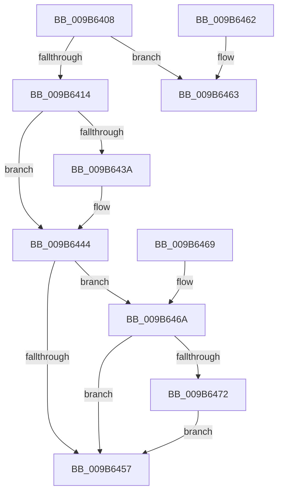

# HvGetEffectiveLogSizeCapForHive

- RVA: `0x009B6408`–`0x009B6479` (길이 `113` bytes)
- VA: `0x00000001409B6408`
- 실행 섹션: `PAGE`
- PDB 이름 있음: `예`; PDB Function 태그: `아니요`
- unwind 정보 RVA: `0x000DB714`
- 디코드: `32`개 명령, `113/113` bytes 표시
- 미해석 바이트: `0` (있으면 어셈블리에 `.byte`로 보존)

> 이 문서는 커널 이미지의 기계어와 PDB 기호를 분석해 생성했습니다. 4번과 5번은 함수 원형과 자료형을 바이너리 사용 방식에서 추정한 C 해석이며 원본 소스 복구 결과는 아닙니다.

## 1. Dependencies

- 직접 호출 지점: **0**; 고유 호출 대상: **0**
- 직접 호출자로 확인된 함수: **7**
- RIP 상대 이미지 참조: **1**

### Outgoing calls
- 직접 디코드된 call 명령이 없습니다.

### Direct callers
- [CmpAdjustRequestedFileSize](CmpAdjustRequestedFileSize_function_009B14C0.md) at `0x009B151C`
- [HvSwapLogFiles](HvSwapLogFiles_function_009B1EF8.md) at `0x009B1F26`
- [HvTruncateCurrentLogFileIfRequired](HvTruncateCurrentLogFileIfRequired_function_009B2728.md) at `0x009B277A`
- [CmpGenerateFlushControlData](CmpGenerateFlushControlData_function_009B4BCC.md) at `0x009B4D6F`
- [CmpDoReconcileNextHive](CmpDoReconcileNextHive_function_009B6BE0.md) at `0x009B6CF7`
- [CmpIsHiveEligibleForLazyReconcile](CmpIsHiveEligibleForLazyReconcile_function_009B6D44.md) at `0x009B6D86`
- [HvTruncateAllLogFilesIfRequired](HvTruncateAllLogFilesIfRequired_function_009B6E1C.md) at `0x009B6E2E`
- [HvTruncateAllLogFilesIfRequired](HvTruncateAllLogFilesIfRequired_function_009B6E1C.md) at `0x009B6E42`
- [HvTruncateAllLogFilesIfRequired](HvTruncateAllLogFilesIfRequired_function_009B6E1C.md) at `0x009B6E5A`

### Static image references
- `0x009B6444` → RVA `0x00EF5548` (`.data`; read)

## 2. Other-region calls and transfers

- 다른 실행 섹션으로 향하는 call: **0**
- 별도 외부 분기/꼬리 이동을 확인하지 못했습니다.

## 3. Assembly (complete function range)

```asm
009B6408  F7 81 10 10 00 00 00 08 00 00   test dword ptr [rcx + 0x1010], 0x800
009B6412  75 4F                           jne 0x1409b6463
009B6414  44 8B 81 18 01 00 00            mov r8d, dword ptr [rcx + 0x118]
009B641B  44 8B 89 BC 00 00 00            mov r9d, dword ptr [rcx + 0xbc]
009B6422  B9 00 20 00 00                  mov ecx, 0x2000
009B6427  44 3B C1                        cmp r8d, ecx
009B642A  41 0F 42 C8                     cmovb ecx, r8d
009B642E  8D 14 CD 00 00 00 00            lea edx, [rcx*8]
009B6435  44 2B C1                        sub r8d, ecx
009B6438  74 0A                           je 0x1409b6444
009B643A  41 8B C0                        mov eax, r8d
009B643D  48 C1 E8 02                     shr rax, 2
009B6441  48 03 D0                        add rdx, rax
009B6444  8B 0D FE F0 53 00               mov ecx, dword ptr [rip + 0x53f0fe]
009B644A  49 3B D1                        cmp rdx, r9
009B644D  41 0F 43 D1                     cmovae edx, r9d
009B6451  8B C2                           mov eax, edx
009B6453  85 C9                           test ecx, ecx
009B6455  75 13                           jne 0x1409b646a
009B6457  B9 00 80 00 00                  mov ecx, 0x8000
009B645C  3B C1                           cmp eax, ecx
009B645E  0F 42 C1                        cmovb eax, ecx
009B6461  C3                              ret
009B6462  CC                              int3
009B6463  B8 00 00 00 02                  mov eax, 0x2000000
009B6468  C3                              ret
009B6469  CC                              int3
009B646A  81 F9 00 00 08 00               cmp ecx, 0x80000
009B6470  72 E5                           jb 0x1409b6457
009B6472  3B CA                           cmp ecx, edx
009B6474  0F 42 C1                        cmovb eax, ecx
009B6477  EB DE                           jmp 0x1409b6457
```

## 4. C-style interpretation (structured pseudocode)

```c
__int64 __fastcall HvGetEffectiveLogSizeCapForHive(__int64 a1)
{
    __int64 result;

    if (((*(unsigned int *)(a1 + 4112)) & (0x800ULL)) != 0) goto loc_009B6463;
    a1 = (unsigned int)(0x2000ULL);
    if (((unsigned int)((unsigned int)(*(unsigned int *)(a1 + 280)))) < ((unsigned int)((unsigned int)(0x2000ULL)))) { a1 = (unsigned int)((unsigned int)(*(unsigned int *)(a1 + 280))); }
    a3 = (unsigned int)(((unsigned int)(*(unsigned int *)(a1 + 280))) - ((unsigned int)(a1)));
    if (!(condition_is_equal)) {
        result = (unsigned int)(a3);
        result = (result) >> (2);
        a2 = (a1 * 8) + (result);
    }
    if (a2 >= ((unsigned int)(*(unsigned int *)(a1 + 188)))) { a2 = (unsigned int)((unsigned int)(*(unsigned int *)(a1 + 188))); }
    if ((unsigned int)((unsigned int)(*(unsigned int *)(v_rip + 5501182))) != 0) goto loc_009B646A;
loc_009B6457:
    result = (unsigned int)((unsigned int)(a2));
    if (((unsigned int)((unsigned int)((unsigned int)(a2)))) < ((unsigned int)((unsigned int)(0x8000ULL)))) { result = (unsigned int)((unsigned int)(0x8000ULL)); }
    return result;
loc_009B6463:
    return (unsigned int)(0x2000000ULL);
loc_009B646A:
    if (((unsigned int)((unsigned int)(0x8000ULL))) < 0x80000ULL) goto loc_009B6457;
    result = (unsigned int)(0x2000000ULL);
    if (((unsigned int)((unsigned int)(0x8000ULL))) < ((unsigned int)(a2))) { result = (unsigned int)((unsigned int)(0x8000ULL)); }
    goto loc_009B6457;
}
```

## 5. (Beta) C Style

```c
int64_t HvGetEffectiveLogSizeCapForHive(void *Arg1)
{
    uint8_t *arg1 = (uint8_t *)Arg1;

    int64_t result;

    if (((*(uint32_t *)(arg1 + 0x1010)) & (0x800ULL)) != 0) goto loc_009B6463;
    Arg1 = (uint32_t)(0x2000ULL);
    if (((uint32_t)((uint32_t)(*(uint32_t *)(arg1 + 0x118)))) < ((uint32_t)((uint32_t)(0x2000ULL)))) { Arg1 = (uint32_t)((uint32_t)(*(uint32_t *)(arg1 + 0x118))); }
    a3 = (uint32_t)(((uint32_t)(*(uint32_t *)(arg1 + 0x118))) - ((uint32_t)(Arg1)));
    if (!(condition_is_equal)) {
        result = (uint32_t)(a3);
        result = (result) >> (2);
        a2 = (Arg1 * 8) + (result);
    }
    if (a2 >= ((uint32_t)(*(uint32_t *)(arg1 + 0xBC)))) { a2 = (uint32_t)((uint32_t)(*(uint32_t *)(arg1 + 0xBC))); }
    if ((uint32_t)((uint32_t)(*(uint32_t *)(v_rip + 0x53F0FE))) != 0) goto loc_009B646A;
loc_009B6457:
    result = (uint32_t)((uint32_t)(a2));
    if (((uint32_t)((uint32_t)((uint32_t)(a2)))) < ((uint32_t)((uint32_t)(0x8000ULL)))) { result = (uint32_t)((uint32_t)(0x8000ULL)); }
    return result;
loc_009B6463:
    return (uint32_t)(0x2000000ULL);
loc_009B646A:
    if (((uint32_t)((uint32_t)(0x8000ULL))) < 0x80000ULL) goto loc_009B6457;
    result = (uint32_t)(0x2000000ULL);
    if (((uint32_t)((uint32_t)(0x8000ULL))) < ((uint32_t)(a2))) { result = (uint32_t)((uint32_t)(0x8000ULL)); }
    goto loc_009B6457;
}
```

### 관측된 메모리 오프셋

구조체 형식이 확인되지 않은 접근은 인자 기준의 오프셋으로만 기록했습니다.

| 기준 인자 | 오프셋 표현 | 폭 (bit) | 접근 |
|---|---:|---:|---|
| `Arg1` | `+ 0xBC` | `32` | `R` |
| `Arg1` | `+ 0x118` | `32` | `R` |
| `Arg1` | `+ 0x1010` | `32` | `R` |

## 6. Execution-region graph

[열기: 2D/3D 그래프와 함수 탐색 컨트롤 패널](../../../control-panel.html?section=page&rva=0x009B6408&view=graph)

- 2D 그래프는 위에서 아래로 흐르고, 3D 그래프는 빈 공간을 드래그해 회전합니다. Shift+드래그는 이동, 휠은 확대·축소, 함수 노드 선택은 대상 보고서 이동입니다.

### Static fallback


