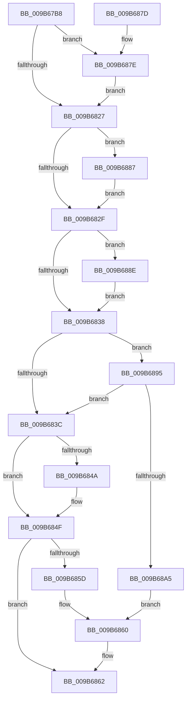

# HvGetHiveLogFileStatus

- RVA: `0x009B67B8`–`0x009B68AA` (길이 `242` bytes)
- VA: `0x00000001409B67B8`
- 실행 섹션: `PAGE`
- PDB 이름 있음: `예`; PDB Function 태그: `아니요`
- unwind 정보 RVA: `0x0009E744`
- 디코드: `71`개 명령, `242/242` bytes 표시
- 미해석 바이트: `0` (있으면 어셈블리에 `.byte`로 보존)

> 이 문서는 커널 이미지의 기계어와 PDB 기호를 분석해 생성했습니다. 4번과 5번은 함수 원형과 자료형을 바이너리 사용 방식에서 추정한 C 해석이며 원본 소스 복구 결과는 아닙니다.

## 1. Dependencies

- 직접 호출 지점: **3**; 고유 호출 대상: **3**
- 직접 호출자로 확인된 함수: **1**
- RIP 상대 이미지 참조: **0**

### Outgoing calls
- `0x009B67DE` → [HvpCountSetRangesInVector](HvpCountSetRangesInVector_function_009B6974.md) (function, `0x009B6974`)
- `0x009B67FF` → [RtlAreBitsClear](../../text/45/RtlAreBitsClear_function_00451800.md) (function, `0x00451800`)
- `0x009B689C` → [CmpIsWriteQueueActive](../../text/48/CmpIsWriteQueueActive_function_0048C7D8.md) (function, `0x0048C7D8`)

### Direct callers
- [CmpGenerateFlushControlData](CmpGenerateFlushControlData_function_009B4BCC.md) at `0x009B4C9A`
- [CmpGenerateFlushControlData](CmpGenerateFlushControlData_function_009B4BCC.md) at `0x009B4E55`

### Static image references
- 디코드된 RIP-relative 메모리 참조가 없습니다.

## 2. Other-region calls and transfers

- 다른 실행 섹션으로 향하는 call: **2**
  - `0x009B67FF` → [RtlAreBitsClear](../../text/45/RtlAreBitsClear_function_00451800.md) (`PAGE` → `.text`)
  - `0x009B689C` → [CmpIsWriteQueueActive](../../text/48/CmpIsWriteQueueActive_function_0048C7D8.md) (`PAGE` → `.text`)
- 별도 외부 분기/꼬리 이동을 확인하지 못했습니다.

## 3. Assembly (complete function range)

```asm
009B67B8  48 8B C4                        mov rax, rsp
009B67BB  48 89 58 08                     mov qword ptr [rax + 8], rbx
009B67BF  48 89 68 10                     mov qword ptr [rax + 0x10], rbp
009B67C3  48 89 70 18                     mov qword ptr [rax + 0x18], rsi
009B67C7  48 89 78 20                     mov qword ptr [rax + 0x20], rdi
009B67CB  41 56                           push r14
009B67CD  48 83 EC 20                     sub rsp, 0x20
009B67D1  48 8B E9                        mov rbp, rcx
009B67D4  44 8B F2                        mov r14d, edx
009B67D7  48 83 C1 58                     add rcx, 0x58
009B67DB  49 8B F0                        mov rsi, r8
009B67DE  E8 91 01 00 00                  call 0x1409b6974
009B67E3  44 8B 55 68                     mov r10d, dword ptr [rbp + 0x68]
009B67E7  48 8D 4D 58                     lea rcx, [rbp + 0x58]
009B67EB  41 C1 E2 09                     shl r10d, 9
009B67EF  33 D2                           xor edx, edx
009B67F1  49 83 C2 28                     add r10, 0x28
009B67F5  8B C0                           mov eax, eax
009B67F7  44 8D 42 08                     lea r8d, [rdx + 8]
009B67FB  49 8D 1C C2                     lea rbx, [r10 + rax*8]
009B67FF  E8 FC AF A9 FF                  call 0x140451800
009B6804  84 C0                           test al, al
009B6806  4C 8D 83 08 10 00 00            lea r8, [rbx + 0x1008]
009B680D  8B 85 B4 00 00 00               mov eax, dword ptr [rbp + 0xb4]
009B6813  4C 0F 44 C3                     cmove r8, rbx
009B6817  83 26 00                        and dword ptr [rsi], 0
009B681A  49 03 C0                        add rax, r8
009B681D  33 D2                           xor edx, edx
009B681F  38 95 C3 00 00 00               cmp byte ptr [rbp + 0xc3], dl
009B6825  75 57                           jne 0x1409b687e
009B6827  48 3D 00 00 00 02               cmp rax, 0x2000000
009B682D  77 58                           ja 0x1409b6887
009B682F  83 BD AC 00 00 00 FF            cmp dword ptr [rbp + 0xac], -1
009B6836  74 56                           je 0x1409b688e
009B6838  85 D2                           test edx, edx
009B683A  75 59                           jne 0x1409b6895
009B683C  8B 85 B4 00 00 00               mov eax, dword ptr [rbp + 0xb4]
009B6842  49 03 C0                        add rax, r8
009B6845  49 3B C6                        cmp rax, r14
009B6848  72 05                           jb 0x1409b684f
009B684A  83 CA 10                        or edx, 0x10
009B684D  89 16                           mov dword ptr [rsi], edx
009B684F  8B 85 B4 00 00 00               mov eax, dword ptr [rbp + 0xb4]
009B6855  49 03 C0                        add rax, r8
009B6858  49 3B C6                        cmp rax, r14
009B685B  72 05                           jb 0x1409b6862
009B685D  83 CA 20                        or edx, 0x20
009B6860  89 16                           mov dword ptr [rsi], edx
009B6862  48 8B 5C 24 30                  mov rbx, qword ptr [rsp + 0x30]
009B6867  48 8B 6C 24 38                  mov rbp, qword ptr [rsp + 0x38]
009B686C  48 8B 74 24 40                  mov rsi, qword ptr [rsp + 0x40]
009B6871  48 8B 7C 24 48                  mov rdi, qword ptr [rsp + 0x48]
009B6876  48 83 C4 20                     add rsp, 0x20
009B687A  41 5E                           pop r14
009B687C  C3                              ret
009B687D  CC                              int3
009B687E  BA 02 00 00 00                  mov edx, 2
009B6883  89 16                           mov dword ptr [rsi], edx
009B6885  EB A0                           jmp 0x1409b6827
009B6887  83 CA 04                        or edx, 4
009B688A  89 16                           mov dword ptr [rsi], edx
009B688C  EB A1                           jmp 0x1409b682f
009B688E  83 CA 08                        or edx, 8
009B6891  89 16                           mov dword ptr [rsi], edx
009B6893  EB A3                           jmp 0x1409b6838
009B6895  48 8D 8D 70 10 00 00            lea rcx, [rbp + 0x1070]
009B689C  E8 37 5F AD FF                  call 0x14048c7d8
009B68A1  84 C0                           test al, al
009B68A3  74 97                           je 0x1409b683c
009B68A5  83 CA 01                        or edx, 1
009B68A8  EB B6                           jmp 0x1409b6860
```

## 4. C-style interpretation (structured pseudocode)

```c
__int64 __fastcall HvGetHiveLogFileStatus(__int64 a1, int a2, __int64 a3)
{
    __int64 result;
    __int64 v_r10;
    __int64 v_rsp;
    unsigned __int64 v_stack_p10;
    unsigned __int64 v_stack_p18;
    unsigned __int64 v_stack_p20;
    unsigned __int64 v_stack_p8;

    *(unsigned __int64 *)(v_rsp + 8) = v_rbx;
    *(unsigned __int64 *)(v_rsp + 16) = v_rbp;
    *(unsigned __int64 *)(v_rsp + 24) = v_rsi;
    *(unsigned __int64 *)(v_rsp + 32) = v_rdi;
    v_rsp = (v_rsp) - (32);
    a1 = (a1) + (88);
    result = HvpCountSetRangesInVector(a1, a2, a3, a4);
    v_r10 = (unsigned int)(((unsigned int)(*(unsigned int *)(a1 + 104))) << (9));
    a2 = 0;
    v_r10 = (v_r10) + (40);
    result = RtlAreBitsClear(a1 + 88, a2, a2 + 8, a4);
    a3 = v_r10 + (unsigned int)((unsigned int)(result)) * 8 + 4104;
    if ((unsigned __int8)(result) == 0) { a3 = v_r10 + (unsigned int)((unsigned int)(result)) * 8; }
    result = ((unsigned int)(*(unsigned int *)(a1 + 180))) + (a3);
    a2 = 0;
    if ((*(unsigned __int8 *)(a1 + 195)) != 0) goto loc_009B687E;
loc_009B6827:
    if (result > 0x2000000ULL) goto loc_009B6887;
loc_009B682F:
    if ((*(unsigned int *)(a1 + 172)) == -1) goto loc_009B688E;
loc_009B6838:
    if (0 != 0) goto loc_009B6895;
loc_009B683C:
    result = ((unsigned int)(*(unsigned int *)(a1 + 180))) + (a3);
    if (result >= ((unsigned int)(a2))) {
        a2 = (unsigned int)((a2) | (16));
        *(unsigned int *)(a3) = a2;
    }
    result = ((unsigned int)(*(unsigned int *)(a1 + 180))) + (a3);
    if (result < ((unsigned int)(a2))) goto loc_009B6862;
    a2 = (unsigned int)((a2) | (32));
loc_009B6860:
    *(unsigned int *)(a3) = a2;
loc_009B6862:
    v_rsp = (v_rsp) + (32);
    return result;
loc_009B687E:
    *(unsigned int *)(v_stack_p18) = 2;
    goto loc_009B6827;
loc_009B6887:
    a2 = (unsigned int)((2) | (4));
    *(unsigned int *)(v_stack_p18) = a2;
    goto loc_009B682F;
loc_009B688E:
    a2 = (unsigned int)((a2) | (8));
    *(unsigned int *)(v_stack_p18) = a2;
    goto loc_009B6838;
loc_009B6895:
    result = CmpIsWriteQueueActive(v_stack_p10 + 4208, a2, a3, a4);
    if ((unsigned __int8)(result) == 0) goto loc_009B683C;
    a2 = (unsigned int)((a2) | (1));
    goto loc_009B6860;
}
```

## 5. (Beta) C Style

```c
int64_t HvGetHiveLogFileStatus(void *Arg1, int32_t Arg2, void *Arg3)
{
    uint8_t *arg1 = (uint8_t *)Arg1;
    uint8_t *arg3 = (uint8_t *)Arg3;

    int64_t result;
    int64_t local_r10;
    int64_t local_rsp;
    uint64_t v_stack_p10;
    uint64_t v_stack_p18;
    uint64_t v_stack_p20;
    uint64_t v_stack_p8;

    *(uint64_t *)(local_rsp + 0x8) = local_rbx;
    *(uint64_t *)(local_rsp + 0x10) = local_rbp;
    *(uint64_t *)(local_rsp + 0x18) = local_rsi;
    *(uint64_t *)(local_rsp + 0x20) = local_rdi;
    local_rsp = (local_rsp) - (32);
    Arg1 = (Arg1) + (88);
    result = HvpCountSetRangesInVector(Arg1, Arg2, Arg3, a4);
    local_r10 = (uint32_t)(((uint32_t)(*(uint32_t *)(arg1 + 0x68))) << (9));
    Arg2 = 0;
    local_r10 = (local_r10) + (40);
    result = RtlAreBitsClear(Arg1 + 88, Arg2, Arg2 + 8, a4);
    Arg3 = local_r10 + (uint32_t)((uint32_t)(result)) * 8 + 4104;
    if ((uint8_t)(result) == 0) { Arg3 = local_r10 + (uint32_t)((uint32_t)(result)) * 8; }
    result = ((uint32_t)(*(uint32_t *)(arg1 + 0xB4))) + (Arg3);
    Arg2 = 0;
    if ((*(uint8_t *)(arg1 + 0xC3)) != 0) goto loc_009B687E;
loc_009B6827:
    if (result > 0x2000000ULL) goto loc_009B6887;
loc_009B682F:
    if ((*(uint32_t *)(arg1 + 0xAC)) == -1) goto loc_009B688E;
loc_009B6838:
    if (0 != 0) goto loc_009B6895;
loc_009B683C:
    result = ((uint32_t)(*(uint32_t *)(arg1 + 0xB4))) + (Arg3);
    if (result >= ((uint32_t)(Arg2))) {
        Arg2 = (uint32_t)((Arg2) | (16));
        *(uint32_t *)(arg3) = Arg2;
    }
    result = ((uint32_t)(*(uint32_t *)(arg1 + 0xB4))) + (Arg3);
    if (result < ((uint32_t)(Arg2))) goto loc_009B6862;
    Arg2 = (uint32_t)((Arg2) | (32));
loc_009B6860:
    *(uint32_t *)(arg3) = Arg2;
loc_009B6862:
    local_rsp = (local_rsp) + (32);
    return result;
loc_009B687E:
    *(uint32_t *)(v_stack_p18) = 2;
    goto loc_009B6827;
loc_009B6887:
    Arg2 = (uint32_t)((2) | (4));
    *(uint32_t *)(v_stack_p18) = Arg2;
    goto loc_009B682F;
loc_009B688E:
    Arg2 = (uint32_t)((Arg2) | (8));
    *(uint32_t *)(v_stack_p18) = Arg2;
    goto loc_009B6838;
loc_009B6895:
    result = CmpIsWriteQueueActive(v_stack_p10 + 4208, Arg2, Arg3, a4);
    if ((uint8_t)(result) == 0) goto loc_009B683C;
    Arg2 = (uint32_t)((Arg2) | (1));
    goto loc_009B6860;
}
```

### 관측된 메모리 오프셋

구조체 형식이 확인되지 않은 접근은 인자 기준의 오프셋으로만 기록했습니다.

| 기준 인자 | 오프셋 표현 | 폭 (bit) | 접근 |
|---|---:|---:|---|
| `Arg1` | `+ 0x58` | `64` | `R` |
| `Arg1` | `+ 0x68` | `32` | `R` |
| `Arg1` | `+ 0xAC` | `32` | `R` |
| `Arg1` | `+ 0xB4` | `32` | `R` |
| `Arg1` | `+ 0xC3` | `8` | `R` |
| `Arg1` | `+ 0x1070` | `64` | `R` |
| `Arg3` | `+ 0x0` | `32` | `R/W` |
| `Arg3` | `+ 0x0` | `32` | `W` |

## 6. Execution-region graph

[열기: 2D/3D 그래프와 함수 탐색 컨트롤 패널](../../../control-panel.html?section=page&rva=0x009B67B8&view=graph)

- 2D 그래프는 위에서 아래로 흐르고, 3D 그래프는 빈 공간을 드래그해 회전합니다. Shift+드래그는 이동, 휠은 확대·축소, 함수 노드 선택은 대상 보고서 이동입니다.

### Static fallback


