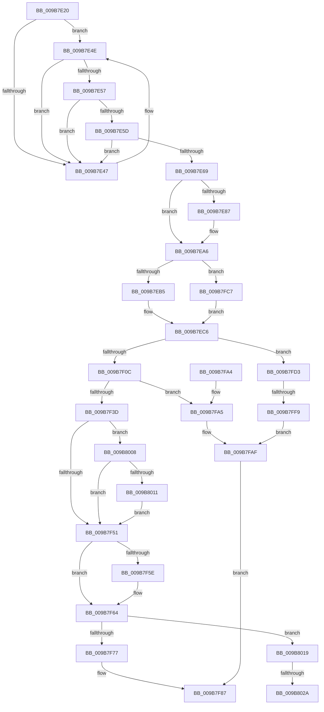

# HvHiveStartFileBacked

- RVA: `0x009B7E20`–`0x009B8032` (길이 `530` bytes)
- VA: `0x00000001409B7E20`
- 실행 섹션: `PAGE`
- PDB 이름 있음: `예`; PDB Function 태그: `예`
- unwind 정보 RVA: `0x0009E8E4`
- 디코드: `121`개 명령, `530/530` bytes 표시
- 미해석 바이트: `0` (있으면 어셈블리에 `.byte`로 보존)

> 이 문서는 커널 이미지의 기계어와 PDB 기호를 분석해 생성했습니다. 4번과 5번은 함수 원형과 자료형을 바이너리 사용 방식에서 추정한 C 해석이며 원본 소스 복구 결과는 아닙니다.

## 1. Dependencies

- 직접 호출 지점: **7**; 고유 호출 대상: **7**
- 직접 호출자로 확인된 함수: **1**
- RIP 상대 이미지 참조: **3**

### Outgoing calls
- `0x009B7F0C` → [CmpTraceHiveMountStart](CmpTraceHiveMountStart_function_009B80C8.md) (function, `0x009B80C8`)
- `0x009B7F2B` → [HvLoadHive](HvLoadHive_function_009B8138.md) (function, `0x009B8138`)
- `0x009B7F34` → [CmpTraceHiveMountStop](CmpTraceHiveMountStop_function_009B8038.md) (function, `0x009B8038`)
- `0x009B7F80` → [HvpFillFileName](HvpFillFileName_function_009B9A2C.md) (function, `0x009B9A2C`)
- `0x009B7FC0` → [SetFailureLocation](../../text/46/SetFailureLocation_function_0046EF54.md) (function, `0x0046EF54`)
- `0x009B7FE6` → [guard_dispatch_icall](../../text/6B/guard_dispatch_icall_function_006BAAD0.md) (function, `0x006BAAD0`)
- `0x009B801C` → [HvMarkBaseBlockDirty](../87/HvMarkBaseBlockDirty_function_0087BD04.md) (function, `0x0087BD04`)

### Direct callers
- [CmpCreateHive](../87/CmpCreateHive_function_00879DF0.md) at `0x0087A183`

### Static image references
- `0x009B7ED0` → RVA `0x00854CB0` (`HvpGetCellPaged`; read)
- `0x009B7EEB` → RVA `0x00855F40` (`HvpReleaseCellPaged`; read)
- `0x009B7F19` → RVA `0x00EF7200` (`.data`; read)

## 2. Other-region calls and transfers

- 다른 실행 섹션으로 향하는 call: **2**
  - `0x009B7FC0` → [SetFailureLocation](../../text/46/SetFailureLocation_function_0046EF54.md) (`PAGE` → `.text`)
  - `0x009B7FE6` → [guard_dispatch_icall](../../text/6B/guard_dispatch_icall_function_006BAAD0.md) (`PAGE` → `.text`)
- call이 아닌 외부 분기/꼬리 이동: **3**
  - `0x009B7FF3` → [sub_00B2DE6C](../B2/Unknown_function_00B2DE6C.md) (`tail-transfer`)
  - `0x009B8024` → [sub_00B2DE6C + 0xFE](../B2/Unknown_function_00B2DE6C.md) (`tail-transfer`)
  - `0x009B802D` → [sub_00B2DE6C + 0xFE](../B2/Unknown_function_00B2DE6C.md) (`tail-transfer`)

## 3. Assembly (complete function range)

```asm
009B7E20  48 8B C4                        mov rax, rsp
009B7E23  48 89 58 08                     mov qword ptr [rax + 8], rbx
009B7E27  48 89 68 10                     mov qword ptr [rax + 0x10], rbp
009B7E2B  48 89 70 18                     mov qword ptr [rax + 0x18], rsi
009B7E2F  48 89 78 20                     mov qword ptr [rax + 0x20], rdi
009B7E33  41 57                           push r15
009B7E35  48 83 EC 30                     sub rsp, 0x30
009B7E39  81 39 E0 BE E0 BE               cmp dword ptr [rcx], 0xbee0bee0
009B7E3F  44 8A D2                        mov r10b, dl
009B7E42  48 8B F9                        mov rdi, rcx
009B7E45  74 07                           je 0x1409b7e4e
009B7E47  B9 05 00 00 00                  mov ecx, 5
009B7E4C  CD 29                           int 0x29
009B7E4E  41 F7 C0 EC 7C 61 F5            test r8d, 0xf5617cec
009B7E55  75 F0                           jne 0x1409b7e47
009B7E57  41 83 F9 02                     cmp r9d, 2
009B7E5B  77 EA                           ja 0x1409b7e47
009B7E5D  8B 54 24 68                     mov edx, dword ptr [rsp + 0x68]
009B7E61  8D 42 FF                        lea eax, [rdx - 1]
009B7E64  83 F8 07                        cmp eax, 7
009B7E67  77 DE                           ja 0x1409b7e47
009B7E69  41 8B E8                        mov ebp, r8d
009B7E6C  0F BA F5 11                     btr ebp, 0x11
009B7E70  45 84 D2                        test r10b, r10b
009B7E73  41 0F 44 E8                     cmove ebp, r8d
009B7E77  89 A9 A0 00 00 00               mov dword ptr [rcx + 0xa0], ebp
009B7E7D  48 8B 4C 24 60                  mov rcx, qword ptr [rsp + 0x60]
009B7E82  48 85 C9                        test rcx, rcx
009B7E85  74 1F                           je 0x1409b7ea6
009B7E87  48 8B 01                        mov rax, qword ptr [rcx]
009B7E8A  48 89 47 18                     mov qword ptr [rdi + 0x18], rax
009B7E8E  48 8B 41 08                     mov rax, qword ptr [rcx + 8]
009B7E92  48 89 47 20                     mov qword ptr [rdi + 0x20], rax
009B7E96  48 8B 41 18                     mov rax, qword ptr [rcx + 0x18]
009B7E9A  48 89 47 28                     mov qword ptr [rdi + 0x28], rax
009B7E9E  48 8B 41 20                     mov rax, qword ptr [rcx + 0x20]
009B7EA2  48 89 47 30                     mov qword ptr [rdi + 0x30], rax
009B7EA6  41 BF 01 00 00 00               mov r15d, 1
009B7EAC  45 85 C9                        test r9d, r9d
009B7EAF  0F 84 12 01 00 00               je 0x1409b7fc7
009B7EB5  45 3B CF                        cmp r9d, r15d
009B7EB8  41 8D 47 03                     lea eax, [r15 + 3]
009B7EBC  41 0F 44 C7                     cmove eax, r15d
009B7EC0  89 87 A8 00 00 00               mov dword ptr [rdi + 0xa8], eax
009B7EC6  C7 87 84 00 00 00 00 10 00 00   mov dword ptr [rdi + 0x84], 0x1000
009B7ED0  48 8D 05 D9 CD E9 FF            lea rax, [rip - 0x163227]
009B7ED7  48 89 47 08                     mov qword ptr [rdi + 8], rax
009B7EDB  48 BB 14 00 00 00 80 F7 FF FF   movabs rbx, 0xfffff78000000014
009B7EE5  89 97 88 00 00 00               mov dword ptr [rdi + 0x88], edx
009B7EEB  48 8D 05 4E E0 E9 FF            lea rax, [rip - 0x161fb2]
009B7EF2  48 89 47 10                     mov qword ptr [rdi + 0x10], rax
009B7EF6  C7 87 D8 00 00 00 02 00 00 00   mov dword ptr [rdi + 0xd8], 2
009B7F00  48 8B 1B                        mov rbx, qword ptr [rbx]
009B7F03  45 84 D2                        test r10b, r10b
009B7F06  0F 85 C7 00 00 00               jne 0x1409b7fd3
009B7F0C  E8 B7 01 00 00                  call 0x1409b80c8
009B7F11  4C 8B 8C 24 A8 00 00 00         mov r9, qword ptr [rsp + 0xa8]
009B7F19  48 8D 15 E0 F2 53 00            lea rdx, [rip + 0x53f2e0]
009B7F20  44 8B 84 24 80 00 00 00         mov r8d, dword ptr [rsp + 0x80]
009B7F28  48 8B CF                        mov rcx, rdi
009B7F2B  E8 08 02 00 00                  call 0x1409b8138
009B7F30  8B C8                           mov ecx, eax
009B7F32  8B D8                           mov ebx, eax
009B7F34  E8 FF 00 00 00                  call 0x1409b8038
009B7F39  85 DB                           test ebx, ebx
009B7F3B  78 68                           js 0x1409b7fa5
009B7F3D  48 8B B4 24 98 00 00 00         mov rsi, qword ptr [rsp + 0x98]
009B7F45  81 FB 09 00 00 40               cmp ebx, 0x40000009
009B7F4B  0F 84 B7 00 00 00               je 0x1409b8008
009B7F51  48 8B 84 24 A0 00 00 00         mov rax, qword ptr [rsp + 0xa0]
009B7F59  48 85 C0                        test rax, rax
009B7F5C  74 06                           je 0x1409b7f64
009B7F5E  C7 00 43 4D 33 31               mov dword ptr [rax], 0x31334d43
009B7F64  48 8B 47 40                     mov rax, qword ptr [rdi + 0x40]
009B7F68  8B 88 90 00 00 00               mov ecx, dword ptr [rax + 0x90]
009B7F6E  41 84 CF                        test r15b, cl
009B7F71  0F 85 A2 00 00 00               jne 0x1409b8019
009B7F77  48 8B 54 24 78                  mov rdx, qword ptr [rsp + 0x78]
009B7F7C  48 8B 4F 40                     mov rcx, qword ptr [rdi + 0x40]
009B7F80  E8 A7 1A 00 00                  call 0x1409b9a2c
009B7F85  33 DB                           xor ebx, ebx
009B7F87  48 8B 6C 24 48                  mov rbp, qword ptr [rsp + 0x48]
009B7F8C  8B C3                           mov eax, ebx
009B7F8E  48 8B 5C 24 40                  mov rbx, qword ptr [rsp + 0x40]
009B7F93  48 8B 74 24 50                  mov rsi, qword ptr [rsp + 0x50]
009B7F98  48 8B 7C 24 58                  mov rdi, qword ptr [rsp + 0x58]
009B7F9D  48 83 C4 30                     add rsp, 0x30
009B7FA1  41 5F                           pop r15
009B7FA3  C3                              ret
009B7FA4  CC                              int3
009B7FA5  C7 44 24 20 40 00 00 00         mov dword ptr [rsp + 0x20], 0x40
009B7FAD  33 D2                           xor edx, edx
009B7FAF  48 8B 8C 24 A8 00 00 00         mov rcx, qword ptr [rsp + 0xa8]
009B7FB7  44 8B CB                        mov r9d, ebx
009B7FBA  41 B8 18 00 00 00               mov r8d, 0x18
009B7FC0  E8 8F 6F AB FF                  call 0x14046ef54
009B7FC5  EB C0                           jmp 0x1409b7f87
009B7FC7  83 A7 A8 00 00 00 00            and dword ptr [rdi + 0xa8], 0
009B7FCE  E9 F3 FE FF FF                  jmp 0x1409b7ec6
009B7FD3  48 8B 47 18                     mov rax, qword ptr [rdi + 0x18]
009B7FD7  41 B8 43 4D 31 31               mov r8d, 0x31314d43
009B7FDD  8B 8F 84 00 00 00               mov ecx, dword ptr [rdi + 0x84]
009B7FE3  41 8A D7                        mov dl, r15b
009B7FE6  E8 E5 2A D0 FF                  call 0x1406baad0
009B7FEB  33 D2                           xor edx, edx
009B7FED  48 8B F0                        mov rsi, rax
009B7FF0  48 85 C0                        test rax, rax
009B7FF3  0F 85 73 5E 17 00               jne 0x140b2de6c
009B7FF9  BB 9A 00 00 C0                  mov ebx, 0xc000009a
009B7FFE  C7 44 24 20 10 00 00 00         mov dword ptr [rsp + 0x20], 0x10
009B8006  EB A7                           jmp 0x1409b7faf
009B8008  48 85 F6                        test rsi, rsi
009B800B  0F 84 40 FF FF FF               je 0x1409b7f51
009B8011  44 88 3E                        mov byte ptr [rsi], r15b
009B8014  E9 38 FF FF FF                  jmp 0x1409b7f51
009B8019  48 8B CF                        mov rcx, rdi
009B801C  E8 E3 3C EC FF                  call 0x14087bd04
009B8021  48 85 F6                        test rsi, rsi
009B8024  0F 84 40 5F 17 00               je 0x140b2df6a
009B802A  44 88 3E                        mov byte ptr [rsi], r15b
009B802D  E9 38 5F 17 00                  jmp 0x140b2df6a
```

## 4. C-style interpretation (structured pseudocode)

```c
__int64 __fastcall HvHiveStartFileBacked(__int64 a1, unsigned __int8 a2, int a3, int a4, __int64 a5, unsigned int a6, __int64 a7, __int64 a8, unsigned int a9, __int64 a10, __int64 a11, __int64 a12, __int64 a13, __int64 a14)
{
    __int64 result;
    __int64 v_rbp;
    __int64 v_rbx;
    __int64 v_rsp;
    unsigned __int64 v_stack_p10;
    unsigned __int64 v_stack_p18;
    unsigned __int64 v_stack_p20;
    unsigned __int64 v_stack_p8;

    *(unsigned __int64 *)(v_rsp + 8) = v_rbx;
    *(unsigned __int64 *)(v_rsp + 16) = v_rbp;
    *(unsigned __int64 *)(v_rsp + 24) = v_rsi;
    *(unsigned __int64 *)(v_rsp + 32) = v_rdi;
    v_rsp = (v_rsp) - (48);
    if ((*(unsigned int *)(a1)) != 0xBEE0BEE0ULL) {
        a1 = 5;
    }
    if (((a3) & (0xF5617CECULL)) != 0) goto loc_009B7E47;
    if (a4 > 2) goto loc_009B7E47;
    if (((unsigned int)((unsigned int)(a6) - 1)) > 7) goto loc_009B7E47;
    v_rbp = (unsigned int)(a3);
    if (a2 == 0) { v_rbp = a3; }
    *(unsigned int *)(a1 + 160) = (unsigned int)(v_rbp);
    result = (unsigned int)(a6) - 1;
    if (a5 != 0) {
        result = *(unsigned __int64 *)(a5);
        *(unsigned __int64 *)(a1 + 24) = result;
        result = *(unsigned __int64 *)(a5 + 8);
        *(unsigned __int64 *)(a1 + 32) = result;
        result = *(unsigned __int64 *)(a5 + 24);
        *(unsigned __int64 *)(a1 + 40) = result;
        result = *(unsigned __int64 *)(a5 + 32);
        *(unsigned __int64 *)(a1 + 48) = result;
    }
    if (a4 == 0) goto loc_009B7FC7;
    result = 1 + 3;
    if (a4 == 1) { result = 1; }
    *(unsigned int *)(a1 + 168) = (unsigned int)(result);
loc_009B7EC6:
    *(unsigned int *)(a1 + 132) = 0x1000ULL;
    *(unsigned __int64 *)(a1 + 8) = v_rip - 1454631;
    *(unsigned int *)(a1 + 136) = (unsigned int)((unsigned int)(a6));
    *(unsigned __int64 *)(a1 + 16) = v_rip - 1449906;
    *(unsigned int *)(a1 + 216) = 2;
    if (a2 != 0) goto loc_009B7FD3;
    result = CmpTraceHiveMountStart(a5, (unsigned int)(a6), a3, a4);
    result = HvLoadHive(a1, v_rip + 5501664, (unsigned int)(a9), a14);
    result = CmpTraceHiveMountStop((unsigned int)((unsigned int)(result)), v_rip + 5501664, (unsigned int)(a9), a14);
    if (sign_flag) goto loc_009B7FA5;
    if (((unsigned int)((unsigned int)((unsigned int)(result)))) == 0x40000009ULL) goto loc_009B8008;
loc_009B7F51:
    if (a13 != 0) {
        *(unsigned int *)(a13) = 0x31334D43ULL;
    }
    if (((1) & ((unsigned __int8)((unsigned int)(*(unsigned int *)(*(unsigned __int64 *)(a1 + 64) + 144))))) != 0) goto loc_009B8019;
    result = HvpFillFileName(*(unsigned __int64 *)(a1 + 64), a8, (unsigned int)(a9), a14);
    v_rbx = 0;
loc_009B7F87:
    v_rsp = (v_rsp) + (48);
    return 0;
loc_009B7FA5:
    v_stack_p20 = 64;
    a2 = 0;
loc_009B7FAF:
    result = SetFailureLocation(a14, a2, 24, (unsigned int)((unsigned int)(v_stack_p8)));
    goto loc_009B7F87;
loc_009B7FC7:
    goto loc_009B7EC6;
loc_009B7FD3:
    result = guard_dispatch_icall((unsigned int)(*(unsigned int *)(v_stack_p20 + 132)), 1, (unsigned int)(0x31314D43ULL), (unsigned int)((unsigned int)(v_stack_p8)));
    a2 = 0;
    v_stack_p20 = 16;
    goto loc_009B7FAF;
loc_009B8008:
    if (result == 0) goto loc_009B7F51;
    *(unsigned __int8 *)(result) = 1;
    goto loc_009B7F51;
loc_009B8019:
    result = HvMarkBaseBlockDirty(v_stack_p20, a2, (unsigned int)(0x31314D43ULL), (unsigned int)((unsigned int)(v_stack_p8)));
    *(unsigned __int8 *)(result) = 1;
}
```

## 5. (Beta) C Style

```c
int64_t HvHiveStartFileBacked(void *Arg1, uint8_t Arg2, int32_t Arg3, int32_t Arg4, int64_t Arg5, void *Arg6, uint64_t Arg7, int64_t Arg8, uint32_t Arg9, uint64_t Arg10, uint64_t Arg11, int64_t Arg12, int64_t Arg13, int64_t Arg14)
{
    uint8_t *arg1 = (uint8_t *)Arg1;
    uint8_t *arg6 = (uint8_t *)Arg6;

    int64_t result;
    int64_t local_rbp;
    int64_t local_rbx;
    int64_t local_rsp;
    uint64_t v_stack_p10;
    uint64_t v_stack_p18;
    uint64_t v_stack_p20;
    uint64_t v_stack_p8;

    *(uint64_t *)(local_rsp + 0x8) = local_rbx;
    *(uint64_t *)(local_rsp + 0x10) = local_rbp;
    *(uint64_t *)(local_rsp + 0x18) = local_rsi;
    *(uint64_t *)(local_rsp + 0x20) = local_rdi;
    local_rsp = (local_rsp) - (48);
    if ((*(uint32_t *)(arg1)) != 0xBEE0BEE0ULL) {
        Arg1 = 5;
    }
    if (((Arg3) & (0xF5617CECULL)) != 0) goto loc_009B7E47;
    if (Arg4 > 2) goto loc_009B7E47;
    if (((uint32_t)((uint32_t)(Arg6) - 1)) > 7) goto loc_009B7E47;
    local_rbp = (uint32_t)(Arg3);
    if (Arg2 == 0) { local_rbp = Arg3; }
    *(uint32_t *)(arg1 + 0xA0) = (uint32_t)(local_rbp);
    result = (uint32_t)(Arg6) - 1;
    if (Arg5 != 0) {
        result = *(uint64_t *)(Arg5);
        *(uint64_t *)(arg1 + 0x18) = result;
        result = *(uint64_t *)(Arg5 + 0x8);
        *(uint64_t *)(arg1 + 0x20) = result;
        result = *(uint64_t *)(Arg5 + 0x18);
        *(uint64_t *)(arg1 + 0x28) = result;
        result = *(uint64_t *)(Arg5 + 0x20);
        *(uint64_t *)(arg1 + 0x30) = result;
    }
    if (Arg4 == 0) goto loc_009B7FC7;
    result = 1 + 3;
    if (Arg4 == 1) { result = 1; }
    *(uint32_t *)(arg1 + 0xA8) = (uint32_t)(result);
loc_009B7EC6:
    *(uint32_t *)(arg1 + 0x84) = 0x1000ULL;
    *(uint64_t *)(arg1 + 0x8) = v_rip - 1454631;
    *(uint32_t *)(arg1 + 0x88) = (uint32_t)((uint32_t)(Arg6));
    *(uint64_t *)(arg1 + 0x10) = v_rip - 1449906;
    *(uint32_t *)(arg1 + 0xD8) = 2;
    if (Arg2 != 0) goto loc_009B7FD3;
    result = CmpTraceHiveMountStart(Arg5, (uint32_t)(Arg6), Arg3, Arg4);
    result = HvLoadHive(Arg1, v_rip + 5501664, (uint32_t)(Arg9), Arg14);
    result = CmpTraceHiveMountStop((uint32_t)((uint32_t)(result)), v_rip + 5501664, (uint32_t)(Arg9), Arg14);
    if (sign_flag) goto loc_009B7FA5;
    if (((uint32_t)((uint32_t)((uint32_t)(result)))) == 0x40000009ULL) goto loc_009B8008;
loc_009B7F51:
    if (Arg13 != 0) {
        *(uint32_t *)(Arg13) = 0x31334D43ULL;
    }
    if (((1) & ((uint8_t)((uint32_t)(*(uint32_t *)(*(uint64_t *)(arg1 + 0x40) + 0x90))))) != 0) goto loc_009B8019;
    result = HvpFillFileName(*(uint64_t *)(arg1 + 0x40), Arg8, (uint32_t)(Arg9), Arg14);
    local_rbx = 0;
loc_009B7F87:
    local_rsp = (local_rsp) + (48);
    return 0;
loc_009B7FA5:
    v_stack_p20 = 64;
    Arg2 = 0;
loc_009B7FAF:
    result = SetFailureLocation(Arg14, Arg2, 24, (uint32_t)((uint32_t)(v_stack_p8)));
    goto loc_009B7F87;
loc_009B7FC7:
    goto loc_009B7EC6;
loc_009B7FD3:
    result = guard_dispatch_icall((uint32_t)(*(uint32_t *)(v_stack_p20 + 0x84)), 1, (uint32_t)(0x31314D43ULL), (uint32_t)((uint32_t)(v_stack_p8)));
    Arg2 = 0;
    v_stack_p20 = 16;
    goto loc_009B7FAF;
loc_009B8008:
    if (result == 0) goto loc_009B7F51;
    *(uint8_t *)(result) = 1;
    goto loc_009B7F51;
loc_009B8019:
    result = HvMarkBaseBlockDirty(v_stack_p20, Arg2, (uint32_t)(0x31314D43ULL), (uint32_t)((uint32_t)(v_stack_p8)));
    *(uint8_t *)(result) = 1;
}
```

### 관측된 메모리 오프셋

구조체 형식이 확인되지 않은 접근은 인자 기준의 오프셋으로만 기록했습니다.

| 기준 인자 | 오프셋 표현 | 폭 (bit) | 접근 |
|---|---:|---:|---|
| `Arg1` | `+ 0x0` | `32` | `R` |
| `Arg1` | `+ 0x8` | `64` | `W` |
| `Arg1` | `+ 0x10` | `64` | `W` |
| `Arg1` | `+ 0x18` | `64` | `R` |
| `Arg1` | `+ 0x18` | `64` | `W` |
| `Arg1` | `+ 0x20` | `64` | `W` |
| `Arg1` | `+ 0x28` | `64` | `W` |
| `Arg1` | `+ 0x30` | `64` | `W` |
| `Arg1` | `+ 0x40` | `64` | `R` |
| `Arg1` | `+ 0x84` | `32` | `R` |
| `Arg1` | `+ 0x84` | `32` | `W` |
| `Arg1` | `+ 0x88` | `32` | `W` |
| `Arg1` | `+ 0xA8` | `32` | `R/W` |
| `Arg1` | `+ 0xA8` | `32` | `W` |
| `Arg1` | `+ 0xD8` | `32` | `W` |
| `Arg6` | `- 0x1` | `32` | `R` |

## 6. Execution-region graph

[열기: 2D/3D 그래프와 함수 탐색 컨트롤 패널](../../../control-panel.html?section=page&rva=0x009B7E20&view=graph)

- 2D 그래프는 위에서 아래로 흐르고, 3D 그래프는 빈 공간을 드래그해 회전합니다. Shift+드래그는 이동, 휠은 확대·축소, 함수 노드 선택은 대상 보고서 이동입니다.

### Static fallback


