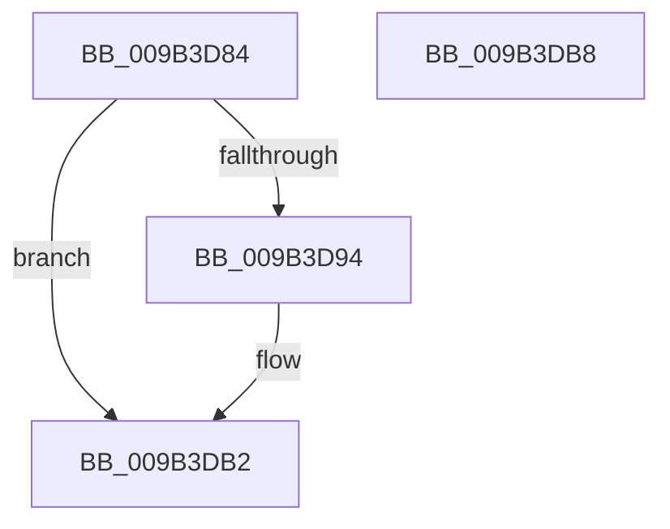

# HvResetDirtyData

- RVA: `0x009B3D84`–`0x009B3DB9` (길이 `53` bytes)
- VA: `0x00000001409B3D84`
- 실행 섹션: `PAGE`
- PDB 이름 있음: `예`; PDB Function 태그: `아니요`
- unwind 정보 RVA: `0x0005CF00`
- 디코드: `16`개 명령, `53/53` bytes 표시
- 미해석 바이트: `0` (있으면 어셈블리에 `.byte`로 보존)

> 이 문서는 커널 이미지의 기계어와 PDB 기호를 분석해 생성했습니다. 4번과 5번은 함수 원형과 자료형을 바이너리 사용 방식에서 추정한 C 해석이며 원본 소스 복구 결과는 아닙니다.

## 1. Dependencies

- 직접 호출 지점: **2**; 고유 호출 대상: **2**
- 직접 호출자로 확인된 함수: **2**
- RIP 상대 이미지 참조: **1**

### Outgoing calls
- `0x009B3D94` → [HvpResetPageProtection](HvpResetPageProtection_function_009B5838.md) (function, `0x009B5838`)
- `0x009B3D9D` → [RtlClearAllBits](../../text/45/RtlClearAllBits_function_00450230.md) (function, `0x00450230`)

### Direct callers
- [CmpDoParseKey](../85/CmpDoParseKey_function_0085F750.md) at `0x00861B8A`
- [HvStoreModifiedData](HvStoreModifiedData_function_009B4FB4.md) at `0x009B5121`

### Static image references
- `0x009B3DA7` → RVA `0x00EF554C` (`.data`; read/write)

## 2. Other-region calls and transfers

- 다른 실행 섹션으로 향하는 call: **1**
  - `0x009B3D9D` → [RtlClearAllBits](../../text/45/RtlClearAllBits_function_00450230.md) (`PAGE` → `.text`)
- 별도 외부 분기/꼬리 이동을 확인하지 못했습니다.

## 3. Assembly (complete function range)

```asm
009B3D84  40 53                           push rbx
009B3D86  48 83 EC 20                     sub rsp, 0x20
009B3D8A  48 83 79 60 00                  cmp qword ptr [rcx + 0x60], 0
009B3D8F  48 8B D9                        mov rbx, rcx
009B3D92  74 1E                           je 0x1409b3db2
009B3D94  E8 9F 1A 00 00                  call 0x1409b5838
009B3D99  48 8D 4B 58                     lea rcx, [rbx + 0x58]
009B3D9D  E8 8E C4 A9 FF                  call 0x140450230
009B3DA2  8B 43 68                        mov eax, dword ptr [rbx + 0x68]
009B3DA5  F7 D8                           neg eax
009B3DA7  F0 01 05 9E 17 54 00            lock add dword ptr [rip + 0x54179e], eax
009B3DAE  83 63 68 00                     and dword ptr [rbx + 0x68], 0
009B3DB2  48 83 C4 20                     add rsp, 0x20
009B3DB6  5B                              pop rbx
009B3DB7  C3                              ret
009B3DB8  CC                              int3
```

## 4. C-style interpretation (structured pseudocode)

```c
__int64 __fastcall HvResetDirtyData(__int64 a1)
{
    __int64 result;
    __int64 v_rsp;

    v_rsp = (v_rsp) - (32);
    if ((*(unsigned __int64 *)(a1 + 96)) != 0) {
        result = HvpResetPageProtection(a1, a2, a3, a4);
        a1 = a1 + 88;
        result = RtlClearAllBits(a1, a2, a3, a4);
        result = *(unsigned int *)(a1 + 104);
        result = (unsigned int)(-(result));
    }
    v_rsp = (v_rsp) + (32);
    return result;
}
```

## 5. (Beta) C Style

```c
int64_t HvResetDirtyData(void *Arg1)
{
    uint8_t *arg1 = (uint8_t *)Arg1;

    int64_t result;
    int64_t local_rsp;

    local_rsp = (local_rsp) - (32);
    if ((*(uint64_t *)(arg1 + 0x60)) != 0) {
        result = HvpResetPageProtection(Arg1, a2, a3, a4);
        Arg1 = Arg1 + 88;
        result = RtlClearAllBits(Arg1, a2, a3, a4);
        result = *(uint32_t *)(arg1 + 0x68);
        result = (uint32_t)(-(result));
    }
    local_rsp = (local_rsp) + (32);
    return result;
}
```

### 관측된 메모리 오프셋

구조체 형식이 확인되지 않은 접근은 인자 기준의 오프셋으로만 기록했습니다.

| 기준 인자 | 오프셋 표현 | 폭 (bit) | 접근 |
|---|---:|---:|---|
| `Arg1` | `+ 0x58` | `64` | `R` |
| `Arg1` | `+ 0x60` | `64` | `R` |
| `Arg1` | `+ 0x68` | `32` | `R` |
| `Arg1` | `+ 0x68` | `32` | `R/W` |

## 6. Execution-region graph

[열기: 2D/3D 그래프와 함수 탐색 컨트롤 패널](../../../control-panel.html?section=page&rva=0x009B3D84&view=graph)

- 2D 그래프는 위에서 아래로 흐르고, 3D 그래프는 빈 공간을 드래그해 회전합니다. Shift+드래그는 이동, 휠은 확대·축소, 함수 노드 선택은 대상 보고서 이동입니다.

### Static fallback


