# HvStoreModifiedData

- RVA: `0x009B4FB4`–`0x009B5423` (길이 `1,135` bytes)
- VA: `0x00000001409B4FB4`
- 실행 섹션: `PAGE`
- PDB 이름 있음: `예`; PDB Function 태그: `예`
- unwind 정보 RVA: `0x0009E5A0`
- 디코드: `286`개 명령, `1,135/1,135` bytes 표시
- 미해석 바이트: `0` (있으면 어셈블리에 `.byte`로 보존)

> 이 문서는 커널 이미지의 기계어와 PDB 기호를 분석해 생성했습니다. 4번과 5번은 함수 원형과 자료형을 바이너리 사용 방식에서 추정한 C 해석이며 원본 소스 복구 결과는 아닙니다.

## 1. Dependencies

- 직접 호출 지점: **17**; 고유 호출 대상: **10**
- 직접 호출자로 확인된 함수: **1**
- RIP 상대 이미지 참조: **0**

### Outgoing calls
- `0x009B5021` → [HvpTruncateBins](HvpTruncateBins_function_009B64F0.md) (function, `0x009B64F0`)
- `0x009B505B` → [ExAllocatePool2](../../poolcode/B8/ExAllocatePool2_function_00B820F0.md) (function, `0x00B820F0`)
- `0x009B5076` → [memcpy](../../text/6C/memcpy_function_006C6840.md) (function, `0x006C6840`)
- `0x009B5097` → [HvpGenerateLogEntry](HvpGenerateLogEntry_function_009B65F0.md) (function, `0x009B65F0`)
- `0x009B5121` → [HvResetDirtyData](HvResetDirtyData_function_009B3D84.md) (function, `0x009B3D84`)
- `0x009B51A0` → [ExAllocatePool2](../../poolcode/B8/ExAllocatePool2_function_00B820F0.md) (function, `0x00B820F0`)
- `0x009B5234` → [ExAllocatePool2](../../poolcode/B8/ExAllocatePool2_function_00B820F0.md) (function, `0x00B820F0`)
- `0x009B524F` → [memcpy](../../text/6C/memcpy_function_006C6840.md) (function, `0x006C6840`)
- `0x009B5270` → [RtlMergeBitMaps](../../text/43/RtlMergeBitMaps_function_0043DF30.md) (function, `0x0043DF30`)
- `0x009B5279` → [HvpCountSetRangesInVector](HvpCountSetRangesInVector_function_009B6974.md) (function, `0x009B6974`)
- `0x009B5296` → [ExAllocatePool2](../../poolcode/B8/ExAllocatePool2_function_00B820F0.md) (function, `0x00B820F0`)
- `0x009B52D7` → [HvpFindNextDirtyBlock](HvpFindNextDirtyBlock_function_009B5540.md) (function, `0x009B5540`)
- `0x009B5317` → [memcpy](../../text/6C/memcpy_function_006C6840.md) (function, `0x006C6840`)
- `0x009B5385` → [RtlClearAllBits](../../text/45/RtlClearAllBits_function_00450230.md) (function, `0x00450230`)
- `0x009B53B1` → [ExFreePoolWithTag](../../poolcode/B8/ExFreePoolWithTag_function_00B82870.md) (function, `0x00B82870`)
- `0x009B53F3` → [ExFreePoolWithTag](../../poolcode/B8/ExFreePoolWithTag_function_00B82870.md) (function, `0x00B82870`)
- `0x009B5419` → [ExFreePoolWithTag](../../poolcode/B8/ExFreePoolWithTag_function_00B82870.md) (function, `0x00B82870`)

### Direct callers
- [CmpFlushHive](CmpFlushHive_function_009B3DC0.md) at `0x009B4222`

### Static image references
- 디코드된 RIP-relative 메모리 참조가 없습니다.

## 2. Other-region calls and transfers

- 다른 실행 섹션으로 향하는 call: **12**
  - `0x009B505B` → [ExAllocatePool2](../../poolcode/B8/ExAllocatePool2_function_00B820F0.md) (`PAGE` → `POOLCODE`)
  - `0x009B5076` → [memcpy](../../text/6C/memcpy_function_006C6840.md) (`PAGE` → `.text`)
  - `0x009B51A0` → [ExAllocatePool2](../../poolcode/B8/ExAllocatePool2_function_00B820F0.md) (`PAGE` → `POOLCODE`)
  - `0x009B5234` → [ExAllocatePool2](../../poolcode/B8/ExAllocatePool2_function_00B820F0.md) (`PAGE` → `POOLCODE`)
  - `0x009B524F` → [memcpy](../../text/6C/memcpy_function_006C6840.md) (`PAGE` → `.text`)
  - `0x009B5270` → [RtlMergeBitMaps](../../text/43/RtlMergeBitMaps_function_0043DF30.md) (`PAGE` → `.text`)
  - `0x009B5296` → [ExAllocatePool2](../../poolcode/B8/ExAllocatePool2_function_00B820F0.md) (`PAGE` → `POOLCODE`)
  - `0x009B5317` → [memcpy](../../text/6C/memcpy_function_006C6840.md) (`PAGE` → `.text`)
  - `0x009B5385` → [RtlClearAllBits](../../text/45/RtlClearAllBits_function_00450230.md) (`PAGE` → `.text`)
  - `0x009B53B1` → [ExFreePoolWithTag](../../poolcode/B8/ExFreePoolWithTag_function_00B82870.md) (`PAGE` → `POOLCODE`)
  - `0x009B53F3` → [ExFreePoolWithTag](../../poolcode/B8/ExFreePoolWithTag_function_00B82870.md) (`PAGE` → `POOLCODE`)
  - `0x009B5419` → [ExFreePoolWithTag](../../poolcode/B8/ExFreePoolWithTag_function_00B82870.md) (`PAGE` → `POOLCODE`)
- call이 아닌 외부 분기/꼬리 이동: **4**
  - `0x009B53DC` → [sub_00B2DCF4 + 0x1D](../B2/Unknown_function_00B2DCF4.md) (`tail-transfer`)
  - `0x009B53E9` → [sub_00B2DCF4](../B2/Unknown_function_00B2DCF4.md) (`tail-transfer`)
  - `0x009B5402` → [sub_00B2DCF4 + 0x46](../B2/Unknown_function_00B2DCF4.md) (`tail-transfer`)
  - `0x009B540F` → [sub_00B2DCF4 + 0x2D](../B2/Unknown_function_00B2DCF4.md) (`tail-transfer`)

## 3. Assembly (complete function range)

```asm
009B4FB4  44 88 44 24 18                  mov byte ptr [rsp + 0x18], r8b
009B4FB9  88 54 24 10                     mov byte ptr [rsp + 0x10], dl
009B4FBD  55                              push rbp
009B4FBE  53                              push rbx
009B4FBF  56                              push rsi
009B4FC0  57                              push rdi
009B4FC1  41 54                           push r12
009B4FC3  41 55                           push r13
009B4FC5  41 56                           push r14
009B4FC7  41 57                           push r15
009B4FC9  48 8D 6C 24 E1                  lea rbp, [rsp - 0x1f]
009B4FCE  48 81 EC 98 00 00 00            sub rsp, 0x98
009B4FD5  33 C0                           xor eax, eax
009B4FD7  0F 57 C0                        xorps xmm0, xmm0
009B4FDA  F7 81 A0 00 00 00 00 80 00 00   test dword ptr [rcx + 0xa0], 0x8000
009B4FE4  0F 57 C9                        xorps xmm1, xmm1
009B4FE7  48 8B D9                        mov rbx, rcx
009B4FEA  48 89 45 FF                     mov qword ptr [rbp - 1], rax
009B4FEE  89 45 CF                        mov dword ptr [rbp - 0x31], eax
009B4FF1  44 8B E0                        mov r12d, eax
009B4FF4  89 45 C7                        mov dword ptr [rbp - 0x39], eax
009B4FF7  44 8B F0                        mov r14d, eax
009B4FFA  48 89 45 DF                     mov qword ptr [rbp - 0x21], rax
009B4FFE  44 8B E8                        mov r13d, eax
009B5001  89 45 7F                        mov dword ptr [rbp + 0x7f], eax
009B5004  44 8B F8                        mov r15d, eax
009B5007  89 45 D7                        mov dword ptr [rbp - 0x29], eax
009B500A  8B F0                           mov esi, eax
009B500C  89 45 67                        mov dword ptr [rbp + 0x67], eax
009B500F  48 89 45 E7                     mov qword ptr [rbp - 0x19], rax
009B5013  0F 11 45 07                     movups xmmword ptr [rbp + 7], xmm0
009B5017  0F 11 4D EF                     movups xmmword ptr [rbp - 0x11], xmm1
009B501B  0F 85 9A 03 00 00               jne 0x1409b53bb
009B5021  E8 CA 14 00 00                  call 0x1409b64f0
009B5026  0F B6 C0                        movzx eax, al
009B5029  89 83 C0 06 00 00               mov dword ptr [rbx + 0x6c0], eax
009B502F  8B 83 A0 00 00 00               mov eax, dword ptr [rbx + 0xa0]
009B5035  A8 01                           test al, 1
009B5037  0F 85 7E 03 00 00               jne 0x1409b53bb
009B503D  8B 43 6C                        mov eax, dword ptr [rbx + 0x6c]
009B5040  8B F8                           mov edi, eax
009B5042  89 45 CB                        mov dword ptr [rbp - 0x35], eax
009B5045  39 73 68                        cmp dword ptr [rbx + 0x68], esi
009B5048  0F 84 37 01 00 00               je 0x1409b5185
009B504E  41 B8 43 4D 35 30               mov r8d, 0x30354d43
009B5054  8B D0                           mov edx, eax
009B5056  B9 00 01 00 00                  mov ecx, 0x100
009B505B  E8 90 D0 1C 00                  call 0x140b820f0
009B5060  4C 8B E0                        mov r12, rax
009B5063  48 85 C0                        test rax, rax
009B5066  0F 84 63 03 00 00               je 0x1409b53cf
009B506C  48 8B 53 60                     mov rdx, qword ptr [rbx + 0x60]
009B5070  44 8B C7                        mov r8d, edi
009B5073  48 8B C8                        mov rcx, rax
009B5076  E8 C5 17 D1 FF                  call 0x1406c6840
009B507B  8B 43 58                        mov eax, dword ptr [rbx + 0x58]
009B507E  4C 8D 4D D7                     lea r9, [rbp - 0x29]
009B5082  4C 8D 45 7F                     lea r8, [rbp + 0x7f]
009B5086  89 45 D3                        mov dword ptr [rbp - 0x2d], eax
009B5089  48 8D 55 DF                     lea rdx, [rbp - 0x21]
009B508D  89 45 07                        mov dword ptr [rbp + 7], eax
009B5090  48 8B CB                        mov rcx, rbx
009B5093  4C 89 65 0F                     mov qword ptr [rbp + 0xf], r12
009B5097  E8 54 15 00 00                  call 0x1409b65f0
009B509C  4C 8B 75 DF                     mov r14, qword ptr [rbp - 0x21]
009B50A0  44 8B 6D 7F                     mov r13d, dword ptr [rbp + 0x7f]
009B50A4  85 C0                           test eax, eax
009B50A6  0F 88 FB 02 00 00               js 0x1409b53a7
009B50AC  40 38 75 6F                     cmp byte ptr [rbp + 0x6f], sil
009B50B0  0F 85 DA 00 00 00               jne 0x1409b5190
009B50B6  40 38 75 77                     cmp byte ptr [rbp + 0x77], sil
009B50BA  0F 85 D0 00 00 00               jne 0x1409b5190
009B50C0  8B 7D EF                        mov edi, dword ptr [rbp - 0x11]
009B50C3  8B 83 18 01 00 00               mov eax, dword ptr [rbx + 0x118]
009B50C9  39 83 00 07 00 00               cmp dword ptr [rbx + 0x700], eax
009B50CF  0F 82 C7 02 00 00               jb 0x1409b539c
009B50D5  83 BB C0 06 00 00 00            cmp dword ptr [rbx + 0x6c0], 0
009B50DC  0F 85 BA 02 00 00               jne 0x1409b539c
009B50E2  83 7B 68 00                     cmp dword ptr [rbx + 0x68], 0
009B50E6  74 3E                           je 0x1409b5126
009B50E8  8B 45 D3                        mov eax, dword ptr [rbp - 0x2d]
009B50EB  48 8B CB                        mov rcx, rbx
009B50EE  89 83 98 06 00 00               mov dword ptr [rbx + 0x698], eax
009B50F4  8B 45 CB                        mov eax, dword ptr [rbp - 0x35]
009B50F7  4C 89 A3 A0 06 00 00            mov qword ptr [rbx + 0x6a0], r12
009B50FE  45 33 E4                        xor r12d, r12d
009B5101  89 83 A8 06 00 00               mov dword ptr [rbx + 0x6a8], eax
009B5107  8B 45 D7                        mov eax, dword ptr [rbp - 0x29]
009B510A  4C 89 B3 B0 06 00 00            mov qword ptr [rbx + 0x6b0], r14
009B5111  45 33 F6                        xor r14d, r14d
009B5114  89 83 BC 06 00 00               mov dword ptr [rbx + 0x6bc], eax
009B511A  44 89 AB B8 06 00 00            mov dword ptr [rbx + 0x6b8], r13d
009B5121  E8 5E EC FF FF                  call 0x1409b3d84
009B5126  80 7D 6F 00                     cmp byte ptr [rbp + 0x6f], 0
009B512A  8A 4D 77                        mov cl, byte ptr [rbp + 0x77]
009B512D  0F 85 F1 01 00 00               jne 0x1409b5324
009B5133  84 C9                           test cl, cl
009B5135  0F 85 E9 01 00 00               jne 0x1409b5324
009B513B  33 DB                           xor ebx, ebx
009B513D  4D 85 E4                        test r12, r12
009B5140  0F 85 66 02 00 00               jne 0x1409b53ac
009B5146  4D 85 F6                        test r14, r14
009B5149  0F 85 8A 02 00 00               jne 0x1409b53d9
009B514F  4D 85 FF                        test r15, r15
009B5152  0F 85 96 02 00 00               jne 0x1409b53ee
009B5158  48 85 F6                        test rsi, rsi
009B515B  0F 85 9C 02 00 00               jne 0x1409b53fd
009B5161  48 8B 45 E7                     mov rax, qword ptr [rbp - 0x19]
009B5165  48 85 C0                        test rax, rax
009B5168  0F 85 A6 02 00 00               jne 0x1409b5414
009B516E  8B C3                           mov eax, ebx
009B5170  48 81 C4 98 00 00 00            add rsp, 0x98
009B5177  41 5F                           pop r15
009B5179  41 5E                           pop r14
009B517B  41 5D                           pop r13
009B517D  41 5C                           pop r12
009B517F  5F                              pop rdi
009B5180  5E                              pop rsi
009B5181  5B                              pop rbx
009B5182  5D                              pop rbp
009B5183  C3                              ret
009B5184  CC                              int3
009B5185  8B 45 07                        mov eax, dword ptr [rbp + 7]
009B5188  89 45 D3                        mov dword ptr [rbp - 0x2d], eax
009B518B  E9 1C FF FF FF                  jmp 0x1409b50ac
009B5190  BA 00 10 00 00                  mov edx, 0x1000
009B5195  B9 00 01 00 00                  mov ecx, 0x100
009B519A  41 B8 43 4D 35 30               mov r8d, 0x30354d43
009B51A0  E8 4B CF 1C 00                  call 0x140b820f0
009B51A5  48 89 45 E7                     mov qword ptr [rbp - 0x19], rax
009B51A9  48 8B D0                        mov rdx, rax
009B51AC  48 85 C0                        test rax, rax
009B51AF  0F 84 10 02 00 00               je 0x1409b53c5
009B51B5  48 8B 4B 40                     mov rcx, qword ptr [rbx + 0x40]
009B51B9  8B 83 18 01 00 00               mov eax, dword ptr [rbx + 0x118]
009B51BF  89 41 28                        mov dword ptr [rcx + 0x28], eax
009B51C2  48 8B CA                        mov rcx, rdx
009B51C5  48 8B 43 40                     mov rax, qword ptr [rbx + 0x40]
009B51C9  BA 04 00 00 00                  mov edx, 4
009B51CE  44 8D 42 7C                     lea r8d, [rdx + 0x7c]
009B51D2  0F 10 00                        movups xmm0, xmmword ptr [rax]
009B51D5  0F 11 01                        movups xmmword ptr [rcx], xmm0
009B51D8  0F 10 48 10                     movups xmm1, xmmword ptr [rax + 0x10]
009B51DC  0F 11 49 10                     movups xmmword ptr [rcx + 0x10], xmm1
009B51E0  0F 10 40 20                     movups xmm0, xmmword ptr [rax + 0x20]
009B51E4  0F 11 41 20                     movups xmmword ptr [rcx + 0x20], xmm0
009B51E8  0F 10 48 30                     movups xmm1, xmmword ptr [rax + 0x30]
009B51EC  0F 11 49 30                     movups xmmword ptr [rcx + 0x30], xmm1
009B51F0  0F 10 40 40                     movups xmm0, xmmword ptr [rax + 0x40]
009B51F4  0F 11 41 40                     movups xmmword ptr [rcx + 0x40], xmm0
009B51F8  0F 10 48 50                     movups xmm1, xmmword ptr [rax + 0x50]
009B51FC  0F 11 49 50                     movups xmmword ptr [rcx + 0x50], xmm1
009B5200  0F 10 40 60                     movups xmm0, xmmword ptr [rax + 0x60]
009B5204  0F 11 41 60                     movups xmmword ptr [rcx + 0x60], xmm0
009B5208  49 03 C8                        add rcx, r8
009B520B  0F 10 48 70                     movups xmm1, xmmword ptr [rax + 0x70]
009B520F  49 03 C0                        add rax, r8
009B5212  0F 11 49 F0                     movups xmmword ptr [rcx - 0x10], xmm1
009B5216  48 83 EA 01                     sub rdx, 1
009B521A  75 B6                           jne 0x1409b51d2
009B521C  40 38 75 77                     cmp byte ptr [rbp + 0x77], sil
009B5220  0F 84 9A FE FF FF               je 0x1409b50c0
009B5226  41 B8 43 4D 35 30               mov r8d, 0x30354d43
009B522C  48 8B D7                        mov rdx, rdi
009B522F  B9 00 01 00 00                  mov ecx, 0x100
009B5234  E8 B7 CE 1C 00                  call 0x140b820f0
009B5239  4C 8B F8                        mov r15, rax
009B523C  48 85 C0                        test rax, rax
009B523F  0F 84 80 01 00 00               je 0x1409b53c5
009B5245  48 8B 53 78                     mov rdx, qword ptr [rbx + 0x78]
009B5249  4C 8B C7                        mov r8, rdi
009B524C  48 8B C8                        mov rcx, rax
009B524F  E8 EC 15 D1 FF                  call 0x1406c6840
009B5254  8B 43 70                        mov eax, dword ptr [rbx + 0x70]
009B5257  89 45 DF                        mov dword ptr [rbp - 0x21], eax
009B525A  89 45 EF                        mov dword ptr [rbp - 0x11], eax
009B525D  33 C0                           xor eax, eax
009B525F  4C 89 7D F7                     mov qword ptr [rbp - 9], r15
009B5263  39 43 68                        cmp dword ptr [rbx + 0x68], eax
009B5266  74 0D                           je 0x1409b5275
009B5268  48 8D 55 07                     lea rdx, [rbp + 7]
009B526C  48 8D 4D EF                     lea rcx, [rbp - 0x11]
009B5270  E8 BB 8C A8 FF                  call 0x14043df30
009B5275  48 8D 4D EF                     lea rcx, [rbp - 0x11]
009B5279  E8 F6 16 00 00                  call 0x1409b6974
009B527E  8B D0                           mov edx, eax
009B5280  B9 00 01 00 00                  mov ecx, 0x100
009B5285  41 B8 43 4D 35 32               mov r8d, 0x32354d43
009B528B  89 45 67                        mov dword ptr [rbp + 0x67], eax
009B528E  48 8D 14 52                     lea rdx, [rdx + rdx*2]
009B5292  48 C1 E2 03                     shl rdx, 3
009B5296  E8 55 CE 1C 00                  call 0x140b820f0
009B529B  48 8B F0                        mov rsi, rax
009B529E  48 85 C0                        test rax, rax
009B52A1  0F 84 1E 01 00 00               je 0x1409b53c5
009B52A7  33 FF                           xor edi, edi
009B52A9  21 7D 7F                        and dword ptr [rbp + 0x7f], edi
009B52AC  3B 7D 67                        cmp edi, dword ptr [rbp + 0x67]
009B52AF  73 5B                           jae 0x1409b530c
009B52B1  48 8D 45 C7                     lea rax, [rbp - 0x39]
009B52B5  C6 44 24 30 01                  mov byte ptr [rsp + 0x30], 1
009B52BA  48 89 44 24 28                  mov qword ptr [rsp + 0x28], rax
009B52BF  4C 8D 4D FF                     lea r9, [rbp - 1]
009B52C3  48 8D 45 CF                     lea rax, [rbp - 0x31]
009B52C7  48 8B CB                        mov rcx, rbx
009B52CA  4C 8D 45 7F                     lea r8, [rbp + 0x7f]
009B52CE  48 89 44 24 20                  mov qword ptr [rsp + 0x20], rax
009B52D3  48 8D 55 EF                     lea rdx, [rbp - 0x11]
009B52D7  E8 64 02 00 00                  call 0x1409b5540
009B52DC  84 C0                           test al, al
009B52DE  74 2C                           je 0x1409b530c
009B52E0  4C 8B 45 FF                     mov r8, qword ptr [rbp - 1]
009B52E4  4D 85 C0                        test r8, r8
009B52E7  0F 84 D8 00 00 00               je 0x1409b53c5
009B52ED  8B 4D C7                        mov ecx, dword ptr [rbp - 0x39]
009B52F0  48 8D 14 7F                     lea rdx, [rdi + rdi*2]
009B52F4  8B 45 CF                        mov eax, dword ptr [rbp - 0x31]
009B52F7  89 0C D6                        mov dword ptr [rsi + rdx*8], ecx
009B52FA  03 C8                           add ecx, eax
009B52FC  89 4D C7                        mov dword ptr [rbp - 0x39], ecx
009B52FF  FF C7                           inc edi
009B5301  89 44 D6 10                     mov dword ptr [rsi + rdx*8 + 0x10], eax
009B5305  4C 89 44 D6 08                  mov qword ptr [rsi + rdx*8 + 8], r8
009B530A  EB A0                           jmp 0x1409b52ac
009B530C  44 8B 45 CB                     mov r8d, dword ptr [rbp - 0x35]
009B5310  49 8B CF                        mov rcx, r15
009B5313  48 8B 53 78                     mov rdx, qword ptr [rbx + 0x78]
009B5317  E8 24 15 D1 FF                  call 0x1406c6840
009B531C  8B 7D DF                        mov edi, dword ptr [rbp - 0x21]
009B531F  E9 9F FD FF FF                  jmp 0x1409b50c3
009B5324  48 8B 45 E7                     mov rax, qword ptr [rbp - 0x19]
009B5328  48 83 65 E7 00                  and qword ptr [rbp - 0x19], 0
009B532D  80 BB C3 00 00 00 00            cmp byte ptr [rbx + 0xc3], 0
009B5334  48 89 83 F0 06 00 00            mov qword ptr [rbx + 0x6f0], rax
009B533B  74 07                           je 0x1409b5344
009B533D  C6 83 C4 06 00 00 01            mov byte ptr [rbx + 0x6c4], 1
009B5344  84 C9                           test cl, cl
009B5346  0F 84 EF FD FF FF               je 0x1409b513b
009B534C  8B 45 CB                        mov eax, dword ptr [rbp - 0x35]
009B534F  4C 89 BB D0 06 00 00            mov qword ptr [rbx + 0x6d0], r15
009B5356  45 33 FF                        xor r15d, r15d
009B5359  89 BB C8 06 00 00               mov dword ptr [rbx + 0x6c8], edi
009B535F  48 89 B3 E0 06 00 00            mov qword ptr [rbx + 0x6e0], rsi
009B5366  33 F6                           xor esi, esi
009B5368  89 83 D8 06 00 00               mov dword ptr [rbx + 0x6d8], eax
009B536E  8B 45 67                        mov eax, dword ptr [rbp + 0x67]
009B5371  89 83 E8 06 00 00               mov dword ptr [rbx + 0x6e8], eax
009B5377  48 39 73 78                     cmp qword ptr [rbx + 0x78], rsi
009B537B  0F 84 BA FD FF FF               je 0x1409b513b
009B5381  48 8D 4B 70                     lea rcx, [rbx + 0x70]
009B5385  E8 A6 AE A9 FF                  call 0x140450230
009B538A  21 B3 80 00 00 00               and dword ptr [rbx + 0x80], esi
009B5390  40 88 B3 C3 00 00 00            mov byte ptr [rbx + 0xc3], sil
009B5397  E9 9F FD FF FF                  jmp 0x1409b513b
009B539C  89 83 00 07 00 00               mov dword ptr [rbx + 0x700], eax
009B53A2  E9 3B FD FF FF                  jmp 0x1409b50e2
009B53A7  BB 02 00 00 00                  mov ebx, 2
009B53AC  33 D2                           xor edx, edx
009B53AE  49 8B CC                        mov rcx, r12
009B53B1  E8 BA D4 1C 00                  call 0x140b82870
009B53B6  E9 8B FD FF FF                  jmp 0x1409b5146
009B53BB  BB 01 00 00 00                  mov ebx, 1
009B53C0  E9 A9 FD FF FF                  jmp 0x1409b516e
009B53C5  BB 02 00 00 00                  mov ebx, 2
009B53CA  E9 6E FD FF FF                  jmp 0x1409b513d
009B53CF  BB 02 00 00 00                  mov ebx, 2
009B53D4  E9 95 FD FF FF                  jmp 0x1409b516e
009B53D9  45 85 ED                        test r13d, r13d
009B53DC  0F 84 2F 89 17 00               je 0x140b2dd11
009B53E2  49 8D 7E 08                     lea rdi, [r14 + 8]
009B53E6  45 8B E5                        mov r12d, r13d
009B53E9  E9 06 89 17 00                  jmp 0x140b2dcf4
009B53EE  33 D2                           xor edx, edx
009B53F0  49 8B CF                        mov rcx, r15
009B53F3  E8 78 D4 1C 00                  call 0x140b82870
009B53F8  E9 5B FD FF FF                  jmp 0x1409b5158
009B53FD  8B 45 67                        mov eax, dword ptr [rbp + 0x67]
009B5400  85 C0                           test eax, eax
009B5402  0F 84 32 89 17 00               je 0x140b2dd3a
009B5408  48 8D 7E 08                     lea rdi, [rsi + 8]
009B540C  44 8B F0                        mov r14d, eax
009B540F  E9 0D 89 17 00                  jmp 0x140b2dd21
009B5414  33 D2                           xor edx, edx
009B5416  48 8B C8                        mov rcx, rax
009B5419  E8 52 D4 1C 00                  call 0x140b82870
009B541E  E9 4B FD FF FF                  jmp 0x1409b516e
```

## 4. C-style interpretation (structured pseudocode)

```c
__int64 __fastcall HvStoreModifiedData(__int64 a1, unsigned __int8 a2, unsigned __int8 a3)
{
    __int64 result;
    __int64 v_r12;
    __int64 v_r14;
    __int64 v_r15;
    __int64 v_rbx;
    __int64 v_rdi;
    __int64 v_rsi;
    __int64 v_rsp;
    unsigned __int64 v_stack_m50;
    unsigned __int64 v_stack_m58;
    unsigned __int64 v_stack_m5F;
    unsigned __int64 v_stack_m60;
    unsigned __int64 v_stack_m68;
    unsigned __int64 v_stack_m70;
    unsigned __int64 v_stack_m78;
    unsigned __int64 v_stack_m80;
    unsigned int v_stack_m88;
    unsigned int v_stack_m8C;
    unsigned int v_stack_m90;
    unsigned int v_stack_m94;
    unsigned int v_stack_m98;
    unsigned __int8 v_stack_p10;
    unsigned __int8 v_stack_p18;
    unsigned int v_stack_p20;
    unsigned __int64 v_stack_p28;
    unsigned __int8 v_stack_p30;
    unsigned int v_stack_p8;

    v_stack_p18 = a3;
    v_stack_p10 = a2;
    v_rsp = (v_rsp) - (152);
    result = 0;
    v_stack_m60 = 0;
    v_stack_m90 = 0;
    v_stack_m98 = 0;
    v_stack_m80 = 0;
    v_stack_p20 = 0;
    v_stack_m88 = 0;
    v_stack_p8 = 0;
    v_stack_m78 = 0;
    v_stack_m58 = v_xmm0;
    v_stack_m70 = v_xmm1;
    if (((*(unsigned int *)(a1 + 160)) & (0x8000ULL)) != 0) goto loc_009B53BB;
    result = HvpTruncateBins(a1, a2, a3, a4);
    *(unsigned int *)(a1 + 1728) = (unsigned int)((unsigned __int8)(result));
    if ((((unsigned __int8)((unsigned int)(*(unsigned int *)(a1 + 160)))) & (1)) != 0) goto loc_009B53BB;
    v_stack_m94 = (unsigned int)((unsigned int)(*(unsigned int *)(a1 + 108)));
    if ((*(unsigned int *)(a1 + 104)) == 0) goto loc_009B5185;
    result = ExAllocatePool2(256, (unsigned int)((unsigned int)((unsigned int)(*(unsigned int *)(a1 + 108)))), (unsigned int)(0x30354D43ULL), a4);
    if (result == 0) goto loc_009B53CF;
    result = memcpy(result, *(unsigned __int64 *)(a1 + 96), (unsigned int)((unsigned int)((unsigned int)((unsigned int)((unsigned int)(*(unsigned int *)(a1 + 108)))))), a4);
    v_stack_m8C = (unsigned int)((unsigned int)(*(unsigned int *)(a1 + 88)));
    v_stack_m58 = (unsigned int)((unsigned int)(*(unsigned int *)(a1 + 88)));
    v_stack_m50 = result;
    result = HvpGenerateLogEntry(a1, v_stack_m80, v_stack_p20, v_stack_m88);
    if (sign_flag) goto loc_009B53A7;
loc_009B50AC:
    if (v_stack_p10 != 0) goto loc_009B5190;
    if (v_stack_p18 != 0) goto loc_009B5190;
loc_009B50C0:
loc_009B50C3:
    if ((*(unsigned int *)(a1 + 1792)) < ((unsigned int)((unsigned int)(*(unsigned int *)(a1 + 280))))) goto loc_009B539C;
    if ((*(unsigned int *)(a1 + 1728)) != 0) goto loc_009B539C;
loc_009B50E2:
    result = (unsigned int)(*(unsigned int *)(a1 + 280));
    v_r12 = result;
    v_r14 = v_stack_m80;
    if ((*(unsigned int *)(a1 + 104)) != 0) {
        result = v_stack_m8C;
        a1 = a1;
        *(unsigned int *)(a1 + 1688) = (unsigned int)(result);
        result = v_stack_m94;
        *(unsigned __int64 *)(a1 + 1696) = result;
        v_r12 = 0;
        *(unsigned int *)(a1 + 1704) = (unsigned int)(result);
        result = v_stack_m88;
        *(unsigned __int64 *)(a1 + 1712) = v_stack_m80;
        v_r14 = 0;
        *(unsigned int *)(a1 + 1724) = (unsigned int)(result);
        *(unsigned int *)(a1 + 1720) = (unsigned int)((unsigned int)(v_stack_p20));
        result = HvResetDirtyData(a1, v_stack_m80, v_stack_p20, v_stack_m88);
    }
    if (v_stack_p10 != 0) goto loc_009B5324;
    if ((unsigned __int8)(v_stack_p18) != 0) goto loc_009B5324;
loc_009B513B:
    v_rbx = 0;
loc_009B513D:
    if (0 != 0) goto loc_009B53AC;
loc_009B5146:
    if (0 != 0) goto loc_009B53D9;
    if (0 != 0) goto loc_009B53EE;
loc_009B5158:
    if (0 != 0) goto loc_009B53FD;
    if (v_stack_m78 != 0) goto loc_009B5414;
loc_009B516E:
    v_rsp = (v_rsp) + (152);
    return 0;
loc_009B5185:
    v_stack_m8C = (unsigned int)((unsigned int)(v_stack_m58));
    goto loc_009B50AC;
loc_009B5190:
    result = ExAllocatePool2(256, (unsigned int)(0x1000ULL), (unsigned int)(0x30354D43ULL), v_stack_m88);
    v_stack_m78 = result;
    if (result == 0) goto loc_009B53C5;
    *(unsigned int *)(*(unsigned __int64 *)(v_rbx + 64) + 40) = (unsigned int)((unsigned int)(*(unsigned int *)(v_rbx + 280)));
loc_009B51D2:
    *(unsigned __int64 *)(result) = v_xmm0;
    *(unsigned __int64 *)(result + 16) = v_xmm1;
    *(unsigned __int64 *)(result + 32) = v_xmm0;
    *(unsigned __int64 *)(result + 48) = v_xmm1;
    *(unsigned __int64 *)(result + 64) = v_xmm0;
    *(unsigned __int64 *)(result + 80) = v_xmm1;
    *(unsigned __int64 *)(result + 96) = v_xmm0;
    a1 = (result) + (4 + 124);
    result = (*(unsigned __int64 *)(v_rbx + 64)) + (4 + 124);
    *(unsigned __int64 *)(a1 - 16) = v_xmm1;
    a2 = (4) - (1);
    if (condition_is_not_equal) goto loc_009B51D2;
    if (v_stack_p18 == 0) goto loc_009B50C0;
    result = ExAllocatePool2(256, (unsigned int)(v_stack_m70), (unsigned int)(0x30354D43ULL), v_stack_m88);
    if (result == 0) goto loc_009B53C5;
    result = memcpy(result, *(unsigned __int64 *)(v_rbx + 120), (unsigned int)(v_stack_m70), v_stack_m88);
    v_stack_m80 = (unsigned int)((unsigned int)(*(unsigned int *)(v_rbx + 112)));
    v_stack_m70 = (unsigned int)((unsigned int)(*(unsigned int *)(v_rbx + 112)));
    result = 0;
    v_stack_m68 = 0;
    if ((*(unsigned int *)(v_rbx + 104)) != 0) {
        a2 = v_stack_m58;
        a1 = v_stack_m70;
        result = RtlMergeBitMaps(a1, a2, (unsigned int)(v_stack_m70), v_stack_m88);
    }
    result = HvpCountSetRangesInVector(v_stack_m70, a2, (unsigned int)(v_stack_m70), v_stack_m88);
    v_stack_p8 = (unsigned int)(result);
    a2 = ((unsigned int)((unsigned int)(result)) + (unsigned int)((unsigned int)(result)) * 2) << (3);
    result = ExAllocatePool2(256, a2, (unsigned int)(0x32354D43ULL), v_stack_m88);
    if (result == 0) goto loc_009B53C5;
    v_rdi = 0;
loc_009B52AC:
    if (0 >= v_stack_p8) goto loc_009B530C;
    v_stack_p30 = 1;
    v_stack_p28 = v_stack_m98;
    v_stack_p20 = v_stack_m90;
    result = HvpFindNextDirtyBlock(0, v_stack_m70, v_stack_p20, v_stack_m60);
    if ((unsigned __int8)(result) == 0) goto loc_009B530C;
    if (v_stack_m60 == 0) goto loc_009B53C5;
    *(unsigned int *)(result + v_rdi + v_rdi * 2 * 8) = (unsigned int)((unsigned int)(v_stack_m98));
    a1 = (unsigned int)(((unsigned int)(v_stack_m98)) + ((unsigned int)((unsigned int)(v_stack_m90))));
    v_stack_m98 = (unsigned int)(a1);
    v_rdi = (unsigned int)((v_rdi) + 1);
    *(unsigned int *)(result + v_rdi + v_rdi * 2 * 8 + 16) = (unsigned int)((unsigned int)(v_stack_m90));
    *(unsigned __int64 *)(result + v_rdi + v_rdi * 2 * 8 + 8) = v_stack_m60;
    goto loc_009B52AC;
loc_009B530C:
    result = memcpy(result, *(unsigned __int64 *)(v_rbx + 120), (unsigned int)(v_stack_m94), v_stack_m60);
    goto loc_009B50C3;
loc_009B5324:
    *(unsigned __int64 *)(v_rbx + 1776) = v_stack_m78;
    if ((*(unsigned __int8 *)(v_rbx + 195)) != 0) {
        *(unsigned __int8 *)(v_rbx + 1732) = 1;
    }
    if ((unsigned __int8)(result) == 0) goto loc_009B513B;
    *(unsigned __int64 *)(v_rbx + 1744) = result;
    v_r15 = 0;
    *(unsigned int *)(v_rbx + 1736) = (unsigned int)((unsigned int)(v_stack_m80));
    *(unsigned __int64 *)(v_rbx + 1760) = result;
    v_rsi = 0;
    *(unsigned int *)(v_rbx + 1752) = (unsigned int)((unsigned int)(v_stack_m94));
    *(unsigned int *)(v_rbx + 1768) = (unsigned int)((unsigned int)(v_stack_p8));
    if ((*(unsigned __int64 *)(v_rbx + 120)) == 0) goto loc_009B513B;
    result = RtlClearAllBits(v_rbx + 112, *(unsigned __int64 *)(v_rbx + 120), (unsigned int)(v_stack_m94), v_stack_m60);
    *(unsigned __int8 *)(v_rbx + 195) = 0;
    goto loc_009B513B;
loc_009B539C:
    *(unsigned int *)(v_rbx + 1792) = (unsigned int)(result);
    goto loc_009B50E2;
loc_009B53A7:
loc_009B53AC:
    a2 = 0;
    result = ExFreePoolWithTag(0, a2, (unsigned int)(v_stack_m94), v_stack_m60);
    goto loc_009B5146;
loc_009B53BB:
    goto loc_009B516E;
loc_009B53C5:
    goto loc_009B513D;
loc_009B53CF:
    goto loc_009B516E;
loc_009B53D9:
loc_009B53EE:
    a2 = 0;
    result = ExFreePoolWithTag(0, a2, (unsigned int)(v_stack_m94), v_stack_m60);
    goto loc_009B5158;
loc_009B53FD:
loc_009B5414:
    a2 = 0;
    result = ExFreePoolWithTag((unsigned int)(v_stack_p8), a2, (unsigned int)(v_stack_m94), v_stack_m60);
    goto loc_009B516E;
}
```

## 5. (Beta) C Style

```c
int64_t HvStoreModifiedData(void *Arg1, uint8_t Arg2, uint8_t Arg3)
{
    uint8_t *arg1 = (uint8_t *)Arg1;

    int64_t result;
    int64_t local_r12;
    int64_t local_r14;
    int64_t local_r15;
    int64_t local_rbx;
    int64_t local_rdi;
    int64_t local_rsi;
    int64_t local_rsp;
    uint64_t v_stack_m50;
    uint64_t v_stack_m58;
    uint64_t v_stack_m5F;
    uint64_t v_stack_m60;
    uint64_t v_stack_m68;
    uint64_t v_stack_m70;
    uint64_t v_stack_m78;
    uint64_t v_stack_m80;
    uint32_t v_stack_m88;
    uint32_t v_stack_m8C;
    uint32_t v_stack_m90;
    uint32_t v_stack_m94;
    uint32_t v_stack_m98;
    uint8_t v_stack_p10;
    uint8_t v_stack_p18;
    uint32_t v_stack_p20;
    uint64_t v_stack_p28;
    uint8_t v_stack_p30;
    uint32_t v_stack_p8;

    v_stack_p18 = Arg3;
    v_stack_p10 = Arg2;
    local_rsp = (local_rsp) - (152);
    result = 0;
    v_stack_m60 = 0;
    v_stack_m90 = 0;
    v_stack_m98 = 0;
    v_stack_m80 = 0;
    v_stack_p20 = 0;
    v_stack_m88 = 0;
    v_stack_p8 = 0;
    v_stack_m78 = 0;
    v_stack_m58 = v_xmm0;
    v_stack_m70 = v_xmm1;
    if (((*(uint32_t *)(arg1 + 0xA0)) & (0x8000ULL)) != 0) goto loc_009B53BB;
    result = HvpTruncateBins(Arg1, Arg2, Arg3, a4);
    *(uint32_t *)(arg1 + 0x6C0) = (uint32_t)((uint8_t)(result));
    if ((((uint8_t)((uint32_t)(*(uint32_t *)(arg1 + 0xA0)))) & (1)) != 0) goto loc_009B53BB;
    v_stack_m94 = (uint32_t)((uint32_t)(*(uint32_t *)(arg1 + 0x6C)));
    if ((*(uint32_t *)(arg1 + 0x68)) == 0) goto loc_009B5185;
    result = ExAllocatePool2(256, (uint32_t)((uint32_t)((uint32_t)(*(uint32_t *)(arg1 + 0x6C)))), (uint32_t)(0x30354D43ULL), a4);
    if (result == 0) goto loc_009B53CF;
    result = memcpy(result, *(uint64_t *)(arg1 + 0x60), (uint32_t)((uint32_t)((uint32_t)((uint32_t)((uint32_t)(*(uint32_t *)(arg1 + 0x6C)))))), a4);
    v_stack_m8C = (uint32_t)((uint32_t)(*(uint32_t *)(arg1 + 0x58)));
    v_stack_m58 = (uint32_t)((uint32_t)(*(uint32_t *)(arg1 + 0x58)));
    v_stack_m50 = result;
    result = HvpGenerateLogEntry(Arg1, v_stack_m80, v_stack_p20, v_stack_m88);
    if (sign_flag) goto loc_009B53A7;
loc_009B50AC:
    if (v_stack_p10 != 0) goto loc_009B5190;
    if (v_stack_p18 != 0) goto loc_009B5190;
loc_009B50C0:
loc_009B50C3:
    if ((*(uint32_t *)(arg1 + 0x700)) < ((uint32_t)((uint32_t)(*(uint32_t *)(arg1 + 0x118))))) goto loc_009B539C;
    if ((*(uint32_t *)(arg1 + 0x6C0)) != 0) goto loc_009B539C;
loc_009B50E2:
    result = (uint32_t)(*(uint32_t *)(arg1 + 0x118));
    local_r12 = result;
    local_r14 = v_stack_m80;
    if ((*(uint32_t *)(arg1 + 0x68)) != 0) {
        result = v_stack_m8C;
        Arg1 = Arg1;
        *(uint32_t *)(arg1 + 0x698) = (uint32_t)(result);
        result = v_stack_m94;
        *(uint64_t *)(arg1 + 0x6A0) = result;
        local_r12 = 0;
        *(uint32_t *)(arg1 + 0x6A8) = (uint32_t)(result);
        result = v_stack_m88;
        *(uint64_t *)(arg1 + 0x6B0) = v_stack_m80;
        local_r14 = 0;
        *(uint32_t *)(arg1 + 0x6BC) = (uint32_t)(result);
        *(uint32_t *)(arg1 + 0x6B8) = (uint32_t)((uint32_t)(v_stack_p20));
        result = HvResetDirtyData(Arg1, v_stack_m80, v_stack_p20, v_stack_m88);
    }
    if (v_stack_p10 != 0) goto loc_009B5324;
    if ((uint8_t)(v_stack_p18) != 0) goto loc_009B5324;
loc_009B513B:
    local_rbx = 0;
loc_009B513D:
    if (0 != 0) goto loc_009B53AC;
loc_009B5146:
    if (0 != 0) goto loc_009B53D9;
    if (0 != 0) goto loc_009B53EE;
loc_009B5158:
    if (0 != 0) goto loc_009B53FD;
    if (v_stack_m78 != 0) goto loc_009B5414;
loc_009B516E:
    local_rsp = (local_rsp) + (152);
    return 0;
loc_009B5185:
    v_stack_m8C = (uint32_t)((uint32_t)(v_stack_m58));
    goto loc_009B50AC;
loc_009B5190:
    result = ExAllocatePool2(256, (uint32_t)(0x1000ULL), (uint32_t)(0x30354D43ULL), v_stack_m88);
    v_stack_m78 = result;
    if (result == 0) goto loc_009B53C5;
    *(uint32_t *)(*(uint64_t *)(local_rbx + 0x40) + 0x28) = (uint32_t)((uint32_t)(*(uint32_t *)(local_rbx + 0x118)));
loc_009B51D2:
    *(uint64_t *)(result) = v_xmm0;
    *(uint64_t *)(result + 0x10) = v_xmm1;
    *(uint64_t *)(result + 0x20) = v_xmm0;
    *(uint64_t *)(result + 0x30) = v_xmm1;
    *(uint64_t *)(result + 0x40) = v_xmm0;
    *(uint64_t *)(result + 0x50) = v_xmm1;
    *(uint64_t *)(result + 0x60) = v_xmm0;
    Arg1 = (result) + (4 + 124);
    result = (*(uint64_t *)(local_rbx + 0x40)) + (4 + 124);
    *(uint64_t *)(arg1 - 0x10) = v_xmm1;
    Arg2 = (4) - (1);
    if (condition_is_not_equal) goto loc_009B51D2;
    if (v_stack_p18 == 0) goto loc_009B50C0;
    result = ExAllocatePool2(256, (uint32_t)(v_stack_m70), (uint32_t)(0x30354D43ULL), v_stack_m88);
    if (result == 0) goto loc_009B53C5;
    result = memcpy(result, *(uint64_t *)(local_rbx + 0x78), (uint32_t)(v_stack_m70), v_stack_m88);
    v_stack_m80 = (uint32_t)((uint32_t)(*(uint32_t *)(local_rbx + 0x70)));
    v_stack_m70 = (uint32_t)((uint32_t)(*(uint32_t *)(local_rbx + 0x70)));
    result = 0;
    v_stack_m68 = 0;
    if ((*(uint32_t *)(local_rbx + 0x68)) != 0) {
        Arg2 = v_stack_m58;
        Arg1 = v_stack_m70;
        result = RtlMergeBitMaps(Arg1, Arg2, (uint32_t)(v_stack_m70), v_stack_m88);
    }
    result = HvpCountSetRangesInVector(v_stack_m70, Arg2, (uint32_t)(v_stack_m70), v_stack_m88);
    v_stack_p8 = (uint32_t)(result);
    Arg2 = ((uint32_t)((uint32_t)(result)) + (uint32_t)((uint32_t)(result)) * 2) << (3);
    result = ExAllocatePool2(256, Arg2, (uint32_t)(0x32354D43ULL), v_stack_m88);
    if (result == 0) goto loc_009B53C5;
    local_rdi = 0;
loc_009B52AC:
    if (0 >= v_stack_p8) goto loc_009B530C;
    v_stack_p30 = 1;
    v_stack_p28 = v_stack_m98;
    v_stack_p20 = v_stack_m90;
    result = HvpFindNextDirtyBlock(0, v_stack_m70, v_stack_p20, v_stack_m60);
    if ((uint8_t)(result) == 0) goto loc_009B530C;
    if (v_stack_m60 == 0) goto loc_009B53C5;
    *(uint32_t *)(result + local_rdi + local_rdi * 2 * 8) = (uint32_t)((uint32_t)(v_stack_m98));
    Arg1 = (uint32_t)(((uint32_t)(v_stack_m98)) + ((uint32_t)((uint32_t)(v_stack_m90))));
    v_stack_m98 = (uint32_t)(Arg1);
    local_rdi = (uint32_t)((local_rdi) + 1);
    *(uint32_t *)(result + local_rdi + local_rdi * 2 * 8 + 0x10) = (uint32_t)((uint32_t)(v_stack_m90));
    *(uint64_t *)(result + local_rdi + local_rdi * 2 * 8 + 0x8) = v_stack_m60;
    goto loc_009B52AC;
loc_009B530C:
    result = memcpy(result, *(uint64_t *)(local_rbx + 0x78), (uint32_t)(v_stack_m94), v_stack_m60);
    goto loc_009B50C3;
loc_009B5324:
    *(uint64_t *)(local_rbx + 0x6F0) = v_stack_m78;
    if ((*(uint8_t *)(local_rbx + 0xC3)) != 0) {
        *(uint8_t *)(local_rbx + 0x6C4) = 1;
    }
    if ((uint8_t)(result) == 0) goto loc_009B513B;
    *(uint64_t *)(local_rbx + 0x6D0) = result;
    local_r15 = 0;
    *(uint32_t *)(local_rbx + 0x6C8) = (uint32_t)((uint32_t)(v_stack_m80));
    *(uint64_t *)(local_rbx + 0x6E0) = result;
    local_rsi = 0;
    *(uint32_t *)(local_rbx + 0x6D8) = (uint32_t)((uint32_t)(v_stack_m94));
    *(uint32_t *)(local_rbx + 0x6E8) = (uint32_t)((uint32_t)(v_stack_p8));
    if ((*(uint64_t *)(local_rbx + 0x78)) == 0) goto loc_009B513B;
    result = RtlClearAllBits(local_rbx + 112, *(uint64_t *)(local_rbx + 0x78), (uint32_t)(v_stack_m94), v_stack_m60);
    *(uint8_t *)(local_rbx + 0xC3) = 0;
    goto loc_009B513B;
loc_009B539C:
    *(uint32_t *)(local_rbx + 0x700) = (uint32_t)(result);
    goto loc_009B50E2;
loc_009B53A7:
loc_009B53AC:
    Arg2 = 0;
    result = ExFreePoolWithTag(0, Arg2, (uint32_t)(v_stack_m94), v_stack_m60);
    goto loc_009B5146;
loc_009B53BB:
    goto loc_009B516E;
loc_009B53C5:
    goto loc_009B513D;
loc_009B53CF:
    goto loc_009B516E;
loc_009B53D9:
loc_009B53EE:
    Arg2 = 0;
    result = ExFreePoolWithTag(0, Arg2, (uint32_t)(v_stack_m94), v_stack_m60);
    goto loc_009B5158;
loc_009B53FD:
loc_009B5414:
    Arg2 = 0;
    result = ExFreePoolWithTag((uint32_t)(v_stack_p8), Arg2, (uint32_t)(v_stack_m94), v_stack_m60);
    goto loc_009B516E;
}
```

### 관측된 메모리 오프셋

구조체 형식이 확인되지 않은 접근은 인자 기준의 오프셋으로만 기록했습니다.

| 기준 인자 | 오프셋 표현 | 폭 (bit) | 접근 |
|---|---:|---:|---|
| `Arg1` | `+ 0x40` | `64` | `R` |
| `Arg1` | `+ 0x58` | `32` | `R` |
| `Arg1` | `+ 0x60` | `64` | `R` |
| `Arg1` | `+ 0x68` | `32` | `R` |
| `Arg1` | `+ 0x6C` | `32` | `R` |
| `Arg1` | `+ 0x70` | `32` | `R` |
| `Arg1` | `+ 0x70` | `64` | `R` |
| `Arg1` | `+ 0x78` | `64` | `R` |
| `Arg1` | `+ 0x80` | `32` | `R/W` |
| `Arg1` | `+ 0xA0` | `32` | `R` |
| `Arg1` | `+ 0xC3` | `8` | `R` |
| `Arg1` | `+ 0xC3` | `8` | `W` |
| `Arg1` | `+ 0x118` | `32` | `R` |
| `Arg1` | `+ 0x698` | `32` | `W` |
| `Arg1` | `+ 0x6A0` | `64` | `W` |
| `Arg1` | `+ 0x6A8` | `32` | `W` |
| `Arg1` | `+ 0x6B0` | `64` | `W` |
| `Arg1` | `+ 0x6B8` | `32` | `W` |
| `Arg1` | `+ 0x6BC` | `32` | `W` |
| `Arg1` | `+ 0x6C0` | `32` | `R` |
| `Arg1` | `+ 0x6C0` | `32` | `W` |
| `Arg1` | `+ 0x6C4` | `8` | `W` |
| `Arg1` | `+ 0x6C8` | `32` | `W` |
| `Arg1` | `+ 0x6D0` | `64` | `W` |
| `Arg1` | `+ 0x6D8` | `32` | `W` |
| `Arg1` | `+ 0x6E0` | `64` | `W` |
| `Arg1` | `+ 0x6E8` | `32` | `W` |
| `Arg1` | `+ 0x6F0` | `64` | `W` |
| `Arg1` | `+ 0x700` | `32` | `R` |
| `Arg1` | `+ 0x700` | `32` | `W` |

## 6. Execution-region graph

[열기: 2D/3D 그래프와 함수 탐색 컨트롤 패널](../../../control-panel.html?section=page&rva=0x009B4FB4&view=graph)

- 2D 그래프는 위에서 아래로 흐르고, 3D 그래프는 빈 공간을 드래그해 회전합니다. Shift+드래그는 이동, 휠은 확대·축소, 함수 노드 선택은 대상 보고서 이동입니다.

### Static fallback

```mermaid
flowchart TD
  bb_009B4FB4[BB_009B4FB4]
  bb_009B5021[BB_009B5021]
  bb_009B503D[BB_009B503D]
  bb_009B504E[BB_009B504E]
  bb_009B506C[BB_009B506C]
  bb_009B50AC[BB_009B50AC]
  bb_009B50B6[BB_009B50B6]
  bb_009B50C0[BB_009B50C0]
  bb_009B50C3[BB_009B50C3]
  bb_009B50D5[BB_009B50D5]
  bb_009B50E2[BB_009B50E2]
  bb_009B50E8[BB_009B50E8]
  bb_009B5126[BB_009B5126]
  bb_009B5133[BB_009B5133]
  bb_009B513B[BB_009B513B]
  bb_009B513D[BB_009B513D]
  bb_009B5146[BB_009B5146]
  bb_009B514F[BB_009B514F]
  bb_009B5158[BB_009B5158]
  bb_009B5161[BB_009B5161]
  bb_009B516E[BB_009B516E]
  bb_009B5184[BB_009B5184]
  bb_009B5185[BB_009B5185]
  bb_009B5190[BB_009B5190]
  bb_009B51B5[BB_009B51B5]
  bb_009B51D2[BB_009B51D2]
  bb_009B521C[BB_009B521C]
  bb_009B5226[BB_009B5226]
  bb_009B5245[BB_009B5245]
  bb_009B5268[BB_009B5268]
  bb_009B5275[BB_009B5275]
  bb_009B52A7[BB_009B52A7]
  bb_009B52AC[BB_009B52AC]
  bb_009B52B1[BB_009B52B1]
  bb_009B52E0[BB_009B52E0]
  bb_009B52ED[BB_009B52ED]
  bb_009B530C[BB_009B530C]
  bb_009B5324[BB_009B5324]
  bb_009B533D[BB_009B533D]
  bb_009B5344[BB_009B5344]
  bb_009B534C[BB_009B534C]
  bb_009B5381[BB_009B5381]
  bb_009B539C[BB_009B539C]
  bb_009B53A7[BB_009B53A7]
  bb_009B53AC[BB_009B53AC]
  bb_009B53BB[BB_009B53BB]
  bb_009B53C5[BB_009B53C5]
  bb_009B53CF[BB_009B53CF]
  bb_009B53D9[BB_009B53D9]
  bb_009B53E2[BB_009B53E2]
  bb_009B53EE[BB_009B53EE]
  bb_009B53FD[BB_009B53FD]
  bb_009B5408[BB_009B5408]
  bb_009B5414[BB_009B5414]
  bb_009B4FB4 -->|branch| bb_009B53BB
  bb_009B4FB4 -->|fallthrough| bb_009B5021
  bb_009B5021 -->|branch| bb_009B53BB
  bb_009B5021 -->|fallthrough| bb_009B503D
  bb_009B503D -->|branch| bb_009B5185
  bb_009B503D -->|fallthrough| bb_009B504E
  bb_009B504E -->|branch| bb_009B53CF
  bb_009B504E -->|fallthrough| bb_009B506C
  bb_009B506C -->|branch| bb_009B53A7
  bb_009B506C -->|fallthrough| bb_009B50AC
  bb_009B50AC -->|branch| bb_009B5190
  bb_009B50AC -->|fallthrough| bb_009B50B6
  bb_009B50B6 -->|branch| bb_009B5190
  bb_009B50B6 -->|fallthrough| bb_009B50C0
  bb_009B50C0 -->|flow| bb_009B50C3
  bb_009B50C3 -->|branch| bb_009B539C
  bb_009B50C3 -->|fallthrough| bb_009B50D5
  bb_009B50D5 -->|branch| bb_009B539C
  bb_009B50D5 -->|fallthrough| bb_009B50E2
  bb_009B50E2 -->|branch| bb_009B5126
  bb_009B50E2 -->|fallthrough| bb_009B50E8
  bb_009B50E8 -->|flow| bb_009B5126
  bb_009B5126 -->|branch| bb_009B5324
  bb_009B5126 -->|fallthrough| bb_009B5133
  bb_009B5133 -->|branch| bb_009B5324
  bb_009B5133 -->|fallthrough| bb_009B513B
  bb_009B513B -->|flow| bb_009B513D
  bb_009B513D -->|branch| bb_009B53AC
  bb_009B513D -->|fallthrough| bb_009B5146
  bb_009B5146 -->|branch| bb_009B53D9
  bb_009B5146 -->|fallthrough| bb_009B514F
  bb_009B514F -->|branch| bb_009B53EE
  bb_009B514F -->|fallthrough| bb_009B5158
  bb_009B5158 -->|branch| bb_009B53FD
  bb_009B5158 -->|fallthrough| bb_009B5161
  bb_009B5161 -->|branch| bb_009B5414
  bb_009B5161 -->|fallthrough| bb_009B516E
  bb_009B5184 -->|flow| bb_009B5185
  bb_009B5185 -->|branch| bb_009B50AC
  bb_009B5190 -->|branch| bb_009B53C5
  bb_009B5190 -->|fallthrough| bb_009B51B5
  bb_009B51B5 -->|flow| bb_009B51D2
  bb_009B51D2 -->|branch| bb_009B51D2
  bb_009B51D2 -->|fallthrough| bb_009B521C
  bb_009B521C -->|branch| bb_009B50C0
  bb_009B521C -->|fallthrough| bb_009B5226
  bb_009B5226 -->|branch| bb_009B53C5
  bb_009B5226 -->|fallthrough| bb_009B5245
  bb_009B5245 -->|branch| bb_009B5275
  bb_009B5245 -->|fallthrough| bb_009B5268
  bb_009B5268 -->|flow| bb_009B5275
  bb_009B5275 -->|branch| bb_009B53C5
  bb_009B5275 -->|fallthrough| bb_009B52A7
  bb_009B52A7 -->|flow| bb_009B52AC
  bb_009B52AC -->|branch| bb_009B530C
  bb_009B52AC -->|fallthrough| bb_009B52B1
  bb_009B52B1 -->|branch| bb_009B530C
  bb_009B52B1 -->|fallthrough| bb_009B52E0
  bb_009B52E0 -->|branch| bb_009B53C5
  bb_009B52E0 -->|fallthrough| bb_009B52ED
  bb_009B52ED -->|branch| bb_009B52AC
  bb_009B530C -->|branch| bb_009B50C3
  bb_009B5324 -->|branch| bb_009B5344
  bb_009B5324 -->|fallthrough| bb_009B533D
  bb_009B533D -->|flow| bb_009B5344
  bb_009B5344 -->|branch| bb_009B513B
  bb_009B5344 -->|fallthrough| bb_009B534C
  bb_009B534C -->|branch| bb_009B513B
  bb_009B534C -->|fallthrough| bb_009B5381
  bb_009B5381 -->|branch| bb_009B513B
  bb_009B539C -->|branch| bb_009B50E2
  bb_009B53A7 -->|flow| bb_009B53AC
  bb_009B53AC -->|branch| bb_009B5146
  bb_009B53BB -->|branch| bb_009B516E
  bb_009B53C5 -->|branch| bb_009B513D
  bb_009B53CF -->|branch| bb_009B516E
  bb_009B53D9 -->|fallthrough| bb_009B53E2
  bb_009B53EE -->|branch| bb_009B5158
  bb_009B53FD -->|fallthrough| bb_009B5408
  bb_009B5414 -->|branch| bb_009B516E
```


