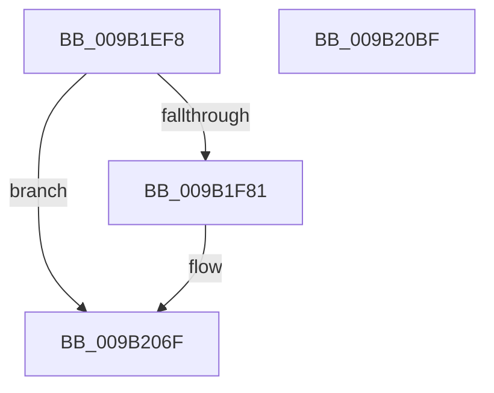

# HvSwapLogFiles

- RVA: `0x009B1EF8`–`0x009B20C0` (길이 `456` bytes)
- VA: `0x00000001409B1EF8`
- 실행 섹션: `PAGE`
- PDB 이름 있음: `예`; PDB Function 태그: `아니요`
- unwind 정보 RVA: `0x0009E330`
- 디코드: `102`개 명령, `456/456` bytes 표시
- 미해석 바이트: `0` (있으면 어셈블리에 `.byte`로 보존)

> 이 문서는 커널 이미지의 기계어와 PDB 기호를 분석해 생성했습니다. 4번과 5번은 함수 원형과 자료형을 바이너리 사용 방식에서 추정한 C 해석이며 원본 소스 복구 결과는 아닙니다.

## 1. Dependencies

- 직접 호출 지점: **4**; 고유 호출 대상: **4**
- 직접 호출자로 확인된 함수: **1**
- RIP 상대 이미지 참조: **3**

### Outgoing calls
- `0x009B1F26` → [HvGetEffectiveLogSizeCapForHive](HvGetEffectiveLogSizeCapForHive_function_009B6408.md) (function, `0x009B6408`)
- `0x009B1F34` → [HvpLogTypeToLogArrayIndex](HvpLogTypeToLogArrayIndex_function_009B2DFC.md) (function, `0x009B2DFC`)
- `0x009B206A` → [tlgWriteTransfer_EtwWriteTransfer](../../text/42/tlgWriteTransfer_EtwWriteTransfer_function_004260E0.md) (function, `0x004260E0`)
- `0x009B20A2` → [_security_check_cookie](../../text/6A/_security_check_cookie_function_006AC640.md) (function, `0x006AC640`)

### Direct callers
- [CmpFlushHive](CmpFlushHive_function_009B3DC0.md) at `0x009B4661`
- [CmpFlushHive](CmpFlushHive_function_009B3DC0.md) at `0x009B46F6`

### Static image references
- `0x009B1F12` → RVA `0x00E0A740` (`.data`; read)
- `0x009B1F74` → RVA `0x00E09F58` (`.data`; read)
- `0x009B202B` → RVA `0x0005746C` (`.rdata`; read)

## 2. Other-region calls and transfers

- 다른 실행 섹션으로 향하는 call: **2**
  - `0x009B206A` → [tlgWriteTransfer_EtwWriteTransfer](../../text/42/tlgWriteTransfer_EtwWriteTransfer_function_004260E0.md) (`PAGE` → `.text`)
  - `0x009B20A2` → [_security_check_cookie](../../text/6A/_security_check_cookie_function_006AC640.md) (`PAGE` → `.text`)
- 별도 외부 분기/꼬리 이동을 확인하지 못했습니다.

## 3. Assembly (complete function range)

```asm
009B1EF8  48 89 5C 24 10                  mov qword ptr [rsp + 0x10], rbx
009B1EFD  48 89 74 24 18                  mov qword ptr [rsp + 0x18], rsi
009B1F02  55                              push rbp
009B1F03  57                              push rdi
009B1F04  41 57                           push r15
009B1F06  48 8D 6C 24 F0                  lea rbp, [rsp - 0x10]
009B1F0B  48 81 EC 10 01 00 00            sub rsp, 0x110
009B1F12  48 8B 05 27 88 45 00            mov rax, qword ptr [rip + 0x458827]
009B1F19  48 33 C4                        xor rax, rsp
009B1F1C  48 89 45 00                     mov qword ptr [rbp], rax
009B1F20  44 8A D2                        mov r10b, dl
009B1F23  48 8B F9                        mov rdi, rcx
009B1F26  E8 DD 44 00 00                  call 0x1409b6408
009B1F2B  8B 8F A8 00 00 00               mov ecx, dword ptr [rdi + 0xa8]
009B1F31  44 8B D8                        mov r11d, eax
009B1F34  E8 C3 0E 00 00                  call 0x1409b2dfc
009B1F39  8B 97 AC 00 00 00               mov edx, dword ptr [rdi + 0xac]
009B1F3F  48 8D B7 B4 00 00 00            lea rsi, [rdi + 0xb4]
009B1F46  2B 97 B0 00 00 00               sub edx, dword ptr [rdi + 0xb0]
009B1F4C  48 BB 14 00 00 00 80 F7 FF FF   movabs rbx, 0xfffff78000000014
009B1F56  44 8B C0                        mov r8d, eax
009B1F59  41 BF 04 00 00 00               mov r15d, 4
009B1F5F  48 8B 1B                        mov rbx, qword ptr [rbx]
009B1F62  46 8B 8C C7 10 07 00 00         mov r9d, dword ptr [rdi + r8*8 + 0x710]
009B1F6A  48 8B C3                        mov rax, rbx
009B1F6D  48 2B 87 C8 00 00 00            sub rax, qword ptr [rdi + 0xc8]
009B1F74  83 3D DD 7F 45 00 05            cmp dword ptr [rip + 0x457fdd], 5
009B1F7B  0F 86 EE 00 00 00               jbe 0x1409b206f
009B1F81  48 8D 4C 24 30                  lea rcx, [rsp + 0x30]
009B1F86  48 89 44 24 50                  mov qword ptr [rsp + 0x50], rax
009B1F8B  48 89 4D 80                     mov qword ptr [rbp - 0x80], rcx
009B1F8F  48 8D 44 24 50                  lea rax, [rsp + 0x50]
009B1F94  8B 8F 18 01 00 00               mov ecx, dword ptr [rdi + 0x118]
009B1F9A  45 84 D2                        test r10b, r10b
009B1F9D  89 4C 24 34                     mov dword ptr [rsp + 0x34], ecx
009B1FA1  48 8D 4C 24 34                  lea rcx, [rsp + 0x34]
009B1FA6  0F 94 44 24 30                  sete byte ptr [rsp + 0x30]
009B1FAB  48 89 4D 90                     mov qword ptr [rbp - 0x70], rcx
009B1FAF  8B 8F BC 00 00 00               mov ecx, dword ptr [rdi + 0xbc]
009B1FB5  45 33 C0                        xor r8d, r8d
009B1FB8  83 65 8C 00                     and dword ptr [rbp - 0x74], 0
009B1FBC  83 65 9C 00                     and dword ptr [rbp - 0x64], 0
009B1FC0  83 65 AC 00                     and dword ptr [rbp - 0x54], 0
009B1FC4  83 65 BC 00                     and dword ptr [rbp - 0x44], 0
009B1FC8  83 65 CC 00                     and dword ptr [rbp - 0x34], 0
009B1FCC  83 65 DC 00                     and dword ptr [rbp - 0x24], 0
009B1FD0  83 65 EC 00                     and dword ptr [rbp - 0x14], 0
009B1FD4  83 65 FC 00                     and dword ptr [rbp - 4], 0
009B1FD8  89 4C 24 38                     mov dword ptr [rsp + 0x38], ecx
009B1FDC  48 8D 4C 24 38                  lea rcx, [rsp + 0x38]
009B1FE1  48 89 4D A0                     mov qword ptr [rbp - 0x60], rcx
009B1FE5  48 8D 4C 24 3C                  lea rcx, [rsp + 0x3c]
009B1FEA  48 89 4D B0                     mov qword ptr [rbp - 0x50], rcx
009B1FEE  8B 0E                           mov ecx, dword ptr [rsi]
009B1FF0  89 4C 24 40                     mov dword ptr [rsp + 0x40], ecx
009B1FF4  48 8D 4C 24 40                  lea rcx, [rsp + 0x40]
009B1FF9  48 89 4D C0                     mov qword ptr [rbp - 0x40], rcx
009B1FFD  48 8D 4C 24 44                  lea rcx, [rsp + 0x44]
009B2002  48 89 4D D0                     mov qword ptr [rbp - 0x30], rcx
009B2006  48 8D 4C 24 48                  lea rcx, [rsp + 0x48]
009B200B  48 89 45 F0                     mov qword ptr [rbp - 0x10], rax
009B200F  48 8D 44 24 60                  lea rax, [rsp + 0x60]
009B2014  48 89 4D E0                     mov qword ptr [rbp - 0x20], rcx
009B2018  48 8D 0D 39 7F 45 00            lea rcx, [rip + 0x457f39]
009B201F  44 89 4C 24 44                  mov dword ptr [rsp + 0x44], r9d
009B2024  45 33 C9                        xor r9d, r9d
009B2027  89 54 24 48                     mov dword ptr [rsp + 0x48], edx
009B202B  48 8D 15 3A 54 6A FF            lea rdx, [rip - 0x95abc6]
009B2032  48 89 44 24 28                  mov qword ptr [rsp + 0x28], rax
009B2037  C7 45 88 01 00 00 00            mov dword ptr [rbp - 0x78], 1
009B203E  44 89 7D 98                     mov dword ptr [rbp - 0x68], r15d
009B2042  44 89 7D A8                     mov dword ptr [rbp - 0x58], r15d
009B2046  44 89 5C 24 3C                  mov dword ptr [rsp + 0x3c], r11d
009B204B  44 89 7D B8                     mov dword ptr [rbp - 0x48], r15d
009B204F  44 89 7D C8                     mov dword ptr [rbp - 0x38], r15d
009B2053  44 89 7D D8                     mov dword ptr [rbp - 0x28], r15d
009B2057  44 89 7D E8                     mov dword ptr [rbp - 0x18], r15d
009B205B  C7 45 F8 08 00 00 00            mov dword ptr [rbp - 8], 8
009B2062  C7 44 24 20 0A 00 00 00         mov dword ptr [rsp + 0x20], 0xa
009B206A  E8 71 40 A7 FF                  call 0x1404260e0
009B206F  8B 87 A8 00 00 00               mov eax, dword ptr [rdi + 0xa8]
009B2075  41 2B C7                        sub eax, r15d
009B2078  F7 D8                           neg eax
009B207A  1B C0                           sbb eax, eax
009B207C  83 C0 05                        add eax, 5
009B207F  89 87 A8 00 00 00               mov dword ptr [rdi + 0xa8], eax
009B2085  8B 87 AC 00 00 00               mov eax, dword ptr [rdi + 0xac]
009B208B  83 26 00                        and dword ptr [rsi], 0
009B208E  89 87 B0 00 00 00               mov dword ptr [rdi + 0xb0], eax
009B2094  48 89 9F C8 00 00 00            mov qword ptr [rdi + 0xc8], rbx
009B209B  48 8B 4D 00                     mov rcx, qword ptr [rbp]
009B209F  48 33 CC                        xor rcx, rsp
009B20A2  E8 99 A5 CF FF                  call 0x1406ac640
009B20A7  4C 8D 9C 24 10 01 00 00         lea r11, [rsp + 0x110]
009B20AF  49 8B 5B 28                     mov rbx, qword ptr [r11 + 0x28]
009B20B3  49 8B 73 30                     mov rsi, qword ptr [r11 + 0x30]
009B20B7  49 8B E3                        mov rsp, r11
009B20BA  41 5F                           pop r15
009B20BC  5F                              pop rdi
009B20BD  5D                              pop rbp
009B20BE  C3                              ret
009B20BF  CC                              int3
```

## 4. C-style interpretation (structured pseudocode)

```c
__int64 __fastcall HvSwapLogFiles(__int64 a1, unsigned __int8 a2)
{
    __int64 result;
    __int64 v_rsp;
    unsigned __int64 v_stack_m100;
    unsigned int v_stack_m108;
    unsigned __int64 v_stack_m18;
    unsigned __int64 v_stack_m28;
    unsigned int v_stack_m2C;
    unsigned int v_stack_m30;
    unsigned __int64 v_stack_m38;
    unsigned int v_stack_m3C;
    unsigned int v_stack_m40;
    unsigned __int64 v_stack_m48;
    unsigned int v_stack_m4C;
    unsigned int v_stack_m50;
    unsigned __int64 v_stack_m58;
    unsigned int v_stack_m5C;
    unsigned int v_stack_m60;
    unsigned __int64 v_stack_m68;
    unsigned int v_stack_m6C;
    unsigned int v_stack_m70;
    unsigned __int64 v_stack_m78;
    unsigned int v_stack_m7C;
    unsigned int v_stack_m80;
    unsigned __int64 v_stack_m88;
    unsigned int v_stack_m8C;
    unsigned int v_stack_m90;
    unsigned __int64 v_stack_m98;
    unsigned int v_stack_m9C;
    unsigned int v_stack_mA0;
    unsigned __int64 v_stack_mA8;
    unsigned __int64 v_stack_mC8;
    unsigned __int64 v_stack_mD8;
    unsigned __int64 v_stack_mE0;
    unsigned __int64 v_stack_mE4;
    unsigned int v_stack_mE8;
    unsigned __int64 v_stack_mEC;
    unsigned int v_stack_mF0;
    unsigned int v_stack_mF4;
    unsigned __int64 v_stack_mF8;
    unsigned __int64 v_stack_p10;
    unsigned __int64 v_stack_p18;

    v_stack_p10 = v_rbx;
    v_stack_p18 = v_rsi;
    v_rsp = (v_rsp) - (272);
    result = (*(unsigned __int64 *)(v_rip + 4556839)) ^ (v_rsp);
    v_stack_m28 = result;
    result = HvGetEffectiveLogSizeCapForHive(a1, a2, a3, a4);
    result = HvpLogTypeToLogArrayIndex((unsigned int)(*(unsigned int *)(a1 + 168)), a2, a3, a4);
    a2 = (unsigned int)(((unsigned int)(*(unsigned int *)(a1 + 172))) - (*(unsigned int *)(a1 + 176)));
    result = (*(unsigned __int64 *)(v_rbx)) - (*(unsigned __int64 *)(a1 + 200));
    if ((*(unsigned int *)(v_rip + 4554717)) >= = 5) {
        a1 = v_stack_mF8;
        v_stack_mD8 = result;
        v_stack_mA8 = a1;
        result = v_stack_mD8;
        a1 = *(unsigned int *)(a1 + 280);
        v_stack_mF4 = (unsigned int)(a1);
        a1 = v_stack_mF4;
        v_stack_m98 = a1;
        a1 = *(unsigned int *)(a1 + 188);
        a3 = 0;
        v_stack_mF0 = (unsigned int)(a1);
        a1 = v_stack_mF0;
        v_stack_m88 = a1;
        a1 = v_stack_mEC;
        v_stack_m78 = a1;
        a1 = *(unsigned int *)(a1 + 180);
        v_stack_mE8 = (unsigned int)(a1);
        a1 = v_stack_mE8;
        v_stack_m68 = a1;
        a1 = v_stack_mE4;
        v_stack_m58 = a1;
        a1 = v_stack_mE0;
        v_stack_m38 = result;
        result = v_stack_mC8;
        v_stack_m48 = a1;
        a1 = v_rip + 4554553;
        v_stack_mE4 = (unsigned int)((unsigned int)(*(unsigned int *)(a1 + (unsigned int)((unsigned int)(result)) * 8 + 1808)));
        a4 = 0;
        v_stack_mE0 = a2;
        a2 = v_rip - 9808838;
        v_stack_m100 = result;
        v_stack_mA0 = 1;
        v_stack_m90 = 4;
        v_stack_m80 = 4;
        v_stack_mEC = (unsigned int)((unsigned int)((unsigned int)(result)));
        v_stack_m70 = 4;
        v_stack_m60 = 4;
        v_stack_m50 = 4;
        v_stack_m40 = 4;
        v_stack_m30 = 8;
        v_stack_m108 = 10;
        result = tlgWriteTransfer_EtwWriteTransfer(a1, a2, a3, a4);
    }
    result = (unsigned int)(((unsigned int)(*(unsigned int *)(a1 + 168))) - (4));
    result = (unsigned int)(-(result));
    result = (unsigned int)((result) + (5));
    *(unsigned int *)(a1 + 168) = (unsigned int)(result);
    *(unsigned int *)(a1 + 176) = (unsigned int)((unsigned int)(*(unsigned int *)(a1 + 172)));
    *(unsigned __int64 *)(a1 + 200) = *(unsigned __int64 *)(v_rbx);
    a1 = (v_stack_m28) ^ (v_rsp);
    result = _security_check_cookie(a1, a2, a3, a4);
    return result;
}
```

## 5. (Beta) C Style

```c
int64_t HvSwapLogFiles(void *Arg1, uint8_t Arg2)
{
    uint8_t *arg1 = (uint8_t *)Arg1;

    int64_t result;
    int64_t local_rsp;
    uint64_t v_stack_m100;
    uint32_t v_stack_m108;
    uint64_t v_stack_m18;
    uint64_t v_stack_m28;
    uint32_t v_stack_m2C;
    uint32_t v_stack_m30;
    uint64_t v_stack_m38;
    uint32_t v_stack_m3C;
    uint32_t v_stack_m40;
    uint64_t v_stack_m48;
    uint32_t v_stack_m4C;
    uint32_t v_stack_m50;
    uint64_t v_stack_m58;
    uint32_t v_stack_m5C;
    uint32_t v_stack_m60;
    uint64_t v_stack_m68;
    uint32_t v_stack_m6C;
    uint32_t v_stack_m70;
    uint64_t v_stack_m78;
    uint32_t v_stack_m7C;
    uint32_t v_stack_m80;
    uint64_t v_stack_m88;
    uint32_t v_stack_m8C;
    uint32_t v_stack_m90;
    uint64_t v_stack_m98;
    uint32_t v_stack_m9C;
    uint32_t v_stack_mA0;
    uint64_t v_stack_mA8;
    uint64_t v_stack_mC8;
    uint64_t v_stack_mD8;
    uint64_t v_stack_mE0;
    uint64_t v_stack_mE4;
    uint32_t v_stack_mE8;
    uint64_t v_stack_mEC;
    uint32_t v_stack_mF0;
    uint32_t v_stack_mF4;
    uint64_t v_stack_mF8;
    uint64_t v_stack_p10;
    uint64_t v_stack_p18;

    v_stack_p10 = local_rbx;
    v_stack_p18 = local_rsi;
    local_rsp = (local_rsp) - (272);
    result = (*(uint64_t *)(v_rip + 0x458827)) ^ (local_rsp);
    v_stack_m28 = result;
    result = HvGetEffectiveLogSizeCapForHive(Arg1, Arg2, a3, a4);
    result = HvpLogTypeToLogArrayIndex((uint32_t)(*(uint32_t *)(arg1 + 0xA8)), Arg2, a3, a4);
    Arg2 = (uint32_t)(((uint32_t)(*(uint32_t *)(arg1 + 0xAC))) - (*(uint32_t *)(arg1 + 0xB0)));
    result = (*(uint64_t *)(local_rbx)) - (*(uint64_t *)(arg1 + 0xC8));
    if ((*(uint32_t *)(v_rip + 0x457FDD)) >= = 5) {
        Arg1 = v_stack_mF8;
        v_stack_mD8 = result;
        v_stack_mA8 = Arg1;
        result = v_stack_mD8;
        Arg1 = *(uint32_t *)(arg1 + 0x118);
        v_stack_mF4 = (uint32_t)(Arg1);
        Arg1 = v_stack_mF4;
        v_stack_m98 = Arg1;
        Arg1 = *(uint32_t *)(arg1 + 0xBC);
        a3 = 0;
        v_stack_mF0 = (uint32_t)(Arg1);
        Arg1 = v_stack_mF0;
        v_stack_m88 = Arg1;
        Arg1 = v_stack_mEC;
        v_stack_m78 = Arg1;
        Arg1 = *(uint32_t *)(arg1 + 0xB4);
        v_stack_mE8 = (uint32_t)(Arg1);
        Arg1 = v_stack_mE8;
        v_stack_m68 = Arg1;
        Arg1 = v_stack_mE4;
        v_stack_m58 = Arg1;
        Arg1 = v_stack_mE0;
        v_stack_m38 = result;
        result = v_stack_mC8;
        v_stack_m48 = Arg1;
        Arg1 = v_rip + 4554553;
        v_stack_mE4 = (uint32_t)((uint32_t)(*(uint32_t *)(arg1 + (uint32_t)((uint32_t)(result)) * 8 + 0x710)));
        a4 = 0;
        v_stack_mE0 = Arg2;
        Arg2 = v_rip - 9808838;
        v_stack_m100 = result;
        v_stack_mA0 = 1;
        v_stack_m90 = 4;
        v_stack_m80 = 4;
        v_stack_mEC = (uint32_t)((uint32_t)((uint32_t)(result)));
        v_stack_m70 = 4;
        v_stack_m60 = 4;
        v_stack_m50 = 4;
        v_stack_m40 = 4;
        v_stack_m30 = 8;
        v_stack_m108 = 10;
        result = tlgWriteTransfer_EtwWriteTransfer(Arg1, Arg2, a3, a4);
    }
    result = (uint32_t)(((uint32_t)(*(uint32_t *)(arg1 + 0xA8))) - (4));
    result = (uint32_t)(-(result));
    result = (uint32_t)((result) + (5));
    *(uint32_t *)(arg1 + 0xA8) = (uint32_t)(result);
    *(uint32_t *)(arg1 + 0xB0) = (uint32_t)((uint32_t)(*(uint32_t *)(arg1 + 0xAC)));
    *(uint64_t *)(arg1 + 0xC8) = *(uint64_t *)(local_rbx);
    Arg1 = (v_stack_m28) ^ (local_rsp);
    result = _security_check_cookie(Arg1, Arg2, a3, a4);
    return result;
}
```

### 관측된 메모리 오프셋

구조체 형식이 확인되지 않은 접근은 인자 기준의 오프셋으로만 기록했습니다.

| 기준 인자 | 오프셋 표현 | 폭 (bit) | 접근 |
|---|---:|---:|---|
| `Arg1` | `+ 0x0` | `32` | `R` |
| `Arg1` | `+ 0x0` | `32` | `R/W` |
| `Arg1` | `+ 0xA8` | `32` | `R` |
| `Arg1` | `+ 0xA8` | `32` | `W` |
| `Arg1` | `+ 0xAC` | `32` | `R` |
| `Arg1` | `+ 0xB0` | `32` | `R` |
| `Arg1` | `+ 0xB0` | `32` | `W` |
| `Arg1` | `+ 0xB4` | `64` | `R` |
| `Arg1` | `+ 0xBC` | `32` | `R` |
| `Arg1` | `+ 0xC8` | `64` | `R` |
| `Arg1` | `+ 0xC8` | `64` | `W` |
| `Arg1` | `+ 0x118` | `32` | `R` |
| `Arg1` | `+ 0x710 + r8*8` | `32` | `R` |

## 6. Execution-region graph

[열기: 2D/3D 그래프와 함수 탐색 컨트롤 패널](../../../control-panel.html?section=page&rva=0x009B1EF8&view=graph)

- 2D 그래프는 위에서 아래로 흐르고, 3D 그래프는 빈 공간을 드래그해 회전합니다. Shift+드래그는 이동, 휠은 확대·축소, 함수 노드 선택은 대상 보고서 이동입니다.

### Static fallback


