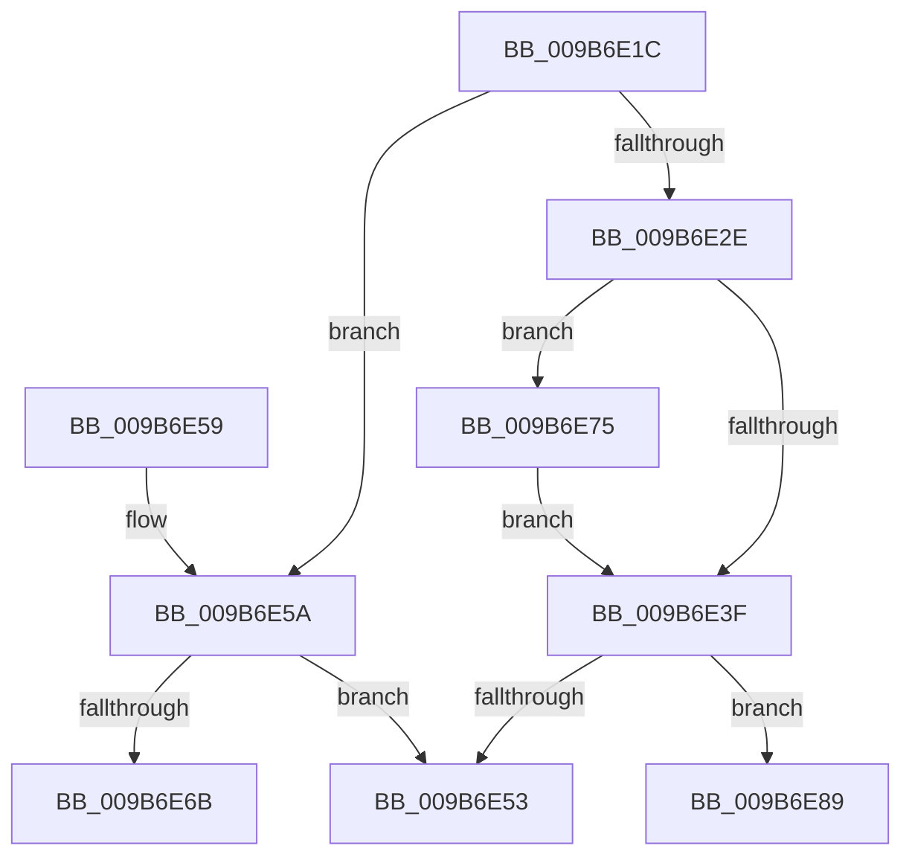

# HvTruncateAllLogFilesIfRequired

- RVA: `0x009B6E1C`–`0x009B6E93` (길이 `119` bytes)
- VA: `0x00000001409B6E1C`
- 실행 섹션: `PAGE`
- PDB 이름 있음: `예`; PDB Function 태그: `예`
- unwind 정보 RVA: `0x0005E698`
- 디코드: `32`개 명령, `119/119` bytes 표시
- 미해석 바이트: `0` (있으면 어셈블리에 `.byte`로 보존)

> 이 문서는 커널 이미지의 기계어와 PDB 기호를 분석해 생성했습니다. 4번과 5번은 함수 원형과 자료형을 바이너리 사용 방식에서 추정한 C 해석이며 원본 소스 복구 결과는 아닙니다.

## 1. Dependencies

- 직접 호출 지점: **4**; 고유 호출 대상: **2**
- 직접 호출자로 확인된 함수: **1**
- RIP 상대 이미지 참조: **0**

### Outgoing calls
- `0x009B6E2E` → [HvGetEffectiveLogSizeCapForHive](HvGetEffectiveLogSizeCapForHive_function_009B6408.md) (function, `0x009B6408`)
- `0x009B6E42` → [HvGetEffectiveLogSizeCapForHive](HvGetEffectiveLogSizeCapForHive_function_009B6408.md) (function, `0x009B6408`)
- `0x009B6E5A` → [HvGetEffectiveLogSizeCapForHive](HvGetEffectiveLogSizeCapForHive_function_009B6408.md) (function, `0x009B6408`)
- `0x009B6E82` → [CmpDoFileSetSizeEx](CmpDoFileSetSizeEx_function_009B2A4C.md) (function, `0x009B2A4C`)

### Direct callers
- [CmpFlushHive](CmpFlushHive_function_009B3DC0.md) at `0x009B4588`

### Static image references
- 디코드된 RIP-relative 메모리 참조가 없습니다.

## 2. Other-region calls and transfers

- 다른 실행 섹션으로 향하는 call: **0**
- call이 아닌 외부 분기/꼬리 이동: **2**
  - `0x009B6E70` → [sub_00B2DE30](../B2/Unknown_function_00B2DE30.md) (`tail-transfer`)
  - `0x009B6E8E` → [sub_00B2DE30](../B2/Unknown_function_00B2DE30.md) (`tail-transfer`)

## 3. Assembly (complete function range)

```asm
009B6E1C  40 53                           push rbx
009B6E1E  48 83 EC 20                     sub rsp, 0x20
009B6E22  83 B9 A8 00 00 00 01            cmp dword ptr [rcx + 0xa8], 1
009B6E29  48 8B D9                        mov rbx, rcx
009B6E2C  74 2C                           je 0x1409b6e5a
009B6E2E  E8 D5 F5 FF FF                  call 0x1409b6408
009B6E33  44 8B D0                        mov r10d, eax
009B6E36  4C 39 93 10 07 00 00            cmp qword ptr [rbx + 0x710], r10
009B6E3D  77 36                           ja 0x1409b6e75
009B6E3F  48 8B CB                        mov rcx, rbx
009B6E42  E8 C1 F5 FF FF                  call 0x1409b6408
009B6E47  44 8B D0                        mov r10d, eax
009B6E4A  4C 39 93 18 07 00 00            cmp qword ptr [rbx + 0x718], r10
009B6E51  77 36                           ja 0x1409b6e89
009B6E53  48 83 C4 20                     add rsp, 0x20
009B6E57  5B                              pop rbx
009B6E58  C3                              ret
009B6E59  CC                              int3
009B6E5A  E8 A9 F5 FF FF                  call 0x1409b6408
009B6E5F  44 8B D0                        mov r10d, eax
009B6E62  4C 39 93 10 07 00 00            cmp qword ptr [rbx + 0x710], r10
009B6E69  76 E8                           jbe 0x1409b6e53
009B6E6B  BA 01 00 00 00                  mov edx, 1
009B6E70  E9 BB 6F 17 00                  jmp 0x140b2de30
009B6E75  45 33 C9                        xor r9d, r9d
009B6E78  45 33 C0                        xor r8d, r8d
009B6E7B  48 8B CB                        mov rcx, rbx
009B6E7E  41 8D 51 04                     lea edx, [r9 + 4]
009B6E82  E8 C5 BB FF FF                  call 0x1409b2a4c
009B6E87  EB B6                           jmp 0x1409b6e3f
009B6E89  BA 05 00 00 00                  mov edx, 5
009B6E8E  E9 9D 6F 17 00                  jmp 0x140b2de30
```

## 4. C-style interpretation (structured pseudocode)

```c
__int64 __fastcall HvTruncateAllLogFilesIfRequired(__int64 a1, __int64 a2, int a3, int a4)
{
    __int64 result;
    __int64 v_rsp;

    v_rsp = (v_rsp) - (32);
    if ((*(unsigned int *)(a1 + 168)) == 1) goto loc_009B6E5A;
    result = HvGetEffectiveLogSizeCapForHive(a1, a2, a3, a4);
    if ((*(unsigned __int64 *)(a1 + 1808)) > ((unsigned int)((unsigned int)(result)))) goto loc_009B6E75;
loc_009B6E3F:
    result = HvGetEffectiveLogSizeCapForHive(a1, a2, a3, a4);
    if ((*(unsigned __int64 *)(a1 + 1816)) > ((unsigned int)((unsigned int)(result)))) goto loc_009B6E89;
loc_009B6E53:
    v_rsp = (v_rsp) + (32);
    return result;
loc_009B6E5A:
    result = HvGetEffectiveLogSizeCapForHive(a1, a2, a3, a4);
    if ((*(unsigned __int64 *)(a1 + 1808)) <= ((unsigned int)((unsigned int)(result)))) goto loc_009B6E53;
loc_009B6E75:
    a4 = 0;
    a3 = 0;
    result = CmpDoFileSetSizeEx(a1, a4 + 4, a3, a4);
    goto loc_009B6E3F;
loc_009B6E89:
}
```

## 5. (Beta) C Style

```c
int64_t HvTruncateAllLogFilesIfRequired(void *Arg1, int64_t Arg2, int32_t Arg3, int32_t Arg4)
{
    uint8_t *arg1 = (uint8_t *)Arg1;

    int64_t result;
    int64_t local_rsp;

    local_rsp = (local_rsp) - (32);
    if ((*(uint32_t *)(arg1 + 0xA8)) == 1) goto loc_009B6E5A;
    result = HvGetEffectiveLogSizeCapForHive(Arg1, Arg2, Arg3, Arg4);
    if ((*(uint64_t *)(arg1 + 0x710)) > ((uint32_t)((uint32_t)(result)))) goto loc_009B6E75;
loc_009B6E3F:
    result = HvGetEffectiveLogSizeCapForHive(Arg1, Arg2, Arg3, Arg4);
    if ((*(uint64_t *)(arg1 + 0x718)) > ((uint32_t)((uint32_t)(result)))) goto loc_009B6E89;
loc_009B6E53:
    local_rsp = (local_rsp) + (32);
    return result;
loc_009B6E5A:
    result = HvGetEffectiveLogSizeCapForHive(Arg1, Arg2, Arg3, Arg4);
    if ((*(uint64_t *)(arg1 + 0x710)) <= ((uint32_t)((uint32_t)(result)))) goto loc_009B6E53;
loc_009B6E75:
    Arg4 = 0;
    Arg3 = 0;
    result = CmpDoFileSetSizeEx(Arg1, Arg4 + 4, Arg3, Arg4);
    goto loc_009B6E3F;
loc_009B6E89:
}
```

### 관측된 메모리 오프셋

구조체 형식이 확인되지 않은 접근은 인자 기준의 오프셋으로만 기록했습니다.

| 기준 인자 | 오프셋 표현 | 폭 (bit) | 접근 |
|---|---:|---:|---|
| `Arg1` | `+ 0xA8` | `32` | `R` |
| `Arg1` | `+ 0x710` | `64` | `R` |
| `Arg1` | `+ 0x718` | `64` | `R` |

## 6. Execution-region graph

[열기: 2D/3D 그래프와 함수 탐색 컨트롤 패널](../../../control-panel.html?section=page&rva=0x009B6E1C&view=graph)

- 2D 그래프는 위에서 아래로 흐르고, 3D 그래프는 빈 공간을 드래그해 회전합니다. Shift+드래그는 이동, 휠은 확대·축소, 함수 노드 선택은 대상 보고서 이동입니다.

### Static fallback


