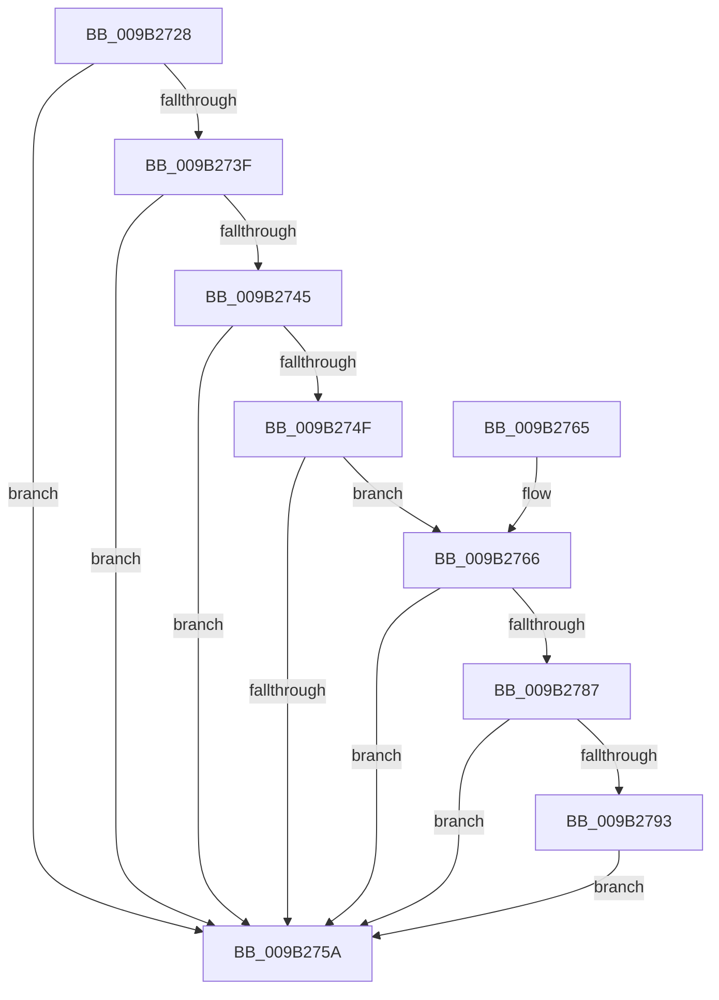

# HvTruncateCurrentLogFileIfRequired

- RVA: `0x009B2728`–`0x009B27A2` (길이 `122` bytes)
- VA: `0x00000001409B2728`
- 실행 섹션: `PAGE`
- PDB 이름 있음: `예`; PDB Function 태그: `아니요`
- unwind 정보 RVA: `0x00080918`
- 디코드: `36`개 명령, `122/122` bytes 표시
- 미해석 바이트: `0` (있으면 어셈블리에 `.byte`로 보존)

> 이 문서는 커널 이미지의 기계어와 PDB 기호를 분석해 생성했습니다. 4번과 5번은 함수 원형과 자료형을 바이너리 사용 방식에서 추정한 C 해석이며 원본 소스 복구 결과는 아닙니다.

## 1. Dependencies

- 직접 호출 지점: **3**; 고유 호출 대상: **3**
- 직접 호출자로 확인된 함수: **1**
- RIP 상대 이미지 참조: **0**

### Outgoing calls
- `0x009B2768` → [HvpLogTypeToLogArrayIndex](HvpLogTypeToLogArrayIndex_function_009B2DFC.md) (function, `0x009B2DFC`)
- `0x009B277A` → [HvGetEffectiveLogSizeCapForHive](HvGetEffectiveLogSizeCapForHive_function_009B6408.md) (function, `0x009B6408`)
- `0x009B279B` → [CmpDoFileSetSizeEx](CmpDoFileSetSizeEx_function_009B2A4C.md) (function, `0x009B2A4C`)

### Direct callers
- [CmpFlushHive](CmpFlushHive_function_009B3DC0.md) at `0x009B429A`

### Static image references
- 디코드된 RIP-relative 메모리 참조가 없습니다.

## 2. Other-region calls and transfers

- 다른 실행 섹션으로 향하는 call: **0**
- 별도 외부 분기/꼬리 이동을 확인하지 못했습니다.

## 3. Assembly (complete function range)

```asm
009B2728  48 89 5C 24 08                  mov qword ptr [rsp + 8], rbx
009B272D  57                              push rdi
009B272E  48 83 EC 20                     sub rsp, 0x20
009B2732  8B 81 A0 00 00 00               mov eax, dword ptr [rcx + 0xa0]
009B2738  4C 8B D9                        mov r11, rcx
009B273B  A8 01                           test al, 1
009B273D  75 1B                           jne 0x1409b275a
009B273F  0F BA E0 0F                     bt eax, 0xf
009B2743  72 15                           jb 0x1409b275a
009B2745  8B 99 A8 00 00 00               mov ebx, dword ptr [rcx + 0xa8]
009B274B  85 DB                           test ebx, ebx
009B274D  74 0B                           je 0x1409b275a
009B274F  48 83 BC D9 08 06 00 00 00      cmp qword ptr [rcx + rbx*8 + 0x608], 0
009B2758  75 0C                           jne 0x1409b2766
009B275A  48 8B 5C 24 30                  mov rbx, qword ptr [rsp + 0x30]
009B275F  48 83 C4 20                     add rsp, 0x20
009B2763  5F                              pop rdi
009B2764  C3                              ret
009B2765  CC                              int3
009B2766  8B CB                           mov ecx, ebx
009B2768  E8 8F 06 00 00                  call 0x1409b2dfc
009B276D  8B C8                           mov ecx, eax
009B276F  49 8B BC CB 10 07 00 00         mov rdi, qword ptr [r11 + rcx*8 + 0x710]
009B2777  49 8B CB                        mov rcx, r11
009B277A  E8 89 3C 00 00                  call 0x1409b6408
009B277F  44 8B D0                        mov r10d, eax
009B2782  49 3B FA                        cmp rdi, r10
009B2785  76 D3                           jbe 0x1409b275a
009B2787  45 8B 83 B4 00 00 00            mov r8d, dword ptr [r11 + 0xb4]
009B278E  49 3B F8                        cmp rdi, r8
009B2791  76 C7                           jbe 0x1409b275a
009B2793  45 33 C9                        xor r9d, r9d
009B2796  8B D3                           mov edx, ebx
009B2798  49 8B CB                        mov rcx, r11
009B279B  E8 AC 02 00 00                  call 0x1409b2a4c
009B27A0  EB B8                           jmp 0x1409b275a
```

## 4. C-style interpretation (structured pseudocode)

```c
__int64 __fastcall HvTruncateCurrentLogFileIfRequired(__int64 a1, __int64 a2, __int64 a3, int a4)
{
    __int64 result;
    __int64 v_rsp;
    unsigned __int64 v_stack_p8;

    v_stack_p8 = v_rbx;
    v_rsp = (v_rsp) - (32);
    if ((((unsigned __int8)((unsigned int)(*(unsigned int *)(a1 + 160)))) & (1)) != 0) goto loc_009B275A;
    if (condition_is_below) goto loc_009B275A;
    if ((unsigned int)((unsigned int)(*(unsigned int *)(a1 + 168))) == 0) goto loc_009B275A;
    if ((*(unsigned __int64 *)(a1 + (unsigned int)(*(unsigned int *)(a1 + 168)) * 8 + 1544)) != 0) goto loc_009B2766;
loc_009B275A:
    v_rsp = (v_rsp) + (32);
    return (unsigned int)(*(unsigned int *)(a1 + 160));
loc_009B2766:
    result = HvpLogTypeToLogArrayIndex((unsigned int)((unsigned int)(v_stack_p8)), a2, a3, a4);
    result = HvGetEffectiveLogSizeCapForHive(a1, a2, a3, a4);
    if ((*(unsigned __int64 *)(a1 + (unsigned int)((unsigned int)(result)) * 8 + 1808)) <= ((unsigned int)((unsigned int)(result)))) goto loc_009B275A;
    if ((*(unsigned __int64 *)(a1 + (unsigned int)((unsigned int)(result)) * 8 + 1808)) <= ((unsigned int)(*(unsigned int *)(a1 + 180)))) goto loc_009B275A;
    a4 = 0;
    result = CmpDoFileSetSizeEx(a1, (unsigned int)((unsigned int)(v_stack_p8)), (unsigned int)(*(unsigned int *)(a1 + 180)), a4);
    goto loc_009B275A;
}
```

## 5. (Beta) C Style

```c
int64_t HvTruncateCurrentLogFileIfRequired(void *Arg1, int64_t Arg2, int64_t Arg3, int32_t Arg4)
{
    uint8_t *arg1 = (uint8_t *)Arg1;

    int64_t result;
    int64_t local_rsp;
    uint64_t v_stack_p8;

    v_stack_p8 = local_rbx;
    local_rsp = (local_rsp) - (32);
    if ((((uint8_t)((uint32_t)(*(uint32_t *)(arg1 + 0xA0)))) & (1)) != 0) goto loc_009B275A;
    if (condition_is_below) goto loc_009B275A;
    if ((uint32_t)((uint32_t)(*(uint32_t *)(arg1 + 0xA8))) == 0) goto loc_009B275A;
    if ((*(uint64_t *)(arg1 + (uint32_t)(*(uint32_t *)(arg1 + 0xA8)) * 8 + 0x608)) != 0) goto loc_009B2766;
loc_009B275A:
    local_rsp = (local_rsp) + (32);
    return (uint32_t)(*(uint32_t *)(arg1 + 0xA0));
loc_009B2766:
    result = HvpLogTypeToLogArrayIndex((uint32_t)((uint32_t)(v_stack_p8)), Arg2, Arg3, Arg4);
    result = HvGetEffectiveLogSizeCapForHive(Arg1, Arg2, Arg3, Arg4);
    if ((*(uint64_t *)(arg1 + (uint32_t)((uint32_t)(result)) * 8 + 0x710)) <= ((uint32_t)((uint32_t)(result)))) goto loc_009B275A;
    if ((*(uint64_t *)(arg1 + (uint32_t)((uint32_t)(result)) * 8 + 0x710)) <= ((uint32_t)(*(uint32_t *)(arg1 + 0xB4)))) goto loc_009B275A;
    Arg4 = 0;
    result = CmpDoFileSetSizeEx(Arg1, (uint32_t)((uint32_t)(v_stack_p8)), (uint32_t)(*(uint32_t *)(arg1 + 0xB4)), Arg4);
    goto loc_009B275A;
}
```

### 관측된 메모리 오프셋

구조체 형식이 확인되지 않은 접근은 인자 기준의 오프셋으로만 기록했습니다.

| 기준 인자 | 오프셋 표현 | 폭 (bit) | 접근 |
|---|---:|---:|---|
| `Arg1` | `+ 0xA0` | `32` | `R` |
| `Arg1` | `+ 0xA8` | `32` | `R` |
| `Arg1` | `+ 0x608 + rbx*8` | `64` | `R` |

## 6. Execution-region graph

[열기: 2D/3D 그래프와 함수 탐색 컨트롤 패널](../../../control-panel.html?section=page&rva=0x009B2728&view=graph)

- 2D 그래프는 위에서 아래로 흐르고, 3D 그래프는 빈 공간을 드래그해 회전합니다. Shift+드래그는 이동, 휠은 확대·축소, 함수 노드 선택은 대상 보고서 이동입니다.

### Static fallback


