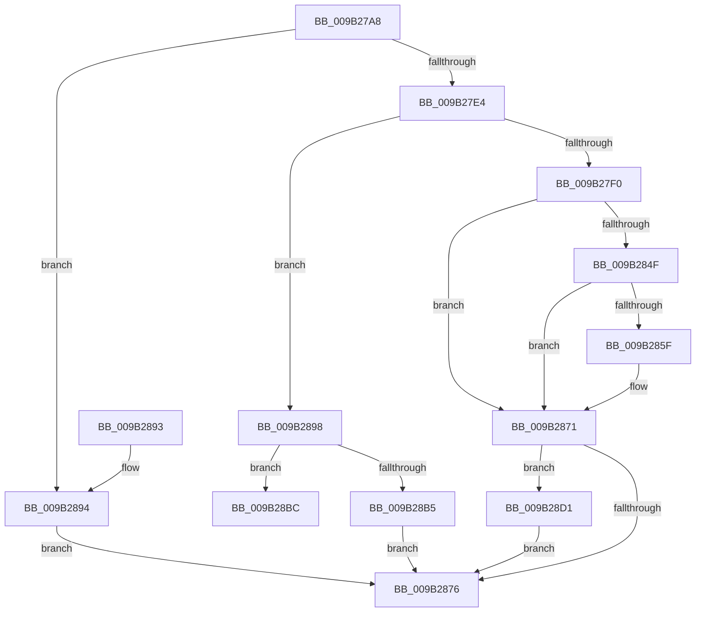

# HvValidateOrInvalidatePrimaryFileHeader

- RVA: `0x009B27A8`–`0x009B28DD` (길이 `309` bytes)
- VA: `0x00000001409B27A8`
- 실행 섹션: `PAGE`
- PDB 이름 있음: `예`; PDB Function 태그: `예`
- unwind 정보 RVA: `0x0009E3A0`
- 디코드: `83`개 명령, `309/309` bytes 표시
- 미해석 바이트: `0` (있으면 어셈블리에 `.byte`로 보존)

> 이 문서는 커널 이미지의 기계어와 PDB 기호를 분석해 생성했습니다. 4번과 5번은 함수 원형과 자료형을 바이너리 사용 방식에서 추정한 C 해석이며 원본 소스 복구 결과는 아닙니다.

## 1. Dependencies

- 직접 호출 지점: **5**; 고유 호출 대상: **5**
- 직접 호출자로 확인된 함수: **2**
- RIP 상대 이미지 참조: **0**

### Outgoing calls
- `0x009B280F` → [HvpHeaderCheckSum](../../pagecmrc/BC/HvpHeaderCheckSum_function_00BC97A0.md) (function, `0x00BC97A0`)
- `0x009B2844` → [guard_dispatch_icall](../../text/6B/guard_dispatch_icall_function_006BAAD0.md) (function, `0x006BAAD0`)
- `0x009B2854` → [CmpFileFlushAndPurge](CmpFileFlushAndPurge_function_009B2BAC.md) (function, `0x009B2BAC`)
- `0x009B28A8` → [ExAllocatePool2](../../poolcode/B8/ExAllocatePool2_function_00B820F0.md) (function, `0x00B820F0`)
- `0x009B28D6` → [ExFreePoolWithTag](../../poolcode/B8/ExFreePoolWithTag_function_00B82870.md) (function, `0x00B82870`)

### Direct callers
- [CmpFlushHive](CmpFlushHive_function_009B3DC0.md) at `0x009B4560`
- [CmpFlushHive](CmpFlushHive_function_009B3DC0.md) at `0x009B467D`
- [HvpPerformLogFileRecovery](HvpPerformLogFileRecovery_function_009B7994.md) at `0x009B7D90`

### Static image references
- 디코드된 RIP-relative 메모리 참조가 없습니다.

## 2. Other-region calls and transfers

- 다른 실행 섹션으로 향하는 call: **4**
  - `0x009B280F` → [HvpHeaderCheckSum](../../pagecmrc/BC/HvpHeaderCheckSum_function_00BC97A0.md) (`PAGE` → `PAGECMRC`)
  - `0x009B2844` → [guard_dispatch_icall](../../text/6B/guard_dispatch_icall_function_006BAAD0.md) (`PAGE` → `.text`)
  - `0x009B28A8` → [ExAllocatePool2](../../poolcode/B8/ExAllocatePool2_function_00B820F0.md) (`PAGE` → `POOLCODE`)
  - `0x009B28D6` → [ExFreePoolWithTag](../../poolcode/B8/ExFreePoolWithTag_function_00B82870.md) (`PAGE` → `POOLCODE`)
- call이 아닌 외부 분기/꼬리 이동: **1**
  - `0x009B28CC` → [sub_00B2DC62](../B2/Unknown_function_00B2DC62.md) (`tail-transfer`)

## 3. Assembly (complete function range)

```asm
009B27A8  48 8B C4                        mov rax, rsp
009B27AB  48 89 58 08                     mov qword ptr [rax + 8], rbx
009B27AF  48 89 68 10                     mov qword ptr [rax + 0x10], rbp
009B27B3  48 89 70 18                     mov qword ptr [rax + 0x18], rsi
009B27B7  48 89 78 20                     mov qword ptr [rax + 0x20], rdi
009B27BB  41 56                           push r14
009B27BD  48 83 EC 50                     sub rsp, 0x50
009B27C1  33 C0                           xor eax, eax
009B27C3  41 8B D9                        mov ebx, r9d
009B27C6  89 44 24 34                     mov dword ptr [rsp + 0x34], eax
009B27CA  41 8A E8                        mov bpl, r8b
009B27CD  21 44 24 34                     and dword ptr [rsp + 0x34], eax
009B27D1  44 8A F2                        mov r14b, dl
009B27D4  48 8B F9                        mov rdi, rcx
009B27D7  48 39 81 08 06 00 00            cmp qword ptr [rcx + 0x608], rax
009B27DE  0F 84 B0 00 00 00               je 0x1409b2894
009B27E4  83 E3 01                        and ebx, 1
009B27E7  45 84 C0                        test r8b, r8b
009B27EA  0F 84 A8 00 00 00               je 0x1409b2898
009B27F0  48 8B B1 F0 06 00 00            mov rsi, qword ptr [rcx + 0x6f0]
009B27F7  8B 8F AC 00 00 00               mov ecx, dword ptr [rdi + 0xac]
009B27FD  45 84 F6                        test r14b, r14b
009B2800  8D 41 FF                        lea eax, [rcx - 1]
009B2803  0F 45 C1                        cmovne eax, ecx
009B2806  89 46 08                        mov dword ptr [rsi + 8], eax
009B2809  89 4E 04                        mov dword ptr [rsi + 4], ecx
009B280C  48 8B CE                        mov rcx, rsi
009B280F  E8 8C 6F 21 00                  call 0x140bc97a0
009B2814  89 86 FC 01 00 00               mov dword ptr [rsi + 0x1fc], eax
009B281A  4C 8D 44 24 30                  lea r8, [rsp + 0x30]
009B281F  48 8B 47 28                     mov rax, qword ptr [rdi + 0x28]
009B2823  41 B9 01 00 00 00               mov r9d, 1
009B2829  83 64 24 30 00                  and dword ptr [rsp + 0x30], 0
009B282E  33 D2                           xor edx, edx
009B2830  48 8B CF                        mov rcx, rdi
009B2833  48 89 74 24 38                  mov qword ptr [rsp + 0x38], rsi
009B2838  C7 44 24 40 00 10 00 00         mov dword ptr [rsp + 0x40], 0x1000
009B2840  89 5C 24 20                     mov dword ptr [rsp + 0x20], ebx
009B2844  E8 87 82 D0 FF                  call 0x1406baad0
009B2849  8B D8                           mov ebx, eax
009B284B  85 C0                           test eax, eax
009B284D  78 22                           js 0x1409b2871
009B284F  33 D2                           xor edx, edx
009B2851  48 8B CF                        mov rcx, rdi
009B2854  E8 53 03 00 00                  call 0x1409b2bac
009B2859  8B D8                           mov ebx, eax
009B285B  85 C0                           test eax, eax
009B285D  78 12                           js 0x1409b2871
009B285F  44 88 B7 C2 00 00 00            mov byte ptr [rdi + 0xc2], r14b
009B2866  33 DB                           xor ebx, ebx
009B2868  8B 46 08                        mov eax, dword ptr [rsi + 8]
009B286B  89 87 B8 00 00 00               mov dword ptr [rdi + 0xb8], eax
009B2871  40 84 ED                        test bpl, bpl
009B2874  74 5B                           je 0x1409b28d1
009B2876  48 8B 6C 24 68                  mov rbp, qword ptr [rsp + 0x68]
009B287B  8B C3                           mov eax, ebx
009B287D  48 8B 5C 24 60                  mov rbx, qword ptr [rsp + 0x60]
009B2882  48 8B 74 24 70                  mov rsi, qword ptr [rsp + 0x70]
009B2887  48 8B 7C 24 78                  mov rdi, qword ptr [rsp + 0x78]
009B288C  48 83 C4 50                     add rsp, 0x50
009B2890  41 5E                           pop r14
009B2892  C3                              ret
009B2893  CC                              int3
009B2894  33 DB                           xor ebx, ebx
009B2896  EB DE                           jmp 0x1409b2876
009B2898  BA 00 10 00 00                  mov edx, 0x1000
009B289D  B9 00 01 00 00                  mov ecx, 0x100
009B28A2  41 B8 43 4D 49 6F               mov r8d, 0x6f494d43
009B28A8  E8 43 F8 1C 00                  call 0x140b820f0
009B28AD  48 8B F0                        mov rsi, rax
009B28B0  48 85 C0                        test rax, rax
009B28B3  75 07                           jne 0x1409b28bc
009B28B5  BB 17 00 00 C0                  mov ebx, 0xc0000017
009B28BA  EB BA                           jmp 0x1409b2876
009B28BC  48 8B 47 40                     mov rax, qword ptr [rdi + 0x40]
009B28C0  BA 04 00 00 00                  mov edx, 4
009B28C5  48 8B CE                        mov rcx, rsi
009B28C8  44 8D 42 7C                     lea r8d, [rdx + 0x7c]
009B28CC  E9 91 B3 17 00                  jmp 0x140b2dc62
009B28D1  33 D2                           xor edx, edx
009B28D3  48 8B CE                        mov rcx, rsi
009B28D6  E8 95 FF 1C 00                  call 0x140b82870
009B28DB  EB 99                           jmp 0x1409b2876
```

## 4. C-style interpretation (structured pseudocode)

```c
__int64 __fastcall HvValidateOrInvalidatePrimaryFileHeader(__int64 a1, int a2, unsigned __int8 a3, int a4)
{
    __int64 result;
    __int64 v_rbx;
    __int64 v_rsp;
    unsigned int v_stack_m18;
    unsigned __int64 v_stack_m20;
    unsigned int v_stack_m24;
    unsigned __int64 v_stack_m28;
    unsigned int v_stack_m38;
    unsigned __int64 v_stack_p10;
    unsigned __int64 v_stack_p18;
    unsigned __int64 v_stack_p20;
    unsigned __int64 v_stack_p8;

    *(unsigned __int64 *)(v_rsp + 8) = v_rbx;
    *(unsigned __int64 *)(v_rsp + 16) = v_rbp;
    *(unsigned __int64 *)(v_rsp + 24) = v_rsi;
    *(unsigned __int64 *)(v_rsp + 32) = v_rdi;
    v_rsp = (v_rsp) - (80);
    result = 0;
    v_stack_m24 = 0;
    if ((*(unsigned __int64 *)(a1 + 1544)) == 0) goto loc_009B2894;
    v_rbx = (unsigned int)(((unsigned int)(a4)) & (1));
    if (a3 == 0) goto loc_009B2898;
    result = (unsigned int)(*(unsigned int *)(a1 + 172)) - 1;
    if ((unsigned __int8)((unsigned __int8)(a2)) != 0) { result = (unsigned int)((unsigned int)(*(unsigned int *)(a1 + 172))); }
    *(unsigned int *)(*(unsigned __int64 *)(a1 + 1776) + 8) = (unsigned int)(result);
    *(unsigned int *)(*(unsigned __int64 *)(a1 + 1776) + 4) = (unsigned int)((unsigned int)(*(unsigned int *)(a1 + 172)));
    result = HvpHeaderCheckSum(*(unsigned __int64 *)(a1 + 1776), a2, a3, a4);
    *(unsigned int *)(*(unsigned __int64 *)(a1 + 1776) + 508) = (unsigned int)(result);
    a2 = 0;
    v_stack_m20 = *(unsigned __int64 *)(a1 + 1776);
    v_stack_m18 = 0x1000ULL;
    v_stack_m38 = (unsigned int)(v_rbx);
    result = guard_dispatch_icall(a1, a2, v_stack_m28, 1);
    if (sign_flag) goto loc_009B2871;
    a2 = 0;
    result = CmpFileFlushAndPurge(a1, a2, v_stack_m28, 1);
    v_rbx = (unsigned int)((unsigned int)(result));
    if (!(sign_flag)) {
        *(unsigned __int8 *)(a1 + 194) = (unsigned __int8)((unsigned __int8)(a2));
        v_rbx = 0;
        result = *(unsigned int *)(*(unsigned __int64 *)(a1 + 1776) + 8);
        *(unsigned int *)(a1 + 184) = (unsigned int)(result);
    }
    if (a3 == 0) goto loc_009B28D1;
loc_009B2876:
    v_rsp = (v_rsp) + (80);
    return 0;
loc_009B2894:
    v_rbx = 0;
    goto loc_009B2876;
loc_009B2898:
    result = ExAllocatePool2(256, (unsigned int)(0x1000ULL), (unsigned int)(0x6F494D43ULL), 1);
    if (result != 0) goto loc_009B28BC;
    goto loc_009B2876;
loc_009B28BC:
loc_009B28D1:
    a2 = 0;
    result = ExFreePoolWithTag(result, a2, 4 + 124, 1);
    goto loc_009B2876;
}
```

## 5. (Beta) C Style

```c
int64_t HvValidateOrInvalidatePrimaryFileHeader(void *Arg1, int32_t Arg2, uint8_t Arg3, int32_t Arg4)
{
    uint8_t *arg1 = (uint8_t *)Arg1;

    int64_t result;
    int64_t local_rbx;
    int64_t local_rsp;
    uint32_t v_stack_m18;
    uint64_t v_stack_m20;
    uint32_t v_stack_m24;
    uint64_t v_stack_m28;
    uint32_t v_stack_m38;
    uint64_t v_stack_p10;
    uint64_t v_stack_p18;
    uint64_t v_stack_p20;
    uint64_t v_stack_p8;

    *(uint64_t *)(local_rsp + 0x8) = local_rbx;
    *(uint64_t *)(local_rsp + 0x10) = local_rbp;
    *(uint64_t *)(local_rsp + 0x18) = local_rsi;
    *(uint64_t *)(local_rsp + 0x20) = local_rdi;
    local_rsp = (local_rsp) - (80);
    result = 0;
    v_stack_m24 = 0;
    if ((*(uint64_t *)(arg1 + 0x608)) == 0) goto loc_009B2894;
    local_rbx = (uint32_t)(((uint32_t)(Arg4)) & (1));
    if (Arg3 == 0) goto loc_009B2898;
    result = (uint32_t)(*(uint32_t *)(arg1 + 0xAC)) - 1;
    if ((uint8_t)((uint8_t)(Arg2)) != 0) { result = (uint32_t)((uint32_t)(*(uint32_t *)(arg1 + 0xAC))); }
    *(uint32_t *)(*(uint64_t *)(arg1 + 0x6F0) + 0x8) = (uint32_t)(result);
    *(uint32_t *)(*(uint64_t *)(arg1 + 0x6F0) + 0x4) = (uint32_t)((uint32_t)(*(uint32_t *)(arg1 + 0xAC)));
    result = HvpHeaderCheckSum(*(uint64_t *)(arg1 + 0x6F0), Arg2, Arg3, Arg4);
    *(uint32_t *)(*(uint64_t *)(arg1 + 0x6F0) + 0x1FC) = (uint32_t)(result);
    Arg2 = 0;
    v_stack_m20 = *(uint64_t *)(arg1 + 0x6F0);
    v_stack_m18 = 0x1000ULL;
    v_stack_m38 = (uint32_t)(local_rbx);
    result = guard_dispatch_icall(Arg1, Arg2, v_stack_m28, 1);
    if (sign_flag) goto loc_009B2871;
    Arg2 = 0;
    result = CmpFileFlushAndPurge(Arg1, Arg2, v_stack_m28, 1);
    local_rbx = (uint32_t)((uint32_t)(result));
    if (!(sign_flag)) {
        *(uint8_t *)(arg1 + 0xC2) = (uint8_t)((uint8_t)(Arg2));
        local_rbx = 0;
        result = *(uint32_t *)(*(uint64_t *)(arg1 + 0x6F0) + 0x8);
        *(uint32_t *)(arg1 + 0xB8) = (uint32_t)(result);
    }
    if (Arg3 == 0) goto loc_009B28D1;
loc_009B2876:
    local_rsp = (local_rsp) + (80);
    return 0;
loc_009B2894:
    local_rbx = 0;
    goto loc_009B2876;
loc_009B2898:
    result = ExAllocatePool2(256, (uint32_t)(0x1000ULL), (uint32_t)(0x6F494D43ULL), 1);
    if (result != 0) goto loc_009B28BC;
    goto loc_009B2876;
loc_009B28BC:
loc_009B28D1:
    Arg2 = 0;
    result = ExFreePoolWithTag(result, Arg2, 4 + 124, 1);
    goto loc_009B2876;
}
```

### 관측된 메모리 오프셋

구조체 형식이 확인되지 않은 접근은 인자 기준의 오프셋으로만 기록했습니다.

| 기준 인자 | 오프셋 표현 | 폭 (bit) | 접근 |
|---|---:|---:|---|
| `Arg1` | `+ 0x28` | `64` | `R` |
| `Arg1` | `+ 0x40` | `64` | `R` |
| `Arg1` | `+ 0xAC` | `32` | `R` |
| `Arg1` | `+ 0xB8` | `32` | `W` |
| `Arg1` | `+ 0xC2` | `8` | `W` |
| `Arg1` | `+ 0x608` | `64` | `R` |
| `Arg1` | `+ 0x6F0` | `64` | `R` |

## 6. Execution-region graph

[열기: 2D/3D 그래프와 함수 탐색 컨트롤 패널](../../../control-panel.html?section=page&rva=0x009B27A8&view=graph)

- 2D 그래프는 위에서 아래로 흐르고, 3D 그래프는 빈 공간을 드래그해 회전합니다. Shift+드래그는 이동, 휠은 확대·축소, 함수 노드 선택은 대상 보고서 이동입니다.

### Static fallback


