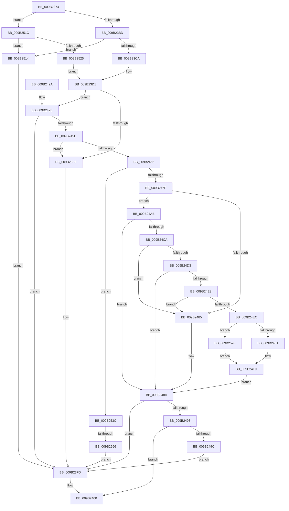

# HvWriteHivePrimaryFile

- RVA: `0x009B2374`–`0x009B2578` (길이 `516` bytes)
- VA: `0x00000001409B2374`
- 실행 섹션: `PAGE`
- PDB 이름 있음: `예`; PDB Function 태그: `예`
- unwind 정보 RVA: `0x0009E374`
- 디코드: `143`개 명령, `516/516` bytes 표시
- 미해석 바이트: `0` (있으면 어셈블리에 `.byte`로 보존)

> 이 문서는 커널 이미지의 기계어와 PDB 기호를 분석해 생성했습니다. 4번과 5번은 함수 원형과 자료형을 바이너리 사용 방식에서 추정한 C 해석이며 원본 소스 복구 결과는 아닙니다.

## 1. Dependencies

- 직접 호출 지점: **9**; 고유 호출 대상: **8**
- 직접 호출자로 확인된 함수: **2**
- RIP 상대 이미지 참조: **1**

### Outgoing calls
- `0x009B23E4` → [HvpHeaderCheckSum](../../pagecmrc/BC/HvpHeaderCheckSum_function_00BC97A0.md) (function, `0x00BC97A0`)
- `0x009B2412` → [HvpFinishPrimaryWrite](HvpFinishPrimaryWrite_function_009B2580.md) (function, `0x009B2580`)
- `0x009B2452` → [guard_dispatch_icall](../../text/6B/guard_dispatch_icall_function_006BAAD0.md) (function, `0x006BAAD0`)
- `0x009B24A1` → [ExFreePoolWithTag](../../poolcode/B8/ExFreePoolWithTag_function_00B82870.md) (function, `0x00B82870`)
- `0x009B24BF` → [guard_dispatch_icall](../../text/6B/guard_dispatch_icall_function_006BAAD0.md) (function, `0x006BAAD0`)
- `0x009B24D8` → [CmpFileFlushAndPurge](CmpFileFlushAndPurge_function_009B2BAC.md) (function, `0x009B2BAC`)
- `0x009B24F8` → [RtlNumberOfSetBits](../../text/43/RtlNumberOfSetBits_function_00433F70.md) (function, `0x00433F70`)
- `0x009B2504` → [CmpTraceHiveFlushWrotePrimaryFile](CmpTraceHiveFlushWrotePrimaryFile_function_009B166C.md) (function, `0x009B166C`)
- `0x009B2555` → [ExAllocatePool2](../../poolcode/B8/ExAllocatePool2_function_00B820F0.md) (function, `0x00B820F0`)

### Direct callers
- [CmpFlushHive](CmpFlushHive_function_009B3DC0.md) at `0x009B45A1`
- [HvpPerformLogFileRecovery](HvpPerformLogFileRecovery_function_009B7994.md) at `0x009B7D61`

### Static image references
- `0x009B23E9` → RVA `0x00EEFC80` (`.data`; read)

## 2. Other-region calls and transfers

- 다른 실행 섹션으로 향하는 call: **6**
  - `0x009B23E4` → [HvpHeaderCheckSum](../../pagecmrc/BC/HvpHeaderCheckSum_function_00BC97A0.md) (`PAGE` → `PAGECMRC`)
  - `0x009B2452` → [guard_dispatch_icall](../../text/6B/guard_dispatch_icall_function_006BAAD0.md) (`PAGE` → `.text`)
  - `0x009B24A1` → [ExFreePoolWithTag](../../poolcode/B8/ExFreePoolWithTag_function_00B82870.md) (`PAGE` → `POOLCODE`)
  - `0x009B24BF` → [guard_dispatch_icall](../../text/6B/guard_dispatch_icall_function_006BAAD0.md) (`PAGE` → `.text`)
  - `0x009B24F8` → [RtlNumberOfSetBits](../../text/43/RtlNumberOfSetBits_function_00433F70.md) (`PAGE` → `.text`)
  - `0x009B2555` → [ExAllocatePool2](../../poolcode/B8/ExAllocatePool2_function_00B820F0.md) (`PAGE` → `POOLCODE`)
- call이 아닌 외부 분기/꼬리 이동: **1**
  - `0x009B2560` → [sub_00B2DBEA](../B2/Unknown_function_00B2DBEA.md) (`tail-transfer`)

## 3. Assembly (complete function range)

```asm
009B2374  40 55                           push rbp
009B2376  53                              push rbx
009B2377  56                              push rsi
009B2378  57                              push rdi
009B2379  41 54                           push r12
009B237B  41 55                           push r13
009B237D  41 56                           push r14
009B237F  41 57                           push r15
009B2381  48 8B EC                        mov rbp, rsp
009B2384  48 83 EC 68                     sub rsp, 0x68
009B2388  45 33 E4                        xor r12d, r12d
009B238B  33 C0                           xor eax, eax
009B238D  45 8B F8                        mov r15d, r8d
009B2390  4C 89 65 60                     mov qword ptr [rbp + 0x60], r12
009B2394  0F 57 C0                        xorps xmm0, xmm0
009B2397  44 89 65 50                     mov dword ptr [rbp + 0x50], r12d
009B239B  44 8A F2                        mov r14b, dl
009B239E  89 45 E8                        mov dword ptr [rbp - 0x18], eax
009B23A1  8D 58 01                        lea ebx, [rax + 1]
009B23A4  44 89 65 58                     mov dword ptr [rbp + 0x58], r12d
009B23A8  44 23 FB                        and r15d, ebx
009B23AB  48 8B F9                        mov rdi, rcx
009B23AE  45 8A EC                        mov r13b, r12b
009B23B1  0F 11 45 D8                     movups xmmword ptr [rbp - 0x28], xmm0
009B23B5  84 D2                           test dl, dl
009B23B7  0F 84 5F 01 00 00               je 0x1409b251c
009B23BD  4C 39 A1 E0 06 00 00            cmp qword ptr [rcx + 0x6e0], r12
009B23C4  0F 84 4A 01 00 00               je 0x1409b2514
009B23CA  4C 8B 89 F0 06 00 00            mov r9, qword ptr [rcx + 0x6f0]
009B23D1  8B 81 B8 00 00 00               mov eax, dword ptr [rcx + 0xb8]
009B23D7  49 8B C9                        mov rcx, r9
009B23DA  41 89 41 08                     mov dword ptr [r9 + 8], eax
009B23DE  FF C0                           inc eax
009B23E0  41 89 41 04                     mov dword ptr [r9 + 4], eax
009B23E4  E8 B7 73 21 00                  call 0x140bc97a0
009B23E9  39 1D 91 D8 53 00               cmp dword ptr [rip + 0x53d891], ebx
009B23EF  41 89 81 FC 01 00 00            mov dword ptr [r9 + 0x1fc], eax
009B23F6  75 33                           jne 0x1409b242b
009B23F8  BB 01 00 00 C0                  mov ebx, 0xc0000001
009B23FD  45 84 F6                        test r14b, r14b
009B2400  41 0F 94 C1                     sete r9b
009B2404  8B D3                           mov edx, ebx
009B2406  C1 EA 1F                        shr edx, 0x1f
009B2409  45 8A C5                        mov r8b, r13b
009B240C  80 F2 01                        xor dl, 1
009B240F  48 8B CF                        mov rcx, rdi
009B2412  E8 69 01 00 00                  call 0x1409b2580
009B2417  8B C3                           mov eax, ebx
009B2419  48 83 C4 68                     add rsp, 0x68
009B241D  41 5F                           pop r15
009B241F  41 5E                           pop r14
009B2421  41 5D                           pop r13
009B2423  41 5C                           pop r12
009B2425  5F                              pop rdi
009B2426  5E                              pop rsi
009B2427  5B                              pop rbx
009B2428  5D                              pop rbp
009B2429  C3                              ret
009B242A  CC                              int3
009B242B  48 8B 47 28                     mov rax, qword ptr [rdi + 0x28]
009B242F  4C 8D 45 D8                     lea r8, [rbp - 0x28]
009B2433  4C 89 4D E0                     mov qword ptr [rbp - 0x20], r9
009B2437  33 D2                           xor edx, edx
009B2439  44 8B CB                        mov r9d, ebx
009B243C  44 89 65 D8                     mov dword ptr [rbp - 0x28], r12d
009B2440  48 8B CF                        mov rcx, rdi
009B2443  C7 45 E8 00 10 00 00            mov dword ptr [rbp - 0x18], 0x1000
009B244A  44 8A EB                        mov r13b, bl
009B244D  44 89 7C 24 20                  mov dword ptr [rsp + 0x20], r15d
009B2452  E8 79 86 D0 FF                  call 0x1406baad0
009B2457  8B D8                           mov ebx, eax
009B2459  85 C0                           test eax, eax
009B245B  78 A0                           js 0x1409b23fd
009B245D  83 3D 1C D8 53 00 02            cmp dword ptr [rip + 0x53d81c], 2
009B2464  74 92                           je 0x1409b23f8
009B2466  45 84 F6                        test r14b, r14b
009B2469  0F 84 CD 00 00 00               je 0x1409b253c
009B246F  48 8B B7 E0 06 00 00            mov rsi, qword ptr [rdi + 0x6e0]
009B2476  8B 9F E8 06 00 00               mov ebx, dword ptr [rdi + 0x6e8]
009B247C  83 3D FD D7 53 00 03            cmp dword ptr [rip + 0x53d7fd], 3
009B2483  75 26                           jne 0x1409b24ab
009B2485  BB 01 00 00 C0                  mov ebx, 0xc0000001
009B248A  48 85 F6                        test rsi, rsi
009B248D  0F 84 6A FF FF FF               je 0x1409b23fd
009B2493  45 84 F6                        test r14b, r14b
009B2496  0F 85 64 FF FF FF               jne 0x1409b2400
009B249C  33 D2                           xor edx, edx
009B249E  48 8B CE                        mov rcx, rsi
009B24A1  E8 CA 03 1D 00                  call 0x140b82870
009B24A6  E9 52 FF FF FF                  jmp 0x1409b23fd
009B24AB  48 8B 47 28                     mov rax, qword ptr [rdi + 0x28]
009B24AF  44 8B CB                        mov r9d, ebx
009B24B2  4C 8B C6                        mov r8, rsi
009B24B5  44 89 7C 24 20                  mov dword ptr [rsp + 0x20], r15d
009B24BA  33 D2                           xor edx, edx
009B24BC  48 8B CF                        mov rcx, rdi
009B24BF  E8 0C 86 D0 FF                  call 0x1406baad0
009B24C4  8B D8                           mov ebx, eax
009B24C6  85 C0                           test eax, eax
009B24C8  78 C0                           js 0x1409b248a
009B24CA  83 3D AF D7 53 00 04            cmp dword ptr [rip + 0x53d7af], 4
009B24D1  74 B2                           je 0x1409b2485
009B24D3  33 D2                           xor edx, edx
009B24D5  48 8B CF                        mov rcx, rdi
009B24D8  E8 CF 06 00 00                  call 0x1409b2bac
009B24DD  8B D8                           mov ebx, eax
009B24DF  85 C0                           test eax, eax
009B24E1  78 A7                           js 0x1409b248a
009B24E3  83 3D 96 D7 53 00 05            cmp dword ptr [rip + 0x53d796], 5
009B24EA  74 99                           je 0x1409b2485
009B24EC  45 84 F6                        test r14b, r14b
009B24EF  74 7F                           je 0x1409b2570
009B24F1  48 8D 8F C8 06 00 00            lea rcx, [rdi + 0x6c8]
009B24F8  E8 73 1A A8 FF                  call 0x140433f70
009B24FD  8B D0                           mov edx, eax
009B24FF  8B C8                           mov ecx, eax
009B2501  C1 E2 09                        shl edx, 9
009B2504  E8 63 F1 FF FF                  call 0x1409b166c
009B2509  45 8A EC                        mov r13b, r12b
009B250C  41 8B DC                        mov ebx, r12d
009B250F  E9 76 FF FF FF                  jmp 0x1409b248a
009B2514  41 8B DC                        mov ebx, r12d
009B2517  E9 E1 FE FF FF                  jmp 0x1409b23fd
009B251C  44 39 A1 80 00 00 00            cmp dword ptr [rcx + 0x80], r12d
009B2523  74 EF                           je 0x1409b2514
009B2525  4C 8B 49 40                     mov r9, qword ptr [rcx + 0x40]
009B2529  8B 81 18 01 00 00               mov eax, dword ptr [rcx + 0x118]
009B252F  41 89 41 28                     mov dword ptr [r9 + 0x28], eax
009B2533  41 89 59 2C                     mov dword ptr [r9 + 0x2c], ebx
009B2537  E9 95 FE FF FF                  jmp 0x1409b23d1
009B253C  8B 87 80 00 00 00               mov eax, dword ptr [rdi + 0x80]
009B2542  B9 00 01 00 00                  mov ecx, 0x100
009B2547  41 B8 43 4D 53 62               mov r8d, 0x62534d43
009B254D  48 8D 14 40                     lea rdx, [rax + rax*2]
009B2551  48 C1 E2 03                     shl rdx, 3
009B2555  E8 96 FB 1C 00                  call 0x140b820f0
009B255A  48 8B F0                        mov rsi, rax
009B255D  48 85 C0                        test rax, rax
009B2560  0F 85 84 B6 17 00               jne 0x140b2dbea
009B2566  BB 17 00 00 C0                  mov ebx, 0xc0000017
009B256B  E9 8D FE FF FF                  jmp 0x1409b23fd
009B2570  8B 87 80 00 00 00               mov eax, dword ptr [rdi + 0x80]
009B2576  EB 85                           jmp 0x1409b24fd
```

## 4. C-style interpretation (structured pseudocode)

```c
__int64 __fastcall HvWriteHivePrimaryFile(__int64 a1, unsigned __int8 a2, int a3)
{
    __int64 result;
    __int64 v_r12;
    __int64 v_r15;
    __int64 v_rsp;
    unsigned int v_stack_m58;
    unsigned __int64 v_stack_m60;
    unsigned __int64 v_stack_m68;
    unsigned int v_stack_p10;
    unsigned int v_stack_p18;
    unsigned __int64 v_stack_p20;

    v_rsp = (v_rsp) - (104);
    v_r12 = 0;
    result = 0;
    v_stack_p20 = 0;
    v_stack_p10 = 0;
    v_stack_m58 = 0;
    v_stack_p18 = 0;
    v_r15 = (unsigned int)(((unsigned int)(a3)) & ((unsigned int)(result + 1)));
    v_stack_m68 = v_xmm0;
    if (a2 == 0) goto loc_009B251C;
    if ((*(unsigned __int64 *)(a1 + 1760)) == 0) goto loc_009B2514;
loc_009B23D1:
    *(unsigned int *)(*(unsigned __int64 *)(a1 + 1776) + 8) = (unsigned int)((unsigned int)(*(unsigned int *)(a1 + 184)));
    result = (unsigned int)(((unsigned int)(*(unsigned int *)(a1 + 184))) + 1);
    *(unsigned int *)(*(unsigned __int64 *)(a1 + 1776) + 4) = (unsigned int)(result);
    result = HvpHeaderCheckSum(*(unsigned __int64 *)(a1 + 1776), a2, a3, *(unsigned __int64 *)(a1 + 1776));
    *(unsigned int *)(*(unsigned __int64 *)(a1 + 1776) + 508) = (unsigned int)(result);
    if ((*(unsigned int *)(v_rip + 5494929)) != ((unsigned int)(result + 1))) goto loc_009B242B;
loc_009B23F8:
loc_009B23FD:
loc_009B2400:
    a4 = (a2 == 0) ? 1 : 0;
    a2 = (unsigned int)(((unsigned int)((unsigned int)((unsigned int)(0xC0000001ULL)))) >> (31));
    a2 = (unsigned __int8)((a2) ^ (1));
    result = HvpFinishPrimaryWrite(a1, a2, 0, a4);
    v_rsp = (v_rsp) + (104);
    return (unsigned int)((unsigned int)((unsigned int)(0xC0000001ULL)));
loc_009B242B:
    v_stack_m60 = a4;
    a2 = 0;
    v_stack_m68 = 0;
    v_stack_m58 = 0x1000ULL;
    v_stack_p20 = (unsigned int)(v_r15);
    result = guard_dispatch_icall(a1, a2, v_stack_m68, (unsigned int)((unsigned int)((unsigned int)(0xC0000001ULL))));
    if (sign_flag) goto loc_009B23FD;
    if ((*(unsigned int *)(v_rip + 5494812)) == 2) goto loc_009B23F8;
    if (0 == 0) goto loc_009B253C;
    if ((*(unsigned int *)(v_rip + 5494781)) != 3) goto loc_009B24AB;
loc_009B2485:
loc_009B248A:
    if (*(unsigned __int64 *)(a1 + 1760) == 0) goto loc_009B23FD;
    if (0 != 0) goto loc_009B2400;
    a2 = 0;
    result = ExFreePoolWithTag(*(unsigned __int64 *)(a1 + 1760), a2, v_stack_m68, (unsigned int)((unsigned int)((unsigned int)(0xC0000001ULL))));
    goto loc_009B23FD;
loc_009B24AB:
    v_stack_p20 = (unsigned int)(v_r15);
    a2 = 0;
    result = guard_dispatch_icall(a1, a2, *(unsigned __int64 *)(a1 + 1760), (unsigned int)((unsigned int)((unsigned int)(0xC0000001ULL))));
    if (sign_flag) goto loc_009B248A;
    if ((*(unsigned int *)(v_rip + 5494703)) == 4) goto loc_009B2485;
    a2 = 0;
    result = CmpFileFlushAndPurge(a1, a2, *(unsigned __int64 *)(a1 + 1760), (unsigned int)((unsigned int)((unsigned int)(0xC0000001ULL))));
    if (sign_flag) goto loc_009B248A;
    if ((*(unsigned int *)(v_rip + 5494678)) == 5) goto loc_009B2485;
    if (0 == 0) goto loc_009B2570;
    result = RtlNumberOfSetBits(a1 + 1736, a2, *(unsigned __int64 *)(a1 + 1760), (unsigned int)((unsigned int)((unsigned int)(0xC0000001ULL))));
loc_009B24FD:
    a2 = (unsigned int)(((unsigned int)((unsigned int)(result))) << (9));
    result = CmpTraceHiveFlushWrotePrimaryFile((unsigned int)((unsigned int)(result)), a2, *(unsigned __int64 *)(a1 + 1760), (unsigned int)((unsigned int)((unsigned int)(0xC0000001ULL))));
    goto loc_009B248A;
loc_009B2514:
    goto loc_009B23FD;
loc_009B251C:
    if ((*(unsigned int *)((unsigned int)((unsigned int)(result)) + 128)) == 0) goto loc_009B2514;
    *(unsigned int *)(*(unsigned __int64 *)((unsigned int)((unsigned int)(result)) + 64) + 40) = (unsigned int)((unsigned int)(*(unsigned int *)((unsigned int)((unsigned int)(result)) + 280)));
    *(unsigned int *)(*(unsigned __int64 *)((unsigned int)((unsigned int)(result)) + 64) + 44) = 0;
    goto loc_009B23D1;
loc_009B253C:
    a2 = ((unsigned int)(*(unsigned int *)(a1 + 128)) + (unsigned int)(*(unsigned int *)(a1 + 128)) * 2) << (3);
    result = ExAllocatePool2(256, a2, (unsigned int)(0x62534D43ULL), *(unsigned __int64 *)((unsigned int)((unsigned int)(result)) + 64));
    goto loc_009B23FD;
loc_009B2570:
    goto loc_009B24FD;
}
```

## 5. (Beta) C Style

```c
int64_t HvWriteHivePrimaryFile(void *Arg1, uint8_t Arg2, int32_t Arg3)
{
    uint8_t *arg1 = (uint8_t *)Arg1;

    int64_t result;
    int64_t local_r12;
    int64_t local_r15;
    int64_t local_rsp;
    uint32_t v_stack_m58;
    uint64_t v_stack_m60;
    uint64_t v_stack_m68;
    uint32_t v_stack_p10;
    uint32_t v_stack_p18;
    uint64_t v_stack_p20;

    local_rsp = (local_rsp) - (104);
    local_r12 = 0;
    result = 0;
    v_stack_p20 = 0;
    v_stack_p10 = 0;
    v_stack_m58 = 0;
    v_stack_p18 = 0;
    local_r15 = (uint32_t)(((uint32_t)(Arg3)) & ((uint32_t)(result + 1)));
    v_stack_m68 = v_xmm0;
    if (Arg2 == 0) goto loc_009B251C;
    if ((*(uint64_t *)(arg1 + 0x6E0)) == 0) goto loc_009B2514;
loc_009B23D1:
    *(uint32_t *)(*(uint64_t *)(arg1 + 0x6F0) + 0x8) = (uint32_t)((uint32_t)(*(uint32_t *)(arg1 + 0xB8)));
    result = (uint32_t)(((uint32_t)(*(uint32_t *)(arg1 + 0xB8))) + 1);
    *(uint32_t *)(*(uint64_t *)(arg1 + 0x6F0) + 0x4) = (uint32_t)(result);
    result = HvpHeaderCheckSum(*(uint64_t *)(arg1 + 0x6F0), Arg2, Arg3, *(uint64_t *)(arg1 + 0x6F0));
    *(uint32_t *)(*(uint64_t *)(arg1 + 0x6F0) + 0x1FC) = (uint32_t)(result);
    if ((*(uint32_t *)(v_rip + 0x53D891)) != ((uint32_t)(result + 1))) goto loc_009B242B;
loc_009B23F8:
loc_009B23FD:
loc_009B2400:
    a4 = (Arg2 == 0) ? 1 : 0;
    Arg2 = (uint32_t)(((uint32_t)((uint32_t)((uint32_t)(0xC0000001ULL)))) >> (31));
    Arg2 = (uint8_t)((Arg2) ^ (1));
    result = HvpFinishPrimaryWrite(Arg1, Arg2, 0, a4);
    local_rsp = (local_rsp) + (104);
    return (uint32_t)((uint32_t)((uint32_t)(0xC0000001ULL)));
loc_009B242B:
    v_stack_m60 = a4;
    Arg2 = 0;
    v_stack_m68 = 0;
    v_stack_m58 = 0x1000ULL;
    v_stack_p20 = (uint32_t)(local_r15);
    result = guard_dispatch_icall(Arg1, Arg2, v_stack_m68, (uint32_t)((uint32_t)((uint32_t)(0xC0000001ULL))));
    if (sign_flag) goto loc_009B23FD;
    if ((*(uint32_t *)(v_rip + 0x53D81C)) == 2) goto loc_009B23F8;
    if (0 == 0) goto loc_009B253C;
    if ((*(uint32_t *)(v_rip + 0x53D7FD)) != 3) goto loc_009B24AB;
loc_009B2485:
loc_009B248A:
    if (*(uint64_t *)(arg1 + 0x6E0) == 0) goto loc_009B23FD;
    if (0 != 0) goto loc_009B2400;
    Arg2 = 0;
    result = ExFreePoolWithTag(*(uint64_t *)(arg1 + 0x6E0), Arg2, v_stack_m68, (uint32_t)((uint32_t)((uint32_t)(0xC0000001ULL))));
    goto loc_009B23FD;
loc_009B24AB:
    v_stack_p20 = (uint32_t)(local_r15);
    Arg2 = 0;
    result = guard_dispatch_icall(Arg1, Arg2, *(uint64_t *)(arg1 + 0x6E0), (uint32_t)((uint32_t)((uint32_t)(0xC0000001ULL))));
    if (sign_flag) goto loc_009B248A;
    if ((*(uint32_t *)(v_rip + 0x53D7AF)) == 4) goto loc_009B2485;
    Arg2 = 0;
    result = CmpFileFlushAndPurge(Arg1, Arg2, *(uint64_t *)(arg1 + 0x6E0), (uint32_t)((uint32_t)((uint32_t)(0xC0000001ULL))));
    if (sign_flag) goto loc_009B248A;
    if ((*(uint32_t *)(v_rip + 0x53D796)) == 5) goto loc_009B2485;
    if (0 == 0) goto loc_009B2570;
    result = RtlNumberOfSetBits(Arg1 + 1736, Arg2, *(uint64_t *)(arg1 + 0x6E0), (uint32_t)((uint32_t)((uint32_t)(0xC0000001ULL))));
loc_009B24FD:
    Arg2 = (uint32_t)(((uint32_t)((uint32_t)(result))) << (9));
    result = CmpTraceHiveFlushWrotePrimaryFile((uint32_t)((uint32_t)(result)), Arg2, *(uint64_t *)(arg1 + 0x6E0), (uint32_t)((uint32_t)((uint32_t)(0xC0000001ULL))));
    goto loc_009B248A;
loc_009B2514:
    goto loc_009B23FD;
loc_009B251C:
    if ((*(uint32_t *)((uint32_t)((uint32_t)(result)) + 0x80)) == 0) goto loc_009B2514;
    *(uint32_t *)(*(uint64_t *)((uint32_t)((uint32_t)(result)) + 0x40) + 0x28) = (uint32_t)((uint32_t)(*(uint32_t *)((uint32_t)((uint32_t)(result)) + 0x118)));
    *(uint32_t *)(*(uint64_t *)((uint32_t)((uint32_t)(result)) + 0x40) + 0x2C) = 0;
    goto loc_009B23D1;
loc_009B253C:
    Arg2 = ((uint32_t)(*(uint32_t *)(arg1 + 0x80)) + (uint32_t)(*(uint32_t *)(arg1 + 0x80)) * 2) << (3);
    result = ExAllocatePool2(256, Arg2, (uint32_t)(0x62534D43ULL), *(uint64_t *)((uint32_t)((uint32_t)(result)) + 0x40));
    goto loc_009B23FD;
loc_009B2570:
    goto loc_009B24FD;
}
```

### 관측된 메모리 오프셋

구조체 형식이 확인되지 않은 접근은 인자 기준의 오프셋으로만 기록했습니다.

| 기준 인자 | 오프셋 표현 | 폭 (bit) | 접근 |
|---|---:|---:|---|
| `Arg1` | `+ 0x28` | `64` | `R` |
| `Arg1` | `+ 0x40` | `64` | `R` |
| `Arg1` | `+ 0x80` | `32` | `R` |
| `Arg1` | `+ 0xB8` | `32` | `R` |
| `Arg1` | `+ 0x118` | `32` | `R` |
| `Arg1` | `+ 0x6C8` | `64` | `R` |
| `Arg1` | `+ 0x6E0` | `64` | `R` |
| `Arg1` | `+ 0x6E8` | `32` | `R` |
| `Arg1` | `+ 0x6F0` | `64` | `R` |

## 6. Execution-region graph

[열기: 2D/3D 그래프와 함수 탐색 컨트롤 패널](../../../control-panel.html?section=page&rva=0x009B2374&view=graph)

- 2D 그래프는 위에서 아래로 흐르고, 3D 그래프는 빈 공간을 드래그해 회전합니다. Shift+드래그는 이동, 휠은 확대·축소, 함수 노드 선택은 대상 보고서 이동입니다.

### Static fallback


