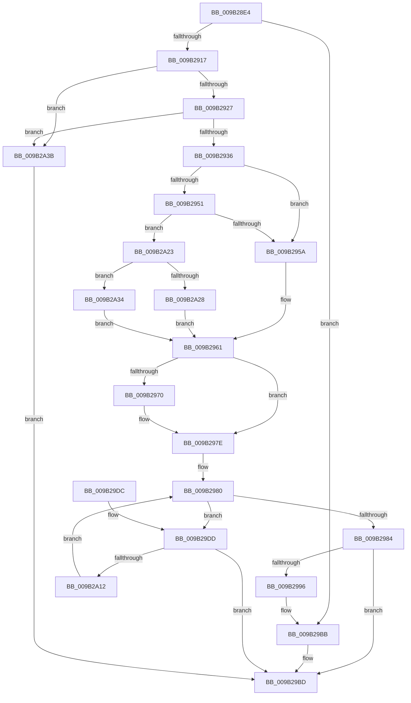

# HvWriteLogFile

- RVA: `0x009B28E4`–`0x009B2A45` (길이 `353` bytes)
- VA: `0x00000001409B28E4`
- 실행 섹션: `PAGE`
- PDB 이름 있음: `예`; PDB Function 태그: `아니요`
- unwind 정보 RVA: `0x0009E3CC`
- 디코드: `86`개 명령, `353/353` bytes 표시
- 미해석 바이트: `0` (있으면 어셈블리에 `.byte`로 보존)

> 이 문서는 커널 이미지의 기계어와 PDB 기호를 분석해 생성했습니다. 4번과 5번은 함수 원형과 자료형을 바이너리 사용 방식에서 추정한 C 해석이며 원본 소스 복구 결과는 아닙니다.

## 1. Dependencies

- 직접 호출 지점: **5**; 고유 호출 대상: **5**
- 직접 호출자로 확인된 함수: **1**
- RIP 상대 이미지 참조: **0**

### Outgoing calls
- `0x009B2979` → [CmpDoFileSetSizeEx](CmpDoFileSetSizeEx_function_009B2A4C.md) (function, `0x009B2A4C`)
- `0x009B298D` → [CmpFileFlushAndPurge](CmpFileFlushAndPurge_function_009B2BAC.md) (function, `0x009B2BAC`)
- `0x009B29A2` → [HvpLogTypeToLogArrayIndex](HvpLogTypeToLogArrayIndex_function_009B2DFC.md) (function, `0x009B2DFC`)
- `0x009B29B3` → [CmpTraceHiveFlushWroteLogFile](CmpTraceHiveFlushWroteLogFile_function_009B2D5C.md) (function, `0x009B2D5C`)
- `0x009B2A09` → [guard_dispatch_icall](../../text/6B/guard_dispatch_icall_function_006BAAD0.md) (function, `0x006BAAD0`)

### Direct callers
- [CmpFlushHive](CmpFlushHive_function_009B3DC0.md) at `0x009B4279`

### Static image references
- 디코드된 RIP-relative 메모리 참조가 없습니다.

## 2. Other-region calls and transfers

- 다른 실행 섹션으로 향하는 call: **1**
  - `0x009B2A09` → [guard_dispatch_icall](../../text/6B/guard_dispatch_icall_function_006BAAD0.md) (`PAGE` → `.text`)
- 별도 외부 분기/꼬리 이동을 확인하지 못했습니다.

## 3. Assembly (complete function range)

```asm
009B28E4  48 8B C4                        mov rax, rsp
009B28E7  48 89 58 08                     mov qword ptr [rax + 8], rbx
009B28EB  48 89 68 10                     mov qword ptr [rax + 0x10], rbp
009B28EF  48 89 70 18                     mov qword ptr [rax + 0x18], rsi
009B28F3  48 89 78 20                     mov qword ptr [rax + 0x20], rdi
009B28F7  41 54                           push r12
009B28F9  41 56                           push r14
009B28FB  41 57                           push r15
009B28FD  48 83 EC 30                     sub rsp, 0x30
009B2901  F7 81 A0 00 00 00 01 80 00 00   test dword ptr [rcx + 0xa0], 0x8001
009B290B  4D 8B F9                        mov r15, r9
009B290E  48 8B D9                        mov rbx, rcx
009B2911  0F 85 A4 00 00 00               jne 0x1409b29bb
009B2917  44 8B 91 A8 00 00 00            mov r10d, dword ptr [rcx + 0xa8]
009B291E  45 85 D2                        test r10d, r10d
009B2921  0F 84 14 01 00 00               je 0x1409b2a3b
009B2927  4A 83 BC D1 08 06 00 00 00      cmp qword ptr [rcx + r10*8 + 0x608], 0
009B2930  0F 84 05 01 00 00               je 0x1409b2a3b
009B2936  4C 8B A1 B0 06 00 00            mov r12, qword ptr [rcx + 0x6b0]
009B293D  41 8B C2                        mov eax, r10d
009B2940  8B A9 B8 06 00 00               mov ebp, dword ptr [rcx + 0x6b8]
009B2946  8B B1 BC 06 00 00               mov esi, dword ptr [rcx + 0x6bc]
009B294C  83 E8 01                        sub eax, 1
009B294F  74 09                           je 0x1409b295a
009B2951  83 E8 03                        sub eax, 3
009B2954  0F 85 C9 00 00 00               jne 0x1409b2a23
009B295A  48 8D 91 10 07 00 00            lea rdx, [rcx + 0x710]
009B2961  44 8B 81 B4 00 00 00            mov r8d, dword ptr [rcx + 0xb4]
009B2968  4C 03 C6                        add r8, rsi
009B296B  4C 3B 02                        cmp r8, qword ptr [rdx]
009B296E  7E 0E                           jle 0x1409b297e
009B2970  41 B9 01 00 00 00               mov r9d, 1
009B2976  41 8B D2                        mov edx, r10d
009B2979  E8 CE 00 00 00                  call 0x1409b2a4c
009B297E  33 FF                           xor edi, edi
009B2980  3B FD                           cmp edi, ebp
009B2982  72 59                           jb 0x1409b29dd
009B2984  8B 93 A8 00 00 00               mov edx, dword ptr [rbx + 0xa8]
009B298A  48 8B CB                        mov rcx, rbx
009B298D  E8 1A 02 00 00                  call 0x1409b2bac
009B2992  85 C0                           test eax, eax
009B2994  78 27                           js 0x1409b29bd
009B2996  FF 83 AC 00 00 00               inc dword ptr [rbx + 0xac]
009B299C  8B 8B A8 00 00 00               mov ecx, dword ptr [rbx + 0xa8]
009B29A2  E8 55 04 00 00                  call 0x1409b2dfc
009B29A7  8B C8                           mov ecx, eax
009B29A9  8B D6                           mov edx, esi
009B29AB  C6 84 19 C0 00 00 00 01         mov byte ptr [rcx + rbx + 0xc0], 1
009B29B3  E8 A4 03 00 00                  call 0x1409b2d5c
009B29B8  41 89 37                        mov dword ptr [r15], esi
009B29BB  33 C0                           xor eax, eax
009B29BD  48 8B 5C 24 50                  mov rbx, qword ptr [rsp + 0x50]
009B29C2  48 8B 6C 24 58                  mov rbp, qword ptr [rsp + 0x58]
009B29C7  48 8B 74 24 60                  mov rsi, qword ptr [rsp + 0x60]
009B29CC  48 8B 7C 24 68                  mov rdi, qword ptr [rsp + 0x68]
009B29D1  48 83 C4 30                     add rsp, 0x30
009B29D5  41 5F                           pop r15
009B29D7  41 5E                           pop r14
009B29D9  41 5C                           pop r12
009B29DB  C3                              ret
009B29DC  CC                              int3
009B29DD  8B 83 B4 00 00 00               mov eax, dword ptr [rbx + 0xb4]
009B29E3  48 8D 0C 7F                     lea rcx, [rdi + rdi*2]
009B29E7  83 64 24 20 00                  and dword ptr [rsp + 0x20], 0
009B29EC  4D 8D 34 CC                     lea r14, [r12 + rcx*8]
009B29F0  41 89 06                        mov dword ptr [r14], eax
009B29F3  41 B9 01 00 00 00               mov r9d, 1
009B29F9  48 8B 43 28                     mov rax, qword ptr [rbx + 0x28]
009B29FD  4D 8B C6                        mov r8, r14
009B2A00  8B 93 A8 00 00 00               mov edx, dword ptr [rbx + 0xa8]
009B2A06  48 8B CB                        mov rcx, rbx
009B2A09  E8 C2 80 D0 FF                  call 0x1406baad0
009B2A0E  85 C0                           test eax, eax
009B2A10  78 AB                           js 0x1409b29bd
009B2A12  41 8B 46 10                     mov eax, dword ptr [r14 + 0x10]
009B2A16  01 83 B4 00 00 00               add dword ptr [rbx + 0xb4], eax
009B2A1C  FF C7                           inc edi
009B2A1E  E9 5D FF FF FF                  jmp 0x1409b2980
009B2A23  83 F8 01                        cmp eax, 1
009B2A26  75 0C                           jne 0x1409b2a34
009B2A28  48 8D 91 18 07 00 00            lea rdx, [rcx + 0x718]
009B2A2F  E9 2D FF FF FF                  jmp 0x1409b2961
009B2A34  33 D2                           xor edx, edx
009B2A36  E9 26 FF FF FF                  jmp 0x1409b2961
009B2A3B  B8 0D 00 00 C0                  mov eax, 0xc000000d
009B2A40  E9 78 FF FF FF                  jmp 0x1409b29bd
```

## 4. C-style interpretation (structured pseudocode)

```c
__int64 __fastcall HvWriteLogFile(__int64 a1, __int64 a2, __int64 a3, __int64 a4)
{
    __int64 result;
    __int64 v_rdi;
    __int64 v_rsp;
    unsigned __int64 v_stack_p10;
    unsigned __int64 v_stack_p18;
    unsigned __int64 v_stack_p20;
    unsigned __int64 v_stack_p8;

    *(unsigned __int64 *)(v_rsp + 8) = v_rbx;
    *(unsigned __int64 *)(v_rsp + 16) = v_rbp;
    *(unsigned __int64 *)(v_rsp + 24) = v_rsi;
    *(unsigned __int64 *)(v_rsp + 32) = v_rdi;
    v_rsp = (v_rsp) - (48);
    if (((*(unsigned int *)(a1 + 160)) & (0x8001ULL)) != 0) goto loc_009B29BB;
    if ((unsigned int)((unsigned int)(*(unsigned int *)(a1 + 168))) == 0) goto loc_009B2A3B;
    if ((*(unsigned __int64 *)(a1 + (unsigned int)(*(unsigned int *)(a1 + 168)) * 8 + 1544)) == 0) goto loc_009B2A3B;
    result = (unsigned int)(((unsigned int)((unsigned int)((unsigned int)(*(unsigned int *)(a1 + 168))))) - (1));
    if (condition_is_equal) goto loc_009B295A;
    result = (unsigned int)((result) - (3));
    if (condition_is_not_equal) goto loc_009B2A23;
loc_009B295A:
loc_009B2961:
    a3 = ((unsigned int)(*(unsigned int *)(a1 + 180))) + ((unsigned int)(*(unsigned int *)(a1 + 1724)));
    if (a3 >= = (*(unsigned __int64 *)(a1 + 1808))) {
        a4 = 1;
        a2 = (unsigned int)((unsigned int)(*(unsigned int *)(a1 + 168)));
        result = CmpDoFileSetSizeEx(a1, a2, a3, a4);
    }
    v_rdi = 0;
loc_009B2980:
    if (0 < ((unsigned int)((unsigned int)(*(unsigned int *)(a1 + 1720))))) goto loc_009B29DD;
    result = CmpFileFlushAndPurge(a1, (unsigned int)(*(unsigned int *)(a1 + 168)), a3, a4);
    if (sign_flag) goto loc_009B29BD;
    result = HvpLogTypeToLogArrayIndex((unsigned int)(*(unsigned int *)(a1 + 168)), (unsigned int)(*(unsigned int *)(a1 + 168)), a3, a4);
    *(unsigned __int8 *)((unsigned int)((unsigned int)(result)) + a1 * 1 + 192) = 1;
    result = CmpTraceHiveFlushWroteLogFile((unsigned int)((unsigned int)(result)), (unsigned int)((unsigned int)((unsigned int)(*(unsigned int *)(a1 + 1724)))), a3, a4);
    *(unsigned int *)(a4) = (unsigned int)((unsigned int)(*(unsigned int *)(a1 + 1724)));
loc_009B29BB:
    result = 0;
loc_009B29BD:
    v_rsp = (v_rsp) + (48);
    return result;
loc_009B29DD:
    *(unsigned int *)(*(unsigned __int64 *)(a1 + 1712) + v_stack_p20 + v_stack_p20 * 2 * 8) = (unsigned int)((unsigned int)(*(unsigned int *)(v_stack_p8 + 180)));
    result = guard_dispatch_icall(v_stack_p8, (unsigned int)(*(unsigned int *)(v_stack_p8 + 168)), *(unsigned __int64 *)(a1 + 1712) + v_stack_p20 + v_stack_p20 * 2 * 8, 1);
    if (sign_flag) goto loc_009B29BD;
    v_rdi = (unsigned int)((v_stack_p20) + 1);
    goto loc_009B2980;
loc_009B2A23:
    if (((unsigned int)((unsigned int)(*(unsigned int *)(*(unsigned __int64 *)(a1 + 1712) + v_stack_p20 + v_stack_p20 * 2 * 8 + 16)))) != 1) goto loc_009B2A34;
    goto loc_009B2961;
loc_009B2A34:
    a2 = 0;
    goto loc_009B2961;
loc_009B2A3B:
    goto loc_009B29BD;
}
```

## 5. (Beta) C Style

```c
int64_t HvWriteLogFile(void *Arg1, int64_t Arg2, int64_t Arg3, void *Arg4)
{
    uint8_t *arg1 = (uint8_t *)Arg1;
    uint8_t *arg4 = (uint8_t *)Arg4;

    int64_t result;
    int64_t local_rdi;
    int64_t local_rsp;
    uint64_t v_stack_p10;
    uint64_t v_stack_p18;
    uint64_t v_stack_p20;
    uint64_t v_stack_p8;

    *(uint64_t *)(local_rsp + 0x8) = local_rbx;
    *(uint64_t *)(local_rsp + 0x10) = local_rbp;
    *(uint64_t *)(local_rsp + 0x18) = local_rsi;
    *(uint64_t *)(local_rsp + 0x20) = local_rdi;
    local_rsp = (local_rsp) - (48);
    if (((*(uint32_t *)(arg1 + 0xA0)) & (0x8001ULL)) != 0) goto loc_009B29BB;
    if ((uint32_t)((uint32_t)(*(uint32_t *)(arg1 + 0xA8))) == 0) goto loc_009B2A3B;
    if ((*(uint64_t *)(arg1 + (uint32_t)(*(uint32_t *)(arg1 + 0xA8)) * 8 + 0x608)) == 0) goto loc_009B2A3B;
    result = (uint32_t)(((uint32_t)((uint32_t)((uint32_t)(*(uint32_t *)(arg1 + 0xA8))))) - (1));
    if (condition_is_equal) goto loc_009B295A;
    result = (uint32_t)((result) - (3));
    if (condition_is_not_equal) goto loc_009B2A23;
loc_009B295A:
loc_009B2961:
    Arg3 = ((uint32_t)(*(uint32_t *)(arg1 + 0xB4))) + ((uint32_t)(*(uint32_t *)(arg1 + 0x6BC)));
    if (Arg3 >= = (*(uint64_t *)(arg1 + 0x710))) {
        Arg4 = 1;
        Arg2 = (uint32_t)((uint32_t)(*(uint32_t *)(arg1 + 0xA8)));
        result = CmpDoFileSetSizeEx(Arg1, Arg2, Arg3, Arg4);
    }
    local_rdi = 0;
loc_009B2980:
    if (0 < ((uint32_t)((uint32_t)(*(uint32_t *)(arg1 + 0x6B8))))) goto loc_009B29DD;
    result = CmpFileFlushAndPurge(Arg1, (uint32_t)(*(uint32_t *)(arg1 + 0xA8)), Arg3, Arg4);
    if (sign_flag) goto loc_009B29BD;
    result = HvpLogTypeToLogArrayIndex((uint32_t)(*(uint32_t *)(arg1 + 0xA8)), (uint32_t)(*(uint32_t *)(arg1 + 0xA8)), Arg3, Arg4);
    *(uint8_t *)((uint32_t)((uint32_t)(result)) + arg1 * 1 + 0xC0) = 1;
    result = CmpTraceHiveFlushWroteLogFile((uint32_t)((uint32_t)(result)), (uint32_t)((uint32_t)((uint32_t)(*(uint32_t *)(arg1 + 0x6BC)))), Arg3, Arg4);
    *(uint32_t *)(arg4) = (uint32_t)((uint32_t)(*(uint32_t *)(arg1 + 0x6BC)));
loc_009B29BB:
    result = 0;
loc_009B29BD:
    local_rsp = (local_rsp) + (48);
    return result;
loc_009B29DD:
    *(uint32_t *)(*(uint64_t *)(arg1 + 0x6B0) + v_stack_p20 + v_stack_p20 * 2 * 8) = (uint32_t)((uint32_t)(*(uint32_t *)(v_stack_p8 + 0xB4)));
    result = guard_dispatch_icall(v_stack_p8, (uint32_t)(*(uint32_t *)(v_stack_p8 + 0xA8)), *(uint64_t *)(arg1 + 0x6B0) + v_stack_p20 + v_stack_p20 * 2 * 8, 1);
    if (sign_flag) goto loc_009B29BD;
    local_rdi = (uint32_t)((v_stack_p20) + 1);
    goto loc_009B2980;
loc_009B2A23:
    if (((uint32_t)((uint32_t)(*(uint32_t *)(*(uint64_t *)(arg1 + 0x6B0) + v_stack_p20 + v_stack_p20 * 2 * 8 + 0x10)))) != 1) goto loc_009B2A34;
    goto loc_009B2961;
loc_009B2A34:
    Arg2 = 0;
    goto loc_009B2961;
loc_009B2A3B:
    goto loc_009B29BD;
}
```

### 관측된 메모리 오프셋

구조체 형식이 확인되지 않은 접근은 인자 기준의 오프셋으로만 기록했습니다.

| 기준 인자 | 오프셋 표현 | 폭 (bit) | 접근 |
|---|---:|---:|---|
| `Arg1` | `+ 0x28` | `64` | `R` |
| `Arg1` | `+ 0xA0` | `32` | `R` |
| `Arg1` | `+ 0xA8` | `32` | `R` |
| `Arg1` | `+ 0xAC` | `32` | `R/W` |
| `Arg1` | `+ 0xB4` | `32` | `R` |
| `Arg1` | `+ 0xB4` | `32` | `R/W` |
| `Arg1` | `+ 0x608 + r10*8` | `64` | `R` |
| `Arg1` | `+ 0x6B0` | `64` | `R` |
| `Arg1` | `+ 0x6B8` | `32` | `R` |
| `Arg1` | `+ 0x6BC` | `32` | `R` |
| `Arg1` | `+ 0x710` | `64` | `R` |
| `Arg1` | `+ 0x718` | `64` | `R` |
| `Arg4` | `+ 0x0` | `32` | `W` |

## 6. Execution-region graph

[열기: 2D/3D 그래프와 함수 탐색 컨트롤 패널](../../../control-panel.html?section=page&rva=0x009B28E4&view=graph)

- 2D 그래프는 위에서 아래로 흐르고, 3D 그래프는 빈 공간을 드래그해 회전합니다. Shift+드래그는 이동, 휠은 확대·축소, 함수 노드 선택은 대상 보고서 이동입니다.

### Static fallback


