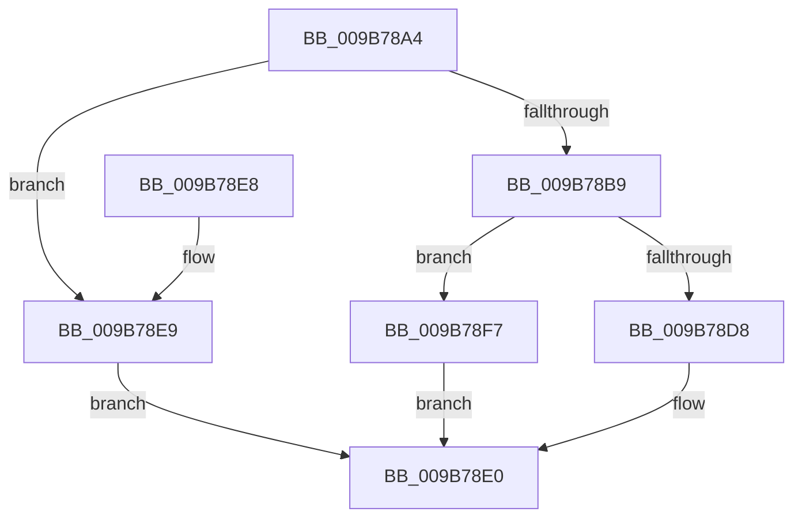

# HvpAllocateBin

- RVA: `0x009B78A4`–`0x009B78FE` (길이 `90` bytes)
- VA: `0x00000001409B78A4`
- 실행 섹션: `PAGE`
- PDB 이름 있음: `예`; PDB Function 태그: `아니요`
- unwind 정보 RVA: `0x0008C670`
- 디코드: `28`개 명령, `90/90` bytes 표시
- 미해석 바이트: `0` (있으면 어셈블리에 `.byte`로 보존)

> 이 문서는 커널 이미지의 기계어와 PDB 기호를 분석해 생성했습니다. 4번과 5번은 함수 원형과 자료형을 바이너리 사용 방식에서 추정한 C 해석이며 원본 소스 복구 결과는 아닙니다.

## 1. Dependencies

- 직접 호출 지점: **2**; 고유 호출 대상: **2**
- 직접 호출자로 확인된 함수: **4**
- RIP 상대 이미지 참조: **0**

### Outgoing calls
- `0x009B78CB` → [guard_dispatch_icall](../../text/6B/guard_dispatch_icall_function_006BAAD0.md) (function, `0x006BAAD0`)
- `0x009B78EE` → [HvpAllocateNonPagedBin](HvpAllocateNonPagedBin_function_009B7904.md) (function, `0x009B7904`)

### Direct callers
- [HvpAddDummyBinToHive](../7E/HvpAddDummyBinToHive_function_007EF80C.md) at `0x007EF847`
- [HvpMapHiveImage](../7E/HvpMapHiveImage_function_007EF8D0.md) at `0x007EF94F`
- [HvpAddBin](../AF/HvpAddBin_function_00AF7D48.md) at `0x00AF822E`
- [HvpAddBin](../AF/HvpAddBin_function_00AF7D48.md) at `0x00AF8344`
- [sub_00B2E0F0](../B2/Unknown_function_00B2E0F0.md) at `0x00B2E26B`

### Static image references
- 디코드된 RIP-relative 메모리 참조가 없습니다.

## 2. Other-region calls and transfers

- 다른 실행 섹션으로 향하는 call: **1**
  - `0x009B78CB` → [guard_dispatch_icall](../../text/6B/guard_dispatch_icall_function_006BAAD0.md) (`PAGE` → `.text`)
- 별도 외부 분기/꼬리 이동을 확인하지 못했습니다.

## 3. Assembly (complete function range)

```asm
009B78A4  40 53                           push rbx
009B78A6  48 83 EC 20                     sub rsp, 0x20
009B78AA  F7 81 A0 00 00 00 00 00 00 02   test dword ptr [rcx + 0xa0], 0x2000000
009B78B4  44 8B D2                        mov r10d, edx
009B78B7  75 30                           jne 0x1409b78e9
009B78B9  48 8B 41 18                     mov rax, qword ptr [rcx + 0x18]
009B78BD  33 DB                           xor ebx, ebx
009B78BF  45 85 C0                        test r8d, r8d
009B78C2  41 8B CA                        mov ecx, r10d
009B78C5  45 8B C1                        mov r8d, r9d
009B78C8  0F 94 C2                        sete dl
009B78CB  E8 00 32 D0 FF                  call 0x1406baad0
009B78D0  48 8B C8                        mov rcx, rax
009B78D3  48 85 C0                        test rax, rax
009B78D6  74 1F                           je 0x1409b78f7
009B78D8  48 8B 44 24 50                  mov rax, qword ptr [rsp + 0x50]
009B78DD  48 89 08                        mov qword ptr [rax], rcx
009B78E0  8B C3                           mov eax, ebx
009B78E2  48 83 C4 20                     add rsp, 0x20
009B78E6  5B                              pop rbx
009B78E7  C3                              ret
009B78E8  CC                              int3
009B78E9  4C 8B 44 24 50                  mov r8, qword ptr [rsp + 0x50]
009B78EE  E8 11 00 00 00                  call 0x1409b7904
009B78F3  8B D8                           mov ebx, eax
009B78F5  EB E9                           jmp 0x1409b78e0
009B78F7  BB 9A 00 00 C0                  mov ebx, 0xc000009a
009B78FC  EB E2                           jmp 0x1409b78e0
```

## 4. C-style interpretation (structured pseudocode)

```c
__int64 __fastcall HvpAllocateBin(__int64 a1, int a2, int a3, int a4, __int64 a5)
{
    __int64 result;
    __int64 v_rbx;
    __int64 v_rsp;

    v_rsp = (v_rsp) - (32);
    if (((*(unsigned int *)(a1 + 160)) & (0x2000000ULL)) != 0) goto loc_009B78E9;
    v_rbx = 0;
    a2 = (a3 == 0) ? 1 : 0;
    result = guard_dispatch_icall((unsigned int)((unsigned int)((unsigned int)(a2))), a2, (unsigned int)(a4), a4);
    if (result == 0) goto loc_009B78F7;
    *(unsigned __int64 *)(a5) = result;
loc_009B78E0:
    v_rsp = (v_rsp) + (32);
    return 0;
loc_009B78E9:
    result = HvpAllocateNonPagedBin(result, a2, a5, a4);
    goto loc_009B78E0;
loc_009B78F7:
    goto loc_009B78E0;
}
```

## 5. (Beta) C Style

```c
int64_t HvpAllocateBin(void *Arg1, int32_t Arg2, int32_t Arg3, int32_t Arg4, void *Arg5)
{
    uint8_t *arg1 = (uint8_t *)Arg1;
    uint8_t *arg5 = (uint8_t *)Arg5;

    int64_t result;
    int64_t local_rbx;
    int64_t local_rsp;

    local_rsp = (local_rsp) - (32);
    if (((*(uint32_t *)(arg1 + 0xA0)) & (0x2000000ULL)) != 0) goto loc_009B78E9;
    local_rbx = 0;
    Arg2 = (Arg3 == 0) ? 1 : 0;
    result = guard_dispatch_icall((uint32_t)((uint32_t)((uint32_t)(Arg2))), Arg2, (uint32_t)(Arg4), Arg4);
    if (result == 0) goto loc_009B78F7;
    *(uint64_t *)(arg5) = result;
loc_009B78E0:
    local_rsp = (local_rsp) + (32);
    return 0;
loc_009B78E9:
    result = HvpAllocateNonPagedBin(result, Arg2, Arg5, Arg4);
    goto loc_009B78E0;
loc_009B78F7:
    goto loc_009B78E0;
}
```

### 관측된 메모리 오프셋

구조체 형식이 확인되지 않은 접근은 인자 기준의 오프셋으로만 기록했습니다.

| 기준 인자 | 오프셋 표현 | 폭 (bit) | 접근 |
|---|---:|---:|---|
| `Arg1` | `+ 0x18` | `64` | `R` |
| `Arg1` | `+ 0xA0` | `32` | `R` |
| `Arg5` | `+ 0x0` | `64` | `W` |

## 6. Execution-region graph

[열기: 2D/3D 그래프와 함수 탐색 컨트롤 패널](../../../control-panel.html?section=page&rva=0x009B78A4&view=graph)

- 2D 그래프는 위에서 아래로 흐르고, 3D 그래프는 빈 공간을 드래그해 회전합니다. Shift+드래그는 이동, 휠은 확대·축소, 함수 노드 선택은 대상 보고서 이동입니다.

### Static fallback


