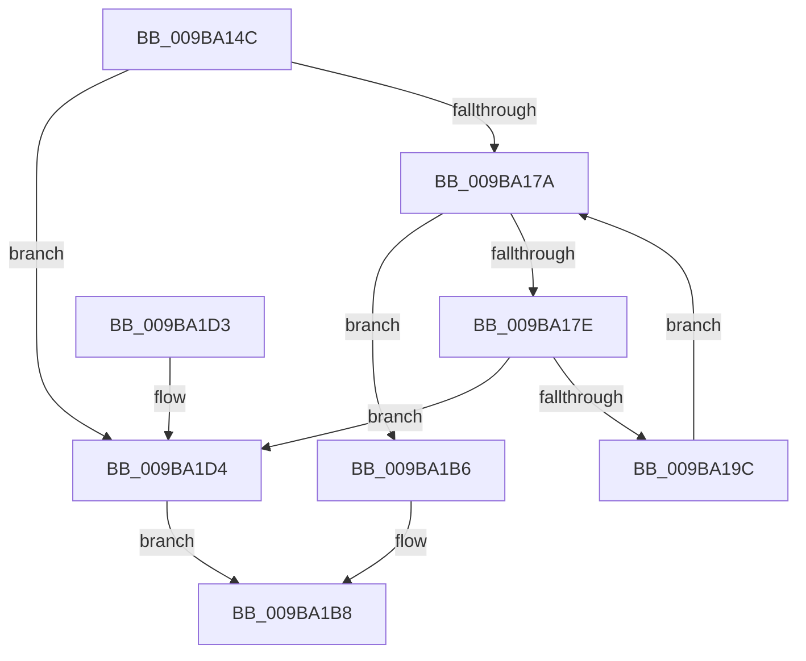

# HvpAllocateMap

- RVA: `0x009BA14C`–`0x009BA1D8` (길이 `140` bytes)
- VA: `0x00000001409BA14C`
- 실행 섹션: `PAGE`
- PDB 이름 있음: `예`; PDB Function 태그: `아니요`
- unwind 정보 RVA: `0x0005FD64`
- 디코드: `42`개 명령, `140/140` bytes 표시
- 미해석 바이트: `0` (있으면 어셈블리에 `.byte`로 보존)

> 이 문서는 커널 이미지의 기계어와 PDB 기호를 분석해 생성했습니다. 4번과 5번은 함수 원형과 자료형을 바이너리 사용 방식에서 추정한 C 해석이며 원본 소스 복구 결과는 아닙니다.

## 1. Dependencies

- 직접 호출 지점: **2**; 고유 호출 대상: **2**
- 직접 호출자로 확인된 함수: **2**
- RIP 상대 이미지 참조: **0**

### Outgoing calls
- `0x009BA18F` → [guard_dispatch_icall](../../text/6B/guard_dispatch_icall_function_006BAAD0.md) (function, `0x006BAAD0`)
- `0x009BA1A7` → [memset](../../text/6C/memset_function_006C6C40.md) (function, `0x006C6C40`)

### Direct callers
- [HvpInitMap](HvpInitMap_function_009B8A68.md) at `0x009B8C1C`
- [sub_00B3D876](../B3/Unknown_function_00B3D876.md) at `0x00B3D8EF`

### Static image references
- 디코드된 RIP-relative 메모리 참조가 없습니다.

## 2. Other-region calls and transfers

- 다른 실행 섹션으로 향하는 call: **2**
  - `0x009BA18F` → [guard_dispatch_icall](../../text/6B/guard_dispatch_icall_function_006BAAD0.md) (`PAGE` → `.text`)
  - `0x009BA1A7` → [memset](../../text/6C/memset_function_006C6C40.md) (`PAGE` → `.text`)
- 별도 외부 분기/꼬리 이동을 확인하지 못했습니다.

## 3. Assembly (complete function range)

```asm
009BA14C  48 8B C4                        mov rax, rsp
009BA14F  48 89 58 08                     mov qword ptr [rax + 8], rbx
009BA153  48 89 68 10                     mov qword ptr [rax + 0x10], rbp
009BA157  48 89 70 18                     mov qword ptr [rax + 0x18], rsi
009BA15B  48 89 78 20                     mov qword ptr [rax + 0x20], rdi
009BA15F  41 56                           push r14
009BA161  48 83 EC 20                     sub rsp, 0x20
009BA165  41 8B F9                        mov edi, r9d
009BA168  41 8B D8                        mov ebx, r8d
009BA16B  4C 8B F2                        mov r14, rdx
009BA16E  48 8B E9                        mov rbp, rcx
009BA171  41 81 F9 00 04 00 00            cmp r9d, 0x400
009BA178  73 5A                           jae 0x1409ba1d4
009BA17A  3B DF                           cmp ebx, edi
009BA17C  77 38                           ja 0x1409ba1b6
009BA17E  48 8B 45 18                     mov rax, qword ptr [rbp + 0x18]
009BA182  33 D2                           xor edx, edx
009BA184  B9 00 30 00 00                  mov ecx, 0x3000
009BA189  41 B8 43 4D 32 39               mov r8d, 0x39324d43
009BA18F  E8 3C 09 D0 FF                  call 0x1406baad0
009BA194  48 8B F0                        mov rsi, rax
009BA197  48 85 C0                        test rax, rax
009BA19A  74 38                           je 0x1409ba1d4
009BA19C  33 D2                           xor edx, edx
009BA19E  41 B8 00 30 00 00               mov r8d, 0x3000
009BA1A4  48 8B C8                        mov rcx, rax
009BA1A7  E8 94 CA D0 FF                  call 0x1406c6c40
009BA1AC  8B C3                           mov eax, ebx
009BA1AE  FF C3                           inc ebx
009BA1B0  49 89 34 C6                     mov qword ptr [r14 + rax*8], rsi
009BA1B4  EB C4                           jmp 0x1409ba17a
009BA1B6  B0 01                           mov al, 1
009BA1B8  48 8B 5C 24 30                  mov rbx, qword ptr [rsp + 0x30]
009BA1BD  48 8B 6C 24 38                  mov rbp, qword ptr [rsp + 0x38]
009BA1C2  48 8B 74 24 40                  mov rsi, qword ptr [rsp + 0x40]
009BA1C7  48 8B 7C 24 48                  mov rdi, qword ptr [rsp + 0x48]
009BA1CC  48 83 C4 20                     add rsp, 0x20
009BA1D0  41 5E                           pop r14
009BA1D2  C3                              ret
009BA1D3  CC                              int3
009BA1D4  32 C0                           xor al, al
009BA1D6  EB E0                           jmp 0x1409ba1b8
```

## 4. C-style interpretation (structured pseudocode)

```c
__int64 __fastcall HvpAllocateMap(__int64 a1, __int64 a2, int a3, int a4)
{
    __int64 result;
    __int64 v_rbx;
    __int64 v_rsp;
    unsigned __int64 v_stack_p10;
    unsigned __int64 v_stack_p18;
    unsigned __int64 v_stack_p20;
    unsigned __int64 v_stack_p8;

    *(unsigned __int64 *)(v_rsp + 8) = v_rbx;
    *(unsigned __int64 *)(v_rsp + 16) = v_rbp;
    *(unsigned __int64 *)(v_rsp + 24) = v_rsi;
    *(unsigned __int64 *)(v_rsp + 32) = v_rdi;
    v_rsp = (v_rsp) - (32);
    if (a4 >= 0x400ULL) goto loc_009BA1D4;
loc_009BA17A:
    if (((unsigned int)((unsigned int)(a3))) > ((unsigned int)((unsigned int)(a4)))) goto loc_009BA1B6;
    a2 = 0;
    result = guard_dispatch_icall((unsigned int)(0x3000ULL), a2, (unsigned int)(0x39324D43ULL), a4);
    if (result == 0) goto loc_009BA1D4;
    a2 = 0;
    result = memset(result, a2, (unsigned int)(0x3000ULL), a4);
    v_rbx = (unsigned int)(((unsigned int)(a3)) + 1);
    *(unsigned __int64 *)(a2 + (unsigned int)((unsigned int)((unsigned int)(a3))) * 8) = result;
    goto loc_009BA17A;
loc_009BA1B6:
loc_009BA1B8:
    v_rsp = (v_rsp) + (32);
    return 1;
loc_009BA1D4:
    result = 0;
    goto loc_009BA1B8;
}
```

## 5. (Beta) C Style

```c
int64_t HvpAllocateMap(void *Arg1, void *Arg2, int32_t Arg3, int32_t Arg4)
{
    uint8_t *arg1 = (uint8_t *)Arg1;
    uint8_t *arg2 = (uint8_t *)Arg2;

    int64_t result;
    int64_t local_rbx;
    int64_t local_rsp;
    uint64_t v_stack_p10;
    uint64_t v_stack_p18;
    uint64_t v_stack_p20;
    uint64_t v_stack_p8;

    *(uint64_t *)(local_rsp + 0x8) = local_rbx;
    *(uint64_t *)(local_rsp + 0x10) = local_rbp;
    *(uint64_t *)(local_rsp + 0x18) = local_rsi;
    *(uint64_t *)(local_rsp + 0x20) = local_rdi;
    local_rsp = (local_rsp) - (32);
    if (Arg4 >= 0x400ULL) goto loc_009BA1D4;
loc_009BA17A:
    if (((uint32_t)((uint32_t)(Arg3))) > ((uint32_t)((uint32_t)(Arg4)))) goto loc_009BA1B6;
    Arg2 = 0;
    result = guard_dispatch_icall((uint32_t)(0x3000ULL), Arg2, (uint32_t)(0x39324D43ULL), Arg4);
    if (result == 0) goto loc_009BA1D4;
    Arg2 = 0;
    result = memset(result, Arg2, (uint32_t)(0x3000ULL), Arg4);
    local_rbx = (uint32_t)(((uint32_t)(Arg3)) + 1);
    *(uint64_t *)(arg2 + (uint32_t)((uint32_t)((uint32_t)(Arg3))) * 8) = result;
    goto loc_009BA17A;
loc_009BA1B6:
loc_009BA1B8:
    local_rsp = (local_rsp) + (32);
    return 1;
loc_009BA1D4:
    result = 0;
    goto loc_009BA1B8;
}
```

### 관측된 메모리 오프셋

구조체 형식이 확인되지 않은 접근은 인자 기준의 오프셋으로만 기록했습니다.

| 기준 인자 | 오프셋 표현 | 폭 (bit) | 접근 |
|---|---:|---:|---|
| `Arg1` | `+ 0x18` | `64` | `R` |
| `Arg2` | `+ 0x0 + rax*8` | `64` | `W` |

## 6. Execution-region graph

[열기: 2D/3D 그래프와 함수 탐색 컨트롤 패널](../../../control-panel.html?section=page&rva=0x009BA14C&view=graph)

- 2D 그래프는 위에서 아래로 흐르고, 3D 그래프는 빈 공간을 드래그해 회전합니다. Shift+드래그는 이동, 휠은 확대·축소, 함수 노드 선택은 대상 보고서 이동입니다.

### Static fallback


