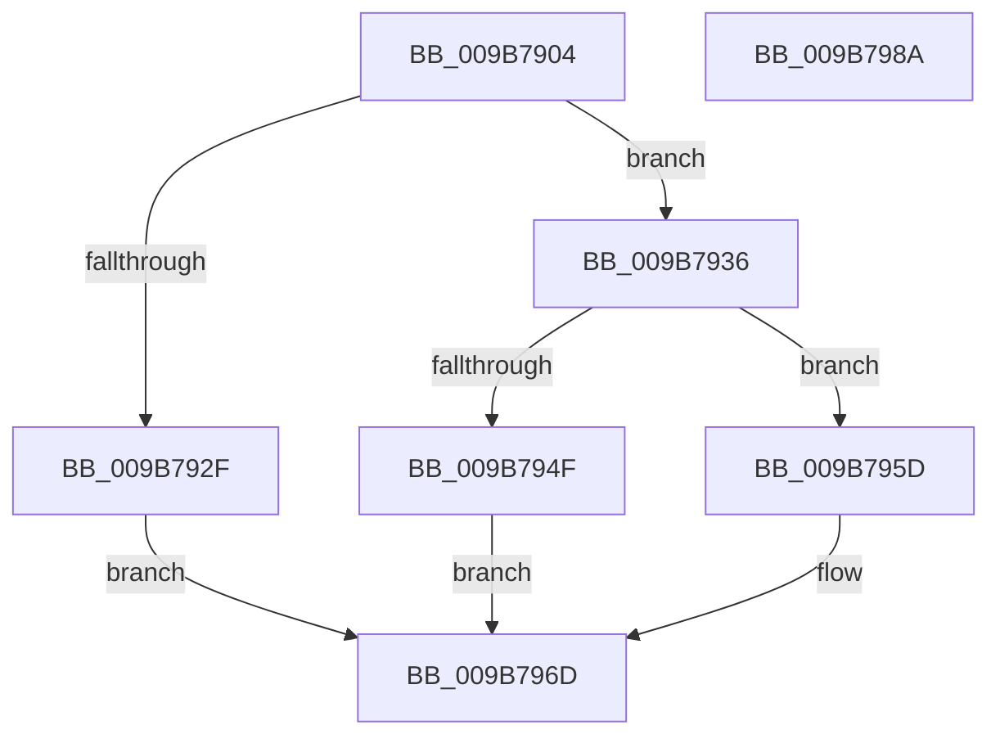

# HvpAllocateNonPagedBin

- RVA: `0x009B7904`–`0x009B798B` (길이 `135` bytes)
- VA: `0x00000001409B7904`
- 실행 섹션: `PAGE`
- PDB 이름 있음: `예`; PDB Function 태그: `아니요`
- unwind 정보 RVA: `0x0005E6B4`
- 디코드: `42`개 명령, `135/135` bytes 표시
- 미해석 바이트: `0` (있으면 어셈블리에 `.byte`로 보존)

> 이 문서는 커널 이미지의 기계어와 PDB 기호를 분석해 생성했습니다. 4번과 5번은 함수 원형과 자료형을 바이너리 사용 방식에서 추정한 C 해석이며 원본 소스 복구 결과는 아닙니다.

## 1. Dependencies

- 직접 호출 지점: **4**; 고유 호출 대상: **4**
- 직접 호출자로 확인된 함수: **2**
- RIP 상대 이미지 참조: **0**

### Outgoing calls
- `0x009B7924` → [CmpClaimGlobalQuota](../84/CmpClaimGlobalQuota_function_0084DDAC.md) (function, `0x0084DDAC`)
- `0x009B7942` → [MmAllocateIndependentPagesEx](../AA/MmAllocateIndependentPagesEx_function_00AA0CFC.md) (function, `0x00AA0CFC`)
- `0x009B7956` → [CmpReleaseGlobalQuota](../84/CmpReleaseGlobalQuota_function_0084DB40.md) (function, `0x0084DB40`)
- `0x009B7965` → [memset](../../text/6C/memset_function_006C6C40.md) (function, `0x006C6C40`)

### Direct callers
- [HvpDropPagedBins](HvpDropPagedBins_function_009B7168.md) at `0x009B7254`
- [HvpAllocateBin](HvpAllocateBin_function_009B78A4.md) at `0x009B78EE`

### Static image references
- 디코드된 RIP-relative 메모리 참조가 없습니다.

## 2. Other-region calls and transfers

- 다른 실행 섹션으로 향하는 call: **1**
  - `0x009B7965` → [memset](../../text/6C/memset_function_006C6C40.md) (`PAGE` → `.text`)
- 별도 외부 분기/꼬리 이동을 확인하지 못했습니다.

## 3. Assembly (complete function range)

```asm
009B7904  48 8B C4                        mov rax, rsp
009B7907  48 89 58 08                     mov qword ptr [rax + 8], rbx
009B790B  48 89 68 10                     mov qword ptr [rax + 0x10], rbp
009B790F  48 89 70 18                     mov qword ptr [rax + 0x18], rsi
009B7913  48 89 78 20                     mov qword ptr [rax + 0x20], rdi
009B7917  41 56                           push r14
009B7919  48 83 EC 20                     sub rsp, 0x20
009B791D  8B CA                           mov ecx, edx
009B791F  8B FA                           mov edi, edx
009B7921  4D 8B F0                        mov r14, r8
009B7924  E8 83 64 E9 FF                  call 0x14084ddac
009B7929  33 DB                           xor ebx, ebx
009B792B  84 C0                           test al, al
009B792D  75 07                           jne 0x1409b7936
009B792F  BB 9A 00 00 C0                  mov ebx, 0xc000009a
009B7934  EB 37                           jmp 0x1409b796d
009B7936  45 33 C9                        xor r9d, r9d
009B7939  45 33 C0                        xor r8d, r8d
009B793C  83 CA FF                        or edx, 0xffffffff
009B793F  48 8B CF                        mov rcx, rdi
009B7942  E8 B5 93 0E 00                  call 0x140aa0cfc
009B7947  48 8B F0                        mov rsi, rax
009B794A  48 85 C0                        test rax, rax
009B794D  75 0E                           jne 0x1409b795d
009B794F  8B CF                           mov ecx, edi
009B7951  BB 9A 00 00 C0                  mov ebx, 0xc000009a
009B7956  E8 E5 61 E9 FF                  call 0x14084db40
009B795B  EB 10                           jmp 0x1409b796d
009B795D  4C 8B C7                        mov r8, rdi
009B7960  33 D2                           xor edx, edx
009B7962  48 8B CE                        mov rcx, rsi
009B7965  E8 D6 F2 D0 FF                  call 0x1406c6c40
009B796A  49 89 36                        mov qword ptr [r14], rsi
009B796D  48 8B 6C 24 38                  mov rbp, qword ptr [rsp + 0x38]
009B7972  8B C3                           mov eax, ebx
009B7974  48 8B 5C 24 30                  mov rbx, qword ptr [rsp + 0x30]
009B7979  48 8B 74 24 40                  mov rsi, qword ptr [rsp + 0x40]
009B797E  48 8B 7C 24 48                  mov rdi, qword ptr [rsp + 0x48]
009B7983  48 83 C4 20                     add rsp, 0x20
009B7987  41 5E                           pop r14
009B7989  C3                              ret
009B798A  CC                              int3
```

## 4. C-style interpretation (structured pseudocode)

```c
__int64 __fastcall HvpAllocateNonPagedBin(__int64 a1, int a2, __int64 a3, int a4)
{
    __int64 result;
    __int64 v_rbx;
    __int64 v_rsp;
    unsigned __int64 v_stack_p10;
    unsigned __int64 v_stack_p18;
    unsigned __int64 v_stack_p20;
    unsigned __int64 v_stack_p8;

    *(unsigned __int64 *)(v_rsp + 8) = v_rbx;
    *(unsigned __int64 *)(v_rsp + 16) = v_rbp;
    *(unsigned __int64 *)(v_rsp + 24) = v_rsi;
    *(unsigned __int64 *)(v_rsp + 32) = v_rdi;
    v_rsp = (v_rsp) - (32);
    result = CmpClaimGlobalQuota((unsigned int)(a2), a2, a3, a4);
    v_rbx = 0;
    if ((unsigned __int8)(result) != 0) goto loc_009B7936;
    goto loc_009B796D;
loc_009B7936:
    a4 = 0;
    a3 = 0;
    a2 = (unsigned int)((a2) | (0xFFFFFFFFULL));
    result = MmAllocateIndependentPagesEx((unsigned int)(a2), a2, a3, a4);
    if (result != 0) goto loc_009B795D;
    result = CmpReleaseGlobalQuota((unsigned int)((unsigned int)((unsigned int)(a2))), a2, a3, a4);
    goto loc_009B796D;
loc_009B795D:
    a2 = 0;
    result = memset(result, a2, (unsigned int)(a2), a4);
    *(unsigned __int64 *)(a3) = result;
loc_009B796D:
    v_rsp = (v_rsp) + (32);
    return (unsigned int)((unsigned int)((unsigned int)(0xC000009AULL)));
}
```

## 5. (Beta) C Style

```c
int64_t HvpAllocateNonPagedBin(int64_t Arg1, int32_t Arg2, void *Arg3, int32_t Arg4)
{
    uint8_t *arg3 = (uint8_t *)Arg3;

    int64_t result;
    int64_t local_rbx;
    int64_t local_rsp;
    uint64_t v_stack_p10;
    uint64_t v_stack_p18;
    uint64_t v_stack_p20;
    uint64_t v_stack_p8;

    *(uint64_t *)(local_rsp + 0x8) = local_rbx;
    *(uint64_t *)(local_rsp + 0x10) = local_rbp;
    *(uint64_t *)(local_rsp + 0x18) = local_rsi;
    *(uint64_t *)(local_rsp + 0x20) = local_rdi;
    local_rsp = (local_rsp) - (32);
    result = CmpClaimGlobalQuota((uint32_t)(Arg2), Arg2, Arg3, Arg4);
    local_rbx = 0;
    if ((uint8_t)(result) != 0) goto loc_009B7936;
    goto loc_009B796D;
loc_009B7936:
    Arg4 = 0;
    Arg3 = 0;
    Arg2 = (uint32_t)((Arg2) | (0xFFFFFFFFULL));
    result = MmAllocateIndependentPagesEx((uint32_t)(Arg2), Arg2, Arg3, Arg4);
    if (result != 0) goto loc_009B795D;
    result = CmpReleaseGlobalQuota((uint32_t)((uint32_t)((uint32_t)(Arg2))), Arg2, Arg3, Arg4);
    goto loc_009B796D;
loc_009B795D:
    Arg2 = 0;
    result = memset(result, Arg2, (uint32_t)(Arg2), Arg4);
    *(uint64_t *)(arg3) = result;
loc_009B796D:
    local_rsp = (local_rsp) + (32);
    return (uint32_t)((uint32_t)((uint32_t)(0xC000009AULL)));
}
```

### 관측된 메모리 오프셋

구조체 형식이 확인되지 않은 접근은 인자 기준의 오프셋으로만 기록했습니다.

| 기준 인자 | 오프셋 표현 | 폭 (bit) | 접근 |
|---|---:|---:|---|
| `Arg3` | `+ 0x0` | `64` | `W` |

## 6. Execution-region graph

[열기: 2D/3D 그래프와 함수 탐색 컨트롤 패널](../../../control-panel.html?section=page&rva=0x009B7904&view=graph)

- 2D 그래프는 위에서 아래로 흐르고, 3D 그래프는 빈 공간을 드래그해 회전합니다. Shift+드래그는 이동, 휠은 확대·축소, 함수 노드 선택은 대상 보고서 이동입니다.

### Static fallback


