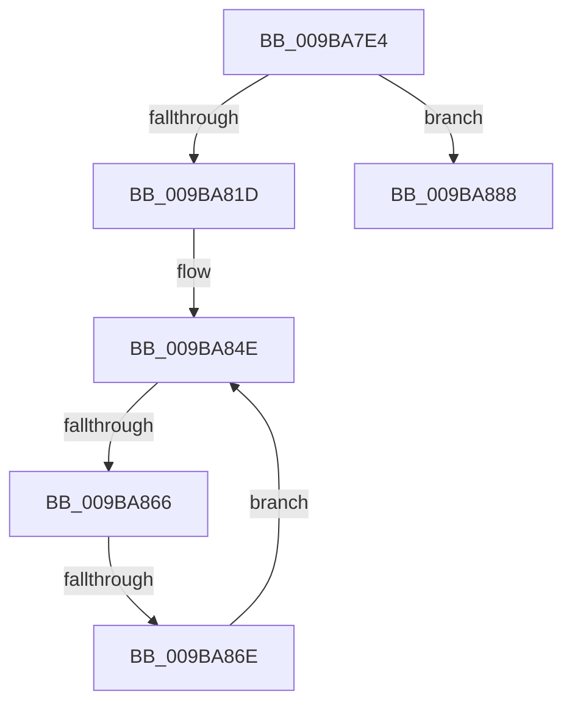

# HvpAnalyzeSingleLogFile

- RVA: `0x009BA7E4`–`0x009BA8A2` (길이 `190` bytes)
- VA: `0x00000001409BA7E4`
- 실행 섹션: `PAGE`
- PDB 이름 있음: `예`; PDB Function 태그: `예`
- unwind 정보 RVA: `0x0009EB48`
- 디코드: `51`개 명령, `190/190` bytes 표시
- 미해석 바이트: `0` (있으면 어셈블리에 `.byte`로 보존)

> 이 문서는 커널 이미지의 기계어와 PDB 기호를 분석해 생성했습니다. 4번과 5번은 함수 원형과 자료형을 바이너리 사용 방식에서 추정한 C 해석이며 원본 소스 복구 결과는 아닙니다.

## 1. Dependencies

- 직접 호출 지점: **1**; 고유 호출 대상: **1**
- 직접 호출자로 확인된 함수: **1**
- RIP 상대 이미지 참조: **0**

### Outgoing calls
- `0x009BA856` → [HvpIncrementalLogFileEnumeratorAdvance](../AA/HvpIncrementalLogFileEnumeratorAdvance_function_00AA07B0.md) (function, `0x00AA07B0`)

### Direct callers
- [HvAnalyzeLogFiles](HvAnalyzeLogFiles_function_009B9A9C.md) at `0x009B9EB2`

### Static image references
- 디코드된 RIP-relative 메모리 참조가 없습니다.

## 2. Other-region calls and transfers

- 다른 실행 섹션으로 향하는 call: **0**
- call이 아닌 외부 분기/꼬리 이동: **3**
  - `0x009BA860` → [sub_00B2E5C2](../B2/Unknown_function_00B2E5C2.md) (`tail-transfer`)
  - `0x009BA868` → [sub_00B2E5C2 + 0x29](../B2/Unknown_function_00B2E5C2.md) (`tail-transfer`)
  - `0x009BA89D` → [sub_00B2E5C2 + 0x16](../B2/Unknown_function_00B2E5C2.md) (`tail-transfer`)

## 3. Assembly (complete function range)

```asm
009BA7E4  48 89 5C 24 10                  mov qword ptr [rsp + 0x10], rbx
009BA7E9  48 89 74 24 18                  mov qword ptr [rsp + 0x18], rsi
009BA7EE  48 89 7C 24 20                  mov qword ptr [rsp + 0x20], rdi
009BA7F3  55                              push rbp
009BA7F4  41 56                           push r14
009BA7F6  41 57                           push r15
009BA7F8  48 8B EC                        mov rbp, rsp
009BA7FB  48 83 EC 50                     sub rsp, 0x50
009BA7FF  83 7A 1C 06                     cmp dword ptr [rdx + 0x1c], 6
009BA803  0F 57 C0                        xorps xmm0, xmm0
009BA806  8B 01                           mov eax, dword ptr [rcx]
009BA808  49 8B F0                        mov rsi, r8
009BA80B  44 8B 4A 04                     mov r9d, dword ptr [rdx + 4]
009BA80F  F3 0F 7F 45 D8                  movdqu xmmword ptr [rbp - 0x28], xmm0
009BA814  44 89 4D D8                     mov dword ptr [rbp - 0x28], r9d
009BA818  89 45 D4                        mov dword ptr [rbp - 0x2c], eax
009BA81B  75 6B                           jne 0x1409ba888
009BA81D  48 8B 41 08                     mov rax, qword ptr [rcx + 8]
009BA821  33 FF                           xor edi, edi
009BA823  48 83 65 20 00                  and qword ptr [rbp + 0x20], 0
009BA828  45 33 F6                        xor r14d, r14d
009BA82B  48 89 45 F0                     mov qword ptr [rbp - 0x10], rax
009BA82F  45 33 FF                        xor r15d, r15d
009BA832  48 8B 41 10                     mov rax, qword ptr [rcx + 0x10]
009BA836  33 DB                           xor ebx, ebx
009BA838  48 89 45 F8                     mov qword ptr [rbp - 8], rax
009BA83C  C7 45 D0 01 00 00 00            mov dword ptr [rbp - 0x30], 1
009BA843  C7 45 E8 00 02 00 00            mov dword ptr [rbp - 0x18], 0x200
009BA84A  44 89 4D EC                     mov dword ptr [rbp - 0x14], r9d
009BA84E  48 8D 55 20                     lea rdx, [rbp + 0x20]
009BA852  48 8D 4D E8                     lea rcx, [rbp - 0x18]
009BA856  E8 55 5F 0E 00                  call 0x140aa07b0
009BA85B  3D 1A 00 00 80                  cmp eax, 0x8000001a
009BA860  0F 84 5C 3D 17 00               je 0x140b2e5c2
009BA866  85 C0                           test eax, eax
009BA868  0F 88 7D 3D 17 00               js 0x140b2e5eb
009BA86E  48 8B 45 20                     mov rax, qword ptr [rbp + 0x20]
009BA872  FF C7                           inc edi
009BA874  44 8B 7D E8                     mov r15d, dword ptr [rbp - 0x18]
009BA878  8B 48 10                        mov ecx, dword ptr [rax + 0x10]
009BA87B  3B CB                           cmp ecx, ebx
009BA87D  44 8B 70 0C                     mov r14d, dword ptr [rax + 0xc]
009BA881  0F 46 CB                        cmovbe ecx, ebx
009BA884  8B D9                           mov ebx, ecx
009BA886  EB C6                           jmp 0x1409ba84e
009BA888  8B 42 28                        mov eax, dword ptr [rdx + 0x28]
009BA88B  83 65 E0 00                     and dword ptr [rbp - 0x20], 0
009BA88F  89 45 E4                        mov dword ptr [rbp - 0x1c], eax
009BA892  C7 45 D0 03 00 00 00            mov dword ptr [rbp - 0x30], 3
009BA899  44 89 4D DC                     mov dword ptr [rbp - 0x24], r9d
009BA89D  E9 36 3D 17 00                  jmp 0x140b2e5d8
```

## 4. C-style interpretation (structured pseudocode)

```c
__int64 __fastcall HvpAnalyzeSingleLogFile(__int64 a1, __int64 a2, __int64 a3)
{
    __int64 result;
    __int64 v_r14;
    __int64 v_r15;
    __int64 v_rbx;
    __int64 v_rdi;
    __int64 v_rsp;
    unsigned __int64 v_stack_m20;
    unsigned __int64 v_stack_m28;
    unsigned int v_stack_m2C;
    unsigned int v_stack_m30;
    unsigned int v_stack_m34;
    unsigned int v_stack_m38;
    unsigned int v_stack_m3C;
    unsigned __int64 v_stack_m40;
    unsigned int v_stack_m44;
    unsigned int v_stack_m48;
    unsigned __int64 v_stack_p10;
    unsigned __int64 v_stack_p18;
    unsigned __int64 v_stack_p20;
    unsigned __int64 v_stack_p8;

    v_stack_p10 = v_rbx;
    v_stack_p18 = v_rsi;
    v_stack_p20 = v_rdi;
    v_rsp = (v_rsp) - (80);
    v_stack_m40 = v_xmm0;
    v_stack_m40 = (unsigned int)((unsigned int)(*(unsigned int *)(a2 + 4)));
    v_stack_m44 = (unsigned int)((unsigned int)(*(unsigned int *)(a1)));
    if ((*(unsigned int *)(a2 + 28)) != 6) goto loc_009BA888;
    v_rdi = 0;
    v_r14 = 0;
    v_stack_m28 = *(unsigned __int64 *)(a1 + 8);
    v_r15 = 0;
    v_rbx = 0;
    v_stack_m20 = *(unsigned __int64 *)(a1 + 16);
    v_stack_m48 = 1;
    v_stack_m30 = 512;
    v_stack_m2C = (unsigned int)((unsigned int)(*(unsigned int *)(a2 + 4)));
loc_009BA84E:
    result = HvpIncrementalLogFileEnumeratorAdvance(v_stack_m30, v_stack_p8, a3, (unsigned int)(*(unsigned int *)(a2 + 4)));
    v_rdi = (unsigned int)((v_rdi) + 1);
    a1 = (unsigned int)(*(unsigned int *)(v_stack_p8 + 16));
    if (((unsigned int)((unsigned int)(*(unsigned int *)(v_stack_p8 + 16)))) <= 0) { a1 = 0; }
    goto loc_009BA84E;
loc_009BA888:
    v_stack_m34 = (unsigned int)((unsigned int)(*(unsigned int *)(v_stack_p8 + 40)));
    v_stack_m48 = 3;
    v_stack_m3C = (unsigned int)((unsigned int)(*(unsigned int *)(a2 + 4)));
}
```

## 5. (Beta) C Style

```c
int64_t HvpAnalyzeSingleLogFile(void *Arg1, void *Arg2, int64_t Arg3)
{
    uint8_t *arg1 = (uint8_t *)Arg1;
    uint8_t *arg2 = (uint8_t *)Arg2;

    int64_t result;
    int64_t local_r14;
    int64_t local_r15;
    int64_t local_rbx;
    int64_t local_rdi;
    int64_t local_rsp;
    uint64_t v_stack_m20;
    uint64_t v_stack_m28;
    uint32_t v_stack_m2C;
    uint32_t v_stack_m30;
    uint32_t v_stack_m34;
    uint32_t v_stack_m38;
    uint32_t v_stack_m3C;
    uint64_t v_stack_m40;
    uint32_t v_stack_m44;
    uint32_t v_stack_m48;
    uint64_t v_stack_p10;
    uint64_t v_stack_p18;
    uint64_t v_stack_p20;
    uint64_t v_stack_p8;

    v_stack_p10 = local_rbx;
    v_stack_p18 = local_rsi;
    v_stack_p20 = local_rdi;
    local_rsp = (local_rsp) - (80);
    v_stack_m40 = v_xmm0;
    v_stack_m40 = (uint32_t)((uint32_t)(*(uint32_t *)(arg2 + 0x4)));
    v_stack_m44 = (uint32_t)((uint32_t)(*(uint32_t *)(arg1)));
    if ((*(uint32_t *)(arg2 + 0x1C)) != 6) goto loc_009BA888;
    local_rdi = 0;
    local_r14 = 0;
    v_stack_m28 = *(uint64_t *)(arg1 + 0x8);
    local_r15 = 0;
    local_rbx = 0;
    v_stack_m20 = *(uint64_t *)(arg1 + 0x10);
    v_stack_m48 = 1;
    v_stack_m30 = 512;
    v_stack_m2C = (uint32_t)((uint32_t)(*(uint32_t *)(arg2 + 0x4)));
loc_009BA84E:
    result = HvpIncrementalLogFileEnumeratorAdvance(v_stack_m30, v_stack_p8, Arg3, (uint32_t)(*(uint32_t *)(arg2 + 0x4)));
    local_rdi = (uint32_t)((local_rdi) + 1);
    Arg1 = (uint32_t)(*(uint32_t *)(v_stack_p8 + 0x10));
    if (((uint32_t)((uint32_t)(*(uint32_t *)(v_stack_p8 + 0x10)))) <= 0) { Arg1 = 0; }
    goto loc_009BA84E;
loc_009BA888:
    v_stack_m34 = (uint32_t)((uint32_t)(*(uint32_t *)(v_stack_p8 + 0x28)));
    v_stack_m48 = 3;
    v_stack_m3C = (uint32_t)((uint32_t)(*(uint32_t *)(arg2 + 0x4)));
}
```

### 관측된 메모리 오프셋

구조체 형식이 확인되지 않은 접근은 인자 기준의 오프셋으로만 기록했습니다.

| 기준 인자 | 오프셋 표현 | 폭 (bit) | 접근 |
|---|---:|---:|---|
| `Arg1` | `+ 0x0` | `32` | `R` |
| `Arg1` | `+ 0x8` | `64` | `R` |
| `Arg1` | `+ 0x10` | `64` | `R` |
| `Arg2` | `+ 0x4` | `32` | `R` |
| `Arg2` | `+ 0x1C` | `32` | `R` |
| `Arg2` | `+ 0x28` | `32` | `R` |

## 6. Execution-region graph

[열기: 2D/3D 그래프와 함수 탐색 컨트롤 패널](../../../control-panel.html?section=page&rva=0x009BA7E4&view=graph)

- 2D 그래프는 위에서 아래로 흐르고, 3D 그래프는 빈 공간을 드래그해 회전합니다. Shift+드래그는 이동, 휠은 확대·축소, 함수 노드 선택은 대상 보고서 이동입니다.

### Static fallback


