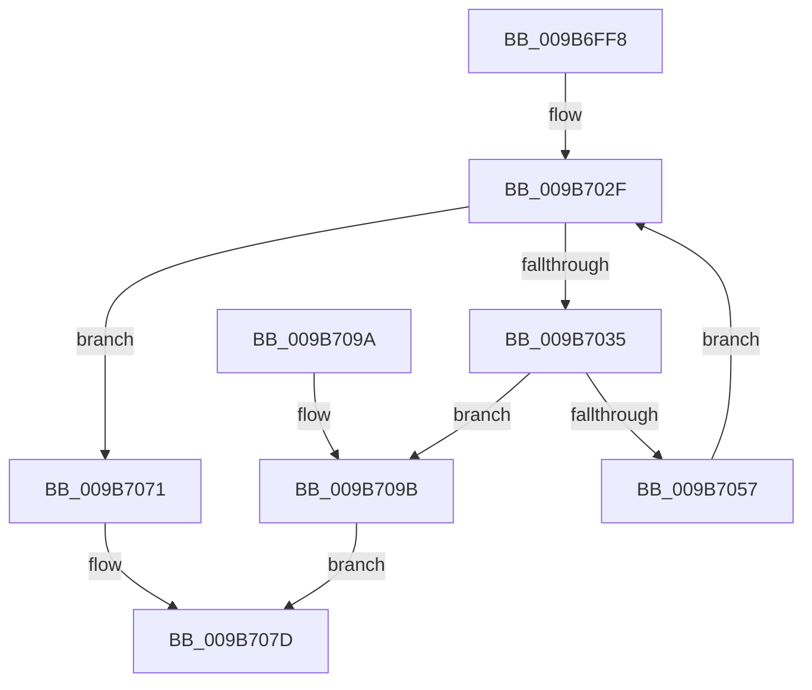

# HvpApplyLogEntryDataToFileBackedHive

- RVA: `0x009B6FF8`–`0x009B70A2` (길이 `170` bytes)
- VA: `0x00000001409B6FF8`
- 실행 섹션: `PAGE`
- PDB 이름 있음: `예`; PDB Function 태그: `아니요`
- unwind 정보 RVA: `0x0008CDD0`
- 디코드: `54`개 명령, `170/170` bytes 표시
- 미해석 바이트: `0` (있으면 어셈블리에 `.byte`로 보존)

> 이 문서는 커널 이미지의 기계어와 PDB 기호를 분석해 생성했습니다. 4번과 5번은 함수 원형과 자료형을 바이너리 사용 방식에서 추정한 C 해석이며 원본 소스 복구 결과는 아닙니다.

## 1. Dependencies

- 직접 호출 지점: **2**; 고유 호출 대상: **2**
- 직접 호출자로 확인된 함수: **2**
- RIP 상대 이미지 참조: **0**

### Outgoing calls
- `0x009B704E` → [HvpSetRangeProtection](HvpSetRangeProtection_function_009B58C0.md) (function, `0x009B58C0`)
- `0x009B7063` → [HvpCopyModifiedData](HvpCopyModifiedData_function_009B70A8.md) (function, `0x009B70A8`)

### Direct callers
- [HvpApplyLegacyLogFile](../7F/HvpApplyLegacyLogFile_function_007F66D0.md) at `0x007F688E`
- [HvpApplyIncrementalLogFile](../AA/HvpApplyIncrementalLogFile_function_00AA06A8.md) at `0x00AA0740`

### Static image references
- 디코드된 RIP-relative 메모리 참조가 없습니다.

## 2. Other-region calls and transfers

- 다른 실행 섹션으로 향하는 call: **0**
- 별도 외부 분기/꼬리 이동을 확인하지 못했습니다.

## 3. Assembly (complete function range)

```asm
009B6FF8  48 89 5C 24 08                  mov qword ptr [rsp + 8], rbx
009B6FFD  48 89 6C 24 10                  mov qword ptr [rsp + 0x10], rbp
009B7002  48 89 74 24 18                  mov qword ptr [rsp + 0x18], rsi
009B7007  57                              push rdi
009B7008  41 54                           push r12
009B700A  41 55                           push r13
009B700C  41 56                           push r14
009B700E  41 57                           push r15
009B7010  48 83 EC 20                     sub rsp, 0x20
009B7014  4C 8B 51 40                     mov r10, qword ptr [rcx + 0x40]
009B7018  33 FF                           xor edi, edi
009B701A  8B 42 10                        mov eax, dword ptr [rdx + 0x10]
009B701D  49 8B E9                        mov rbp, r9
009B7020  4D 8B E8                        mov r13, r8
009B7023  4C 8B F2                        mov r14, rdx
009B7026  4C 8B F9                        mov r15, rcx
009B7029  33 DB                           xor ebx, ebx
009B702B  41 89 42 28                     mov dword ptr [r10 + 0x28], eax
009B702F  41 3B 5E 14                     cmp ebx, dword ptr [r14 + 0x14]
009B7033  73 3C                           jae 0x1409b7071
009B7035  41 8B 74 DD 04                  mov esi, dword ptr [r13 + rbx*8 + 4]
009B703A  41 B9 04 00 00 00               mov r9d, 4
009B7040  45 8B 64 DD 00                  mov r12d, dword ptr [r13 + rbx*8]
009B7045  44 8B C6                        mov r8d, esi
009B7048  41 8B D4                        mov edx, r12d
009B704B  49 8B CF                        mov rcx, r15
009B704E  E8 6D E8 FF FF                  call 0x1409b58c0
009B7053  84 C0                           test al, al
009B7055  74 44                           je 0x1409b709b
009B7057  44 8B CE                        mov r9d, esi
009B705A  4C 8B C5                        mov r8, rbp
009B705D  41 8B D4                        mov edx, r12d
009B7060  49 8B CF                        mov rcx, r15
009B7063  E8 40 00 00 00                  call 0x1409b70a8
009B7068  48 03 EE                        add rbp, rsi
009B706B  03 FE                           add edi, esi
009B706D  FF C3                           inc ebx
009B706F  EB BE                           jmp 0x1409b702f
009B7071  48 8B 4C 24 78                  mov rcx, qword ptr [rsp + 0x78]
009B7076  B8 09 00 00 40                  mov eax, 0x40000009
009B707B  89 39                           mov dword ptr [rcx], edi
009B707D  48 8B 5C 24 50                  mov rbx, qword ptr [rsp + 0x50]
009B7082  48 8B 6C 24 58                  mov rbp, qword ptr [rsp + 0x58]
009B7087  48 8B 74 24 60                  mov rsi, qword ptr [rsp + 0x60]
009B708C  48 83 C4 20                     add rsp, 0x20
009B7090  41 5F                           pop r15
009B7092  41 5E                           pop r14
009B7094  41 5D                           pop r13
009B7096  41 5C                           pop r12
009B7098  5F                              pop rdi
009B7099  C3                              ret
009B709A  CC                              int3
009B709B  B8 9A 00 00 C0                  mov eax, 0xc000009a
009B70A0  EB DB                           jmp 0x1409b707d
```

## 4. C-style interpretation (structured pseudocode)

```c
__int64 __fastcall HvpApplyLogEntryDataToFileBackedHive(__int64 a1, __int64 a2, __int64 a3, __int64 a4, __int64 a5, __int64 a6)
{
    __int64 result;
    __int64 v_rbp;
    __int64 v_rbx;
    __int64 v_rdi;
    __int64 v_rsp;
    unsigned __int64 v_stack_p10;
    unsigned __int64 v_stack_p18;
    unsigned __int64 v_stack_p8;

    v_stack_p8 = v_rbx;
    v_stack_p10 = v_rbp;
    v_stack_p18 = v_rsi;
    v_rsp = (v_rsp) - (32);
    v_rdi = 0;
    v_rbx = 0;
    *(unsigned int *)(*(unsigned __int64 *)(a1 + 64) + 40) = (unsigned int)((unsigned int)(*(unsigned int *)(a2 + 16)));
loc_009B702F:
    if (0 >= (*(unsigned int *)(a2 + 20))) goto loc_009B7071;
    result = HvpSetRangeProtection(a1, (unsigned int)((unsigned int)((unsigned int)(*(unsigned int *)(a3 + v_rbx * 8)))), (unsigned int)((unsigned int)((unsigned int)(*(unsigned int *)(a3 + v_rbx * 8 + 4)))), 4);
    if ((unsigned __int8)(result) == 0) goto loc_009B709B;
    result = HvpCopyModifiedData(a1, (unsigned int)((unsigned int)((unsigned int)(*(unsigned int *)(a3 + v_rbx * 8)))), a4, (unsigned int)((unsigned int)((unsigned int)(*(unsigned int *)(a3 + v_rbx * 8 + 4)))));
    v_rbp = (a4) + ((unsigned int)(*(unsigned int *)(a3 + v_rbx * 8 + 4)));
    v_rdi = (unsigned int)((v_rdi) + ((unsigned int)((unsigned int)(*(unsigned int *)(a3 + v_rbx * 8 + 4)))));
    v_rbx = (unsigned int)((v_rbx) + 1);
    goto loc_009B702F;
loc_009B7071:
    *(unsigned int *)(a6) = (unsigned int)(v_rdi);
loc_009B707D:
    v_rsp = (v_rsp) + (32);
    return (unsigned int)(0x40000009ULL);
loc_009B709B:
    goto loc_009B707D;
}
```

## 5. (Beta) C Style

```c
int64_t HvpApplyLogEntryDataToFileBackedHive(void *Arg1, void *Arg2, void *Arg3, int64_t Arg4, uint64_t Arg5, void *Arg6)
{
    uint8_t *arg1 = (uint8_t *)Arg1;
    uint8_t *arg2 = (uint8_t *)Arg2;
    uint8_t *arg3 = (uint8_t *)Arg3;
    uint8_t *arg6 = (uint8_t *)Arg6;

    int64_t result;
    int64_t local_rbp;
    int64_t local_rbx;
    int64_t local_rdi;
    int64_t local_rsp;
    uint64_t v_stack_p10;
    uint64_t v_stack_p18;
    uint64_t v_stack_p8;

    v_stack_p8 = local_rbx;
    v_stack_p10 = local_rbp;
    v_stack_p18 = local_rsi;
    local_rsp = (local_rsp) - (32);
    local_rdi = 0;
    local_rbx = 0;
    *(uint32_t *)(*(uint64_t *)(arg1 + 0x40) + 0x28) = (uint32_t)((uint32_t)(*(uint32_t *)(arg2 + 0x10)));
loc_009B702F:
    if (0 >= (*(uint32_t *)(arg2 + 0x14))) goto loc_009B7071;
    result = HvpSetRangeProtection(Arg1, (uint32_t)((uint32_t)((uint32_t)(*(uint32_t *)(arg3 + local_rbx * 8)))), (uint32_t)((uint32_t)((uint32_t)(*(uint32_t *)(arg3 + local_rbx * 8 + 0x4)))), 4);
    if ((uint8_t)(result) == 0) goto loc_009B709B;
    result = HvpCopyModifiedData(Arg1, (uint32_t)((uint32_t)((uint32_t)(*(uint32_t *)(arg3 + local_rbx * 8)))), Arg4, (uint32_t)((uint32_t)((uint32_t)(*(uint32_t *)(arg3 + local_rbx * 8 + 0x4)))));
    local_rbp = (Arg4) + ((uint32_t)(*(uint32_t *)(arg3 + local_rbx * 8 + 0x4)));
    local_rdi = (uint32_t)((local_rdi) + ((uint32_t)((uint32_t)(*(uint32_t *)(arg3 + local_rbx * 8 + 0x4)))));
    local_rbx = (uint32_t)((local_rbx) + 1);
    goto loc_009B702F;
loc_009B7071:
    *(uint32_t *)(arg6) = (uint32_t)(local_rdi);
loc_009B707D:
    local_rsp = (local_rsp) + (32);
    return (uint32_t)(0x40000009ULL);
loc_009B709B:
    goto loc_009B707D;
}
```

### 관측된 메모리 오프셋

구조체 형식이 확인되지 않은 접근은 인자 기준의 오프셋으로만 기록했습니다.

| 기준 인자 | 오프셋 표현 | 폭 (bit) | 접근 |
|---|---:|---:|---|
| `Arg1` | `+ 0x40` | `64` | `R` |
| `Arg2` | `+ 0x10` | `32` | `R` |
| `Arg2` | `+ 0x14` | `32` | `R` |
| `Arg3` | `+ 0x0 + rbx*8` | `32` | `R` |
| `Arg3` | `+ 0x4 + rbx*8` | `32` | `R` |
| `Arg6` | `+ 0x0` | `32` | `W` |

## 6. Execution-region graph

[열기: 2D/3D 그래프와 함수 탐색 컨트롤 패널](../../../control-panel.html?section=page&rva=0x009B6FF8&view=graph)

- 2D 그래프는 위에서 아래로 흐르고, 3D 그래프는 빈 공간을 드래그해 회전합니다. Shift+드래그는 이동, 휠은 확대·축소, 함수 노드 선택은 대상 보고서 이동입니다.

### Static fallback


