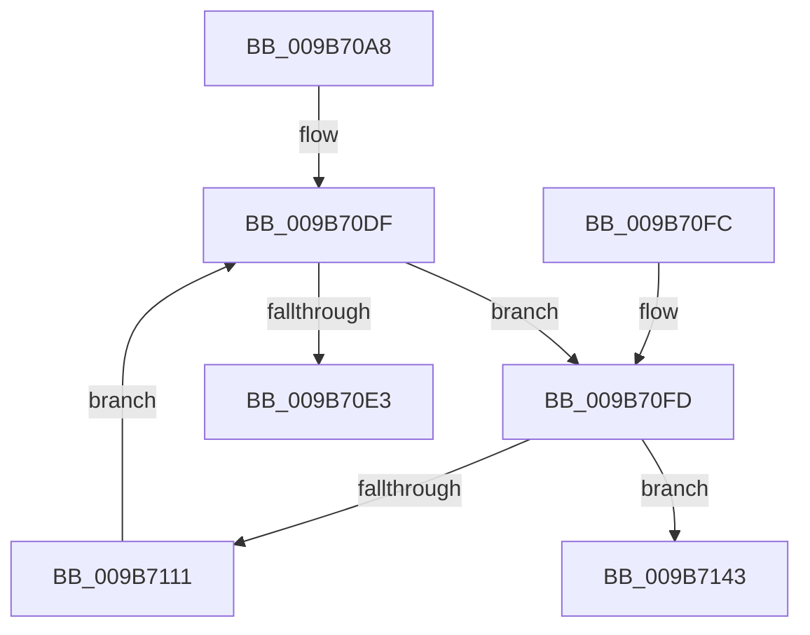

# HvpCopyModifiedData

- RVA: `0x009B70A8`–`0x009B7160` (길이 `184` bytes)
- VA: `0x00000001409B70A8`
- 실행 섹션: `PAGE`
- PDB 이름 있음: `예`; PDB Function 태그: `아니요`
- unwind 정보 RVA: `0x0009E7F4`
- 디코드: `53`개 명령, `184/184` bytes 표시
- 미해석 바이트: `0` (있으면 어셈블리에 `.byte`로 보존)

> 이 문서는 커널 이미지의 기계어와 PDB 기호를 분석해 생성했습니다. 4번과 5번은 함수 원형과 자료형을 바이너리 사용 방식에서 추정한 C 해석이며 원본 소스 복구 결과는 아닙니다.

## 1. Dependencies

- 직접 호출 지점: **6**; 고유 호출 대상: **6**
- 직접 호출자로 확인된 함수: **1**
- RIP 상대 이미지 참조: **0**

### Outgoing calls
- `0x009B70D7` → [HvpGetBinContextInitialize](../../pagecmrc/BC/HvpGetBinContextInitialize_function_00BC98D0.md) (function, `0x00BC98D0`)
- `0x009B7107` → [HvpGetCellMap](../../pagecmrc/BC/HvpGetCellMap_function_00BC9710.md) (function, `0x00BC9710`)
- `0x009B7119` → [HvpMapEntryGetBlockAddress](../85/HvpMapEntryGetBlockAddress_function_00854D70.md) (function, `0x00854D70`)
- `0x009B712C` → [memcpy](../../text/6C/memcpy_function_006C6840.md) (function, `0x006C6840`)
- `0x009B7136` → [HvpMapEntryReleaseBlockAddress](HvpMapEntryReleaseBlockAddress_function_009B73E8.md) (function, `0x009B73E8`)
- `0x009B715A` → [KeBugCheckEx](../../text/4F/KeBugCheckEx_function_004FD660.md) (function, `0x004FD660`)

### Direct callers
- [HvpApplyLogEntryDataToFileBackedHive](HvpApplyLogEntryDataToFileBackedHive_function_009B6FF8.md) at `0x009B7063`

### Static image references
- 디코드된 RIP-relative 메모리 참조가 없습니다.

## 2. Other-region calls and transfers

- 다른 실행 섹션으로 향하는 call: **4**
  - `0x009B70D7` → [HvpGetBinContextInitialize](../../pagecmrc/BC/HvpGetBinContextInitialize_function_00BC98D0.md) (`PAGE` → `PAGECMRC`)
  - `0x009B7107` → [HvpGetCellMap](../../pagecmrc/BC/HvpGetCellMap_function_00BC9710.md) (`PAGE` → `PAGECMRC`)
  - `0x009B712C` → [memcpy](../../text/6C/memcpy_function_006C6840.md) (`PAGE` → `.text`)
  - `0x009B715A` → [KeBugCheckEx](../../text/4F/KeBugCheckEx_function_004FD660.md) (`PAGE` → `.text`)
- 별도 외부 분기/꼬리 이동을 확인하지 못했습니다.

## 3. Assembly (complete function range)

```asm
009B70A8  48 8B C4                        mov rax, rsp
009B70AB  48 89 58 08                     mov qword ptr [rax + 8], rbx
009B70AF  48 89 68 10                     mov qword ptr [rax + 0x10], rbp
009B70B3  48 89 70 18                     mov qword ptr [rax + 0x18], rsi
009B70B7  57                              push rdi
009B70B8  41 56                           push r14
009B70BA  41 57                           push r15
009B70BC  48 83 EC 30                     sub rsp, 0x30
009B70C0  45 33 FF                        xor r15d, r15d
009B70C3  48 8B F9                        mov rdi, rcx
009B70C6  48 8D 48 20                     lea rcx, [rax + 0x20]
009B70CA  66 44 89 78 20                  mov word ptr [rax + 0x20], r15w
009B70CF  41 8B F1                        mov esi, r9d
009B70D2  4D 8B F0                        mov r14, r8
009B70D5  8B EA                           mov ebp, edx
009B70D7  E8 F4 27 21 00                  call 0x140bc98d0
009B70DC  41 8B DF                        mov ebx, r15d
009B70DF  3B DE                           cmp ebx, esi
009B70E1  72 1A                           jb 0x1409b70fd
009B70E3  48 8B 5C 24 50                  mov rbx, qword ptr [rsp + 0x50]
009B70E8  48 8B 6C 24 58                  mov rbp, qword ptr [rsp + 0x58]
009B70ED  48 8B 74 24 60                  mov rsi, qword ptr [rsp + 0x60]
009B70F2  48 83 C4 30                     add rsp, 0x30
009B70F6  41 5F                           pop r15
009B70F8  41 5E                           pop r14
009B70FA  5F                              pop rdi
009B70FB  C3                              ret
009B70FC  CC                              int3
009B70FD  44 8D 04 2B                     lea r8d, [rbx + rbp]
009B7101  48 8B CF                        mov rcx, rdi
009B7104  41 8B D0                        mov edx, r8d
009B7107  E8 04 26 21 00                  call 0x140bc9710
009B710C  48 85 C0                        test rax, rax
009B710F  74 32                           je 0x1409b7143
009B7111  4C 8D 44 24 68                  lea r8, [rsp + 0x68]
009B7116  48 8B D0                        mov rdx, rax
009B7119  E8 52 DC E9 FF                  call 0x140854d70
009B711E  8B D3                           mov edx, ebx
009B7120  41 B8 00 10 00 00               mov r8d, 0x1000
009B7126  49 03 D6                        add rdx, r14
009B7129  48 8B C8                        mov rcx, rax
009B712C  E8 0F F7 D0 FF                  call 0x1406c6840
009B7131  4C 8D 44 24 68                  lea r8, [rsp + 0x68]
009B7136  E8 AD 02 00 00                  call 0x1409b73e8
009B713B  81 C3 00 10 00 00               add ebx, 0x1000
009B7141  EB 9C                           jmp 0x1409b70df
009B7143  BA 01 00 00 00                  mov edx, 1
009B7148  45 8B C8                        mov r9d, r8d
009B714B  4C 8B C7                        mov r8, rdi
009B714E  48 C7 44 24 20 45 0C 00 00      mov qword ptr [rsp + 0x20], 0xc45
009B7157  8D 4A 50                        lea ecx, [rdx + 0x50]
009B715A  E8 01 65 B4 FF                  call 0x1404fd660
009B715F  CC                              int3
```

## 4. C-style interpretation (structured pseudocode)

```c
__int64 __fastcall HvpCopyModifiedData(__int64 a1, int a2, __int64 a3, int a4)
{
    __int64 result;
    __int64 v_r15;
    __int64 v_rbx;
    __int64 v_rsp;
    unsigned __int64 v_stack_p10;
    unsigned __int64 v_stack_p18;
    unsigned __int64 v_stack_p20;
    unsigned __int64 v_stack_p68;
    unsigned __int64 v_stack_p8;

    *(unsigned __int64 *)(v_rsp + 8) = v_rbx;
    *(unsigned __int64 *)(v_rsp + 16) = v_rbp;
    *(unsigned __int64 *)(v_rsp + 24) = v_rsi;
    v_rsp = (v_rsp) - (48);
    v_r15 = 0;
    *(unsigned __int16 *)(v_rsp + 32) = 0;
    result = HvpGetBinContextInitialize(v_rsp + 32, a2, a3, a4);
loc_009B70DF:
    if (0 < ((unsigned int)((unsigned int)(a4)))) goto loc_009B70FD;
    v_rsp = (v_rsp) + (48);
    return result;
loc_009B70FD:
    result = HvpGetCellMap(a1, (unsigned int)((unsigned int)(v_stack_p8 + v_stack_p10 * 1)), v_stack_p8 + v_stack_p10 * 1, a4);
    if (result == 0) goto loc_009B7143;
    result = HvpMapEntryGetBlockAddress(a1, result, v_stack_p68, a4);
    a2 = ((unsigned int)((unsigned int)(v_stack_p8))) + (a3);
    result = memcpy(result, a2, (unsigned int)(0x1000ULL), a4);
    result = HvpMapEntryReleaseBlockAddress(result, a2, v_stack_p68, a4);
    v_rbx = (unsigned int)((v_stack_p8) + (0x1000ULL));
    goto loc_009B70DF;
loc_009B7143:
    v_stack_p20 = 0xC45ULL;
    result = KeBugCheckEx(1 + 80, 1, a1, (unsigned int)((unsigned int)(v_stack_p68)));
    return result;
}
```

## 5. (Beta) C Style

```c
int64_t HvpCopyModifiedData(int64_t Arg1, int32_t Arg2, int64_t Arg3, int32_t Arg4)
{
    int64_t result;
    int64_t local_r15;
    int64_t local_rbx;
    int64_t local_rsp;
    uint64_t v_stack_p10;
    uint64_t v_stack_p18;
    uint64_t v_stack_p20;
    uint64_t v_stack_p68;
    uint64_t v_stack_p8;

    *(uint64_t *)(local_rsp + 0x8) = local_rbx;
    *(uint64_t *)(local_rsp + 0x10) = local_rbp;
    *(uint64_t *)(local_rsp + 0x18) = local_rsi;
    local_rsp = (local_rsp) - (48);
    local_r15 = 0;
    *(uint16_t *)(local_rsp + 0x20) = 0;
    result = HvpGetBinContextInitialize(local_rsp + 32, Arg2, Arg3, Arg4);
loc_009B70DF:
    if (0 < ((uint32_t)((uint32_t)(Arg4)))) goto loc_009B70FD;
    local_rsp = (local_rsp) + (48);
    return result;
loc_009B70FD:
    result = HvpGetCellMap(Arg1, (uint32_t)((uint32_t)(v_stack_p8 + v_stack_p10 * 1)), v_stack_p8 + v_stack_p10 * 1, Arg4);
    if (result == 0) goto loc_009B7143;
    result = HvpMapEntryGetBlockAddress(Arg1, result, v_stack_p68, Arg4);
    Arg2 = ((uint32_t)((uint32_t)(v_stack_p8))) + (Arg3);
    result = memcpy(result, Arg2, (uint32_t)(0x1000ULL), Arg4);
    result = HvpMapEntryReleaseBlockAddress(result, Arg2, v_stack_p68, Arg4);
    local_rbx = (uint32_t)((v_stack_p8) + (0x1000ULL));
    goto loc_009B70DF;
loc_009B7143:
    v_stack_p20 = 0xC45ULL;
    result = KeBugCheckEx(1 + 80, 1, Arg1, (uint32_t)((uint32_t)(v_stack_p68)));
    return result;
}
```

## 6. Execution-region graph

[열기: 2D/3D 그래프와 함수 탐색 컨트롤 패널](../../../control-panel.html?section=page&rva=0x009B70A8&view=graph)

- 2D 그래프는 위에서 아래로 흐르고, 3D 그래프는 빈 공간을 드래그해 회전합니다. Shift+드래그는 이동, 휠은 확대·축소, 함수 노드 선택은 대상 보고서 이동입니다.

### Static fallback


