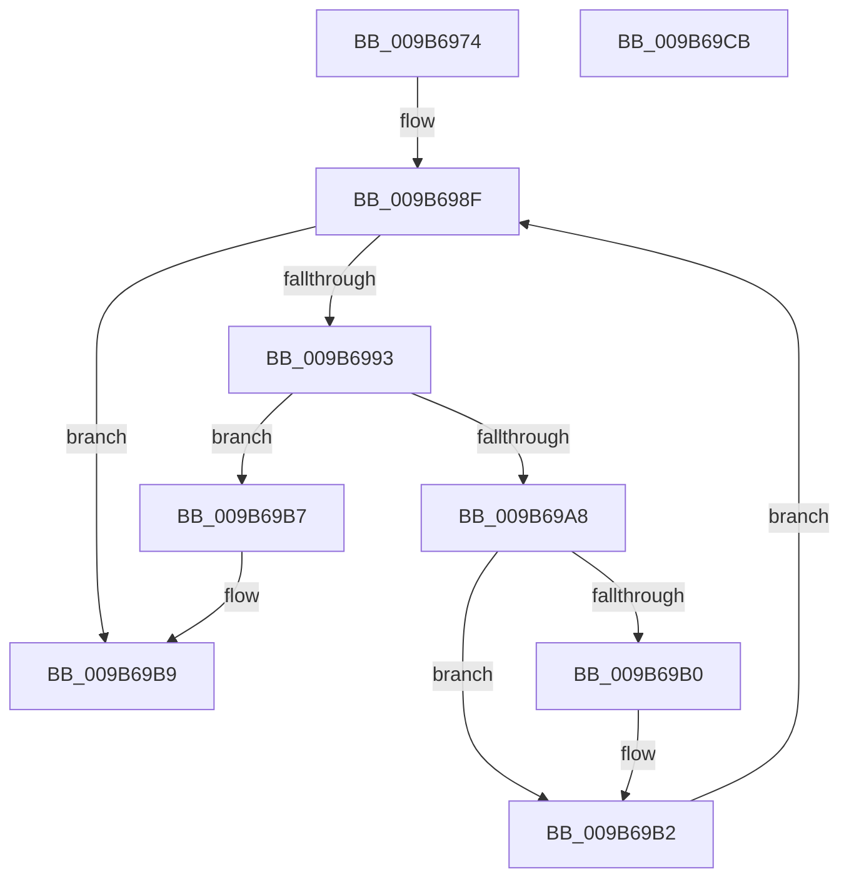

# HvpCountSetRangesInVector

- RVA: `0x009B6974`–`0x009B69CC` (길이 `88` bytes)
- VA: `0x00000001409B6974`
- 실행 섹션: `PAGE`
- PDB 이름 있음: `예`; PDB Function 태그: `아니요`
- unwind 정보 RVA: `0x0005FD94`
- 디코드: `31`개 명령, `88/88` bytes 표시
- 미해석 바이트: `0` (있으면 어셈블리에 `.byte`로 보존)

> 이 문서는 커널 이미지의 기계어와 PDB 기호를 분석해 생성했습니다. 4번과 5번은 함수 원형과 자료형을 바이너리 사용 방식에서 추정한 C 해석이며 원본 소스 복구 결과는 아닙니다.

## 1. Dependencies

- 직접 호출 지점: **1**; 고유 호출 대상: **1**
- 직접 호출자로 확인된 함수: **5**
- RIP 상대 이미지 참조: **0**

### Outgoing calls
- `0x009B699D` → [RtlFindNextForwardRunClear](../../text/3C/RtlFindNextForwardRunClear_function_003CF6A0.md) (function, `0x003CF6A0`)

### Direct callers
- [HvpGenerateLogEntryDirtyData](../../text/43/HvpGenerateLogEntryDirtyData_function_00433ABC.md) at `0x00433B74`
- [HvStoreModifiedData](HvStoreModifiedData_function_009B4FB4.md) at `0x009B5279`
- [HvpGenerateLogEntry](HvpGenerateLogEntry_function_009B65F0.md) at `0x009B6638`
- [HvGetHiveLogFileStatus](HvGetHiveLogFileStatus_function_009B67B8.md) at `0x009B67DE`
- [HvpGenerateLogMetadata](HvpGenerateLogMetadata_function_009B68B0.md) at `0x009B68D5`

### Static image references
- 디코드된 RIP-relative 메모리 참조가 없습니다.

## 2. Other-region calls and transfers

- 다른 실행 섹션으로 향하는 call: **1**
  - `0x009B699D` → [RtlFindNextForwardRunClear](../../text/3C/RtlFindNextForwardRunClear_function_003CF6A0.md) (`PAGE` → `.text`)
- 별도 외부 분기/꼬리 이동을 확인하지 못했습니다.

## 3. Assembly (complete function range)

```asm
009B6974  48 89 5C 24 10                  mov qword ptr [rsp + 0x10], rbx
009B6979  48 89 74 24 18                  mov qword ptr [rsp + 0x18], rsi
009B697E  57                              push rdi
009B697F  48 83 EC 20                     sub rsp, 0x20
009B6983  83 64 24 30 00                  and dword ptr [rsp + 0x30], 0
009B6988  33 FF                           xor edi, edi
009B698A  33 DB                           xor ebx, ebx
009B698C  48 8B F1                        mov rsi, rcx
009B698F  3B 3E                           cmp edi, dword ptr [rsi]
009B6991  73 26                           jae 0x1409b69b9
009B6993  4C 8D 44 24 30                  lea r8, [rsp + 0x30]
009B6998  8B D7                           mov edx, edi
009B699A  48 8B CE                        mov rcx, rsi
009B699D  E8 FE 8C A1 FF                  call 0x1403cf6a0
009B69A2  8B C8                           mov ecx, eax
009B69A4  85 C0                           test eax, eax
009B69A6  74 0F                           je 0x1409b69b7
009B69A8  8B 44 24 30                     mov eax, dword ptr [rsp + 0x30]
009B69AC  3B C7                           cmp eax, edi
009B69AE  74 02                           je 0x1409b69b2
009B69B0  FF C3                           inc ebx
009B69B2  8D 3C 08                        lea edi, [rax + rcx]
009B69B5  EB D8                           jmp 0x1409b698f
009B69B7  FF C3                           inc ebx
009B69B9  48 8B 74 24 40                  mov rsi, qword ptr [rsp + 0x40]
009B69BE  8B C3                           mov eax, ebx
009B69C0  48 8B 5C 24 38                  mov rbx, qword ptr [rsp + 0x38]
009B69C5  48 83 C4 20                     add rsp, 0x20
009B69C9  5F                              pop rdi
009B69CA  C3                              ret
009B69CB  CC                              int3
```

## 4. C-style interpretation (structured pseudocode)

```c
__int64 __fastcall HvpCountSetRangesInVector(__int64 a1)
{
    __int64 result;
    __int64 v_rbx;
    __int64 v_rdi;
    __int64 v_rsp;
    unsigned __int64 v_stack_p10;
    unsigned __int64 v_stack_p18;
    unsigned int v_stack_p8;

    v_stack_p10 = v_rbx;
    v_stack_p18 = v_rsi;
    v_rsp = (v_rsp) - (32);
    v_rdi = 0;
    v_rbx = 0;
loc_009B698F:
    if (0 >= (*(unsigned int *)(a1))) goto loc_009B69B9;
    result = RtlFindNextForwardRunClear(a1, 0, v_stack_p8, a4);
    if ((unsigned int)(result) == 0) goto loc_009B69B7;
    if (((unsigned int)((unsigned int)(v_stack_p8))) != 0) {
        v_rbx = (unsigned int)((v_rbx) + 1);
    }
    goto loc_009B698F;
loc_009B69B7:
    v_rbx = (unsigned int)((v_rbx) + 1);
loc_009B69B9:
    v_rsp = (v_rsp) + (32);
    return (unsigned int)((unsigned int)(v_rbx));
}
```

## 5. (Beta) C Style

```c
int64_t HvpCountSetRangesInVector(void *Arg1)
{
    uint8_t *arg1 = (uint8_t *)Arg1;

    int64_t result;
    int64_t local_rbx;
    int64_t local_rdi;
    int64_t local_rsp;
    uint64_t v_stack_p10;
    uint64_t v_stack_p18;
    uint32_t v_stack_p8;

    v_stack_p10 = local_rbx;
    v_stack_p18 = local_rsi;
    local_rsp = (local_rsp) - (32);
    local_rdi = 0;
    local_rbx = 0;
loc_009B698F:
    if (0 >= (*(uint32_t *)(arg1))) goto loc_009B69B9;
    result = RtlFindNextForwardRunClear(Arg1, 0, v_stack_p8, a4);
    if ((uint32_t)(result) == 0) goto loc_009B69B7;
    if (((uint32_t)((uint32_t)(v_stack_p8))) != 0) {
        local_rbx = (uint32_t)((local_rbx) + 1);
    }
    goto loc_009B698F;
loc_009B69B7:
    local_rbx = (uint32_t)((local_rbx) + 1);
loc_009B69B9:
    local_rsp = (local_rsp) + (32);
    return (uint32_t)((uint32_t)(local_rbx));
}
```

### 관측된 메모리 오프셋

구조체 형식이 확인되지 않은 접근은 인자 기준의 오프셋으로만 기록했습니다.

| 기준 인자 | 오프셋 표현 | 폭 (bit) | 접근 |
|---|---:|---:|---|
| `Arg1` | `+ 0x0` | `32` | `R` |

## 6. Execution-region graph

[열기: 2D/3D 그래프와 함수 탐색 컨트롤 패널](../../../control-panel.html?section=page&rva=0x009B6974&view=graph)

- 2D 그래프는 위에서 아래로 흐르고, 3D 그래프는 빈 공간을 드래그해 회전합니다. Shift+드래그는 이동, 휠은 확대·축소, 함수 노드 선택은 대상 보고서 이동입니다.

### Static fallback


