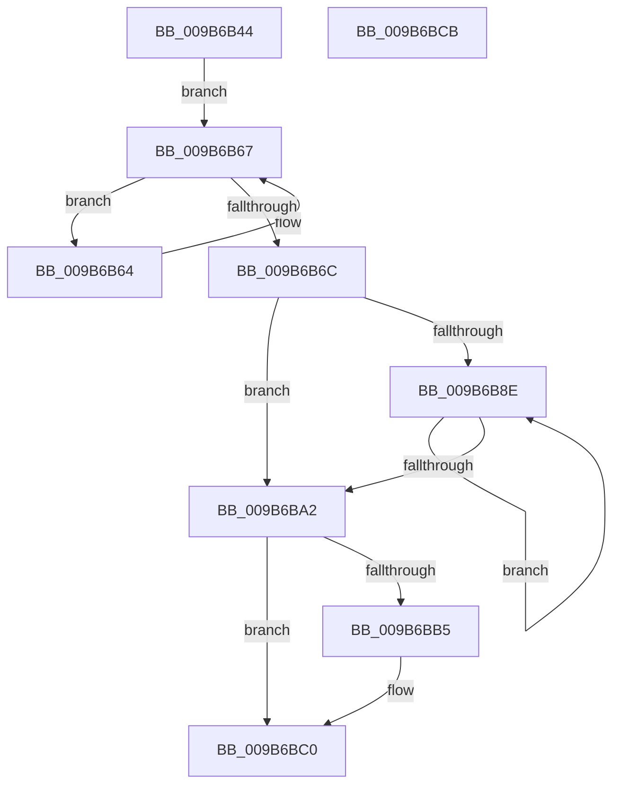

# HvpDetermineFinalViewReservationEnd

- RVA: `0x009B6B44`–`0x009B6BCC` (길이 `136` bytes)
- VA: `0x00000001409B6B44`
- 실행 섹션: `PAGE`
- PDB 이름 있음: `예`; PDB Function 태그: `아니요`
- unwind 정보 RVA: `0x0005CAAC`
- 디코드: `45`개 명령, `136/136` bytes 표시
- 미해석 바이트: `0` (있으면 어셈블리에 `.byte`로 보존)

> 이 문서는 커널 이미지의 기계어와 PDB 기호를 분석해 생성했습니다. 4번과 5번은 함수 원형과 자료형을 바이너리 사용 방식에서 추정한 C 해석이며 원본 소스 복구 결과는 아닙니다.

## 1. Dependencies

- 직접 호출 지점: **1**; 고유 호출 대상: **1**
- 직접 호출자로 확인된 함수: **1**
- RIP 상대 이미지 참조: **0**

### Outgoing calls
- `0x009B6B54` → [CmSiGetMemoryAllocationGranularity](../../text/4B/CmSiGetMemoryAllocationGranularity_function_004B2CB8.md) (function, `0x004B2CB8`)

### Direct callers
- [HvpViewMapCreateViewsForRegion](HvpViewMapCreateViewsForRegion_function_009B6094.md) at `0x009B6107`

### Static image references
- 디코드된 RIP-relative 메모리 참조가 없습니다.

## 2. Other-region calls and transfers

- 다른 실행 섹션으로 향하는 call: **1**
  - `0x009B6B54` → [CmSiGetMemoryAllocationGranularity](../../text/4B/CmSiGetMemoryAllocationGranularity_function_004B2CB8.md) (`PAGE` → `.text`)
- 별도 외부 분기/꼬리 이동을 확인하지 못했습니다.

## 3. Assembly (complete function range)

```asm
009B6B44  48 89 5C 24 08                  mov qword ptr [rsp + 8], rbx
009B6B49  57                              push rdi
009B6B4A  48 83 EC 20                     sub rsp, 0x20
009B6B4E  4C 8B DA                        mov r11, rdx
009B6B51  48 8B D9                        mov rbx, rcx
009B6B54  E8 5F C1 AF FF                  call 0x1404b2cb8
009B6B59  4C 8B D0                        mov r10, rax
009B6B5C  49 8B C0                        mov rax, r8
009B6B5F  48 2B C2                        sub rax, rdx
009B6B62  EB 03                           jmp 0x1409b6b67
009B6B64  4D 03 D2                        add r10, r10
009B6B67  4C 3B D0                        cmp r10, rax
009B6B6A  7C F8                           jl 0x1409b6b64
009B6B6C  B9 08 00 00 00                  mov ecx, 8
009B6B71  49 8B C0                        mov rax, r8
009B6B74  48 99                           cqo
009B6B76  48 F7 F9                        idiv rcx
009B6B79  4B 8D 14 12                     lea rdx, [r10 + r10]
009B6B7D  48 8B CA                        mov rcx, rdx
009B6B80  48 8B F8                        mov rdi, rax
009B6B83  49 2B C8                        sub rcx, r8
009B6B86  49 03 CB                        add rcx, r11
009B6B89  48 3B C8                        cmp rcx, rax
009B6B8C  7F 14                           jg 0x1409b6ba2
009B6B8E  4C 8B D2                        mov r10, rdx
009B6B91  48 03 D2                        add rdx, rdx
009B6B94  48 8B C2                        mov rax, rdx
009B6B97  49 2B C0                        sub rax, r8
009B6B9A  49 03 C3                        add rax, r11
009B6B9D  48 3B C7                        cmp rax, rdi
009B6BA0  7E EC                           jle 0x1409b6b8e
009B6BA2  8B 4B 20                        mov ecx, dword ptr [rbx + 0x20]
009B6BA5  4D 3B D1                        cmp r10, r9
009B6BA8  4D 0F 4D D1                     cmovge r10, r9
009B6BAC  4B 8D 04 1A                     lea rax, [r10 + r11]
009B6BB0  F6 C1 01                        test cl, 1
009B6BB3  74 0B                           je 0x1409b6bc0
009B6BB5  48 8B 4B 10                     mov rcx, qword ptr [rbx + 0x10]
009B6BB9  48 3B C1                        cmp rax, rcx
009B6BBC  48 0F 4D C1                     cmovge rax, rcx
009B6BC0  48 8B 5C 24 30                  mov rbx, qword ptr [rsp + 0x30]
009B6BC5  48 83 C4 20                     add rsp, 0x20
009B6BC9  5F                              pop rdi
009B6BCA  C3                              ret
009B6BCB  CC                              int3
```

## 4. C-style interpretation (structured pseudocode)

```c
__int64 __fastcall HvpDetermineFinalViewReservationEnd(__int64 a1, __int64 a2, __int64 a3, __int64 a4)
{
    __int64 result;
    __int64 v_r10;
    __int64 v_rsp;
    unsigned __int64 v_stack_p8;

    v_stack_p8 = v_rbx;
    v_rsp = (v_rsp) - (32);
    result = CmSiGetMemoryAllocationGranularity(a1, a2, a3, a4);
    result = (a3) - (a2);
    goto loc_009B6B67;
loc_009B6B64:
    v_r10 = (result) + (result);
loc_009B6B67:
    if (v_r10 < result) goto loc_009B6B64;
    a1 = (v_r10 + v_r10 * 1) - (a3);
    a1 = (a1) + (a2);
    if (a1 > a3) goto loc_009B6BA2;
loc_009B6B8E:
    a2 = (v_r10 + v_r10 * 1) + (v_r10 + v_r10 * 1);
    result = (a2) - (a3);
    result = (result) + (a2);
    if (result <= a3) goto loc_009B6B8E;
loc_009B6BA2:
    v_r10 = v_r10 + v_r10 * 1;
    if ((v_r10 + v_r10 * 1) >= a4) { v_r10 = a4; }
    result = v_r10 + a2 * 1;
    if ((((unsigned __int8)((unsigned int)(*(unsigned int *)(a1 + 32)))) & (1)) != 0) {
        a1 = *(unsigned __int64 *)(a1 + 16);
        result = v_r10 + a2 * 1;
        if ((v_r10 + a2 * 1) >= a1) { result = a1; }
    }
    v_rsp = (v_rsp) + (32);
    return result;
}
```

## 5. (Beta) C Style

```c
int64_t HvpDetermineFinalViewReservationEnd(void *Arg1, int64_t Arg2, int64_t Arg3, int64_t Arg4)
{
    uint8_t *arg1 = (uint8_t *)Arg1;

    int64_t result;
    int64_t local_r10;
    int64_t local_rsp;
    uint64_t v_stack_p8;

    v_stack_p8 = local_rbx;
    local_rsp = (local_rsp) - (32);
    result = CmSiGetMemoryAllocationGranularity(Arg1, Arg2, Arg3, Arg4);
    result = (Arg3) - (Arg2);
    goto loc_009B6B67;
loc_009B6B64:
    local_r10 = (result) + (result);
loc_009B6B67:
    if (local_r10 < result) goto loc_009B6B64;
    Arg1 = (local_r10 + local_r10 * 1) - (Arg3);
    Arg1 = (Arg1) + (Arg2);
    if (Arg1 > Arg3) goto loc_009B6BA2;
loc_009B6B8E:
    Arg2 = (local_r10 + local_r10 * 1) + (local_r10 + local_r10 * 1);
    result = (Arg2) - (Arg3);
    result = (result) + (Arg2);
    if (result <= Arg3) goto loc_009B6B8E;
loc_009B6BA2:
    local_r10 = local_r10 + local_r10 * 1;
    if ((local_r10 + local_r10 * 1) >= Arg4) { local_r10 = Arg4; }
    result = local_r10 + Arg2 * 1;
    if ((((uint8_t)((uint32_t)(*(uint32_t *)(arg1 + 0x20)))) & (1)) != 0) {
        Arg1 = *(uint64_t *)(arg1 + 0x10);
        result = local_r10 + Arg2 * 1;
        if ((local_r10 + Arg2 * 1) >= Arg1) { result = Arg1; }
    }
    local_rsp = (local_rsp) + (32);
    return result;
}
```

### 관측된 메모리 오프셋

구조체 형식이 확인되지 않은 접근은 인자 기준의 오프셋으로만 기록했습니다.

| 기준 인자 | 오프셋 표현 | 폭 (bit) | 접근 |
|---|---:|---:|---|
| `Arg1` | `+ 0x10` | `64` | `R` |
| `Arg1` | `+ 0x20` | `32` | `R` |

## 6. Execution-region graph

[열기: 2D/3D 그래프와 함수 탐색 컨트롤 패널](../../../control-panel.html?section=page&rva=0x009B6B44&view=graph)

- 2D 그래프는 위에서 아래로 흐르고, 3D 그래프는 빈 공간을 드래그해 회전합니다. Shift+드래그는 이동, 휠은 확대·축소, 함수 노드 선택은 대상 보고서 이동입니다.

### Static fallback


