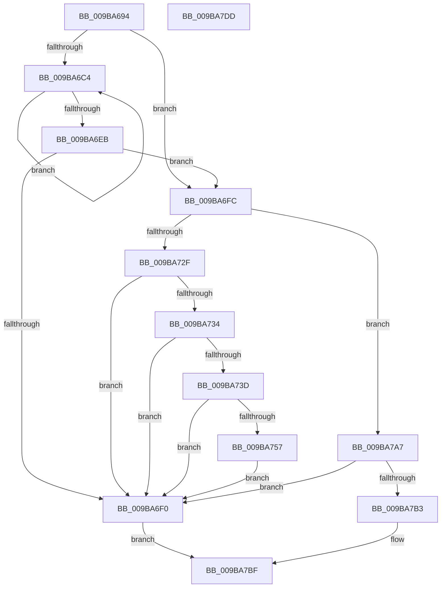

# HvpDetermineLogFileApplicationOrder

- RVA: `0x009BA694`–`0x009BA7DE` (길이 `330` bytes)
- VA: `0x00000001409BA694`
- 실행 섹션: `PAGE`
- PDB 이름 있음: `예`; PDB Function 태그: `아니요`
- unwind 정보 RVA: `0x0009EB30`
- 디코드: `84`개 명령, `330/330` bytes 표시
- 미해석 바이트: `0` (있으면 어셈블리에 `.byte`로 보존)

> 이 문서는 커널 이미지의 기계어와 PDB 기호를 분석해 생성했습니다. 4번과 5번은 함수 원형과 자료형을 바이너리 사용 방식에서 추정한 C 해석이며 원본 소스 복구 결과는 아닙니다.

## 1. Dependencies

- 직접 호출 지점: **4**; 고유 호출 대상: **4**
- 직접 호출자로 확인된 함수: **1**
- RIP 상대 이미지 참조: **3**

### Outgoing calls
- `0x009BA702` → [HvpCompareLogSequenceNumbers](../7F/HvpCompareLogSequenceNumbers_function_007F6904.md) (function, `0x007F6904`)
- `0x009BA74E` → [tlgKeywordOn](../../text/42/tlgKeywordOn_function_0042EAA0.md) (function, `0x0042EAA0`)
- `0x009BA79D` → [tlgWriteTransfer_EtwWriteTransfer](../../text/42/tlgWriteTransfer_EtwWriteTransfer_function_004260E0.md) (function, `0x004260E0`)
- `0x009BA7CA` → [_security_check_cookie](../../text/6A/_security_check_cookie_function_006AC640.md) (function, `0x006AC640`)

### Direct callers
- [HvAnalyzeLogFiles](HvAnalyzeLogFiles_function_009B9A9C.md) at `0x009B9D79`

### Static image references
- `0x009BA69E` → RVA `0x00E0A740` (`.data`; read)
- `0x009BA734` → RVA `0x00E09F58` (`.data`; read)
- `0x009BA766` → RVA `0x00057714` (`.rdata`; read)

## 2. Other-region calls and transfers

- 다른 실행 섹션으로 향하는 call: **3**
  - `0x009BA74E` → [tlgKeywordOn](../../text/42/tlgKeywordOn_function_0042EAA0.md) (`PAGE` → `.text`)
  - `0x009BA79D` → [tlgWriteTransfer_EtwWriteTransfer](../../text/42/tlgWriteTransfer_EtwWriteTransfer_function_004260E0.md) (`PAGE` → `.text`)
  - `0x009BA7CA` → [_security_check_cookie](../../text/6A/_security_check_cookie_function_006AC640.md) (`PAGE` → `.text`)
- 별도 외부 분기/꼬리 이동을 확인하지 못했습니다.

## 3. Assembly (complete function range)

```asm
009BA694  48 89 5C 24 10                  mov qword ptr [rsp + 0x10], rbx
009BA699  57                              push rdi
009BA69A  48 83 EC 70                     sub rsp, 0x70
009BA69E  48 8B 05 9B 00 45 00            mov rax, qword ptr [rip + 0x45009b]
009BA6A5  48 33 C4                        xor rax, rsp
009BA6A8  48 89 44 24 68                  mov qword ptr [rsp + 0x68], rax
009BA6AD  44 8B 11                        mov r10d, dword ptr [rcx]
009BA6B0  45 33 C0                        xor r8d, r8d
009BA6B3  83 CF FF                        or edi, 0xffffffff
009BA6B6  45 33 C9                        xor r9d, r9d
009BA6B9  44 8A DA                        mov r11b, dl
009BA6BC  48 8B D9                        mov rbx, rcx
009BA6BF  45 85 D2                        test r10d, r10d
009BA6C2  74 38                           je 0x1409ba6fc
009BA6C4  4B 8D 0C 49                     lea rcx, [r9 + r9*2]
009BA6C8  41 8B C1                        mov eax, r9d
009BA6CB  8B 54 CB 04                     mov edx, dword ptr [rbx + rcx*8 + 4]
009BA6CF  0F BA E2 00                     bt edx, 0
009BA6D3  0F 43 C7                        cmovae eax, edi
009BA6D6  8B F8                           mov edi, eax
009BA6D8  41 8D 40 01                     lea eax, [r8 + 1]
009BA6DC  41 0F 43 C0                     cmovae eax, r8d
009BA6E0  41 FF C1                        inc r9d
009BA6E3  44 8B C0                        mov r8d, eax
009BA6E6  45 3B CA                        cmp r9d, r10d
009BA6E9  72 D9                           jb 0x1409ba6c4
009BA6EB  83 F8 01                        cmp eax, 1
009BA6EE  75 0C                           jne 0x1409ba6fc
009BA6F0  C7 43 3C 01 00 00 00            mov dword ptr [rbx + 0x3c], 1
009BA6F7  E9 C3 00 00 00                  jmp 0x1409ba7bf
009BA6FC  8B 53 24                        mov edx, dword ptr [rbx + 0x24]
009BA6FF  8B 4B 0C                        mov ecx, dword ptr [rbx + 0xc]
009BA702  E8 FD C1 E3 FF                  call 0x1407f6904
009BA707  48 63 F8                        movsxd rdi, eax
009BA70A  48 8B C7                        mov rax, rdi
009BA70D  C1 EF 1F                        shr edi, 0x1f
009BA710  48 C1 F8 3F                     sar rax, 0x3f
009BA714  8B D7                           mov edx, edi
009BA716  48 8B C8                        mov rcx, rax
009BA719  83 F2 01                        xor edx, 1
009BA71C  48 83 E0 E8                     and rax, 0xffffffffffffffe8
009BA720  83 E1 18                        and ecx, 0x18
009BA723  8B 44 18 28                     mov eax, dword ptr [rax + rbx + 0x28]
009BA727  FF C0                           inc eax
009BA729  3B 44 19 0C                     cmp eax, dword ptr [rcx + rbx + 0xc]
009BA72D  74 78                           je 0x1409ba7a7
009BA72F  45 84 DB                        test r11b, r11b
009BA732  75 BC                           jne 0x1409ba6f0
009BA734  83 3D 1D F8 44 00 05            cmp dword ptr [rip + 0x44f81d], 5
009BA73B  76 B3                           jbe 0x1409ba6f0
009BA73D  48 BA 00 00 00 00 00 40 00 00   movabs rdx, 0x400000000000
009BA747  48 8D 0D 0A F8 44 00            lea rcx, [rip + 0x44f80a]
009BA74E  E8 4D 43 A7 FF                  call 0x14042eaa0
009BA753  84 C0                           test al, al
009BA755  74 99                           je 0x1409ba6f0
009BA757  83 64 24 64 00                  and dword ptr [rsp + 0x64], 0
009BA75C  48 8D 44 24 30                  lea rax, [rsp + 0x30]
009BA761  48 89 44 24 58                  mov qword ptr [rsp + 0x58], rax
009BA766  48 8D 15 A7 CF 69 FF            lea rdx, [rip - 0x963059]
009BA76D  48 8D 44 24 38                  lea rax, [rsp + 0x38]
009BA772  48 C7 44 24 30 00 00 00 01      mov qword ptr [rsp + 0x30], 0x1000000
009BA77B  48 89 44 24 28                  mov qword ptr [rsp + 0x28], rax
009BA780  48 8D 0D D1 F7 44 00            lea rcx, [rip + 0x44f7d1]
009BA787  45 33 C9                        xor r9d, r9d
009BA78A  C7 44 24 20 03 00 00 00         mov dword ptr [rsp + 0x20], 3
009BA792  45 33 C0                        xor r8d, r8d
009BA795  C7 44 24 60 08 00 00 00         mov dword ptr [rsp + 0x60], 8
009BA79D  E8 3E B9 A6 FF                  call 0x1404260e0
009BA7A2  E9 49 FF FF FF                  jmp 0x1409ba6f0
009BA7A7  8B 44 19 04                     mov eax, dword ptr [rcx + rbx + 4]
009BA7AB  A8 02                           test al, 2
009BA7AD  0F 85 3D FF FF FF               jne 0x1409ba6f0
009BA7B3  89 7B 38                        mov dword ptr [rbx + 0x38], edi
009BA7B6  8B FA                           mov edi, edx
009BA7B8  C7 43 3C 02 00 00 00            mov dword ptr [rbx + 0x3c], 2
009BA7BF  89 7B 34                        mov dword ptr [rbx + 0x34], edi
009BA7C2  48 8B 4C 24 68                  mov rcx, qword ptr [rsp + 0x68]
009BA7C7  48 33 CC                        xor rcx, rsp
009BA7CA  E8 71 1E CF FF                  call 0x1406ac640
009BA7CF  48 8B 9C 24 88 00 00 00         mov rbx, qword ptr [rsp + 0x88]
009BA7D7  48 83 C4 70                     add rsp, 0x70
009BA7DB  5F                              pop rdi
009BA7DC  C3                              ret
009BA7DD  CC                              int3
```

## 4. C-style interpretation (structured pseudocode)

```c
__int64 __fastcall HvpDetermineLogFileApplicationOrder(__int64 a1, unsigned __int8 a2, int a3, int a4)
{
    __int64 result;
    __int64 v_rdi;
    __int64 v_rsp;
    unsigned __int64 v_stack_m10;
    unsigned int v_stack_m14;
    unsigned int v_stack_m18;
    unsigned __int64 v_stack_m20;
    unsigned __int64 v_stack_m40;
    unsigned __int64 v_stack_m48;
    unsigned __int64 v_stack_m50;
    unsigned int v_stack_m58;
    unsigned __int64 v_stack_p10;

    v_stack_p10 = v_rbx;
    v_rsp = (v_rsp) - (112);
    result = (*(unsigned __int64 *)(v_rip + 4522139)) ^ (v_rsp);
    v_stack_m10 = result;
    a3 = 0;
    v_rdi = (unsigned int)((v_rdi) | (0xFFFFFFFFULL));
    a4 = 0;
    if ((unsigned int)((unsigned int)(*(unsigned int *)(a1))) == 0) goto loc_009BA6FC;
loc_009BA6C4:
    result = 0;
    if (condition_is_above_or_equal) { result = (unsigned int)(v_rdi); }
    result = a3 + 1;
    if (condition_is_above_or_equal) { result = 0; }
    a4 = (unsigned int)((a4) + 1);
    if (a4 < ((unsigned int)((unsigned int)(*(unsigned int *)(a1))))) goto loc_009BA6C4;
    if (((unsigned int)(result)) != 1) goto loc_009BA6FC;
loc_009BA6F0:
    *(unsigned int *)(a1 + 60) = 1;
    goto loc_009BA7BF;
loc_009BA6FC:
    result = HvpCompareLogSequenceNumbers((unsigned int)(*(unsigned int *)(a1 + 12)), (unsigned int)(*(unsigned int *)(a1 + 36)), (unsigned int)((unsigned int)(result)), a4);
    v_rdi = (unsigned int)(((int)((unsigned int)(result))) >> (31));
    result = ((int)((unsigned int)(result))) >> (63);
    a2 = (unsigned int)(((unsigned int)((unsigned int)(v_rdi))) ^ (1));
    result = (result) & (-24);
    a1 = (unsigned int)((result) & (24));
    result = (unsigned int)(((unsigned int)(*(unsigned int *)(result + a1 * 1 + 40))) + 1);
    if (((unsigned int)(result)) == (*(unsigned int *)(a1 + a1 * 1 + 12))) goto loc_009BA7A7;
    if (a2 != 0) goto loc_009BA6F0;
    if ((*(unsigned int *)(v_rip + 4519965)) <= 5) goto loc_009BA6F0;
    result = tlgKeywordOn(v_rip + 4519946, a2, (unsigned int)((unsigned int)(result)), a4);
    if ((unsigned __int8)(result) == 0) goto loc_009BA6F0;
    v_stack_m20 = v_stack_m48;
    v_stack_m48 = 0x1000000ULL;
    v_stack_m50 = v_stack_m40;
    a4 = 0;
    v_stack_m58 = 3;
    a3 = 0;
    v_stack_m18 = 8;
    result = tlgWriteTransfer_EtwWriteTransfer(v_rip + 4519889, v_rip - 9842777, a3, a4);
    goto loc_009BA6F0;
loc_009BA7A7:
    if ((((unsigned __int8)((unsigned int)(*(unsigned int *)(v_rip + 4519889 + a1 * 1 + 4)))) & (2)) != 0) goto loc_009BA6F0;
    *(unsigned int *)(a1 + 56) = (unsigned int)(v_rdi);
    *(unsigned int *)(a1 + 60) = 2;
loc_009BA7BF:
    *(unsigned int *)(a1 + 52) = (unsigned int)((unsigned int)((unsigned int)(v_rip - 9842777)));
    a1 = (v_stack_m10) ^ (v_rsp);
    result = _security_check_cookie(a1, v_rip - 9842777, a3, a4);
    v_rsp = (v_rsp) + (112);
    return result;
}
```

## 5. (Beta) C Style

```c
int64_t HvpDetermineLogFileApplicationOrder(void *Arg1, uint8_t Arg2, int32_t Arg3, int32_t Arg4)
{
    uint8_t *arg1 = (uint8_t *)Arg1;

    int64_t result;
    int64_t local_rdi;
    int64_t local_rsp;
    uint64_t v_stack_m10;
    uint32_t v_stack_m14;
    uint32_t v_stack_m18;
    uint64_t v_stack_m20;
    uint64_t v_stack_m40;
    uint64_t v_stack_m48;
    uint64_t v_stack_m50;
    uint32_t v_stack_m58;
    uint64_t v_stack_p10;

    v_stack_p10 = local_rbx;
    local_rsp = (local_rsp) - (112);
    result = (*(uint64_t *)(v_rip + 0x45009B)) ^ (local_rsp);
    v_stack_m10 = result;
    Arg3 = 0;
    local_rdi = (uint32_t)((local_rdi) | (0xFFFFFFFFULL));
    Arg4 = 0;
    if ((uint32_t)((uint32_t)(*(uint32_t *)(arg1))) == 0) goto loc_009BA6FC;
loc_009BA6C4:
    result = 0;
    if (condition_is_above_or_equal) { result = (uint32_t)(local_rdi); }
    result = Arg3 + 1;
    if (condition_is_above_or_equal) { result = 0; }
    Arg4 = (uint32_t)((Arg4) + 1);
    if (Arg4 < ((uint32_t)((uint32_t)(*(uint32_t *)(arg1))))) goto loc_009BA6C4;
    if (((uint32_t)(result)) != 1) goto loc_009BA6FC;
loc_009BA6F0:
    *(uint32_t *)(arg1 + 0x3C) = 1;
    goto loc_009BA7BF;
loc_009BA6FC:
    result = HvpCompareLogSequenceNumbers((uint32_t)(*(uint32_t *)(arg1 + 0xC)), (uint32_t)(*(uint32_t *)(arg1 + 0x24)), (uint32_t)((uint32_t)(result)), Arg4);
    local_rdi = (uint32_t)(((int32_t)((uint32_t)(result))) >> (31));
    result = ((int32_t)((uint32_t)(result))) >> (63);
    Arg2 = (uint32_t)(((uint32_t)((uint32_t)(local_rdi))) ^ (1));
    result = (result) & (-24);
    Arg1 = (uint32_t)((result) & (24));
    result = (uint32_t)(((uint32_t)(*(uint32_t *)(result + arg1 * 1 + 0x28))) + 1);
    if (((uint32_t)(result)) == (*(uint32_t *)(arg1 + arg1 * 1 + 0xC))) goto loc_009BA7A7;
    if (Arg2 != 0) goto loc_009BA6F0;
    if ((*(uint32_t *)(v_rip + 0x44F81D)) <= 5) goto loc_009BA6F0;
    result = tlgKeywordOn(v_rip + 4519946, Arg2, (uint32_t)((uint32_t)(result)), Arg4);
    if ((uint8_t)(result) == 0) goto loc_009BA6F0;
    v_stack_m20 = v_stack_m48;
    v_stack_m48 = 0x1000000ULL;
    v_stack_m50 = v_stack_m40;
    Arg4 = 0;
    v_stack_m58 = 3;
    Arg3 = 0;
    v_stack_m18 = 8;
    result = tlgWriteTransfer_EtwWriteTransfer(v_rip + 4519889, v_rip - 9842777, Arg3, Arg4);
    goto loc_009BA6F0;
loc_009BA7A7:
    if ((((uint8_t)((uint32_t)(*(uint32_t *)(v_rip + 0x44F7D1 + arg1 * 1 + 0x4)))) & (2)) != 0) goto loc_009BA6F0;
    *(uint32_t *)(arg1 + 0x38) = (uint32_t)(local_rdi);
    *(uint32_t *)(arg1 + 0x3C) = 2;
loc_009BA7BF:
    *(uint32_t *)(arg1 + 0x34) = (uint32_t)((uint32_t)((uint32_t)(v_rip - 9842777)));
    Arg1 = (v_stack_m10) ^ (local_rsp);
    result = _security_check_cookie(Arg1, v_rip - 9842777, Arg3, Arg4);
    local_rsp = (local_rsp) + (112);
    return result;
}
```

### 관측된 메모리 오프셋

구조체 형식이 확인되지 않은 접근은 인자 기준의 오프셋으로만 기록했습니다.

| 기준 인자 | 오프셋 표현 | 폭 (bit) | 접근 |
|---|---:|---:|---|
| `Arg1` | `+ 0x0` | `32` | `R` |
| `Arg1` | `+ 0x4 + rcx*8` | `32` | `R` |
| `Arg1` | `+ 0xC` | `32` | `R` |
| `Arg1` | `+ 0x24` | `32` | `R` |
| `Arg1` | `+ 0x34` | `32` | `W` |
| `Arg1` | `+ 0x38` | `32` | `W` |
| `Arg1` | `+ 0x3C` | `32` | `W` |

## 6. Execution-region graph

[열기: 2D/3D 그래프와 함수 탐색 컨트롤 패널](../../../control-panel.html?section=page&rva=0x009BA694&view=graph)

- 2D 그래프는 위에서 아래로 흐르고, 3D 그래프는 빈 공간을 드래그해 회전합니다. Shift+드래그는 이동, 휠은 확대·축소, 함수 노드 선택은 대상 보고서 이동입니다.

### Static fallback


