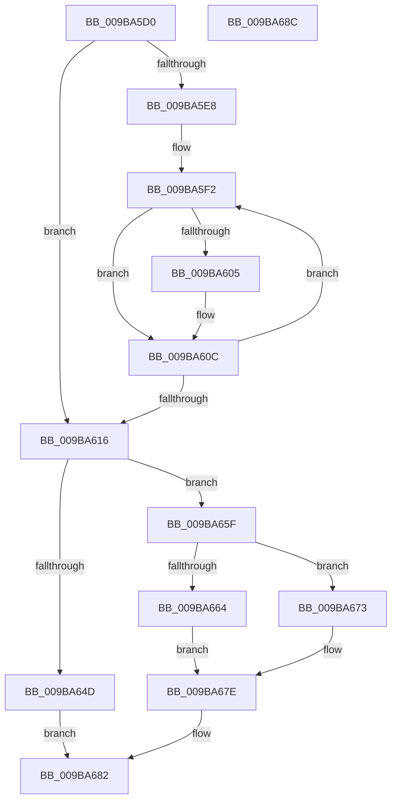

# HvpDetermineResultingLoggingState

- RVA: `0x009BA5D0`–`0x009BA68D` (길이 `189` bytes)
- VA: `0x00000001409BA5D0`
- 실행 섹션: `PAGE`
- PDB 이름 있음: `예`; PDB Function 태그: `아니요`
- unwind 정보 RVA: `0x00071750`
- 디코드: `56`개 명령, `189/189` bytes 표시
- 미해석 바이트: `0` (있으면 어셈블리에 `.byte`로 보존)

> 이 문서는 커널 이미지의 기계어와 PDB 기호를 분석해 생성했습니다. 4번과 5번은 함수 원형과 자료형을 바이너리 사용 방식에서 추정한 C 해석이며 원본 소스 복구 결과는 아닙니다.

## 1. Dependencies

- 직접 호출 지점: **0**; 고유 호출 대상: **0**
- 직접 호출자로 확인된 함수: **1**
- RIP 상대 이미지 참조: **0**

### Outgoing calls
- 직접 디코드된 call 명령이 없습니다.

### Direct callers
- [HvAnalyzeLogFiles](HvAnalyzeLogFiles_function_009B9A9C.md) at `0x009B9D83`

### Static image references
- 디코드된 RIP-relative 메모리 참조가 없습니다.

## 2. Other-region calls and transfers

- 다른 실행 섹션으로 향하는 call: **0**
- 별도 외부 분기/꼬리 이동을 확인하지 못했습니다.

## 3. Assembly (complete function range)

```asm
009BA5D0  48 89 5C 24 08                  mov qword ptr [rsp + 8], rbx
009BA5D5  44 8B 59 3C                     mov r11d, dword ptr [rcx + 0x3c]
009BA5D9  45 33 C0                        xor r8d, r8d
009BA5DC  44 89 41 40                     mov dword ptr [rcx + 0x40], r8d
009BA5E0  48 8B D1                        mov rdx, rcx
009BA5E3  45 85 DB                        test r11d, r11d
009BA5E6  74 2E                           je 0x1409ba616
009BA5E8  41 8B C8                        mov ecx, r8d
009BA5EB  4C 8D 4A 34                     lea r9, [rdx + 0x34]
009BA5EF  41 8B DB                        mov ebx, r11d
009BA5F2  41 8B 01                        mov eax, dword ptr [r9]
009BA5F5  48 FF C0                        inc rax
009BA5F8  48 8D 04 40                     lea rax, [rax + rax*2]
009BA5FC  44 8B 14 C2                     mov r10d, dword ptr [rdx + rax*8]
009BA600  44 3B D1                        cmp r10d, ecx
009BA603  76 07                           jbe 0x1409ba60c
009BA605  44 89 52 40                     mov dword ptr [rdx + 0x40], r10d
009BA609  41 8B CA                        mov ecx, r10d
009BA60C  49 83 C1 04                     add r9, 4
009BA610  48 83 EB 01                     sub rbx, 1
009BA614  75 DC                           jne 0x1409ba5f2
009BA616  41 8D 43 FF                     lea eax, [r11 - 1]
009BA61A  4C 8B D2                        mov r10, rdx
009BA61D  8B 44 82 34                     mov eax, dword ptr [rdx + rax*4 + 0x34]
009BA621  4C 8D 0C 40                     lea r9, [rax + rax*2]
009BA625  8B 42 34                        mov eax, dword ptr [rdx + 0x34]
009BA628  48 8D 0C 40                     lea rcx, [rax + rax*2]
009BA62C  8B 44 CA 0C                     mov eax, dword ptr [rdx + rcx*8 + 0xc]
009BA630  89 42 44                        mov dword ptr [rdx + 0x44], eax
009BA633  46 8B 54 CA 10                  mov r10d, dword ptr [rdx + r9*8 + 0x10]
009BA638  41 FF C2                        inc r10d
009BA63B  44 89 52 50                     mov dword ptr [rdx + 0x50], r10d
009BA63F  42 8B 44 CA 04                  mov eax, dword ptr [rdx + r9*8 + 4]
009BA644  42 8B 4C CA 08                  mov ecx, dword ptr [rdx + r9*8 + 8]
009BA649  A8 02                           test al, 2
009BA64B  75 12                           jne 0x1409ba65f
009BA64D  89 4A 48                        mov dword ptr [rdx + 0x48], ecx
009BA650  42 8B 44 CA 0C                  mov eax, dword ptr [rdx + r9*8 + 0xc]
009BA655  89 42 4C                        mov dword ptr [rdx + 0x4c], eax
009BA658  46 8B 44 CA 14                  mov r8d, dword ptr [rdx + r9*8 + 0x14]
009BA65D  EB 23                           jmp 0x1409ba682
009BA65F  83 F9 01                        cmp ecx, 1
009BA662  74 0F                           je 0x1409ba673
009BA664  83 E9 04                        sub ecx, 4
009BA667  F7 D9                           neg ecx
009BA669  1B C0                           sbb eax, eax
009BA66B  83 C0 05                        add eax, 5
009BA66E  89 42 48                        mov dword ptr [rdx + 0x48], eax
009BA671  EB 0B                           jmp 0x1409ba67e
009BA673  83 4A 58 01                     or dword ptr [rdx + 0x58], 1
009BA677  C7 42 48 01 00 00 00            mov dword ptr [rdx + 0x48], 1
009BA67E  44 89 52 4C                     mov dword ptr [rdx + 0x4c], r10d
009BA682  44 89 42 54                     mov dword ptr [rdx + 0x54], r8d
009BA686  48 8B 5C 24 08                  mov rbx, qword ptr [rsp + 8]
009BA68B  C3                              ret
009BA68C  CC                              int3
```

## 4. C-style interpretation (structured pseudocode)

```c
__int64 __fastcall HvpDetermineResultingLoggingState(__int64 a1, __int64 a2, int a3)
{
    __int64 result;
    __int64 v_r10;
    __int64 v_rbx;
    unsigned __int64 v_stack_p8;

    v_stack_p8 = v_rbx;
    a3 = 0;
    *(unsigned int *)(a1 + 64) = 0;
    if ((unsigned int)((unsigned int)(*(unsigned int *)(a1 + 60))) == 0) goto loc_009BA616;
loc_009BA5F2:
    result = ((unsigned int)(*(unsigned int *)(a1 + 52))) + 1;
    if (((unsigned int)((unsigned int)(*(unsigned int *)(a1 + result + result * 2 * 8)))) >= = 0) {
        *(unsigned int *)(a1 + 64) = (unsigned int)((unsigned int)(*(unsigned int *)(a1 + result + result * 2 * 8)));
        a1 = (unsigned int)((unsigned int)(*(unsigned int *)(a1 + result + result * 2 * 8)));
    }
    a4 = (a1 + 52) + (4);
    v_rbx = ((unsigned int)((unsigned int)((unsigned int)(*(unsigned int *)(a1 + 60))))) - (1);
    if (condition_is_not_equal) goto loc_009BA5F2;
loc_009BA616:
    *(unsigned int *)(a1 + 68) = (unsigned int)((unsigned int)(*(unsigned int *)(a1 + (unsigned int)(*(unsigned int *)(a1 + 52)) + (unsigned int)(*(unsigned int *)(a1 + 52)) * 2 * 8 + 12)));
    v_r10 = (unsigned int)(((unsigned int)(*(unsigned int *)(a1 + (unsigned int)(*(unsigned int *)(a1 + (unsigned int)(*(unsigned int *)(a1 + 60)) - 1 * 4 + 52)) + (unsigned int)(*(unsigned int *)(a1 + (unsigned int)(*(unsigned int *)(a1 + 60)) - 1 * 4 + 52)) * 2 * 8 + 16))) + 1);
    *(unsigned int *)(a1 + 80) = (unsigned int)(v_r10);
    if ((((unsigned __int8)((unsigned int)(*(unsigned int *)(a1 + (unsigned int)(*(unsigned int *)(a1 + (unsigned int)(*(unsigned int *)(a1 + 60)) - 1 * 4 + 52)) + (unsigned int)(*(unsigned int *)(a1 + (unsigned int)(*(unsigned int *)(a1 + 60)) - 1 * 4 + 52)) * 2 * 8 + 4)))) & (2)) != 0) goto loc_009BA65F;
    *(unsigned int *)(a1 + 72) = (unsigned int)((unsigned int)(*(unsigned int *)(a1 + (unsigned int)(*(unsigned int *)(a1 + (unsigned int)(*(unsigned int *)(a1 + 60)) - 1 * 4 + 52)) + (unsigned int)(*(unsigned int *)(a1 + (unsigned int)(*(unsigned int *)(a1 + 60)) - 1 * 4 + 52)) * 2 * 8 + 8)));
    *(unsigned int *)(a1 + 76) = (unsigned int)((unsigned int)(*(unsigned int *)(a1 + (unsigned int)(*(unsigned int *)(a1 + (unsigned int)(*(unsigned int *)(a1 + 60)) - 1 * 4 + 52)) + (unsigned int)(*(unsigned int *)(a1 + (unsigned int)(*(unsigned int *)(a1 + 60)) - 1 * 4 + 52)) * 2 * 8 + 12)));
    goto loc_009BA682;
loc_009BA65F:
    if (((unsigned int)((unsigned int)(*(unsigned int *)(a1 + (unsigned int)(*(unsigned int *)(a1 + (unsigned int)(*(unsigned int *)(a1 + 60)) - 1 * 4 + 52)) + (unsigned int)(*(unsigned int *)(a1 + (unsigned int)(*(unsigned int *)(a1 + 60)) - 1 * 4 + 52)) * 2 * 8 + 8)))) == 1) goto loc_009BA673;
    a1 = (unsigned int)(((unsigned int)(*(unsigned int *)(a1 + (unsigned int)(*(unsigned int *)(a1 + (unsigned int)(*(unsigned int *)(a1 + 60)) - 1 * 4 + 52)) + (unsigned int)(*(unsigned int *)(a1 + (unsigned int)(*(unsigned int *)(a1 + 60)) - 1 * 4 + 52)) * 2 * 8 + 8))) - (4));
    a1 = (unsigned int)(-(a1));
    result = (unsigned int)(((unsigned int)(*(unsigned int *)(a1 + (unsigned int)(*(unsigned int *)(a1 + (unsigned int)(*(unsigned int *)(a1 + 60)) - 1 * 4 + 52)) + (unsigned int)(*(unsigned int *)(a1 + (unsigned int)(*(unsigned int *)(a1 + 60)) - 1 * 4 + 52)) * 2 * 8 + 12))) + (5));
    *(unsigned int *)(a1 + 72) = (unsigned int)(result);
    goto loc_009BA67E;
loc_009BA673:
    *(unsigned int *)(a1 + 72) = 1;
loc_009BA67E:
    *(unsigned int *)(a1 + 76) = (unsigned int)(v_r10);
loc_009BA682:
    *(unsigned int *)(a1 + 84) = (unsigned int)((unsigned int)(*(unsigned int *)(a1 + (unsigned int)(*(unsigned int *)(a1 + (unsigned int)(*(unsigned int *)(a1 + 60)) - 1 * 4 + 52)) + (unsigned int)(*(unsigned int *)(a1 + (unsigned int)(*(unsigned int *)(a1 + 60)) - 1 * 4 + 52)) * 2 * 8 + 20)));
    return result;
}
```

## 5. (Beta) C Style

```c
int64_t HvpDetermineResultingLoggingState(void *Arg1, int64_t Arg2, int32_t Arg3)
{
    uint8_t *arg1 = (uint8_t *)Arg1;

    int64_t result;
    int64_t local_r10;
    int64_t local_rbx;
    uint64_t v_stack_p8;

    v_stack_p8 = local_rbx;
    Arg3 = 0;
    *(uint32_t *)(arg1 + 0x40) = 0;
    if ((uint32_t)((uint32_t)(*(uint32_t *)(arg1 + 0x3C))) == 0) goto loc_009BA616;
loc_009BA5F2:
    result = ((uint32_t)(*(uint32_t *)(arg1 + 0x34))) + 1;
    if (((uint32_t)((uint32_t)(*(uint32_t *)(arg1 + result + result * 2 * 8)))) >= = 0) {
        *(uint32_t *)(arg1 + 0x40) = (uint32_t)((uint32_t)(*(uint32_t *)(arg1 + result + result * 2 * 8)));
        Arg1 = (uint32_t)((uint32_t)(*(uint32_t *)(arg1 + result + result * 2 * 8)));
    }
    a4 = (Arg1 + 52) + (4);
    local_rbx = ((uint32_t)((uint32_t)((uint32_t)(*(uint32_t *)(arg1 + 0x3C))))) - (1);
    if (condition_is_not_equal) goto loc_009BA5F2;
loc_009BA616:
    *(uint32_t *)(arg1 + 0x44) = (uint32_t)((uint32_t)(*(uint32_t *)(arg1 + (uint32_t)(*(uint32_t *)(arg1 + 0x34)) + (uint32_t)(*(uint32_t *)(arg1 + 0x34)) * 2 * 8 + 0xC)));
    local_r10 = (uint32_t)(((uint32_t)(*(uint32_t *)(arg1 + (uint32_t)(*(uint32_t *)(arg1 + (uint32_t)(*(uint32_t *)(arg1 + 0x3C)) - 0x1 * 4 + 0x34)) + (uint32_t)(*(uint32_t *)(arg1 + (uint32_t)(*(uint32_t *)(arg1 + 0x3C)) - 0x1 * 4 + 0x34)) * 2 * 8 + 0x10))) + 1);
    *(uint32_t *)(arg1 + 0x50) = (uint32_t)(local_r10);
    if ((((uint8_t)((uint32_t)(*(uint32_t *)(arg1 + (uint32_t)(*(uint32_t *)(arg1 + (uint32_t)(*(uint32_t *)(arg1 + 0x3C)) - 0x1 * 4 + 0x34)) + (uint32_t)(*(uint32_t *)(arg1 + (uint32_t)(*(uint32_t *)(arg1 + 0x3C)) - 0x1 * 4 + 0x34)) * 2 * 8 + 0x4)))) & (2)) != 0) goto loc_009BA65F;
    *(uint32_t *)(arg1 + 0x48) = (uint32_t)((uint32_t)(*(uint32_t *)(arg1 + (uint32_t)(*(uint32_t *)(arg1 + (uint32_t)(*(uint32_t *)(arg1 + 0x3C)) - 0x1 * 4 + 0x34)) + (uint32_t)(*(uint32_t *)(arg1 + (uint32_t)(*(uint32_t *)(arg1 + 0x3C)) - 0x1 * 4 + 0x34)) * 2 * 8 + 0x8)));
    *(uint32_t *)(arg1 + 0x4C) = (uint32_t)((uint32_t)(*(uint32_t *)(arg1 + (uint32_t)(*(uint32_t *)(arg1 + (uint32_t)(*(uint32_t *)(arg1 + 0x3C)) - 0x1 * 4 + 0x34)) + (uint32_t)(*(uint32_t *)(arg1 + (uint32_t)(*(uint32_t *)(arg1 + 0x3C)) - 0x1 * 4 + 0x34)) * 2 * 8 + 0xC)));
    goto loc_009BA682;
loc_009BA65F:
    if (((uint32_t)((uint32_t)(*(uint32_t *)(arg1 + (uint32_t)(*(uint32_t *)(arg1 + (uint32_t)(*(uint32_t *)(arg1 + 0x3C)) - 0x1 * 4 + 0x34)) + (uint32_t)(*(uint32_t *)(arg1 + (uint32_t)(*(uint32_t *)(arg1 + 0x3C)) - 0x1 * 4 + 0x34)) * 2 * 8 + 0x8)))) == 1) goto loc_009BA673;
    Arg1 = (uint32_t)(((uint32_t)(*(uint32_t *)(arg1 + (uint32_t)(*(uint32_t *)(arg1 + (uint32_t)(*(uint32_t *)(arg1 + 0x3C)) - 0x1 * 4 + 0x34)) + (uint32_t)(*(uint32_t *)(arg1 + (uint32_t)(*(uint32_t *)(arg1 + 0x3C)) - 0x1 * 4 + 0x34)) * 2 * 8 + 0x8))) - (4));
    Arg1 = (uint32_t)(-(Arg1));
    result = (uint32_t)(((uint32_t)(*(uint32_t *)(arg1 + (uint32_t)(*(uint32_t *)(arg1 + (uint32_t)(*(uint32_t *)(arg1 + 0x3C)) - 0x1 * 4 + 0x34)) + (uint32_t)(*(uint32_t *)(arg1 + (uint32_t)(*(uint32_t *)(arg1 + 0x3C)) - 0x1 * 4 + 0x34)) * 2 * 8 + 0xC))) + (5));
    *(uint32_t *)(arg1 + 0x48) = (uint32_t)(result);
    goto loc_009BA67E;
loc_009BA673:
    *(uint32_t *)(arg1 + 0x48) = 1;
loc_009BA67E:
    *(uint32_t *)(arg1 + 0x4C) = (uint32_t)(local_r10);
loc_009BA682:
    *(uint32_t *)(arg1 + 0x54) = (uint32_t)((uint32_t)(*(uint32_t *)(arg1 + (uint32_t)(*(uint32_t *)(arg1 + (uint32_t)(*(uint32_t *)(arg1 + 0x3C)) - 0x1 * 4 + 0x34)) + (uint32_t)(*(uint32_t *)(arg1 + (uint32_t)(*(uint32_t *)(arg1 + 0x3C)) - 0x1 * 4 + 0x34)) * 2 * 8 + 0x14)));
    return result;
}
```

### 관측된 메모리 오프셋

구조체 형식이 확인되지 않은 접근은 인자 기준의 오프셋으로만 기록했습니다.

| 기준 인자 | 오프셋 표현 | 폭 (bit) | 접근 |
|---|---:|---:|---|
| `Arg1` | `+ 0x0` | `32` | `R` |
| `Arg1` | `+ 0x0 + rax*8` | `32` | `R` |
| `Arg1` | `+ 0x4 + r9*8` | `32` | `R` |
| `Arg1` | `+ 0x8 + r9*8` | `32` | `R` |
| `Arg1` | `+ 0xC + r9*8` | `32` | `R` |
| `Arg1` | `+ 0xC + rcx*8` | `32` | `R` |
| `Arg1` | `+ 0x10 + r9*8` | `32` | `R` |
| `Arg1` | `+ 0x14 + r9*8` | `32` | `R` |
| `Arg1` | `+ 0x34` | `32` | `R` |
| `Arg1` | `+ 0x34` | `64` | `R` |
| `Arg1` | `+ 0x34 + rax*4` | `32` | `R` |
| `Arg1` | `+ 0x3C` | `32` | `R` |
| `Arg1` | `+ 0x40` | `32` | `W` |
| `Arg1` | `+ 0x44` | `32` | `W` |
| `Arg1` | `+ 0x48` | `32` | `W` |
| `Arg1` | `+ 0x4C` | `32` | `W` |
| `Arg1` | `+ 0x50` | `32` | `W` |
| `Arg1` | `+ 0x54` | `32` | `W` |
| `Arg1` | `+ 0x58` | `32` | `R/W` |

## 6. Execution-region graph

[열기: 2D/3D 그래프와 함수 탐색 컨트롤 패널](../../../control-panel.html?section=page&rva=0x009BA5D0&view=graph)

- 2D 그래프는 위에서 아래로 흐르고, 3D 그래프는 빈 공간을 드래그해 회전합니다. Shift+드래그는 이동, 휠은 확대·축소, 함수 노드 선택은 대상 보고서 이동입니다.

### Static fallback


