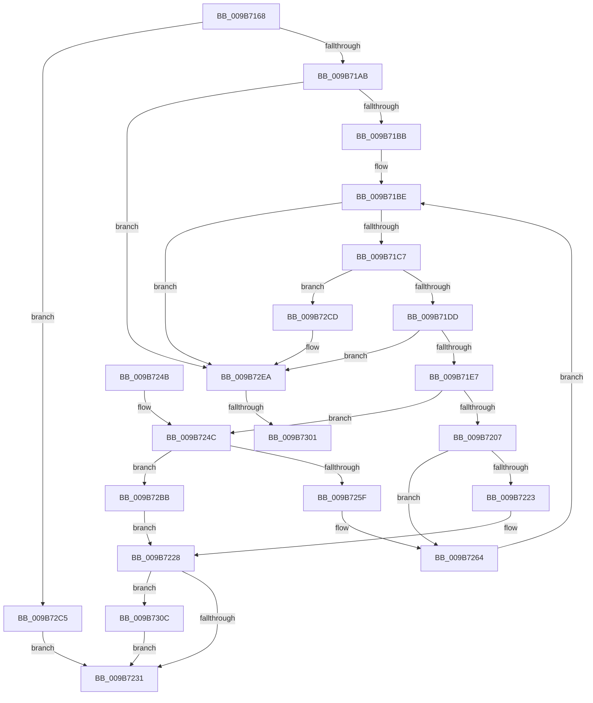

# HvpDropPagedBins

- RVA: `0x009B7168`–`0x009B731F` (길이 `439` bytes)
- VA: `0x00000001409B7168`
- 실행 섹션: `PAGE`
- PDB 이름 있음: `예`; PDB Function 태그: `예`
- unwind 정보 RVA: `0x0009E810`
- 디코드: `118`개 명령, `439/439` bytes 표시
- 미해석 바이트: `0` (있으면 어셈블리에 `.byte`로 보존)

> 이 문서는 커널 이미지의 기계어와 PDB 기호를 분석해 생성했습니다. 4번과 5번은 함수 원형과 자료형을 바이너리 사용 방식에서 추정한 C 해석이며 원본 소스 복구 결과는 아닙니다.

## 1. Dependencies

- 직접 호출 지점: **13**; 고유 호출 대상: **13**
- 직접 호출자로 확인된 함수: **2**
- RIP 상대 이미지 참조: **1**

### Outgoing calls
- `0x009B718D` → [HvpGetBinContextInitialize](../../pagecmrc/BC/HvpGetBinContextInitialize_function_00BC98D0.md) (function, `0x00BC98D0`)
- `0x009B71CC` → [HvpGetCellMap](../../pagecmrc/BC/HvpGetCellMap_function_00BC9710.md) (function, `0x00BC9710`)
- `0x009B71EF` → [HvpMapEntryGetBinAddress](../../pagecmrc/BC/HvpMapEntryGetBinAddress_function_00BC9770.md) (function, `0x00BC9770`)
- `0x009B7216` → [guard_dispatch_icall](../../text/6B/guard_dispatch_icall_function_006BAAD0.md) (function, `0x006BAAD0`)
- `0x009B7254` → [HvpAllocateNonPagedBin](HvpAllocateNonPagedBin_function_009B7904.md) (function, `0x009B7904`)
- `0x009B726D` → [memcpy](../../text/6C/memcpy_function_006C6840.md) (function, `0x006C6840`)
- `0x009B7277` → [HvpMapEntryReleaseBinAddress](../../pagecmrc/BC/HvpMapEntryReleaseBinAddress_function_00BC9790.md) (function, `0x00BC9790`)
- `0x009B727F` → [HvpMapEntryGetFreeBin](HvpMapEntryGetFreeBin_function_009B5A40.md) (function, `0x009B5A40`)
- `0x009B729A` → [HvpPointMapEntriesToBuffer](HvpPointMapEntriesToBuffer_function_009B7328.md) (function, `0x009B7328`)
- `0x009B72AB` → [CmpReleaseGlobalQuota](../84/CmpReleaseGlobalQuota_function_0084DB40.md) (function, `0x0084DB40`)
- `0x009B72E4` → [KeBugCheckEx](../../text/4F/KeBugCheckEx_function_004FD660.md) (function, `0x004FD660`)
- `0x009B7301` → [MmFreeBootRegistry](../7F/MmFreeBootRegistry_function_007F7C50.md) (function, `0x007F7C50`)
- `0x009B7315` → [HvpFreeBin](../A8/HvpFreeBin_function_00A8158C.md) (function, `0x00A8158C`)

### Direct callers
- [CmpLoadHiveThread](../7D/CmpLoadHiveThread_function_007DB040.md) at `0x007DB909`
- [CmpMountPreloadedHives](../7D/CmpMountPreloadedHives_function_007DBE18.md) at `0x007DC38C`

### Static image references
- `0x009B72F0` → RVA `0x00EEFB50` (`.data`; read/write)

## 2. Other-region calls and transfers

- 다른 실행 섹션으로 향하는 call: **7**
  - `0x009B718D` → [HvpGetBinContextInitialize](../../pagecmrc/BC/HvpGetBinContextInitialize_function_00BC98D0.md) (`PAGE` → `PAGECMRC`)
  - `0x009B71CC` → [HvpGetCellMap](../../pagecmrc/BC/HvpGetCellMap_function_00BC9710.md) (`PAGE` → `PAGECMRC`)
  - `0x009B71EF` → [HvpMapEntryGetBinAddress](../../pagecmrc/BC/HvpMapEntryGetBinAddress_function_00BC9770.md) (`PAGE` → `PAGECMRC`)
  - `0x009B7216` → [guard_dispatch_icall](../../text/6B/guard_dispatch_icall_function_006BAAD0.md) (`PAGE` → `.text`)
  - `0x009B726D` → [memcpy](../../text/6C/memcpy_function_006C6840.md) (`PAGE` → `.text`)
  - `0x009B7277` → [HvpMapEntryReleaseBinAddress](../../pagecmrc/BC/HvpMapEntryReleaseBinAddress_function_00BC9790.md) (`PAGE` → `PAGECMRC`)
  - `0x009B72E4` → [KeBugCheckEx](../../text/4F/KeBugCheckEx_function_004FD660.md) (`PAGE` → `.text`)
- call이 아닌 외부 분기/꼬리 이동: **2**
  - `0x009B72FB` → [sub_00B2DE44](../B2/Unknown_function_00B2DE44.md) (`tail-transfer`)
  - `0x009B7307` → [sub_00B2DE44](../B2/Unknown_function_00B2DE44.md) (`tail-transfer`)

## 3. Assembly (complete function range)

```asm
009B7168  48 89 5C 24 18                  mov qword ptr [rsp + 0x18], rbx
009B716D  55                              push rbp
009B716E  56                              push rsi
009B716F  57                              push rdi
009B7170  41 54                           push r12
009B7172  41 55                           push r13
009B7174  41 56                           push r14
009B7176  41 57                           push r15
009B7178  48 83 EC 30                     sub rsp, 0x30
009B717C  48 8B D9                        mov rbx, rcx
009B717F  45 33 C0                        xor r8d, r8d
009B7182  48 8D 4C 24 70                  lea rcx, [rsp + 0x70]
009B7187  66 44 89 44 24 70               mov word ptr [rsp + 0x70], r8w
009B718D  E8 3E 27 21 00                  call 0x140bc98d0
009B7192  8B 83 A0 00 00 00               mov eax, dword ptr [rbx + 0xa0]
009B7198  41 8B F0                        mov esi, r8d
009B719B  4C 89 44 24 78                  mov qword ptr [rsp + 0x78], r8
009B71A0  45 8B F0                        mov r14d, r8d
009B71A3  A8 10                           test al, 0x10
009B71A5  0F 84 1A 01 00 00               je 0x1409b72c5
009B71AB  44 8B A3 18 01 00 00            mov r12d, dword ptr [rbx + 0x118]
009B71B2  45 85 E4                        test r12d, r12d
009B71B5  0F 84 2F 01 00 00               je 0x1409b72ea
009B71BB  41 8B E8                        mov ebp, r8d
009B71BE  41 3B EC                        cmp ebp, r12d
009B71C1  0F 83 23 01 00 00               jae 0x1409b72ea
009B71C7  8B D5                           mov edx, ebp
009B71C9  48 8B CB                        mov rcx, rbx
009B71CC  E8 3F 25 21 00                  call 0x140bc9710
009B71D1  4C 8B F8                        mov r15, rax
009B71D4  48 85 C0                        test rax, rax
009B71D7  0F 84 F0 00 00 00               je 0x1409b72cd
009B71DD  F6 40 08 08                     test byte ptr [rax + 8], 8
009B71E1  0F 85 03 01 00 00               jne 0x1409b72ea
009B71E7  4C 8D 44 24 70                  lea r8, [rsp + 0x70]
009B71EC  48 8B D0                        mov rdx, rax
009B71EF  E8 7C 25 21 00                  call 0x140bc9770
009B71F4  F7 83 A0 00 00 00 00 00 00 02   test dword ptr [rbx + 0xa0], 0x2000000
009B71FE  4C 8B E8                        mov r13, rax
009B7201  44 8B 70 08                     mov r14d, dword ptr [rax + 8]
009B7205  75 45                           jne 0x1409b724c
009B7207  48 8B 43 18                     mov rax, qword ptr [rbx + 0x18]
009B720B  41 B8 43 4D 32 35               mov r8d, 0x35324d43
009B7211  B2 01                           mov dl, 1
009B7213  41 8B CE                        mov ecx, r14d
009B7216  E8 B5 38 D0 FF                  call 0x1406baad0
009B721B  48 8B F8                        mov rdi, rax
009B721E  48 85 C0                        test rax, rax
009B7221  75 41                           jne 0x1409b7264
009B7223  BF 9A 00 00 C0                  mov edi, 0xc000009a
009B7228  48 85 F6                        test rsi, rsi
009B722B  0F 85 DB 00 00 00               jne 0x1409b730c
009B7231  48 8B 9C 24 80 00 00 00         mov rbx, qword ptr [rsp + 0x80]
009B7239  8B C7                           mov eax, edi
009B723B  48 83 C4 30                     add rsp, 0x30
009B723F  41 5F                           pop r15
009B7241  41 5E                           pop r14
009B7243  41 5D                           pop r13
009B7245  41 5C                           pop r12
009B7247  5F                              pop rdi
009B7248  5E                              pop rsi
009B7249  5D                              pop rbp
009B724A  C3                              ret
009B724B  CC                              int3
009B724C  4C 8D 44 24 78                  lea r8, [rsp + 0x78]
009B7251  41 8B D6                        mov edx, r14d
009B7254  E8 AB 06 00 00                  call 0x1409b7904
009B7259  8B F8                           mov edi, eax
009B725B  85 C0                           test eax, eax
009B725D  78 5C                           js 0x1409b72bb
009B725F  48 8B 7C 24 78                  mov rdi, qword ptr [rsp + 0x78]
009B7264  4D 8B C6                        mov r8, r14
009B7267  49 8B D5                        mov rdx, r13
009B726A  48 8B CF                        mov rcx, rdi
009B726D  E8 CE F5 D0 FF                  call 0x1406c6840
009B7272  4C 8D 44 24 70                  lea r8, [rsp + 0x70]
009B7277  E8 14 25 21 00                  call 0x140bc9790
009B727C  49 8B CF                        mov rcx, r15
009B727F  E8 BC E7 FF FF                  call 0x1409b5a40
009B7284  48 89 44 24 28                  mov qword ptr [rsp + 0x28], rax
009B7289  44 8B CD                        mov r9d, ebp
009B728C  45 8B C6                        mov r8d, r14d
009B728F  C6 44 24 20 01                  mov byte ptr [rsp + 0x20], 1
009B7294  48 8B D7                        mov rdx, rdi
009B7297  48 8B CB                        mov rcx, rbx
009B729A  E8 89 00 00 00                  call 0x1409b7328
009B729F  33 C0                           xor eax, eax
009B72A1  41 8B CE                        mov ecx, r14d
009B72A4  8B F0                           mov esi, eax
009B72A6  48 89 44 24 78                  mov qword ptr [rsp + 0x78], rax
009B72AB  E8 90 68 E9 FF                  call 0x14084db40
009B72B0  41 03 EE                        add ebp, r14d
009B72B3  45 33 C0                        xor r8d, r8d
009B72B6  E9 03 FF FF FF                  jmp 0x1409b71be
009B72BB  48 8B 74 24 78                  mov rsi, qword ptr [rsp + 0x78]
009B72C0  E9 63 FF FF FF                  jmp 0x1409b7228
009B72C5  41 8B F8                        mov edi, r8d
009B72C8  E9 64 FF FF FF                  jmp 0x1409b7231
009B72CD  BA 01 00 00 00                  mov edx, 1
009B72D2  44 8B CD                        mov r9d, ebp
009B72D5  4C 8B C3                        mov r8, rbx
009B72D8  48 C7 44 24 20 9C 14 00 00      mov qword ptr [rsp + 0x20], 0x149c
009B72E1  8D 4A 50                        lea ecx, [rdx + 0x50]
009B72E4  E8 77 63 B4 FF                  call 0x1404fd660
009B72E9  CC                              int3
009B72EA  41 8B F8                        mov edi, r8d
009B72ED  83 C8 FF                        or eax, 0xffffffff
009B72F0  F0 0F C1 05 58 88 53 00         lock xadd dword ptr [rip + 0x538858], eax
009B72F8  83 F8 01                        cmp eax, 1
009B72FB  0F 85 43 6B 17 00               jne 0x140b2de44
009B7301  E8 4A 09 E4 FF                  call 0x1407f7c50
009B7306  90                              nop
009B7307  E9 38 6B 17 00                  jmp 0x140b2de44
009B730C  4C 8B C6                        mov r8, rsi
009B730F  41 8B D6                        mov edx, r14d
009B7312  48 8B CB                        mov rcx, rbx
009B7315  E8 72 A2 0C 00                  call 0x140a8158c
009B731A  E9 12 FF FF FF                  jmp 0x1409b7231
```

## 4. C-style interpretation (structured pseudocode)

```c
__int64 __fastcall HvpDropPagedBins(__int64 a1, __int64 a2, int a3)
{
    __int64 result;
    __int64 v_rbp;
    __int64 v_rsp;
    unsigned __int64 v_stack_p10;
    unsigned __int64 v_stack_p18;
    unsigned __int8 v_stack_p20;
    unsigned __int64 v_stack_p28;
    unsigned __int64 v_stack_p70;
    unsigned __int64 v_stack_p78;
    unsigned __int64 v_stack_p8;

    v_stack_p18 = v_rbx;
    v_rsp = (v_rsp) - (48);
    a3 = 0;
    v_stack_p8 = 0;
    result = HvpGetBinContextInitialize(v_stack_p8, a2, a3, a4);
    v_stack_p10 = 0;
    if ((((unsigned __int8)((unsigned int)(*(unsigned int *)(a1 + 160)))) & (16)) == 0) goto loc_009B72C5;
    if ((unsigned int)((unsigned int)(*(unsigned int *)(a1 + 280))) == 0) goto loc_009B72EA;
loc_009B71BE:
    if (0 >= ((unsigned int)((unsigned int)(*(unsigned int *)(a1 + 280))))) goto loc_009B72EA;
    result = HvpGetCellMap(a1, 0, a3, a4);
    if (result == 0) goto loc_009B72CD;
    if (((*(unsigned __int8 *)(result + 8)) & (8)) != 0) goto loc_009B72EA;
    result = HvpMapEntryGetBinAddress(a1, result, v_stack_p8, a4);
    if (((*(unsigned int *)(a1 + 160)) & (0x2000000ULL)) != 0) goto loc_009B724C;
    result = guard_dispatch_icall((unsigned int)((unsigned int)((unsigned int)(*(unsigned int *)(result + 8)))), 1, (unsigned int)(0x35324D43ULL), a4);
    if (result != 0) goto loc_009B7264;
loc_009B7228:
    if (0 != 0) goto loc_009B730C;
loc_009B7231:
    v_rsp = (v_rsp) + (48);
    return (unsigned int)((unsigned int)((unsigned int)(0xC000009AULL)));
loc_009B724C:
    result = HvpAllocateNonPagedBin((unsigned int)((unsigned int)((unsigned int)(*(unsigned int *)(result + 8)))), (unsigned int)((unsigned int)((unsigned int)(*(unsigned int *)(result + 8)))), v_stack_p78, a4);
    if (sign_flag) goto loc_009B72BB;
loc_009B7264:
    result = memcpy(v_stack_p78, result, (unsigned int)(*(unsigned int *)(result + 8)), a4);
    result = HvpMapEntryReleaseBinAddress(v_stack_p78, result, v_stack_p70, a4);
    result = HvpMapEntryGetFreeBin(result, result, v_stack_p70, a4);
    v_stack_p28 = result;
    v_stack_p20 = 1;
    result = HvpPointMapEntriesToBuffer(v_stack_p18, v_stack_p78, (unsigned int)((unsigned int)((unsigned int)(*(unsigned int *)(result + 8)))), 0);
    result = 0;
    v_stack_p78 = 0;
    result = CmpReleaseGlobalQuota((unsigned int)((unsigned int)((unsigned int)(*(unsigned int *)(result + 8)))), v_stack_p78, (unsigned int)((unsigned int)((unsigned int)(*(unsigned int *)(result + 8)))), 0);
    v_rbp = (unsigned int)((0) + ((unsigned int)((unsigned int)(*(unsigned int *)(result + 8)))));
    a3 = 0;
    goto loc_009B71BE;
loc_009B72BB:
    goto loc_009B7228;
loc_009B72C5:
    goto loc_009B7231;
loc_009B72CD:
    v_stack_p20 = 0x149CULL;
    result = KeBugCheckEx(1 + 80, 1, v_stack_p18, (unsigned int)((unsigned int)(v_rbp)));
loc_009B72EA:
    result = (unsigned int)((result) | (0xFFFFFFFFULL));
    result = MmFreeBootRegistry(1 + 80, 1, v_stack_p18, (unsigned int)((unsigned int)(v_rbp)));
loc_009B730C:
    result = HvpFreeBin(v_stack_p18, (unsigned int)((unsigned int)((unsigned int)(*(unsigned int *)(result + 8)))), v_stack_p78, (unsigned int)((unsigned int)(v_rbp)));
    goto loc_009B7231;
}
```

## 5. (Beta) C Style

```c
int64_t HvpDropPagedBins(void *Arg1, int64_t Arg2, int32_t Arg3)
{
    uint8_t *arg1 = (uint8_t *)Arg1;

    int64_t result;
    int64_t local_rbp;
    int64_t local_rsp;
    uint64_t v_stack_p10;
    uint64_t v_stack_p18;
    uint8_t v_stack_p20;
    uint64_t v_stack_p28;
    uint64_t v_stack_p70;
    uint64_t v_stack_p78;
    uint64_t v_stack_p8;

    v_stack_p18 = local_rbx;
    local_rsp = (local_rsp) - (48);
    Arg3 = 0;
    v_stack_p8 = 0;
    result = HvpGetBinContextInitialize(v_stack_p8, Arg2, Arg3, a4);
    v_stack_p10 = 0;
    if ((((uint8_t)((uint32_t)(*(uint32_t *)(arg1 + 0xA0)))) & (16)) == 0) goto loc_009B72C5;
    if ((uint32_t)((uint32_t)(*(uint32_t *)(arg1 + 0x118))) == 0) goto loc_009B72EA;
loc_009B71BE:
    if (0 >= ((uint32_t)((uint32_t)(*(uint32_t *)(arg1 + 0x118))))) goto loc_009B72EA;
    result = HvpGetCellMap(Arg1, 0, Arg3, a4);
    if (result == 0) goto loc_009B72CD;
    if (((*(uint8_t *)(result + 0x8)) & (8)) != 0) goto loc_009B72EA;
    result = HvpMapEntryGetBinAddress(Arg1, result, v_stack_p8, a4);
    if (((*(uint32_t *)(arg1 + 0xA0)) & (0x2000000ULL)) != 0) goto loc_009B724C;
    result = guard_dispatch_icall((uint32_t)((uint32_t)((uint32_t)(*(uint32_t *)(result + 0x8)))), 1, (uint32_t)(0x35324D43ULL), a4);
    if (result != 0) goto loc_009B7264;
loc_009B7228:
    if (0 != 0) goto loc_009B730C;
loc_009B7231:
    local_rsp = (local_rsp) + (48);
    return (uint32_t)((uint32_t)((uint32_t)(0xC000009AULL)));
loc_009B724C:
    result = HvpAllocateNonPagedBin((uint32_t)((uint32_t)((uint32_t)(*(uint32_t *)(result + 0x8)))), (uint32_t)((uint32_t)((uint32_t)(*(uint32_t *)(result + 0x8)))), v_stack_p78, a4);
    if (sign_flag) goto loc_009B72BB;
loc_009B7264:
    result = memcpy(v_stack_p78, result, (uint32_t)(*(uint32_t *)(result + 0x8)), a4);
    result = HvpMapEntryReleaseBinAddress(v_stack_p78, result, v_stack_p70, a4);
    result = HvpMapEntryGetFreeBin(result, result, v_stack_p70, a4);
    v_stack_p28 = result;
    v_stack_p20 = 1;
    result = HvpPointMapEntriesToBuffer(v_stack_p18, v_stack_p78, (uint32_t)((uint32_t)((uint32_t)(*(uint32_t *)(result + 0x8)))), 0);
    result = 0;
    v_stack_p78 = 0;
    result = CmpReleaseGlobalQuota((uint32_t)((uint32_t)((uint32_t)(*(uint32_t *)(result + 0x8)))), v_stack_p78, (uint32_t)((uint32_t)((uint32_t)(*(uint32_t *)(result + 0x8)))), 0);
    local_rbp = (uint32_t)((0) + ((uint32_t)((uint32_t)(*(uint32_t *)(result + 0x8)))));
    Arg3 = 0;
    goto loc_009B71BE;
loc_009B72BB:
    goto loc_009B7228;
loc_009B72C5:
    goto loc_009B7231;
loc_009B72CD:
    v_stack_p20 = 0x149CULL;
    result = KeBugCheckEx(1 + 80, 1, v_stack_p18, (uint32_t)((uint32_t)(local_rbp)));
loc_009B72EA:
    result = (uint32_t)((result) | (0xFFFFFFFFULL));
    result = MmFreeBootRegistry(1 + 80, 1, v_stack_p18, (uint32_t)((uint32_t)(local_rbp)));
loc_009B730C:
    result = HvpFreeBin(v_stack_p18, (uint32_t)((uint32_t)((uint32_t)(*(uint32_t *)(result + 0x8)))), v_stack_p78, (uint32_t)((uint32_t)(local_rbp)));
    goto loc_009B7231;
}
```

### 관측된 메모리 오프셋

구조체 형식이 확인되지 않은 접근은 인자 기준의 오프셋으로만 기록했습니다.

| 기준 인자 | 오프셋 표현 | 폭 (bit) | 접근 |
|---|---:|---:|---|
| `Arg1` | `+ 0x18` | `64` | `R` |
| `Arg1` | `+ 0xA0` | `32` | `R` |
| `Arg1` | `+ 0x118` | `32` | `R` |

## 6. Execution-region graph

[열기: 2D/3D 그래프와 함수 탐색 컨트롤 패널](../../../control-panel.html?section=page&rva=0x009B7168&view=graph)

- 2D 그래프는 위에서 아래로 흐르고, 3D 그래프는 빈 공간을 드래그해 회전합니다. Shift+드래그는 이동, 휠은 확대·축소, 함수 노드 선택은 대상 보고서 이동입니다.

### Static fallback


