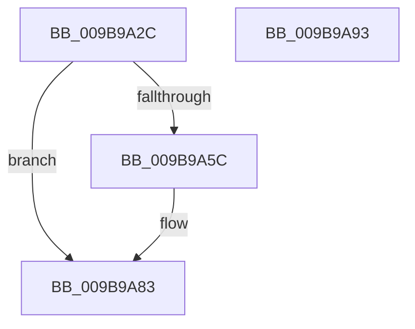

# HvpFillFileName

- RVA: `0x009B9A2C`–`0x009B9A94` (길이 `104` bytes)
- VA: `0x00000001409B9A2C`
- 실행 섹션: `PAGE`
- PDB 이름 있음: `예`; PDB Function 태그: `아니요`
- unwind 정보 RVA: `0x00060BC4`
- 디코드: `30`개 명령, `104/104` bytes 표시
- 미해석 바이트: `0` (있으면 어셈블리에 `.byte`로 보존)

> 이 문서는 커널 이미지의 기계어와 PDB 기호를 분석해 생성했습니다. 4번과 5번은 함수 원형과 자료형을 바이너리 사용 방식에서 추정한 C 해석이며 원본 소스 복구 결과는 아닙니다.

## 1. Dependencies

- 직접 호출 지점: **2**; 고유 호출 대상: **2**
- 직접 호출자로 확인된 함수: **3**
- RIP 상대 이미지 참조: **0**

### Outgoing calls
- `0x009B9A4F` → [memset](../../text/6C/memset_function_006C6C40.md) (function, `0x006C6C40`)
- `0x009B9A7E` → [memcpy](../../text/6C/memcpy_function_006C6840.md) (function, `0x006C6840`)

### Direct callers
- [HvHiveStartMemoryBacked](../87/HvHiveStartMemoryBacked_function_0087BF38.md) at `0x0087C1AC`
- [HvHiveStartMemoryBacked](../87/HvHiveStartMemoryBacked_function_0087BF38.md) at `0x0087C621`
- [HvHiveStartFileBacked](HvHiveStartFileBacked_function_009B7E20.md) at `0x009B7F80`
- [sub_00B2DE6C](../B2/Unknown_function_00B2DE6C.md) at `0x00B2DEA5`

### Static image references
- 디코드된 RIP-relative 메모리 참조가 없습니다.

## 2. Other-region calls and transfers

- 다른 실행 섹션으로 향하는 call: **2**
  - `0x009B9A4F` → [memset](../../text/6C/memset_function_006C6C40.md) (`PAGE` → `.text`)
  - `0x009B9A7E` → [memcpy](../../text/6C/memcpy_function_006C6840.md) (`PAGE` → `.text`)
- 별도 외부 분기/꼬리 이동을 확인하지 못했습니다.

## 3. Assembly (complete function range)

```asm
009B9A2C  48 89 5C 24 08                  mov qword ptr [rsp + 8], rbx
009B9A31  48 89 74 24 10                  mov qword ptr [rsp + 0x10], rsi
009B9A36  57                              push rdi
009B9A37  48 83 EC 20                     sub rsp, 0x20
009B9A3B  48 8D 79 30                     lea rdi, [rcx + 0x30]
009B9A3F  48 8B DA                        mov rbx, rdx
009B9A42  BE 40 00 00 00                  mov esi, 0x40
009B9A47  48 8B CF                        mov rcx, rdi
009B9A4A  44 8B C6                        mov r8d, esi
009B9A4D  33 D2                           xor edx, edx
009B9A4F  E8 EC D1 D0 FF                  call 0x1406c6c40
009B9A54  45 33 D2                        xor r10d, r10d
009B9A57  48 85 DB                        test rbx, rbx
009B9A5A  74 27                           je 0x1409b9a83
009B9A5C  44 0F B7 0B                     movzx r9d, word ptr [rbx]
009B9A60  44 8D 46 FE                     lea r8d, [rsi - 2]
009B9A64  66 44 3B CE                     cmp r9w, si
009B9A68  48 8B CF                        mov rcx, rdi
009B9A6B  45 0F 42 C1                     cmovb r8d, r9d
009B9A6F  41 8D 41 C2                     lea eax, [r9 - 0x3e]
009B9A73  44 0F 43 D0                     cmovae r10d, eax
009B9A77  41 8B D2                        mov edx, r10d
009B9A7A  48 03 53 08                     add rdx, qword ptr [rbx + 8]
009B9A7E  E8 BD CD D0 FF                  call 0x1406c6840
009B9A83  48 8B 5C 24 30                  mov rbx, qword ptr [rsp + 0x30]
009B9A88  48 8B 74 24 38                  mov rsi, qword ptr [rsp + 0x38]
009B9A8D  48 83 C4 20                     add rsp, 0x20
009B9A91  5F                              pop rdi
009B9A92  C3                              ret
009B9A93  CC                              int3
```

## 4. C-style interpretation (structured pseudocode)

```c
__int64 __fastcall HvpFillFileName(__int64 a1, __int64 a2)
{
    __int64 result;
    __int64 v_r10;
    __int64 v_rsp;
    unsigned __int64 v_stack_p10;
    unsigned __int64 v_stack_p8;

    v_stack_p8 = v_rbx;
    v_stack_p10 = v_rsi;
    v_rsp = (v_rsp) - (32);
    a2 = 0;
    result = memset(a1 + 48, a2, 64, a4);
    v_r10 = 0;
    if (0 != 0) {
        a4 = *(unsigned __int16 *)(a2);
        a3 = 64 - 2;
        a1 = a1 + 48;
        if (((unsigned __int16)(a4)) < 64) { a3 = (unsigned int)(a4); }
        result = a4 - 62;
        if (((unsigned __int16)(a4)) >= 64) { v_r10 = (unsigned int)(result); }
        a2 = (unsigned int)(v_r10);
        a2 = (a2) + (*(unsigned __int64 *)(a2 + 8));
        result = memcpy(a1, a2, a3, a4);
    }
    v_rsp = (v_rsp) + (32);
    return result;
}
```

## 5. (Beta) C Style

```c
int64_t HvpFillFileName(void *Arg1, int64_t Arg2)
{
    uint8_t *arg1 = (uint8_t *)Arg1;

    int64_t result;
    int64_t local_r10;
    int64_t local_rsp;
    uint64_t v_stack_p10;
    uint64_t v_stack_p8;

    v_stack_p8 = local_rbx;
    v_stack_p10 = local_rsi;
    local_rsp = (local_rsp) - (32);
    Arg2 = 0;
    result = memset(Arg1 + 48, Arg2, 64, a4);
    local_r10 = 0;
    if (0 != 0) {
        a4 = *(uint16_t *)(Arg2);
        a3 = 64 - 2;
        Arg1 = Arg1 + 48;
        if (((uint16_t)(a4)) < 64) { a3 = (uint32_t)(a4); }
        result = a4 - 62;
        if (((uint16_t)(a4)) >= 64) { local_r10 = (uint32_t)(result); }
        Arg2 = (uint32_t)(local_r10);
        Arg2 = (Arg2) + (*(uint64_t *)(Arg2 + 0x8));
        result = memcpy(Arg1, Arg2, a3, a4);
    }
    local_rsp = (local_rsp) + (32);
    return result;
}
```

### 관측된 메모리 오프셋

구조체 형식이 확인되지 않은 접근은 인자 기준의 오프셋으로만 기록했습니다.

| 기준 인자 | 오프셋 표현 | 폭 (bit) | 접근 |
|---|---:|---:|---|
| `Arg1` | `+ 0x30` | `64` | `R` |

## 6. Execution-region graph

[열기: 2D/3D 그래프와 함수 탐색 컨트롤 패널](../../../control-panel.html?section=page&rva=0x009B9A2C&view=graph)

- 2D 그래프는 위에서 아래로 흐르고, 3D 그래프는 빈 공간을 드래그해 회전합니다. Shift+드래그는 이동, 휠은 확대·축소, 함수 노드 선택은 대상 보고서 이동입니다.

### Static fallback


