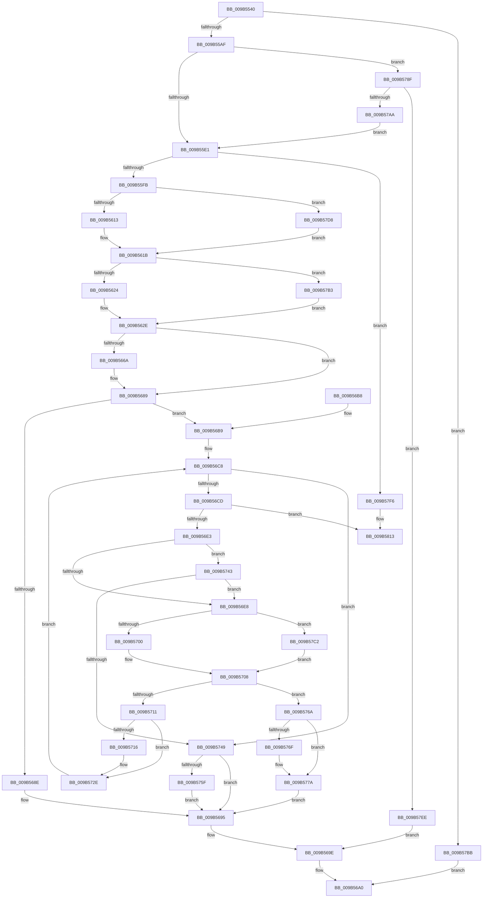

# HvpFindNextDirtyBlock

- RVA: `0x009B5540`–`0x009B5830` (길이 `752` bytes)
- VA: `0x00000001409B5540`
- 실행 섹션: `PAGE`
- PDB 이름 있음: `예`; PDB Function 태그: `아니요`
- unwind 정보 RVA: `0x0009E5E4`
- 디코드: `212`개 명령, `752/752` bytes 표시
- 미해석 바이트: `0` (있으면 어셈블리에 `.byte`로 보존)

> 이 문서는 커널 이미지의 기계어와 PDB 기호를 분석해 생성했습니다. 4번과 5번은 함수 원형과 자료형을 바이너리 사용 방식에서 추정한 C 해석이며 원본 소스 복구 결과는 아닙니다.

## 1. Dependencies

- 직접 호출 지점: **20**; 고유 호출 대상: **10**
- 직접 호출자로 확인된 함수: **3**
- RIP 상대 이미지 참조: **0**

### Outgoing calls
- `0x009B5583` → [HvpGetBinContextInitialize](../../pagecmrc/BC/HvpGetBinContextInitialize_function_00BC98D0.md) (function, `0x00BC98D0`)
- `0x009B558C` → [HvpGetBinContextInitialize](../../pagecmrc/BC/HvpGetBinContextInitialize_function_00BC98D0.md) (function, `0x00BC98D0`)
- `0x009B55A2` → [HvpFindNextDirtyRun](../../text/43/HvpFindNextDirtyRun_function_00437880.md) (function, `0x00437880`)
- `0x009B55EA` → [HvpGetCellMap](../../pagecmrc/BC/HvpGetCellMap_function_00BC9710.md) (function, `0x00BC9710`)
- `0x009B55FB` → [HvpMapEntryGetFreeBin](HvpMapEntryGetFreeBin_function_009B5A40.md) (function, `0x009B5A40`)
- `0x009B5613` → [HvpMapEntryGetBlockAddress](../85/HvpMapEntryGetBlockAddress_function_00854D70.md) (function, `0x00854D70`)
- `0x009B5679` → [memcpy](../../text/6C/memcpy_function_006C6840.md) (function, `0x006C6840`)
- `0x009B5699` → [HvpMapEntryReleaseBinAddress](../../pagecmrc/BC/HvpMapEntryReleaseBinAddress_function_00BC9790.md) (function, `0x00BC9790`)
- `0x009B56D2` → [HvpGetCellMap](../../pagecmrc/BC/HvpGetCellMap_function_00BC9710.md) (function, `0x00BC9710`)
- `0x009B56EB` → [HvpMapEntryGetFreeBin](HvpMapEntryGetFreeBin_function_009B5A40.md) (function, `0x009B5A40`)
- `0x009B5700` → [HvpMapEntryGetBlockAddress](../85/HvpMapEntryGetBlockAddress_function_00854D70.md) (function, `0x00854D70`)
- `0x009B571C` → [memcpy](../../text/6C/memcpy_function_006C6840.md) (function, `0x006C6840`)
- `0x009B573C` → [HvpMapEntryReleaseBinAddress](../../pagecmrc/BC/HvpMapEntryReleaseBinAddress_function_00BC9790.md) (function, `0x00BC9790`)
- `0x009B5775` → [memcpy](../../text/6C/memcpy_function_006C6840.md) (function, `0x006C6840`)
- `0x009B5785` → [HvpMapEntryReleaseBinAddress](../../pagecmrc/BC/HvpMapEntryReleaseBinAddress_function_00BC9790.md) (function, `0x00BC9790`)
- `0x009B579D` → [ExAllocatePool2](../../poolcode/B8/ExAllocatePool2_function_00B820F0.md) (function, `0x00B820F0`)
- `0x009B57C2` → [HvpMapEntryGetBinAddress](../../pagecmrc/BC/HvpMapEntryGetBinAddress_function_00BC9770.md) (function, `0x00BC9770`)
- `0x009B57D8` → [HvpMapEntryGetBinAddress](../../pagecmrc/BC/HvpMapEntryGetBinAddress_function_00BC9770.md) (function, `0x00BC9770`)
- `0x009B580D` → [KeBugCheckEx](../../text/4F/KeBugCheckEx_function_004FD660.md) (function, `0x004FD660`)
- `0x009B582A` → [KeBugCheckEx](../../text/4F/KeBugCheckEx_function_004FD660.md) (function, `0x004FD660`)

### Direct callers
- [HvpGenerateLogEntryDirtyData](../../text/43/HvpGenerateLogEntryDirtyData_function_00433ABC.md) at `0x00433B13`
- [HvpGenerateLogEntryDirtyData](../../text/43/HvpGenerateLogEntryDirtyData_function_00433ABC.md) at `0x00433B5E`
- [HvStoreModifiedData](HvStoreModifiedData_function_009B4FB4.md) at `0x009B52D7`
- [sub_00B2DBEA](../B2/Unknown_function_00B2DBEA.md) at `0x00B2DC24`

### Static image references
- 디코드된 RIP-relative 메모리 참조가 없습니다.

## 2. Other-region calls and transfers

- 다른 실행 섹션으로 향하는 call: **16**
  - `0x009B5583` → [HvpGetBinContextInitialize](../../pagecmrc/BC/HvpGetBinContextInitialize_function_00BC98D0.md) (`PAGE` → `PAGECMRC`)
  - `0x009B558C` → [HvpGetBinContextInitialize](../../pagecmrc/BC/HvpGetBinContextInitialize_function_00BC98D0.md) (`PAGE` → `PAGECMRC`)
  - `0x009B55A2` → [HvpFindNextDirtyRun](../../text/43/HvpFindNextDirtyRun_function_00437880.md) (`PAGE` → `.text`)
  - `0x009B55EA` → [HvpGetCellMap](../../pagecmrc/BC/HvpGetCellMap_function_00BC9710.md) (`PAGE` → `PAGECMRC`)
  - `0x009B5679` → [memcpy](../../text/6C/memcpy_function_006C6840.md) (`PAGE` → `.text`)
  - `0x009B5699` → [HvpMapEntryReleaseBinAddress](../../pagecmrc/BC/HvpMapEntryReleaseBinAddress_function_00BC9790.md) (`PAGE` → `PAGECMRC`)
  - `0x009B56D2` → [HvpGetCellMap](../../pagecmrc/BC/HvpGetCellMap_function_00BC9710.md) (`PAGE` → `PAGECMRC`)
  - `0x009B571C` → [memcpy](../../text/6C/memcpy_function_006C6840.md) (`PAGE` → `.text`)
  - `0x009B573C` → [HvpMapEntryReleaseBinAddress](../../pagecmrc/BC/HvpMapEntryReleaseBinAddress_function_00BC9790.md) (`PAGE` → `PAGECMRC`)
  - `0x009B5775` → [memcpy](../../text/6C/memcpy_function_006C6840.md) (`PAGE` → `.text`)
  - `0x009B5785` → [HvpMapEntryReleaseBinAddress](../../pagecmrc/BC/HvpMapEntryReleaseBinAddress_function_00BC9790.md) (`PAGE` → `PAGECMRC`)
  - `0x009B579D` → [ExAllocatePool2](../../poolcode/B8/ExAllocatePool2_function_00B820F0.md) (`PAGE` → `POOLCODE`)
  - `0x009B57C2` → [HvpMapEntryGetBinAddress](../../pagecmrc/BC/HvpMapEntryGetBinAddress_function_00BC9770.md) (`PAGE` → `PAGECMRC`)
  - `0x009B57D8` → [HvpMapEntryGetBinAddress](../../pagecmrc/BC/HvpMapEntryGetBinAddress_function_00BC9770.md) (`PAGE` → `PAGECMRC`)
  - `0x009B580D` → [KeBugCheckEx](../../text/4F/KeBugCheckEx_function_004FD660.md) (`PAGE` → `.text`)
  - `0x009B582A` → [KeBugCheckEx](../../text/4F/KeBugCheckEx_function_004FD660.md) (`PAGE` → `.text`)
- 별도 외부 분기/꼬리 이동을 확인하지 못했습니다.

## 3. Assembly (complete function range)

```asm
009B5540  48 89 5C 24 10                  mov qword ptr [rsp + 0x10], rbx
009B5545  4C 89 44 24 18                  mov qword ptr [rsp + 0x18], r8
009B554A  48 89 4C 24 08                  mov qword ptr [rsp + 8], rcx
009B554F  55                              push rbp
009B5550  56                              push rsi
009B5551  57                              push rdi
009B5552  41 54                           push r12
009B5554  41 55                           push r13
009B5556  41 56                           push r14
009B5558  41 57                           push r15
009B555A  48 8B EC                        mov rbp, rsp
009B555D  48 83 EC 50                     sub rsp, 0x50
009B5561  45 33 ED                        xor r13d, r13d
009B5564  48 8D 4D E4                     lea rcx, [rbp - 0x1c]
009B5568  44 89 6D EC                     mov dword ptr [rbp - 0x14], r13d
009B556C  49 8B F1                        mov rsi, r9
009B556F  66 44 89 6D E4                  mov word ptr [rbp - 0x1c], r13w
009B5574  4D 8B D8                        mov r11, r8
009B5577  44 89 6D E8                     mov dword ptr [rbp - 0x18], r13d
009B557B  4C 8B D2                        mov r10, rdx
009B557E  66 44 89 6D E0                  mov word ptr [rbp - 0x20], r13w
009B5583  E8 48 43 21 00                  call 0x140bc98d0
009B5588  48 8D 4D E0                     lea rcx, [rbp - 0x20]
009B558C  E8 3F 43 21 00                  call 0x140bc98d0
009B5591  4C 8D 4D EC                     lea r9, [rbp - 0x14]
009B5595  49 8B D3                        mov rdx, r11
009B5598  4C 8D 45 E8                     lea r8, [rbp - 0x18]
009B559C  49 8B CA                        mov rcx, r10
009B559F  41 8B FD                        mov edi, r13d
009B55A2  E8 D9 22 A8 FF                  call 0x140437880
009B55A7  84 C0                           test al, al
009B55A9  0F 84 0C 02 00 00               je 0x1409b57bb
009B55AF  44 8B 65 EC                     mov r12d, dword ptr [rbp - 0x14]
009B55B3  41 8B C4                        mov eax, r12d
009B55B6  44 8B 5D E8                     mov r11d, dword ptr [rbp - 0x18]
009B55BA  41 8B DB                        mov ebx, r11d
009B55BD  44 8A 7D 70                     mov r15b, byte ptr [rbp + 0x70]
009B55C1  C1 E0 09                        shl eax, 9
009B55C4  C1 E3 09                        shl ebx, 9
009B55C7  44 8B F0                        mov r14d, eax
009B55CA  44 2B F3                        sub r14d, ebx
009B55CD  44 89 5D E8                     mov dword ptr [rbp - 0x18], r11d
009B55D1  44 89 65 F4                     mov dword ptr [rbp - 0xc], r12d
009B55D5  89 45 F0                        mov dword ptr [rbp - 0x10], eax
009B55D8  45 84 FF                        test r15b, r15b
009B55DB  0F 85 AE 01 00 00               jne 0x1409b578f
009B55E1  4C 8B 55 40                     mov r10, qword ptr [rbp + 0x40]
009B55E5  8B D3                           mov edx, ebx
009B55E7  49 8B CA                        mov rcx, r10
009B55EA  E8 21 41 21 00                  call 0x140bc9710
009B55EF  48 8B C8                        mov rcx, rax
009B55F2  48 85 C0                        test rax, rax
009B55F5  0F 84 FB 01 00 00               je 0x1409b57f6
009B55FB  E8 40 04 00 00                  call 0x1409b5a40
009B5600  4C 8D 45 E0                     lea r8, [rbp - 0x20]
009B5604  4C 8B C8                        mov r9, rax
009B5607  48 8B D1                        mov rdx, rcx
009B560A  48 85 C0                        test rax, rax
009B560D  0F 85 C5 01 00 00               jne 0x1409b57d8
009B5613  E8 58 F7 E9 FF                  call 0x140854d70
009B5618  48 8B C8                        mov rcx, rax
009B561B  45 84 FF                        test r15b, r15b
009B561E  0F 85 8F 01 00 00               jne 0x1409b57b3
009B5624  8B C3                           mov eax, ebx
009B5626  25 FF 0F 00 00                  and eax, 0xfff
009B562B  48 03 C1                        add rax, rcx
009B562E  48 89 06                        mov qword ptr [rsi], rax
009B5631  45 8B C4                        mov r8d, r12d
009B5634  48 8B 45 68                     mov rax, qword ptr [rbp + 0x68]
009B5638  8D B3 00 10 00 00               lea esi, [rbx + 0x1000]
009B563E  45 2B C3                        sub r8d, r11d
009B5641  41 8B D3                        mov edx, r11d
009B5644  83 E2 07                        and edx, 7
009B5647  44 89 45 EC                     mov dword ptr [rbp - 0x14], r8d
009B564B  45 8B E8                        mov r13d, r8d
009B564E  89 30                           mov dword ptr [rax], esi
009B5650  B8 08 00 00 00                  mov eax, 8
009B5655  2B C2                           sub eax, edx
009B5657  44 3B C0                        cmp r8d, eax
009B565A  44 0F 43 E8                     cmovae r13d, eax
009B565E  45 8B E5                        mov r12d, r13d
009B5661  41 C1 E4 09                     shl r12d, 9
009B5665  45 84 FF                        test r15b, r15b
009B5668  74 1F                           je 0x1409b5689
009B566A  C1 E2 09                        shl edx, 9
009B566D  48 03 D1                        add rdx, rcx
009B5670  45 8B C4                        mov r8d, r12d
009B5673  48 8B CF                        mov rcx, rdi
009B5676  41 8B DC                        mov ebx, r12d
009B5679  E8 C2 11 D1 FF                  call 0x1406c6840
009B567E  4C 8B 55 40                     mov r10, qword ptr [rbp + 0x40]
009B5682  48 03 FB                        add rdi, rbx
009B5685  44 8B 45 EC                     mov r8d, dword ptr [rbp - 0x14]
009B5689  45 3B C5                        cmp r8d, r13d
009B568C  77 2B                           ja 0x1409b56b9
009B568E  48 8B 45 60                     mov rax, qword ptr [rbp + 0x60]
009B5692  44 89 30                        mov dword ptr [rax], r14d
009B5695  4C 8D 45 E0                     lea r8, [rbp - 0x20]
009B5699  E8 F2 40 21 00                  call 0x140bc9790
009B569E  B0 01                           mov al, 1
009B56A0  48 8B 9C 24 98 00 00 00         mov rbx, qword ptr [rsp + 0x98]
009B56A8  48 83 C4 50                     add rsp, 0x50
009B56AC  41 5F                           pop r15
009B56AE  41 5E                           pop r14
009B56B0  41 5D                           pop r13
009B56B2  41 5C                           pop r12
009B56B4  5F                              pop rdi
009B56B5  5E                              pop rsi
009B56B6  5D                              pop rbp
009B56B7  C3                              ret
009B56B8  CC                              int3
009B56B9  8B 5D F0                        mov ebx, dword ptr [rbp - 0x10]
009B56BC  81 E6 00 F0 FF FF               and esi, 0xfffff000
009B56C2  41 BB 00 10 00 00               mov r11d, 0x1000
009B56C8  45 3B E6                        cmp r12d, r14d
009B56CB  73 7C                           jae 0x1409b5749
009B56CD  8B D6                           mov edx, esi
009B56CF  49 8B CA                        mov rcx, r10
009B56D2  E8 39 40 21 00                  call 0x140bc9710
009B56D7  48 8B D0                        mov rdx, rax
009B56DA  48 85 C0                        test rax, rax
009B56DD  0F 84 30 01 00 00               je 0x1409b5813
009B56E3  45 84 FF                        test r15b, r15b
009B56E6  74 5B                           je 0x1409b5743
009B56E8  48 8B CA                        mov rcx, rdx
009B56EB  E8 50 03 00 00                  call 0x1409b5a40
009B56F0  4C 8D 45 E4                     lea r8, [rbp - 0x1c]
009B56F4  4C 8B C8                        mov r9, rax
009B56F7  48 85 C0                        test rax, rax
009B56FA  0F 85 C2 00 00 00               jne 0x1409b57c2
009B5700  E8 6B F6 E9 FF                  call 0x140854d70
009B5705  48 8B D0                        mov rdx, rax
009B5708  8B CB                           mov ecx, ebx
009B570A  2B CE                           sub ecx, esi
009B570C  41 3B CB                        cmp ecx, r11d
009B570F  76 59                           jbe 0x1409b576a
009B5711  45 84 FF                        test r15b, r15b
009B5714  74 18                           je 0x1409b572e
009B5716  4D 8B C3                        mov r8, r11
009B5719  48 8B CF                        mov rcx, rdi
009B571C  E8 1F 11 D1 FF                  call 0x1406c6840
009B5721  4C 8B 55 40                     mov r10, qword ptr [rbp + 0x40]
009B5725  41 BB 00 10 00 00               mov r11d, 0x1000
009B572B  49 03 FB                        add rdi, r11
009B572E  45 03 E3                        add r12d, r11d
009B5731  4C 8D 45 E4                     lea r8, [rbp - 0x1c]
009B5735  41 83 C5 08                     add r13d, 8
009B5739  41 03 F3                        add esi, r11d
009B573C  E8 4F 40 21 00                  call 0x140bc9790
009B5741  EB 85                           jmp 0x1409b56c8
009B5743  F6 40 08 01                     test byte ptr [rax + 8], 1
009B5747  74 9F                           je 0x1409b56e8
009B5749  48 8B 45 60                     mov rax, qword ptr [rbp + 0x60]
009B574D  44 89 20                        mov dword ptr [rax], r12d
009B5750  8B 45 E8                        mov eax, dword ptr [rbp - 0x18]
009B5753  41 03 C5                        add eax, r13d
009B5756  3B 45 F4                        cmp eax, dword ptr [rbp - 0xc]
009B5759  0F 84 36 FF FF FF               je 0x1409b5695
009B575F  48 8B 4D 50                     mov rcx, qword ptr [rbp + 0x50]
009B5763  89 01                           mov dword ptr [rcx], eax
009B5765  E9 2B FF FF FF                  jmp 0x1409b5695
009B576A  45 84 FF                        test r15b, r15b
009B576D  74 0B                           je 0x1409b577a
009B576F  44 8B C1                        mov r8d, ecx
009B5772  48 8B CF                        mov rcx, rdi
009B5775  E8 C6 10 D1 FF                  call 0x1406c6840
009B577A  48 8B 45 60                     mov rax, qword ptr [rbp + 0x60]
009B577E  4C 8D 45 E4                     lea r8, [rbp - 0x1c]
009B5782  44 89 30                        mov dword ptr [rax], r14d
009B5785  E8 06 40 21 00                  call 0x140bc9790
009B578A  E9 06 FF FF FF                  jmp 0x1409b5695
009B578F  41 8B D6                        mov edx, r14d
009B5792  B9 00 01 00 00                  mov ecx, 0x100
009B5797  41 B8 43 4D 35 33               mov r8d, 0x33354d43
009B579D  E8 4E C9 1C 00                  call 0x140b820f0
009B57A2  48 8B F8                        mov rdi, rax
009B57A5  48 85 C0                        test rax, rax
009B57A8  74 44                           je 0x1409b57ee
009B57AA  44 8B 5D E8                     mov r11d, dword ptr [rbp - 0x18]
009B57AE  E9 2E FE FF FF                  jmp 0x1409b55e1
009B57B3  48 8B C7                        mov rax, rdi
009B57B6  E9 73 FE FF FF                  jmp 0x1409b562e
009B57BB  32 C0                           xor al, al
009B57BD  E9 DE FE FF FF                  jmp 0x1409b56a0
009B57C2  E8 A9 3F 21 00                  call 0x140bc9770
009B57C7  48 8B D0                        mov rdx, rax
009B57CA  8B C6                           mov eax, esi
009B57CC  41 2B 41 14                     sub eax, dword ptr [r9 + 0x14]
009B57D0  48 03 D0                        add rdx, rax
009B57D3  E9 30 FF FF FF                  jmp 0x1409b5708
009B57D8  E8 93 3F 21 00                  call 0x140bc9770
009B57DD  48 8B C8                        mov rcx, rax
009B57E0  8B C3                           mov eax, ebx
009B57E2  41 2B 41 14                     sub eax, dword ptr [r9 + 0x14]
009B57E6  48 03 C8                        add rcx, rax
009B57E9  E9 2D FE FF FF                  jmp 0x1409b561b
009B57EE  4C 89 2E                        mov qword ptr [rsi], r13
009B57F1  E9 A8 FE FF FF                  jmp 0x1409b569e
009B57F6  BA 01 00 00 00                  mov edx, 1
009B57FB  44 8B CB                        mov r9d, ebx
009B57FE  4D 8B C2                        mov r8, r10
009B5801  48 C7 44 24 20 C3 12 00 00      mov qword ptr [rsp + 0x20], 0x12c3
009B580A  8D 4A 50                        lea ecx, [rdx + 0x50]
009B580D  E8 4E 7E B4 FF                  call 0x1404fd660
009B5812  CC                              int3
009B5813  BA 01 00 00 00                  mov edx, 1
009B5818  44 8B CE                        mov r9d, esi
009B581B  4D 8B C2                        mov r8, r10
009B581E  48 C7 44 24 20 2D 13 00 00      mov qword ptr [rsp + 0x20], 0x132d
009B5827  8D 4A 50                        lea ecx, [rdx + 0x50]
009B582A  E8 31 7E B4 FF                  call 0x1404fd660
009B582F  CC                              int3
```

## 4. C-style interpretation (structured pseudocode)

```c
__int64 __fastcall HvpFindNextDirtyBlock(__int64 a1, __int64 a2, __int64 a3, __int64 a4, __int64 a5, __int64 a6, unsigned __int8 a7)
{
    __int64 result;
    __int64 v_r10;
    __int64 v_r11;
    __int64 v_r12;
    __int64 v_r13;
    __int64 v_r14;
    __int64 v_rbx;
    __int64 v_rdi;
    __int64 v_rsi;
    __int64 v_rsp;
    unsigned int v_stack_m44;
    unsigned int v_stack_m48;
    unsigned int v_stack_m4C;
    unsigned int v_stack_m50;
    unsigned __int64 v_stack_m54;
    unsigned __int16 v_stack_m58;
    unsigned __int64 v_stack_p10;
    unsigned __int64 v_stack_p18;
    unsigned __int64 v_stack_p20;
    unsigned __int64 v_stack_p8;

    v_stack_p10 = v_rbx;
    v_stack_p18 = a3;
    v_stack_p8 = a1;
    v_rsp = (v_rsp) - (80);
    v_r13 = 0;
    v_stack_m4C = 0;
    v_stack_m54 = 0;
    v_stack_m50 = 0;
    v_stack_m58 = 0;
    result = HvpGetBinContextInitialize(v_stack_m54, a2, a3, a4);
    result = HvpGetBinContextInitialize(v_stack_m58, a2, a3, a4);
    result = HvpFindNextDirtyRun(a2, a3, v_stack_m50, v_stack_m4C);
    if ((unsigned __int8)(result) == 0) goto loc_009B57BB;
    result = (unsigned int)(((unsigned int)((unsigned int)((unsigned int)(v_stack_m4C)))) << (9));
    v_rbx = (unsigned int)(((unsigned int)((unsigned int)((unsigned int)(v_stack_m50)))) << (9));
    v_r14 = (unsigned int)(((unsigned int)((unsigned int)(result))) - ((unsigned int)(v_rbx)));
    v_stack_m50 = (unsigned int)((unsigned int)(v_stack_m50));
    v_stack_m44 = (unsigned int)((unsigned int)(v_stack_m4C));
    v_stack_m48 = (unsigned int)(result);
    if (a7 != 0) goto loc_009B578F;
loc_009B55E1:
    result = HvpGetCellMap(v_stack_p8, (unsigned int)((unsigned int)(v_rbx)), v_stack_m50, v_stack_m4C);
    if (result == 0) goto loc_009B57F6;
    result = HvpMapEntryGetFreeBin(result, (unsigned int)((unsigned int)(v_rbx)), v_stack_m50, v_stack_m4C);
    if (result != 0) goto loc_009B57D8;
    result = HvpMapEntryGetBlockAddress(result, result, v_stack_m58, result);
loc_009B561B:
    if (a7 != 0) goto loc_009B57B3;
    result = (unsigned int)(((unsigned int)((unsigned int)(v_rbx))) & (0xFFFULL));
    result = (result) + (result);
loc_009B562E:
    *(unsigned __int64 *)(a4) = result;
    a3 = (unsigned int)(((unsigned int)((unsigned int)((unsigned int)(v_stack_m4C)))) - ((unsigned int)((unsigned int)(v_stack_m50))));
    a2 = (unsigned int)(((unsigned int)((unsigned int)((unsigned int)(v_stack_m50)))) & (7));
    v_stack_m4C = (unsigned int)(a3);
    *(unsigned int *)(a6) = (unsigned int)(v_rbx + 4096);
    result = (unsigned int)((8) - ((unsigned int)(a2)));
    v_r13 = (unsigned int)((unsigned int)(a3));
    if (((unsigned int)(a3)) >= ((unsigned int)(result))) { v_r13 = (unsigned int)(result); }
    v_r12 = (unsigned int)(((unsigned int)((unsigned int)(v_r13))) << (9));
    v_rdi = 0;
    v_r10 = v_stack_p8;
    if (a7 != 0) {
        a2 = (unsigned int)((a2) << (9));
        a2 = (a2) + (result);
        a3 = (unsigned int)(v_r12);
        a1 = 0;
        v_rbx = (unsigned int)(v_r12);
        result = memcpy(a1, a2, a3, result);
        v_r10 = v_stack_p8;
        v_rdi = (0) + (v_rbx);
        a3 = v_stack_m4C;
    }
    if (((unsigned int)(a3)) > ((unsigned int)(v_r13))) goto loc_009B56B9;
    *(unsigned int *)(a5) = (unsigned int)(v_r14);
loc_009B5695:
    result = HvpMapEntryReleaseBinAddress(a1, a2, v_stack_m58, result);
loc_009B569E:
loc_009B56A0:
    v_rsp = (v_rsp) + (80);
    return 1;
loc_009B56B9:
    v_rsi = (unsigned int)((v_rbx + 4096) & (0xFFFFF000ULL));
loc_009B56C8:
    if (((unsigned int)(v_r12)) >= ((unsigned int)(v_r14))) goto loc_009B5749;
    result = HvpGetCellMap(v_r10, (unsigned int)((unsigned int)(v_rsi)), v_stack_m58, result);
    if (result == 0) goto loc_009B5813;
    if (a7 == 0) goto loc_009B5743;
loc_009B56E8:
    result = HvpMapEntryGetFreeBin(result, result, v_stack_m58, result);
    if (result != 0) goto loc_009B57C2;
    result = HvpMapEntryGetBlockAddress(result, result, v_stack_m54, result);
loc_009B5708:
    a1 = (unsigned int)(((unsigned int)((unsigned int)((unsigned int)(v_stack_m48)))) - ((unsigned int)(v_rsi)));
    if (((unsigned int)(a1)) <= ((unsigned int)((unsigned int)(0x1000ULL)))) goto loc_009B576A;
    v_r11 = (unsigned int)(0x1000ULL);
    if (a7 != 0) {
        a3 = (unsigned int)(0x1000ULL);
        a1 = v_rdi;
        result = memcpy(a1, result, a3, result);
        v_r10 = v_stack_p8;
        v_r11 = 0x1000ULL;
        v_rdi = (v_rdi) + (v_r11);
    }
    v_r12 = (unsigned int)((v_r12) + ((unsigned int)(v_r11)));
    v_r13 = (unsigned int)((v_r13) + (8));
    v_rsi = (unsigned int)((v_rsi) + ((unsigned int)(v_r11)));
    result = HvpMapEntryReleaseBinAddress(a1, result, v_stack_m54, result);
    goto loc_009B56C8;
loc_009B5743:
    if (((*(unsigned __int8 *)(result + 8)) & (1)) == 0) goto loc_009B56E8;
loc_009B5749:
    *(unsigned int *)(a5) = (unsigned int)(v_r12);
    result = (unsigned int)(((unsigned int)(v_stack_m50)) + ((unsigned int)(v_r13)));
    if (((unsigned int)(result)) == v_stack_m44) goto loc_009B5695;
    *(unsigned int *)(v_stack_p18) = (unsigned int)(result);
    goto loc_009B5695;
loc_009B576A:
    if (a7 != 0) {
        a3 = (unsigned int)(v_stack_p18);
        a1 = v_rdi;
        result = memcpy(a1, result, a3, result);
    }
    *(unsigned int *)(a5) = (unsigned int)(v_r14);
    result = HvpMapEntryReleaseBinAddress(a1, result, v_stack_m54, result);
    goto loc_009B5695;
loc_009B578F:
    result = ExAllocatePool2(256, (unsigned int)((unsigned int)(v_r14)), (unsigned int)(0x33354D43ULL), result);
    if (result == 0) goto loc_009B57EE;
    goto loc_009B55E1;
loc_009B57B3:
    goto loc_009B562E;
loc_009B57BB:
    result = 0;
    goto loc_009B56A0;
loc_009B57C2:
    result = HvpMapEntryGetBinAddress(256, (unsigned int)((unsigned int)(v_r14)), (unsigned int)(0x33354D43ULL), result);
    result = (unsigned int)(((unsigned int)((unsigned int)(v_rsi))) - (*(unsigned int *)(result + 20)));
    a2 = (result) + (result);
    goto loc_009B5708;
loc_009B57D8:
    result = HvpMapEntryGetBinAddress(256, a2, (unsigned int)(0x33354D43ULL), result);
    result = (unsigned int)(((unsigned int)((unsigned int)((unsigned int)(v_stack_m48)))) - (*(unsigned int *)(result + 20)));
    a1 = (result) + (result);
    goto loc_009B561B;
loc_009B57EE:
    *(unsigned __int64 *)(v_rsi) = v_r13;
    goto loc_009B569E;
loc_009B57F6:
    v_stack_p20 = 0x12C3ULL;
    result = KeBugCheckEx(1 + 80, 1, v_r10, (unsigned int)((unsigned int)((unsigned int)(v_stack_m48))));
loc_009B5813:
    v_stack_p20 = 0x132DULL;
    result = KeBugCheckEx(1 + 80, 1, v_r10, (unsigned int)((unsigned int)(v_rsi)));
    return result;
}
```

## 5. (Beta) C Style

```c
int64_t HvpFindNextDirtyBlock(int64_t Arg1, int64_t Arg2, int64_t Arg3, void *Arg4, void *Arg5, void *Arg6, uint8_t Arg7)
{
    uint8_t *arg4 = (uint8_t *)Arg4;
    uint8_t *arg5 = (uint8_t *)Arg5;
    uint8_t *arg6 = (uint8_t *)Arg6;

    int64_t result;
    int64_t local_r10;
    int64_t local_r11;
    int64_t local_r12;
    int64_t local_r13;
    int64_t local_r14;
    int64_t local_rbx;
    int64_t local_rdi;
    int64_t local_rsi;
    int64_t local_rsp;
    uint32_t v_stack_m44;
    uint32_t v_stack_m48;
    uint32_t v_stack_m4C;
    uint32_t v_stack_m50;
    uint64_t v_stack_m54;
    uint16_t v_stack_m58;
    uint64_t v_stack_p10;
    uint64_t v_stack_p18;
    uint64_t v_stack_p20;
    uint64_t v_stack_p8;

    v_stack_p10 = local_rbx;
    v_stack_p18 = Arg3;
    v_stack_p8 = Arg1;
    local_rsp = (local_rsp) - (80);
    local_r13 = 0;
    v_stack_m4C = 0;
    v_stack_m54 = 0;
    v_stack_m50 = 0;
    v_stack_m58 = 0;
    result = HvpGetBinContextInitialize(v_stack_m54, Arg2, Arg3, Arg4);
    result = HvpGetBinContextInitialize(v_stack_m58, Arg2, Arg3, Arg4);
    result = HvpFindNextDirtyRun(Arg2, Arg3, v_stack_m50, v_stack_m4C);
    if ((uint8_t)(result) == 0) goto loc_009B57BB;
    result = (uint32_t)(((uint32_t)((uint32_t)((uint32_t)(v_stack_m4C)))) << (9));
    local_rbx = (uint32_t)(((uint32_t)((uint32_t)((uint32_t)(v_stack_m50)))) << (9));
    local_r14 = (uint32_t)(((uint32_t)((uint32_t)(result))) - ((uint32_t)(local_rbx)));
    v_stack_m50 = (uint32_t)((uint32_t)(v_stack_m50));
    v_stack_m44 = (uint32_t)((uint32_t)(v_stack_m4C));
    v_stack_m48 = (uint32_t)(result);
    if (Arg7 != 0) goto loc_009B578F;
loc_009B55E1:
    result = HvpGetCellMap(v_stack_p8, (uint32_t)((uint32_t)(local_rbx)), v_stack_m50, v_stack_m4C);
    if (result == 0) goto loc_009B57F6;
    result = HvpMapEntryGetFreeBin(result, (uint32_t)((uint32_t)(local_rbx)), v_stack_m50, v_stack_m4C);
    if (result != 0) goto loc_009B57D8;
    result = HvpMapEntryGetBlockAddress(result, result, v_stack_m58, result);
loc_009B561B:
    if (Arg7 != 0) goto loc_009B57B3;
    result = (uint32_t)(((uint32_t)((uint32_t)(local_rbx))) & (0xFFFULL));
    result = (result) + (result);
loc_009B562E:
    *(uint64_t *)(arg4) = result;
    Arg3 = (uint32_t)(((uint32_t)((uint32_t)((uint32_t)(v_stack_m4C)))) - ((uint32_t)((uint32_t)(v_stack_m50))));
    Arg2 = (uint32_t)(((uint32_t)((uint32_t)((uint32_t)(v_stack_m50)))) & (7));
    v_stack_m4C = (uint32_t)(Arg3);
    *(uint32_t *)(arg6) = (uint32_t)(local_rbx + 4096);
    result = (uint32_t)((8) - ((uint32_t)(Arg2)));
    local_r13 = (uint32_t)((uint32_t)(Arg3));
    if (((uint32_t)(Arg3)) >= ((uint32_t)(result))) { local_r13 = (uint32_t)(result); }
    local_r12 = (uint32_t)(((uint32_t)((uint32_t)(local_r13))) << (9));
    local_rdi = 0;
    local_r10 = v_stack_p8;
    if (Arg7 != 0) {
        Arg2 = (uint32_t)((Arg2) << (9));
        Arg2 = (Arg2) + (result);
        Arg3 = (uint32_t)(local_r12);
        Arg1 = 0;
        local_rbx = (uint32_t)(local_r12);
        result = memcpy(Arg1, Arg2, Arg3, result);
        local_r10 = v_stack_p8;
        local_rdi = (0) + (local_rbx);
        Arg3 = v_stack_m4C;
    }
    if (((uint32_t)(Arg3)) > ((uint32_t)(local_r13))) goto loc_009B56B9;
    *(uint32_t *)(arg5) = (uint32_t)(local_r14);
loc_009B5695:
    result = HvpMapEntryReleaseBinAddress(Arg1, Arg2, v_stack_m58, result);
loc_009B569E:
loc_009B56A0:
    local_rsp = (local_rsp) + (80);
    return 1;
loc_009B56B9:
    local_rsi = (uint32_t)((local_rbx + 4096) & (0xFFFFF000ULL));
loc_009B56C8:
    if (((uint32_t)(local_r12)) >= ((uint32_t)(local_r14))) goto loc_009B5749;
    result = HvpGetCellMap(local_r10, (uint32_t)((uint32_t)(local_rsi)), v_stack_m58, result);
    if (result == 0) goto loc_009B5813;
    if (Arg7 == 0) goto loc_009B5743;
loc_009B56E8:
    result = HvpMapEntryGetFreeBin(result, result, v_stack_m58, result);
    if (result != 0) goto loc_009B57C2;
    result = HvpMapEntryGetBlockAddress(result, result, v_stack_m54, result);
loc_009B5708:
    Arg1 = (uint32_t)(((uint32_t)((uint32_t)((uint32_t)(v_stack_m48)))) - ((uint32_t)(local_rsi)));
    if (((uint32_t)(Arg1)) <= ((uint32_t)((uint32_t)(0x1000ULL)))) goto loc_009B576A;
    local_r11 = (uint32_t)(0x1000ULL);
    if (Arg7 != 0) {
        Arg3 = (uint32_t)(0x1000ULL);
        Arg1 = local_rdi;
        result = memcpy(Arg1, result, Arg3, result);
        local_r10 = v_stack_p8;
        local_r11 = 0x1000ULL;
        local_rdi = (local_rdi) + (local_r11);
    }
    local_r12 = (uint32_t)((local_r12) + ((uint32_t)(local_r11)));
    local_r13 = (uint32_t)((local_r13) + (8));
    local_rsi = (uint32_t)((local_rsi) + ((uint32_t)(local_r11)));
    result = HvpMapEntryReleaseBinAddress(Arg1, result, v_stack_m54, result);
    goto loc_009B56C8;
loc_009B5743:
    if (((*(uint8_t *)(result + 0x8)) & (1)) == 0) goto loc_009B56E8;
loc_009B5749:
    *(uint32_t *)(arg5) = (uint32_t)(local_r12);
    result = (uint32_t)(((uint32_t)(v_stack_m50)) + ((uint32_t)(local_r13)));
    if (((uint32_t)(result)) == v_stack_m44) goto loc_009B5695;
    *(uint32_t *)(v_stack_p18) = (uint32_t)(result);
    goto loc_009B5695;
loc_009B576A:
    if (Arg7 != 0) {
        Arg3 = (uint32_t)(v_stack_p18);
        Arg1 = local_rdi;
        result = memcpy(Arg1, result, Arg3, result);
    }
    *(uint32_t *)(arg5) = (uint32_t)(local_r14);
    result = HvpMapEntryReleaseBinAddress(Arg1, result, v_stack_m54, result);
    goto loc_009B5695;
loc_009B578F:
    result = ExAllocatePool2(256, (uint32_t)((uint32_t)(local_r14)), (uint32_t)(0x33354D43ULL), result);
    if (result == 0) goto loc_009B57EE;
    goto loc_009B55E1;
loc_009B57B3:
    goto loc_009B562E;
loc_009B57BB:
    result = 0;
    goto loc_009B56A0;
loc_009B57C2:
    result = HvpMapEntryGetBinAddress(256, (uint32_t)((uint32_t)(local_r14)), (uint32_t)(0x33354D43ULL), result);
    result = (uint32_t)(((uint32_t)((uint32_t)(local_rsi))) - (*(uint32_t *)(result + 0x14)));
    Arg2 = (result) + (result);
    goto loc_009B5708;
loc_009B57D8:
    result = HvpMapEntryGetBinAddress(256, Arg2, (uint32_t)(0x33354D43ULL), result);
    result = (uint32_t)(((uint32_t)((uint32_t)((uint32_t)(v_stack_m48)))) - (*(uint32_t *)(result + 0x14)));
    Arg1 = (result) + (result);
    goto loc_009B561B;
loc_009B57EE:
    *(uint64_t *)(local_rsi) = local_r13;
    goto loc_009B569E;
loc_009B57F6:
    v_stack_p20 = 0x12C3ULL;
    result = KeBugCheckEx(1 + 80, 1, local_r10, (uint32_t)((uint32_t)((uint32_t)(v_stack_m48))));
loc_009B5813:
    v_stack_p20 = 0x132DULL;
    result = KeBugCheckEx(1 + 80, 1, local_r10, (uint32_t)((uint32_t)(local_rsi)));
    return result;
}
```

### 관측된 메모리 오프셋

구조체 형식이 확인되지 않은 접근은 인자 기준의 오프셋으로만 기록했습니다.

| 기준 인자 | 오프셋 표현 | 폭 (bit) | 접근 |
|---|---:|---:|---|
| `Arg4` | `+ 0x0` | `64` | `W` |
| `Arg5` | `+ 0x0` | `32` | `W` |
| `Arg6` | `+ 0x0` | `32` | `W` |

## 6. Execution-region graph

[열기: 2D/3D 그래프와 함수 탐색 컨트롤 패널](../../../control-panel.html?section=page&rva=0x009B5540&view=graph)

- 2D 그래프는 위에서 아래로 흐르고, 3D 그래프는 빈 공간을 드래그해 회전합니다. Shift+드래그는 이동, 휠은 확대·축소, 함수 노드 선택은 대상 보고서 이동입니다.

### Static fallback


