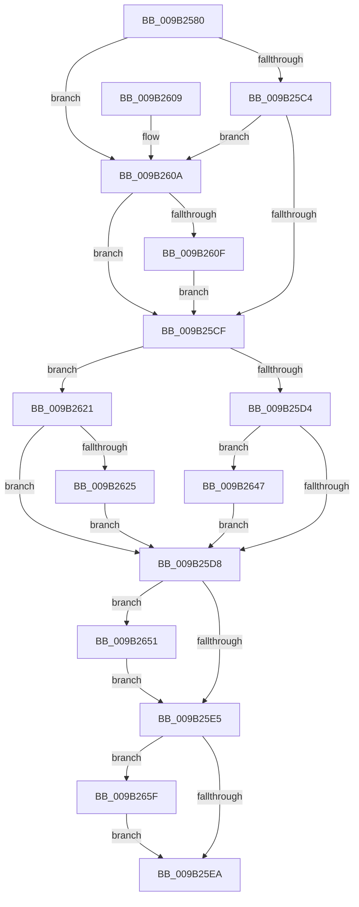

# HvpFinishPrimaryWrite

- RVA: `0x009B2580`–`0x009B2671` (길이 `241` bytes)
- VA: `0x00000001409B2580`
- 실행 섹션: `PAGE`
- PDB 이름 있음: `예`; PDB Function 태그: `아니요`
- unwind 정보 RVA: `0x00067500`
- 디코드: `73`개 명령, `241/241` bytes 표시
- 미해석 바이트: `0` (있으면 어셈블리에 `.byte`로 보존)

> 이 문서는 커널 이미지의 기계어와 PDB 기호를 분석해 생성했습니다. 4번과 5번은 함수 원형과 자료형을 바이너리 사용 방식에서 추정한 C 해석이며 원본 소스 복구 결과는 아닙니다.

## 1. Dependencies

- 직접 호출 지점: **5**; 고유 호출 대상: **5**
- 직접 호출자로 확인된 함수: **1**
- RIP 상대 이미지 참조: **1**

### Outgoing calls
- `0x009B260F` → [CmpLockRegistry](../../pagecmrc/BC/CmpLockRegistry_function_00BC9B34.md) (function, `0x00BC9B34`)
- `0x009B2617` → [HvLockHiveFlusherExclusive](../../pagecmrc/BC/HvLockHiveFlusherExclusive_function_00BC9C50.md) (function, `0x00BC9C50`)
- `0x009B2638` → [CmpLogEvent](../87/CmpLogEvent_function_0087A664.md) (function, `0x0087A664`)
- `0x009B2662` → [HvUnlockHiveFlusherExclusive](../../pagecmrc/BC/HvUnlockHiveFlusherExclusive_function_00BC9C34.md) (function, `0x00BC9C34`)
- `0x009B2667` → [CmpUnlockRegistry](../../pagecmrc/BC/CmpUnlockRegistry_function_00BC9A84.md) (function, `0x00BC9A84`)

### Direct callers
- [HvWriteHivePrimaryFile](HvWriteHivePrimaryFile_function_009B2374.md) at `0x009B2412`

### Static image references
- `0x009B2631` → RVA `0x00023170` (`.rdata`; read)

## 2. Other-region calls and transfers

- 다른 실행 섹션으로 향하는 call: **4**
  - `0x009B260F` → [CmpLockRegistry](../../pagecmrc/BC/CmpLockRegistry_function_00BC9B34.md) (`PAGE` → `PAGECMRC`)
  - `0x009B2617` → [HvLockHiveFlusherExclusive](../../pagecmrc/BC/HvLockHiveFlusherExclusive_function_00BC9C50.md) (`PAGE` → `PAGECMRC`)
  - `0x009B2662` → [HvUnlockHiveFlusherExclusive](../../pagecmrc/BC/HvUnlockHiveFlusherExclusive_function_00BC9C34.md) (`PAGE` → `PAGECMRC`)
  - `0x009B2667` → [CmpUnlockRegistry](../../pagecmrc/BC/CmpUnlockRegistry_function_00BC9A84.md) (`PAGE` → `PAGECMRC`)
- 별도 외부 분기/꼬리 이동을 확인하지 못했습니다.

## 3. Assembly (complete function range)

```asm
009B2580  48 8B C4                        mov rax, rsp
009B2583  48 89 58 08                     mov qword ptr [rax + 8], rbx
009B2587  48 89 68 10                     mov qword ptr [rax + 0x10], rbp
009B258B  48 89 70 18                     mov qword ptr [rax + 0x18], rsi
009B258F  48 89 78 20                     mov qword ptr [rax + 0x20], rdi
009B2593  41 54                           push r12
009B2595  41 56                           push r14
009B2597  41 57                           push r15
009B2599  48 83 EC 20                     sub rsp, 0x20
009B259D  8B A9 A0 00 00 00               mov ebp, dword ptr [rcx + 0xa0]
009B25A3  48 8D B1 80 10 00 00            lea rsi, [rcx + 0x1080]
009B25AA  45 32 FF                        xor r15b, r15b
009B25AD  41 0F B6 F8                     movzx edi, r8b
009B25B1  81 E5 00 01 00 00               and ebp, 0x100
009B25B7  44 8A E2                        mov r12b, dl
009B25BA  48 8B D9                        mov rbx, rcx
009B25BD  0F 95 C0                        setne al
009B25C0  3A D0                           cmp dl, al
009B25C2  74 46                           je 0x1409b260a
009B25C4  8B 06                           mov eax, dword ptr [rsi]
009B25C6  D1 E8                           shr eax, 1
009B25C8  83 E0 01                        and eax, 1
009B25CB  3B C7                           cmp eax, edi
009B25CD  75 3B                           jne 0x1409b260a
009B25CF  45 84 E4                        test r12b, r12b
009B25D2  74 4D                           je 0x1409b2621
009B25D4  85 ED                           test ebp, ebp
009B25D6  75 6F                           jne 0x1409b2647
009B25D8  8B 0E                           mov ecx, dword ptr [rsi]
009B25DA  8B C1                           mov eax, ecx
009B25DC  D1 E8                           shr eax, 1
009B25DE  83 E0 01                        and eax, 1
009B25E1  3B C7                           cmp eax, edi
009B25E3  75 6C                           jne 0x1409b2651
009B25E5  45 84 FF                        test r15b, r15b
009B25E8  75 75                           jne 0x1409b265f
009B25EA  48 8B 5C 24 40                  mov rbx, qword ptr [rsp + 0x40]
009B25EF  48 8B 6C 24 48                  mov rbp, qword ptr [rsp + 0x48]
009B25F4  48 8B 74 24 50                  mov rsi, qword ptr [rsp + 0x50]
009B25F9  48 8B 7C 24 58                  mov rdi, qword ptr [rsp + 0x58]
009B25FE  48 83 C4 20                     add rsp, 0x20
009B2602  41 5F                           pop r15
009B2604  41 5E                           pop r14
009B2606  41 5C                           pop r12
009B2608  C3                              ret
009B2609  CC                              int3
009B260A  45 84 C9                        test r9b, r9b
009B260D  75 C0                           jne 0x1409b25cf
009B260F  E8 20 75 21 00                  call 0x140bc9b34
009B2614  48 8B CB                        mov rcx, rbx
009B2617  E8 34 76 21 00                  call 0x140bc9c50
009B261C  41 B7 01                        mov r15b, 1
009B261F  EB AE                           jmp 0x1409b25cf
009B2621  85 ED                           test ebp, ebp
009B2623  75 B3                           jne 0x1409b25d8
009B2625  4C 8D 83 30 07 00 00            lea r8, [rbx + 0x730]
009B262C  BA 4D 01 00 C0                  mov edx, 0xc000014d
009B2631  48 8D 0D 38 0B 67 FF            lea rcx, [rip - 0x98f4c8]
009B2638  E8 27 80 EC FF                  call 0x14087a664
009B263D  0F BA AB A0 00 00 00 08         bts dword ptr [rbx + 0xa0], 8
009B2645  EB 91                           jmp 0x1409b25d8
009B2647  0F BA B3 A0 00 00 00 08         btr dword ptr [rbx + 0xa0], 8
009B264F  EB 87                           jmp 0x1409b25d8
009B2651  8D 04 3F                        lea eax, [rdi + rdi]
009B2654  33 C1                           xor eax, ecx
009B2656  83 E0 02                        and eax, 2
009B2659  33 C1                           xor eax, ecx
009B265B  89 06                           mov dword ptr [rsi], eax
009B265D  EB 86                           jmp 0x1409b25e5
009B265F  48 8B CB                        mov rcx, rbx
009B2662  E8 CD 75 21 00                  call 0x140bc9c34
009B2667  E8 18 74 21 00                  call 0x140bc9a84
009B266C  E9 79 FF FF FF                  jmp 0x1409b25ea
```

## 4. C-style interpretation (structured pseudocode)

```c
__int64 __fastcall HvpFinishPrimaryWrite(__int64 a1, unsigned __int8 a2, unsigned __int8 a3, unsigned __int8 a4)
{
    __int64 result;
    __int64 v_r15;
    __int64 v_rbp;
    __int64 v_rsp;
    unsigned __int64 v_stack_p10;
    unsigned __int64 v_stack_p18;
    unsigned __int64 v_stack_p20;
    unsigned __int64 v_stack_p8;

    *(unsigned __int64 *)(v_rsp + 8) = v_rbx;
    *(unsigned __int64 *)(v_rsp + 16) = v_rbp;
    *(unsigned __int64 *)(v_rsp + 24) = v_rsi;
    *(unsigned __int64 *)(v_rsp + 32) = v_rdi;
    v_rsp = (v_rsp) - (32);
    v_r15 = 0;
    v_rbp = (unsigned int)(((unsigned int)(*(unsigned int *)(a1 + 160))) & (256));
    result = (condition_is_not_equal) ? 1 : 0;
    if (a2 == ((unsigned __int8)(result))) goto loc_009B260A;
    result = (unsigned int)(((unsigned int)(*(unsigned int *)(a1 + 4224))) >> (1));
    result = (unsigned int)((result) & (1));
    if (((unsigned int)(result)) != a3) goto loc_009B260A;
loc_009B25CF:
    if (a2 == 0) goto loc_009B2621;
    if ((unsigned int)(v_rbp) != 0) goto loc_009B2647;
loc_009B25D8:
    result = (unsigned int)(((unsigned int)((unsigned int)((unsigned int)(*(unsigned int *)(a1 + 4224))))) >> (1));
    result = (unsigned int)((result) & (1));
    if (((unsigned int)(result)) != a3) goto loc_009B2651;
loc_009B25E5:
    if (0 != 0) goto loc_009B265F;
loc_009B25EA:
    v_rsp = (v_rsp) + (32);
    return result;
loc_009B260A:
    if (a4 != 0) goto loc_009B25CF;
    result = CmpLockRegistry((unsigned int)(*(unsigned int *)(a1 + 4224)), a2, a3, a4);
    result = HvLockHiveFlusherExclusive(v_stack_p8, a2, a3, a4);
    goto loc_009B25CF;
loc_009B2621:
    if ((unsigned int)(v_stack_p10) != 0) goto loc_009B25D8;
    result = CmpLogEvent(v_rip - 10024136, (unsigned int)(0xC000014DULL), v_stack_p8 + 1840, a4);
    goto loc_009B25D8;
loc_009B2647:
    goto loc_009B25D8;
loc_009B2651:
    result = (unsigned int)((v_stack_p20 + v_stack_p20 * 1) ^ ((unsigned int)(v_rip - 10024136)));
    result = (unsigned int)((result) & (2));
    result = (unsigned int)((result) ^ ((unsigned int)(v_rip - 10024136)));
    *(unsigned int *)(v_stack_p18) = (unsigned int)(result);
    goto loc_009B25E5;
loc_009B265F:
    result = HvUnlockHiveFlusherExclusive(v_stack_p8, (unsigned int)(0xC000014DULL), v_stack_p8 + 1840, a4);
    result = CmpUnlockRegistry(v_stack_p8, (unsigned int)(0xC000014DULL), v_stack_p8 + 1840, a4);
    goto loc_009B25EA;
}
```

## 5. (Beta) C Style

```c
int64_t HvpFinishPrimaryWrite(void *Arg1, uint8_t Arg2, void *Arg3, uint8_t Arg4)
{
    uint8_t *arg1 = (uint8_t *)Arg1;
    uint8_t *arg3 = (uint8_t *)Arg3;

    int64_t result;
    int64_t local_r15;
    int64_t local_rbp;
    int64_t local_rsp;
    uint64_t v_stack_p10;
    uint64_t v_stack_p18;
    uint64_t v_stack_p20;
    uint64_t v_stack_p8;

    *(uint64_t *)(local_rsp + 0x8) = local_rbx;
    *(uint64_t *)(local_rsp + 0x10) = local_rbp;
    *(uint64_t *)(local_rsp + 0x18) = local_rsi;
    *(uint64_t *)(local_rsp + 0x20) = local_rdi;
    local_rsp = (local_rsp) - (32);
    local_r15 = 0;
    local_rbp = (uint32_t)(((uint32_t)(*(uint32_t *)(arg1 + 0xA0))) & (256));
    result = (condition_is_not_equal) ? 1 : 0;
    if (Arg2 == ((uint8_t)(result))) goto loc_009B260A;
    result = (uint32_t)(((uint32_t)(*(uint32_t *)(arg1 + 0x1080))) >> (1));
    result = (uint32_t)((result) & (1));
    if (((uint32_t)(result)) != Arg3) goto loc_009B260A;
loc_009B25CF:
    if (Arg2 == 0) goto loc_009B2621;
    if ((uint32_t)(local_rbp) != 0) goto loc_009B2647;
loc_009B25D8:
    result = (uint32_t)(((uint32_t)((uint32_t)((uint32_t)(*(uint32_t *)(arg1 + 0x1080))))) >> (1));
    result = (uint32_t)((result) & (1));
    if (((uint32_t)(result)) != Arg3) goto loc_009B2651;
loc_009B25E5:
    if (0 != 0) goto loc_009B265F;
loc_009B25EA:
    local_rsp = (local_rsp) + (32);
    return result;
loc_009B260A:
    if (Arg4 != 0) goto loc_009B25CF;
    result = CmpLockRegistry((uint32_t)(*(uint32_t *)(arg1 + 0x1080)), Arg2, Arg3, Arg4);
    result = HvLockHiveFlusherExclusive(v_stack_p8, Arg2, Arg3, Arg4);
    goto loc_009B25CF;
loc_009B2621:
    if ((uint32_t)(v_stack_p10) != 0) goto loc_009B25D8;
    result = CmpLogEvent(v_rip - 10024136, (uint32_t)(0xC000014DULL), v_stack_p8 + 1840, Arg4);
    goto loc_009B25D8;
loc_009B2647:
    goto loc_009B25D8;
loc_009B2651:
    result = (uint32_t)((v_stack_p20 + v_stack_p20 * 1) ^ ((uint32_t)(v_rip - 10024136)));
    result = (uint32_t)((result) & (2));
    result = (uint32_t)((result) ^ ((uint32_t)(v_rip - 10024136)));
    *(uint32_t *)(v_stack_p18) = (uint32_t)(result);
    goto loc_009B25E5;
loc_009B265F:
    result = HvUnlockHiveFlusherExclusive(v_stack_p8, (uint32_t)(0xC000014DULL), v_stack_p8 + 1840, Arg4);
    result = CmpUnlockRegistry(v_stack_p8, (uint32_t)(0xC000014DULL), v_stack_p8 + 1840, Arg4);
    goto loc_009B25EA;
}
```

### 관측된 메모리 오프셋

구조체 형식이 확인되지 않은 접근은 인자 기준의 오프셋으로만 기록했습니다.

| 기준 인자 | 오프셋 표현 | 폭 (bit) | 접근 |
|---|---:|---:|---|
| `Arg1` | `+ 0x0` | `32` | `R` |
| `Arg1` | `+ 0x0` | `32` | `W` |
| `Arg1` | `+ 0xA0` | `32` | `R` |
| `Arg1` | `+ 0xA0` | `32` | `R/W` |
| `Arg1` | `+ 0x730` | `64` | `R` |
| `Arg1` | `+ 0x1080` | `64` | `R` |
| `Arg3` | `+ 0x0 + rdi*1` | `32` | `R` |

## 6. Execution-region graph

[열기: 2D/3D 그래프와 함수 탐색 컨트롤 패널](../../../control-panel.html?section=page&rva=0x009B2580&view=graph)

- 2D 그래프는 위에서 아래로 흐르고, 3D 그래프는 빈 공간을 드래그해 회전합니다. Shift+드래그는 이동, 휠은 확대·축소, 함수 노드 선택은 대상 보고서 이동입니다.

### Static fallback


