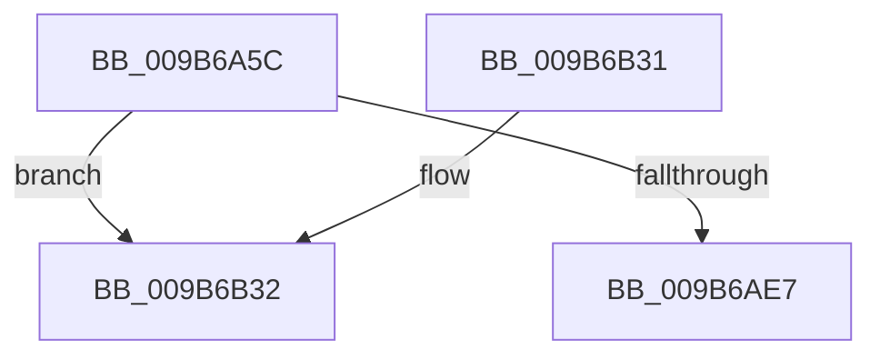

# HvpGenerateLogEntryChecksums

- RVA: `0x009B6A5C`–`0x009B6B3E` (길이 `226` bytes)
- VA: `0x00000001409B6A5C`
- 실행 섹션: `PAGE`
- PDB 이름 있음: `예`; PDB Function 태그: `예`
- unwind 정보 RVA: `0x0009E77C`
- 디코드: `57`개 명령, `226/226` bytes 표시
- 미해석 바이트: `0` (있으면 어셈블리에 `.byte`로 보존)

> 이 문서는 커널 이미지의 기계어와 PDB 기호를 분석해 생성했습니다. 4번과 5번은 함수 원형과 자료형을 바이너리 사용 방식에서 추정한 C 해석이며 원본 소스 복구 결과는 아닙니다.

## 1. Dependencies

- 직접 호출 지점: **5**; 고유 호출 대상: **5**
- 직접 호출자로 확인된 함수: **1**
- RIP 상대 이미지 참조: **2**

### Outgoing calls
- `0x009B6ABC` → [SymCryptMarvin32Init](../../text/51/SymCryptMarvin32Init_function_0051F660.md) (function, `0x0051F660`)
- `0x009B6ADD` → [SymCryptMarvin32Append](../../text/51/SymCryptMarvin32Append_function_0051F4AC.md) (function, `0x0051F4AC`)
- `0x009B6AF0` → [SymCryptMarvin32Result](../../text/51/SymCryptMarvin32Result_function_0051F67C.md) (function, `0x0051F67C`)
- `0x009B6B09` → [SymCryptMarvin32](../../text/51/SymCryptMarvin32_function_0051F308.md) (function, `0x0051F308`)
- `0x009B6B16` → [_security_check_cookie](../../text/6A/_security_check_cookie_function_006AC640.md) (function, `0x006AC640`)

### Direct callers
- [HvpGenerateLogEntry](HvpGenerateLogEntry_function_009B65F0.md) at `0x009B6750`

### Static image references
- `0x009B6A70` → RVA `0x00E0A740` (`.data`; read)
- `0x009B6A96` → RVA `0x00E2CB20` (`.data`; read)

## 2. Other-region calls and transfers

- 다른 실행 섹션으로 향하는 call: **5**
  - `0x009B6ABC` → [SymCryptMarvin32Init](../../text/51/SymCryptMarvin32Init_function_0051F660.md) (`PAGE` → `.text`)
  - `0x009B6ADD` → [SymCryptMarvin32Append](../../text/51/SymCryptMarvin32Append_function_0051F4AC.md) (`PAGE` → `.text`)
  - `0x009B6AF0` → [SymCryptMarvin32Result](../../text/51/SymCryptMarvin32Result_function_0051F67C.md) (`PAGE` → `.text`)
  - `0x009B6B09` → [SymCryptMarvin32](../../text/51/SymCryptMarvin32_function_0051F308.md) (`PAGE` → `.text`)
  - `0x009B6B16` → [_security_check_cookie](../../text/6A/_security_check_cookie_function_006AC640.md) (`PAGE` → `.text`)
- call이 아닌 외부 분기/꼬리 이동: **1**
  - `0x009B6B39` → [sub_00B2DE10](../B2/Unknown_function_00B2DE10.md) (`tail-transfer`)

## 3. Assembly (complete function range)

```asm
009B6A5C  4C 8B DC                        mov r11, rsp
009B6A5F  49 89 5B 10                     mov qword ptr [r11 + 0x10], rbx
009B6A63  49 89 6B 18                     mov qword ptr [r11 + 0x18], rbp
009B6A67  49 89 73 20                     mov qword ptr [r11 + 0x20], rsi
009B6A6B  57                              push rdi
009B6A6C  48 83 EC 70                     sub rsp, 0x70
009B6A70  48 8B 05 C9 3C 45 00            mov rax, qword ptr [rip + 0x453cc9]
009B6A77  48 33 C4                        xor rax, rsp
009B6A7A  48 89 44 24 60                  mov qword ptr [rsp + 0x60], rax
009B6A7F  0F 57 C0                        xorps xmm0, xmm0
009B6A82  33 C0                           xor eax, eax
009B6A84  0F 11 44 24 20                  movups xmmword ptr [rsp + 0x20], xmm0
009B6A89  45 84 C0                        test r8b, r8b
009B6A8C  8B EA                           mov ebp, edx
009B6A8E  0F 11 44 24 30                  movups xmmword ptr [rsp + 0x30], xmm0
009B6A93  48 8B F1                        mov rsi, rcx
009B6A96  48 8D 15 83 60 47 00            lea rdx, [rip + 0x476083]
009B6A9D  0F 11 44 24 40                  movups xmmword ptr [rsp + 0x40], xmm0
009B6AA2  49 89 43 D8                     mov qword ptr [r11 - 0x28], rax
009B6AA6  41 8A D8                        mov bl, r8b
009B6AA9  48 8B 41 08                     mov rax, qword ptr [rcx + 8]
009B6AAD  49 8D 4B A8                     lea rcx, [r11 - 0x58]
009B6AB1  48 8D B8 00 02 00 00            lea rdi, [rax + 0x200]
009B6AB8  48 0F 44 F8                     cmove rdi, rax
009B6ABC  E8 9F 8B B6 FF                  call 0x14051f660
009B6AC1  8B 4E 10                        mov ecx, dword ptr [rsi + 0x10]
009B6AC4  48 8D 57 28                     lea rdx, [rdi + 0x28]
009B6AC8  83 C1 D8                        add ecx, -0x28
009B6ACB  84 DB                           test bl, bl
009B6ACD  44 8D 81 00 FE FF FF            lea r8d, [rcx - 0x200]
009B6AD4  44 0F 44 C1                     cmove r8d, ecx
009B6AD8  48 8D 4C 24 20                  lea rcx, [rsp + 0x20]
009B6ADD  E8 CA 89 B6 FF                  call 0x14051f4ac
009B6AE2  83 FD 01                        cmp ebp, 1
009B6AE5  77 4B                           ja 0x1409b6b32
009B6AE7  48 8D 57 18                     lea rdx, [rdi + 0x18]
009B6AEB  48 8D 4C 24 20                  lea rcx, [rsp + 0x20]
009B6AF0  E8 87 8B B6 FF                  call 0x14051f67c
009B6AF5  4C 8D 4F 20                     lea r9, [rdi + 0x20]
009B6AF9  41 B8 20 00 00 00               mov r8d, 0x20
009B6AFF  48 8B D7                        mov rdx, rdi
009B6B02  48 8D 0D 17 60 47 00            lea rcx, [rip + 0x476017]
009B6B09  E8 FA 87 B6 FF                  call 0x14051f308
009B6B0E  48 8B 4C 24 60                  mov rcx, qword ptr [rsp + 0x60]
009B6B13  48 33 CC                        xor rcx, rsp
009B6B16  E8 25 5B CF FF                  call 0x1406ac640
009B6B1B  4C 8D 5C 24 70                  lea r11, [rsp + 0x70]
009B6B20  49 8B 5B 18                     mov rbx, qword ptr [r11 + 0x18]
009B6B24  49 8B 6B 20                     mov rbp, qword ptr [r11 + 0x20]
009B6B28  49 8B 73 28                     mov rsi, qword ptr [r11 + 0x28]
009B6B2C  49 8B E3                        mov rsp, r11
009B6B2F  5F                              pop rdi
009B6B30  C3                              ret
009B6B31  CC                              int3
009B6B32  48 8D 5E 20                     lea rbx, [rsi + 0x20]
009B6B36  8D 75 FF                        lea esi, [rbp - 1]
009B6B39  E9 D2 72 17 00                  jmp 0x140b2de10
```

## 4. C-style interpretation (structured pseudocode)

```c
__int64 __fastcall HvpGenerateLogEntryChecksums(__int64 a1, int a2, unsigned __int8 a3)
{
    __int64 result;
    __int64 v_rdi;
    __int64 v_rsp;
    unsigned __int64 v_stack_m18;
    unsigned __int64 v_stack_m38;
    unsigned __int64 v_stack_m48;
    unsigned __int64 v_stack_m58;
    unsigned __int64 v_stack_m8;

    *(unsigned __int64 *)(v_rsp + 16) = v_rbx;
    *(unsigned __int64 *)(v_rsp + 24) = v_rbp;
    *(unsigned __int64 *)(v_rsp + 32) = v_rsi;
    v_rsp = (v_rsp) - (112);
    result = (*(unsigned __int64 *)(v_rip + 4537545)) ^ (v_rsp);
    v_stack_m18 = result;
    result = 0;
    v_stack_m58 = v_xmm0;
    v_stack_m48 = v_xmm0;
    v_stack_m38 = v_xmm0;
    *(unsigned __int64 *)(v_rsp - 40) = 0;
    v_rdi = *(unsigned __int64 *)(a1 + 8) + 512;
    if (a3 == 0) { v_rdi = *(unsigned __int64 *)(a1 + 8); }
    result = SymCryptMarvin32Init(v_rsp - 88, v_rip + 4677763, a3, a4);
    a1 = (unsigned int)(((unsigned int)(*(unsigned int *)(a1 + 16))) + (-40));
    a3 = a1 - 512;
    if (a3 == 0) { a3 = (unsigned int)(a1); }
    result = SymCryptMarvin32Append(v_stack_m58, v_rdi + 40, a3, a4);
    if (((unsigned int)((unsigned int)(a2))) > 1) goto loc_009B6B32;
    result = SymCryptMarvin32Result(v_stack_m58, v_rdi + 24, a3, a4);
    result = SymCryptMarvin32(v_rip + 4677655, v_rdi, 32, v_rdi + 32);
    a1 = (v_stack_m18) ^ (v_rsp);
    result = _security_check_cookie(a1, v_rdi, 32, v_rdi + 32);
    return result;
loc_009B6B32:
}
```

## 5. (Beta) C Style

```c
int64_t HvpGenerateLogEntryChecksums(void *Arg1, int32_t Arg2, uint8_t Arg3)
{
    uint8_t *arg1 = (uint8_t *)Arg1;

    int64_t result;
    int64_t local_rdi;
    int64_t local_rsp;
    uint64_t v_stack_m18;
    uint64_t v_stack_m38;
    uint64_t v_stack_m48;
    uint64_t v_stack_m58;
    uint64_t v_stack_m8;

    *(uint64_t *)(local_rsp + 0x10) = local_rbx;
    *(uint64_t *)(local_rsp + 0x18) = local_rbp;
    *(uint64_t *)(local_rsp + 0x20) = local_rsi;
    local_rsp = (local_rsp) - (112);
    result = (*(uint64_t *)(v_rip + 0x453CC9)) ^ (local_rsp);
    v_stack_m18 = result;
    result = 0;
    v_stack_m58 = v_xmm0;
    v_stack_m48 = v_xmm0;
    v_stack_m38 = v_xmm0;
    *(uint64_t *)(local_rsp - 0x28) = 0;
    local_rdi = *(uint64_t *)(arg1 + 0x8) + 512;
    if (Arg3 == 0) { local_rdi = *(uint64_t *)(arg1 + 0x8); }
    result = SymCryptMarvin32Init(local_rsp - 88, v_rip + 4677763, Arg3, a4);
    Arg1 = (uint32_t)(((uint32_t)(*(uint32_t *)(arg1 + 0x10))) + (-40));
    Arg3 = Arg1 - 512;
    if (Arg3 == 0) { Arg3 = (uint32_t)(Arg1); }
    result = SymCryptMarvin32Append(v_stack_m58, local_rdi + 40, Arg3, a4);
    if (((uint32_t)((uint32_t)(Arg2))) > 1) goto loc_009B6B32;
    result = SymCryptMarvin32Result(v_stack_m58, local_rdi + 24, Arg3, a4);
    result = SymCryptMarvin32(v_rip + 4677655, local_rdi, 32, local_rdi + 32);
    Arg1 = (v_stack_m18) ^ (local_rsp);
    result = _security_check_cookie(Arg1, local_rdi, 32, local_rdi + 32);
    return result;
loc_009B6B32:
}
```

### 관측된 메모리 오프셋

구조체 형식이 확인되지 않은 접근은 인자 기준의 오프셋으로만 기록했습니다.

| 기준 인자 | 오프셋 표현 | 폭 (bit) | 접근 |
|---|---:|---:|---|
| `Arg1` | `+ 0x8` | `64` | `R` |
| `Arg1` | `+ 0x10` | `32` | `R` |
| `Arg1` | `+ 0x20` | `64` | `R` |

## 6. Execution-region graph

[열기: 2D/3D 그래프와 함수 탐색 컨트롤 패널](../../../control-panel.html?section=page&rva=0x009B6A5C&view=graph)

- 2D 그래프는 위에서 아래로 흐르고, 3D 그래프는 빈 공간을 드래그해 회전합니다. Shift+드래그는 이동, 휠은 확대·축소, 함수 노드 선택은 대상 보고서 이동입니다.

### Static fallback


