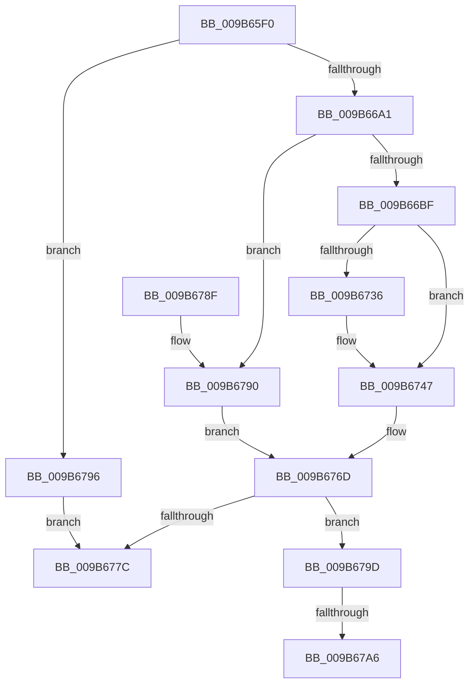

# HvpGenerateLogEntry

- RVA: `0x009B65F0`–`0x009B67AF` (길이 `447` bytes)
- VA: `0x00000001409B65F0`
- 실행 섹션: `PAGE`
- PDB 이름 있음: `예`; PDB Function 태그: `예`
- unwind 정보 RVA: `0x0009E718`
- 디코드: `130`개 명령, `447/447` bytes 표시
- 미해석 바이트: `0` (있으면 어셈블리에 `.byte`로 보존)

> 이 문서는 커널 이미지의 기계어와 PDB 기호를 분석해 생성했습니다. 4번과 5번은 함수 원형과 자료형을 바이너리 사용 방식에서 추정한 C 해석이며 원본 소스 복구 결과는 아닙니다.

## 1. Dependencies

- 직접 호출 지점: **11**; 고유 호출 대상: **11**
- 직접 호출자로 확인된 함수: **1**
- RIP 상대 이미지 참조: **0**

### Outgoing calls
- `0x009B6638` → [HvpCountSetRangesInVector](HvpCountSetRangesInVector_function_009B6974.md) (function, `0x009B6974`)
- `0x009B6646` → [RtlNumberOfSetBits](../../text/43/RtlNumberOfSetBits_function_00433F70.md) (function, `0x00433F70`)
- `0x009B6658` → [CmpLogDirtyVectorUse](CmpLogDirtyVectorUse_function_009B69D4.md) (function, `0x009B69D4`)
- `0x009B6690` → [ExAllocatePool2](../../poolcode/B8/ExAllocatePool2_function_00B820F0.md) (function, `0x00B820F0`)
- `0x009B66AC` → [HvpAllocateLogBuffers](../../text/49/HvpAllocateLogBuffers_function_00493A14.md) (function, `0x00493A14`)
- `0x009B66E6` → [HvpGenerateLogEntryHeader](../../text/48/HvpGenerateLogEntryHeader_function_00481A60.md) (function, `0x00481A60`)
- `0x009B6707` → [HvpGenerateLogEntryMetadata](../../text/43/HvpGenerateLogEntryMetadata_function_00433A4C.md) (function, `0x00433A4C`)
- `0x009B671F` → [HvpGenerateLogEntryDirtyData](../../text/43/HvpGenerateLogEntryDirtyData_function_00433ABC.md) (function, `0x00433ABC`)
- `0x009B6742` → [memset](../../text/6C/memset_function_006C6C40.md) (function, `0x006C6C40`)
- `0x009B6750` → [HvpGenerateLogEntryChecksums](HvpGenerateLogEntryChecksums_function_009B6A5C.md) (function, `0x009B6A5C`)
- `0x009B6772` → [ExFreePoolWithTag](../../poolcode/B8/ExFreePoolWithTag_function_00B82870.md) (function, `0x00B82870`)

### Direct callers
- [HvStoreModifiedData](HvStoreModifiedData_function_009B4FB4.md) at `0x009B5097`

### Static image references
- 디코드된 RIP-relative 메모리 참조가 없습니다.

## 2. Other-region calls and transfers

- 다른 실행 섹션으로 향하는 call: **8**
  - `0x009B6646` → [RtlNumberOfSetBits](../../text/43/RtlNumberOfSetBits_function_00433F70.md) (`PAGE` → `.text`)
  - `0x009B6690` → [ExAllocatePool2](../../poolcode/B8/ExAllocatePool2_function_00B820F0.md) (`PAGE` → `POOLCODE`)
  - `0x009B66AC` → [HvpAllocateLogBuffers](../../text/49/HvpAllocateLogBuffers_function_00493A14.md) (`PAGE` → `.text`)
  - `0x009B66E6` → [HvpGenerateLogEntryHeader](../../text/48/HvpGenerateLogEntryHeader_function_00481A60.md) (`PAGE` → `.text`)
  - `0x009B6707` → [HvpGenerateLogEntryMetadata](../../text/43/HvpGenerateLogEntryMetadata_function_00433A4C.md) (`PAGE` → `.text`)
  - `0x009B671F` → [HvpGenerateLogEntryDirtyData](../../text/43/HvpGenerateLogEntryDirtyData_function_00433ABC.md) (`PAGE` → `.text`)
  - `0x009B6742` → [memset](../../text/6C/memset_function_006C6C40.md) (`PAGE` → `.text`)
  - `0x009B6772` → [ExFreePoolWithTag](../../poolcode/B8/ExFreePoolWithTag_function_00B82870.md) (`PAGE` → `POOLCODE`)
- call이 아닌 외부 분기/꼬리 이동: **2**
  - `0x009B67A0` → [sub_00B2DDE2 + 0x1D](../B2/Unknown_function_00B2DDE2.md) (`tail-transfer`)
  - `0x009B67AA` → [sub_00B2DDE2](../B2/Unknown_function_00B2DDE2.md) (`tail-transfer`)

## 3. Assembly (complete function range)

```asm
009B65F0  4C 89 4C 24 20                  mov qword ptr [rsp + 0x20], r9
009B65F5  4C 89 44 24 18                  mov qword ptr [rsp + 0x18], r8
009B65FA  48 89 54 24 10                  mov qword ptr [rsp + 0x10], rdx
009B65FF  55                              push rbp
009B6600  53                              push rbx
009B6601  56                              push rsi
009B6602  57                              push rdi
009B6603  41 54                           push r12
009B6605  41 55                           push r13
009B6607  41 56                           push r14
009B6609  41 57                           push r15
009B660B  48 8B EC                        mov rbp, rsp
009B660E  48 83 EC 68                     sub rsp, 0x68
009B6612  8B B9 B4 00 00 00               mov edi, dword ptr [rcx + 0xb4]
009B6618  45 33 F6                        xor r14d, r14d
009B661B  85 FF                           test edi, edi
009B661D  4C 89 75 E8                     mov qword ptr [rbp - 0x18], r14
009B6621  4C 8B F9                        mov r15, rcx
009B6624  44 89 75 D8                     mov dword ptr [rbp - 0x28], r14d
009B6628  41 0F 94 C5                     sete r13b
009B662C  44 89 75 DC                     mov dword ptr [rbp - 0x24], r14d
009B6630  48 83 C1 58                     add rcx, 0x58
009B6634  44 89 75 48                     mov dword ptr [rbp + 0x48], r14d
009B6638  E8 37 03 00 00                  call 0x1409b6974
009B663D  8B F0                           mov esi, eax
009B663F  89 45 E0                        mov dword ptr [rbp - 0x20], eax
009B6642  49 8D 4F 58                     lea rcx, [r15 + 0x58]
009B6646  E8 25 D9 A7 FF                  call 0x140433f70
009B664B  44 8B C8                        mov r9d, eax
009B664E  41 8D 56 01                     lea edx, [r14 + 1]
009B6652  44 8B C6                        mov r8d, esi
009B6655  49 8B CF                        mov rcx, r15
009B6658  E8 77 03 00 00                  call 0x1409b69d4
009B665D  F7 DF                           neg edi
009B665F  8D 14 F5 00 00 00 00            lea edx, [rsi*8]
009B6666  41 8B 7F 68                     mov edi, dword ptr [r15 + 0x68]
009B666A  41 B8 43 4D 49 6F               mov r8d, 0x6f494d43
009B6670  1B C9                           sbb ecx, ecx
009B6672  C1 E7 09                        shl edi, 9
009B6675  81 E1 00 FE FF FF               and ecx, 0xfffffe00
009B667B  8D 81 27 12 00 00               lea eax, [rcx + 0x1227]
009B6681  B9 08 01 00 00                  mov ecx, 0x108
009B6686  03 C2                           add eax, edx
009B6688  03 F8                           add edi, eax
009B668A  81 E7 00 F0 FF FF               and edi, 0xfffff000
009B6690  E8 5B BA 1C 00                  call 0x140b820f0
009B6695  4C 8B E0                        mov r12, rax
009B6698  48 85 C0                        test rax, rax
009B669B  0F 84 F5 00 00 00               je 0x1409b6796
009B66A1  44 8B C7                        mov r8d, edi
009B66A4  48 8D 55 DC                     lea rdx, [rbp - 0x24]
009B66A8  48 8D 4D E8                     lea rcx, [rbp - 0x18]
009B66AC  E8 63 D3 AD FF                  call 0x140493a14
009B66B1  44 8B 75 DC                     mov r14d, dword ptr [rbp - 0x24]
009B66B5  8B F0                           mov esi, eax
009B66B7  85 C0                           test eax, eax
009B66B9  0F 88 D1 00 00 00               js 0x1409b6790
009B66BF  8B 75 E0                        mov esi, dword ptr [rbp - 0x20]
009B66C2  48 8D 45 D8                     lea rax, [rbp - 0x28]
009B66C6  48 8B 5D E8                     mov rbx, qword ptr [rbp - 0x18]
009B66CA  4C 8D 4D 48                     lea r9, [rbp + 0x48]
009B66CE  44 88 6C 24 38                  mov byte ptr [rsp + 0x38], r13b
009B66D3  48 8B D3                        mov rdx, rbx
009B66D6  89 74 24 30                     mov dword ptr [rsp + 0x30], esi
009B66DA  49 8B CF                        mov rcx, r15
009B66DD  89 7C 24 28                     mov dword ptr [rsp + 0x28], edi
009B66E1  48 89 44 24 20                  mov qword ptr [rsp + 0x20], rax
009B66E6  E8 75 B3 AC FF                  call 0x140481a60
009B66EB  48 8D 45 D8                     lea rax, [rbp - 0x28]
009B66EF  89 74 24 30                     mov dword ptr [rsp + 0x30], esi
009B66F3  4C 89 64 24 28                  mov qword ptr [rsp + 0x28], r12
009B66F8  4C 8D 4D 48                     lea r9, [rbp + 0x48]
009B66FC  48 8B D3                        mov rdx, rbx
009B66FF  48 89 44 24 20                  mov qword ptr [rsp + 0x20], rax
009B6704  49 8B CF                        mov rcx, r15
009B6707  E8 40 D3 A7 FF                  call 0x140433a4c
009B670C  48 8D 45 D8                     lea rax, [rbp - 0x28]
009B6710  48 8B D3                        mov rdx, rbx
009B6713  4C 8D 4D 48                     lea r9, [rbp + 0x48]
009B6717  48 89 44 24 20                  mov qword ptr [rsp + 0x20], rax
009B671C  49 8B CF                        mov rcx, r15
009B671F  E8 98 D3 A7 FF                  call 0x140433abc
009B6724  8B 45 48                        mov eax, dword ptr [rbp + 0x48]
009B6727  8B 4D D8                        mov ecx, dword ptr [rbp - 0x28]
009B672A  48 8D 14 40                     lea rdx, [rax + rax*2]
009B672E  8B 44 D3 10                     mov eax, dword ptr [rbx + rdx*8 + 0x10]
009B6732  3B C8                           cmp ecx, eax
009B6734  73 11                           jae 0x1409b6747
009B6736  2B C1                           sub eax, ecx
009B6738  48 03 4C D3 08                  add rcx, qword ptr [rbx + rdx*8 + 8]
009B673D  44 8B C0                        mov r8d, eax
009B6740  33 D2                           xor edx, edx
009B6742  E8 F9 04 D1 FF                  call 0x1406c6c40
009B6747  45 8A C5                        mov r8b, r13b
009B674A  41 8B D6                        mov edx, r14d
009B674D  48 8B CB                        mov rcx, rbx
009B6750  E8 07 03 00 00                  call 0x1409b6a5c
009B6755  48 8B 45 50                     mov rax, qword ptr [rbp + 0x50]
009B6759  48 89 18                        mov qword ptr [rax], rbx
009B675C  48 8B 45 58                     mov rax, qword ptr [rbp + 0x58]
009B6760  44 89 30                        mov dword ptr [rax], r14d
009B6763  48 8B 45 60                     mov rax, qword ptr [rbp + 0x60]
009B6767  89 38                           mov dword ptr [rax], edi
009B6769  33 FF                           xor edi, edi
009B676B  33 F6                           xor esi, esi
009B676D  33 D2                           xor edx, edx
009B676F  49 8B CC                        mov rcx, r12
009B6772  E8 F9 C0 1C 00                  call 0x140b82870
009B6777  48 85 FF                        test rdi, rdi
009B677A  75 21                           jne 0x1409b679d
009B677C  8B C6                           mov eax, esi
009B677E  48 83 C4 68                     add rsp, 0x68
009B6782  41 5F                           pop r15
009B6784  41 5E                           pop r14
009B6786  41 5D                           pop r13
009B6788  41 5C                           pop r12
009B678A  5F                              pop rdi
009B678B  5E                              pop rsi
009B678C  5B                              pop rbx
009B678D  5D                              pop rbp
009B678E  C3                              ret
009B678F  CC                              int3
009B6790  48 8B 7D E8                     mov rdi, qword ptr [rbp - 0x18]
009B6794  EB D7                           jmp 0x1409b676d
009B6796  BE 17 00 00 C0                  mov esi, 0xc0000017
009B679B  EB DF                           jmp 0x1409b677c
009B679D  45 85 F6                        test r14d, r14d
009B67A0  0F 84 59 76 17 00               je 0x140b2ddff
009B67A6  48 8D 5F 08                     lea rbx, [rdi + 8]
009B67AA  E9 33 76 17 00                  jmp 0x140b2dde2
```

## 4. C-style interpretation (structured pseudocode)

```c
__int64 __fastcall HvpGenerateLogEntry(__int64 a1, __int64 a2, __int64 a3, __int64 a4)
{
    __int64 result;
    __int64 v_r13;
    __int64 v_r14;
    __int64 v_rdi;
    __int64 v_rsi;
    __int64 v_rsp;
    unsigned __int64 v_stack_m58;
    unsigned int v_stack_m60;
    unsigned int v_stack_m64;
    unsigned int v_stack_m68;
    unsigned __int8 v_stack_m70;
    unsigned int v_stack_m78;
    unsigned int v_stack_m80;
    unsigned __int64 v_stack_m88;
    unsigned __int64 v_stack_p10;
    unsigned __int64 v_stack_p18;
    unsigned __int64 v_stack_p20;
    unsigned int v_stack_p8;

    v_stack_p20 = a4;
    v_stack_p18 = a3;
    v_stack_p10 = a2;
    v_rsp = (v_rsp) - (104);
    v_r14 = 0;
    v_stack_m58 = 0;
    v_stack_m68 = 0;
    v_r13 = ((unsigned int)((unsigned int)(*(unsigned int *)(a1 + 180))) == 0) ? 1 : 0;
    v_stack_m64 = 0;
    a1 = (a1) + (88);
    v_stack_p8 = 0;
    result = HvpCountSetRangesInVector(a1, a2, a3, a4);
    v_stack_m60 = (unsigned int)(result);
    result = RtlNumberOfSetBits(a1 + 88, a2, a3, a4);
    result = CmpLogDirtyVectorUse(a1, v_r14 + 1, (unsigned int)((unsigned int)((unsigned int)((unsigned int)(result)))), (unsigned int)((unsigned int)(result)));
    v_rdi = (unsigned int)(-((unsigned int)(*(unsigned int *)(a1 + 180))));
    v_rdi = (unsigned int)(((unsigned int)(*(unsigned int *)(a1 + 104))) << (9));
    a1 = (unsigned int)((a1) & (0xFFFFFE00ULL));
    result = (unsigned int)((a1 + 4647) + ((unsigned int)((unsigned int)((unsigned int)(result)) * 8)));
    v_rdi = (unsigned int)((v_rdi) + ((unsigned int)(result)));
    v_rdi = (unsigned int)((v_rdi) & (0xFFFFF000ULL));
    result = ExAllocatePool2(264, (unsigned int)((unsigned int)(result)) * 8, (unsigned int)(0x6F494D43ULL), (unsigned int)((unsigned int)(result)));
    if (result == 0) goto loc_009B6796;
    result = HvpAllocateLogBuffers(v_stack_m58, v_stack_m64, (unsigned int)((unsigned int)(v_rdi)), (unsigned int)((unsigned int)(result)));
    if (sign_flag) goto loc_009B6790;
    v_stack_m70 = (unsigned __int8)(v_r13);
    v_stack_m78 = (unsigned int)((unsigned int)(v_stack_m60));
    v_stack_m80 = (unsigned int)(v_rdi);
    v_stack_m88 = v_stack_m68;
    result = HvpGenerateLogEntryHeader(a1, v_stack_m58, (unsigned int)((unsigned int)(v_rdi)), v_stack_p8);
    v_stack_m78 = (unsigned int)((unsigned int)(v_stack_m60));
    v_stack_m80 = result;
    v_stack_m88 = v_stack_m68;
    result = HvpGenerateLogEntryMetadata(a1, v_stack_m58, (unsigned int)((unsigned int)(v_rdi)), v_stack_p8);
    v_stack_m88 = v_stack_m68;
    result = HvpGenerateLogEntryDirtyData(a1, v_stack_m58, (unsigned int)((unsigned int)(v_rdi)), v_stack_p8);
    result = (unsigned int)(*(unsigned int *)(v_stack_m58 + (unsigned int)(v_stack_p8) + (unsigned int)(v_stack_p8) * 2 * 8 + 16));
    if (((unsigned int)((unsigned int)(v_stack_m68))) < ((unsigned int)((unsigned int)(*(unsigned int *)(v_stack_m58 + (unsigned int)(v_stack_p8) + (unsigned int)(v_stack_p8) * 2 * 8 + 16))))) {
        result = (unsigned int)(((unsigned int)(*(unsigned int *)(v_stack_m58 + (unsigned int)(v_stack_p8) + (unsigned int)(v_stack_p8) * 2 * 8 + 16))) - ((unsigned int)((unsigned int)(v_stack_m68))));
        a1 = ((unsigned int)(v_stack_m68)) + (*(unsigned __int64 *)(v_stack_m58 + (unsigned int)(v_stack_p8) + (unsigned int)(v_stack_p8) * 2 * 8 + 8));
        a3 = (unsigned int)(result);
        a2 = 0;
        result = memset(a1, a2, a3, v_stack_p8);
    }
    result = HvpGenerateLogEntryChecksums(v_stack_m58, (unsigned int)((unsigned int)((unsigned int)(v_stack_m64))), (unsigned __int8)(v_r13), v_stack_p8);
    *(unsigned __int64 *)(v_stack_p10) = v_stack_m58;
    *(unsigned int *)(v_stack_p18) = (unsigned int)((unsigned int)(v_stack_m64));
    *(unsigned int *)(v_stack_p20) = (unsigned int)(v_rdi);
    v_rdi = 0;
    v_rsi = 0;
loc_009B676D:
    a2 = 0;
    result = ExFreePoolWithTag(result, a2, (unsigned __int8)(v_r13), v_stack_p8);
    if (0 != 0) goto loc_009B679D;
loc_009B677C:
    v_rsp = (v_rsp) + (104);
    return 0;
loc_009B6790:
    goto loc_009B676D;
loc_009B6796:
    goto loc_009B677C;
loc_009B679D:
}
```

## 5. (Beta) C Style

```c
int64_t HvpGenerateLogEntry(void *Arg1, int64_t Arg2, int64_t Arg3, int64_t Arg4)
{
    uint8_t *arg1 = (uint8_t *)Arg1;

    int64_t result;
    int64_t local_r13;
    int64_t local_r14;
    int64_t local_rdi;
    int64_t local_rsi;
    int64_t local_rsp;
    uint64_t v_stack_m58;
    uint32_t v_stack_m60;
    uint32_t v_stack_m64;
    uint32_t v_stack_m68;
    uint8_t v_stack_m70;
    uint32_t v_stack_m78;
    uint32_t v_stack_m80;
    uint64_t v_stack_m88;
    uint64_t v_stack_p10;
    uint64_t v_stack_p18;
    uint64_t v_stack_p20;
    uint32_t v_stack_p8;

    v_stack_p20 = Arg4;
    v_stack_p18 = Arg3;
    v_stack_p10 = Arg2;
    local_rsp = (local_rsp) - (104);
    local_r14 = 0;
    v_stack_m58 = 0;
    v_stack_m68 = 0;
    local_r13 = ((uint32_t)((uint32_t)(*(uint32_t *)(arg1 + 0xB4))) == 0) ? 1 : 0;
    v_stack_m64 = 0;
    Arg1 = (Arg1) + (88);
    v_stack_p8 = 0;
    result = HvpCountSetRangesInVector(Arg1, Arg2, Arg3, Arg4);
    v_stack_m60 = (uint32_t)(result);
    result = RtlNumberOfSetBits(Arg1 + 88, Arg2, Arg3, Arg4);
    result = CmpLogDirtyVectorUse(Arg1, local_r14 + 1, (uint32_t)((uint32_t)((uint32_t)((uint32_t)(result)))), (uint32_t)((uint32_t)(result)));
    local_rdi = (uint32_t)(-((uint32_t)(*(uint32_t *)(arg1 + 0xB4))));
    local_rdi = (uint32_t)(((uint32_t)(*(uint32_t *)(arg1 + 0x68))) << (9));
    Arg1 = (uint32_t)((Arg1) & (0xFFFFFE00ULL));
    result = (uint32_t)((Arg1 + 4647) + ((uint32_t)((uint32_t)((uint32_t)(result)) * 8)));
    local_rdi = (uint32_t)((local_rdi) + ((uint32_t)(result)));
    local_rdi = (uint32_t)((local_rdi) & (0xFFFFF000ULL));
    result = ExAllocatePool2(264, (uint32_t)((uint32_t)(result)) * 8, (uint32_t)(0x6F494D43ULL), (uint32_t)((uint32_t)(result)));
    if (result == 0) goto loc_009B6796;
    result = HvpAllocateLogBuffers(v_stack_m58, v_stack_m64, (uint32_t)((uint32_t)(local_rdi)), (uint32_t)((uint32_t)(result)));
    if (sign_flag) goto loc_009B6790;
    v_stack_m70 = (uint8_t)(local_r13);
    v_stack_m78 = (uint32_t)((uint32_t)(v_stack_m60));
    v_stack_m80 = (uint32_t)(local_rdi);
    v_stack_m88 = v_stack_m68;
    result = HvpGenerateLogEntryHeader(Arg1, v_stack_m58, (uint32_t)((uint32_t)(local_rdi)), v_stack_p8);
    v_stack_m78 = (uint32_t)((uint32_t)(v_stack_m60));
    v_stack_m80 = result;
    v_stack_m88 = v_stack_m68;
    result = HvpGenerateLogEntryMetadata(Arg1, v_stack_m58, (uint32_t)((uint32_t)(local_rdi)), v_stack_p8);
    v_stack_m88 = v_stack_m68;
    result = HvpGenerateLogEntryDirtyData(Arg1, v_stack_m58, (uint32_t)((uint32_t)(local_rdi)), v_stack_p8);
    result = (uint32_t)(*(uint32_t *)(v_stack_m58 + (uint32_t)(v_stack_p8) + (uint32_t)(v_stack_p8) * 2 * 8 + 0x10));
    if (((uint32_t)((uint32_t)(v_stack_m68))) < ((uint32_t)((uint32_t)(*(uint32_t *)(v_stack_m58 + (uint32_t)(v_stack_p8) + (uint32_t)(v_stack_p8) * 2 * 8 + 0x10))))) {
        result = (uint32_t)(((uint32_t)(*(uint32_t *)(v_stack_m58 + (uint32_t)(v_stack_p8) + (uint32_t)(v_stack_p8) * 2 * 8 + 0x10))) - ((uint32_t)((uint32_t)(v_stack_m68))));
        Arg1 = ((uint32_t)(v_stack_m68)) + (*(uint64_t *)(v_stack_m58 + (uint32_t)(v_stack_p8) + (uint32_t)(v_stack_p8) * 2 * 8 + 0x8));
        Arg3 = (uint32_t)(result);
        Arg2 = 0;
        result = memset(Arg1, Arg2, Arg3, v_stack_p8);
    }
    result = HvpGenerateLogEntryChecksums(v_stack_m58, (uint32_t)((uint32_t)((uint32_t)(v_stack_m64))), (uint8_t)(local_r13), v_stack_p8);
    *(uint64_t *)(v_stack_p10) = v_stack_m58;
    *(uint32_t *)(v_stack_p18) = (uint32_t)((uint32_t)(v_stack_m64));
    *(uint32_t *)(v_stack_p20) = (uint32_t)(local_rdi);
    local_rdi = 0;
    local_rsi = 0;
loc_009B676D:
    Arg2 = 0;
    result = ExFreePoolWithTag(result, Arg2, (uint8_t)(local_r13), v_stack_p8);
    if (0 != 0) goto loc_009B679D;
loc_009B677C:
    local_rsp = (local_rsp) + (104);
    return 0;
loc_009B6790:
    goto loc_009B676D;
loc_009B6796:
    goto loc_009B677C;
loc_009B679D:
}
```

### 관측된 메모리 오프셋

구조체 형식이 확인되지 않은 접근은 인자 기준의 오프셋으로만 기록했습니다.

| 기준 인자 | 오프셋 표현 | 폭 (bit) | 접근 |
|---|---:|---:|---|
| `Arg1` | `+ 0x58` | `64` | `R` |
| `Arg1` | `+ 0x68` | `32` | `R` |
| `Arg1` | `+ 0xB4` | `32` | `R` |

## 6. Execution-region graph

[열기: 2D/3D 그래프와 함수 탐색 컨트롤 패널](../../../control-panel.html?section=page&rva=0x009B65F0&view=graph)

- 2D 그래프는 위에서 아래로 흐르고, 3D 그래프는 빈 공간을 드래그해 회전합니다. Shift+드래그는 이동, 휠은 확대·축소, 함수 노드 선택은 대상 보고서 이동입니다.

### Static fallback


