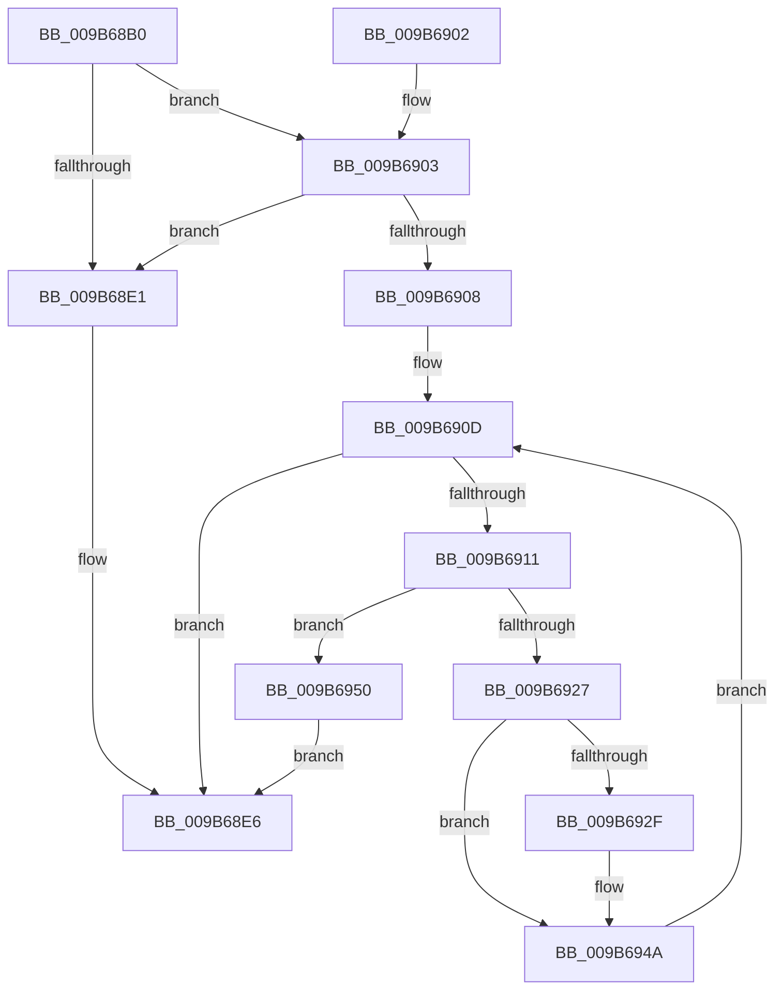

# HvpGenerateLogMetadata

- RVA: `0x009B68B0`–`0x009B696D` (길이 `189` bytes)
- VA: `0x00000001409B68B0`
- 실행 섹션: `PAGE`
- PDB 이름 있음: `예`; PDB Function 태그: `아니요`
- unwind 정보 RVA: `0x0009E760`
- 디코드: `66`개 명령, `189/189` bytes 표시
- 미해석 바이트: `0` (있으면 어셈블리에 `.byte`로 보존)

> 이 문서는 커널 이미지의 기계어와 PDB 기호를 분석해 생성했습니다. 4번과 5번은 함수 원형과 자료형을 바이너리 사용 방식에서 추정한 C 해석이며 원본 소스 복구 결과는 아닙니다.

## 1. Dependencies

- 직접 호출 지점: **2**; 고유 호출 대상: **2**
- 직접 호출자로 확인된 함수: **2**
- RIP 상대 이미지 참조: **0**

### Outgoing calls
- `0x009B68D5` → [HvpCountSetRangesInVector](HvpCountSetRangesInVector_function_009B6974.md) (function, `0x009B6974`)
- `0x009B691B` → [RtlFindNextForwardRunClear](../../text/3C/RtlFindNextForwardRunClear_function_003CF6A0.md) (function, `0x003CF6A0`)

### Direct callers
- [HvpGenerateLogEntryMetadata](../../text/43/HvpGenerateLogEntryMetadata_function_00433A4C.md) at `0x00433A7A`
- [HvpApplyLegacyLogFile](../7F/HvpApplyLegacyLogFile_function_007F66D0.md) at `0x007F67D1`
- [HvpApplyLegacyLogFile](../7F/HvpApplyLegacyLogFile_function_007F66D0.md) at `0x007F6809`

### Static image references
- 디코드된 RIP-relative 메모리 참조가 없습니다.

## 2. Other-region calls and transfers

- 다른 실행 섹션으로 향하는 call: **1**
  - `0x009B691B` → [RtlFindNextForwardRunClear](../../text/3C/RtlFindNextForwardRunClear_function_003CF6A0.md) (`PAGE` → `.text`)
- 별도 외부 분기/꼬리 이동을 확인하지 못했습니다.

## 3. Assembly (complete function range)

```asm
009B68B0  48 89 5C 24 08                  mov qword ptr [rsp + 8], rbx
009B68B5  48 89 6C 24 18                  mov qword ptr [rsp + 0x18], rbp
009B68BA  56                              push rsi
009B68BB  57                              push rdi
009B68BC  41 54                           push r12
009B68BE  41 56                           push r14
009B68C0  41 57                           push r15
009B68C2  48 83 EC 20                     sub rsp, 0x20
009B68C6  33 DB                           xor ebx, ebx
009B68C8  4D 8B F8                        mov r15, r8
009B68CB  89 5C 24 58                     mov dword ptr [rsp + 0x58], ebx
009B68CF  4C 8B F2                        mov r14, rdx
009B68D2  48 8B F1                        mov rsi, rcx
009B68D5  E8 9A 00 00 00                  call 0x1409b6974
009B68DA  8B E8                           mov ebp, eax
009B68DC  4D 85 F6                        test r14, r14
009B68DF  75 22                           jne 0x1409b6903
009B68E1  BB 23 00 00 C0                  mov ebx, 0xc0000023
009B68E6  41 89 2F                        mov dword ptr [r15], ebp
009B68E9  8B C3                           mov eax, ebx
009B68EB  48 8B 5C 24 50                  mov rbx, qword ptr [rsp + 0x50]
009B68F0  48 8B 6C 24 60                  mov rbp, qword ptr [rsp + 0x60]
009B68F5  48 83 C4 20                     add rsp, 0x20
009B68F9  41 5F                           pop r15
009B68FB  41 5E                           pop r14
009B68FD  41 5C                           pop r12
009B68FF  5F                              pop rdi
009B6900  5E                              pop rsi
009B6901  C3                              ret
009B6902  CC                              int3
009B6903  41 39 2F                        cmp dword ptr [r15], ebp
009B6906  72 D9                           jb 0x1409b68e1
009B6908  8B FB                           mov edi, ebx
009B690A  44 8B E3                        mov r12d, ebx
009B690D  3B 3E                           cmp edi, dword ptr [rsi]
009B690F  73 D5                           jae 0x1409b68e6
009B6911  4C 8D 44 24 58                  lea r8, [rsp + 0x58]
009B6916  8B D7                           mov edx, edi
009B6918  48 8B CE                        mov rcx, rsi
009B691B  E8 80 8D A1 FF                  call 0x1403cf6a0
009B6920  44 8B C0                        mov r8d, eax
009B6923  85 C0                           test eax, eax
009B6925  74 29                           je 0x1409b6950
009B6927  8B 54 24 58                     mov edx, dword ptr [rsp + 0x58]
009B692B  3B D7                           cmp edx, edi
009B692D  74 1B                           je 0x1409b694a
009B692F  41 8B CC                        mov ecx, r12d
009B6932  8B C7                           mov eax, edi
009B6934  C1 E0 09                        shl eax, 9
009B6937  41 89 04 CE                     mov dword ptr [r14 + rcx*8], eax
009B693B  8B C2                           mov eax, edx
009B693D  2B C7                           sub eax, edi
009B693F  C1 E0 09                        shl eax, 9
009B6942  41 89 44 CE 04                  mov dword ptr [r14 + rcx*8 + 4], eax
009B6947  41 FF C4                        inc r12d
009B694A  42 8D 3C 02                     lea edi, [rdx + r8]
009B694E  EB BD                           jmp 0x1409b690d
009B6950  41 8B CC                        mov ecx, r12d
009B6953  8B C7                           mov eax, edi
009B6955  C1 E0 09                        shl eax, 9
009B6958  41 89 04 CE                     mov dword ptr [r14 + rcx*8], eax
009B695C  8B 06                           mov eax, dword ptr [rsi]
009B695E  2B C7                           sub eax, edi
009B6960  C1 E0 09                        shl eax, 9
009B6963  41 89 44 CE 04                  mov dword ptr [r14 + rcx*8 + 4], eax
009B6968  E9 79 FF FF FF                  jmp 0x1409b68e6
```

## 4. C-style interpretation (structured pseudocode)

```c
__int64 __fastcall HvpGenerateLogMetadata(__int64 a1, __int64 a2, __int64 a3)
{
    __int64 result;
    __int64 v_r12;
    __int64 v_rbx;
    __int64 v_rsp;
    unsigned int v_stack_p10;
    unsigned __int64 v_stack_p18;
    unsigned __int64 v_stack_p58;
    unsigned __int64 v_stack_p8;

    v_stack_p8 = v_rbx;
    v_stack_p18 = v_rbp;
    v_rsp = (v_rsp) - (32);
    v_rbx = 0;
    v_stack_p10 = 0;
    result = HvpCountSetRangesInVector(a1, a2, a3, a4);
    if (a2 != 0) goto loc_009B6903;
loc_009B68E1:
loc_009B68E6:
    *(unsigned int *)(a3) = (unsigned int)((unsigned int)((unsigned int)(result)));
    v_rsp = (v_rsp) + (32);
    return (unsigned int)((unsigned int)((unsigned int)(0xC0000023ULL)));
loc_009B6903:
    if ((*(unsigned int *)(a3)) < ((unsigned int)(v_stack_p18))) goto loc_009B68E1;
loc_009B690D:
    if (((unsigned int)((unsigned int)((unsigned int)(v_stack_p8)))) >= (*(unsigned int *)(a1))) goto loc_009B68E6;
    result = RtlFindNextForwardRunClear(a1, (unsigned int)((unsigned int)((unsigned int)((unsigned int)(v_stack_p8)))), v_stack_p58, a4);
    if ((unsigned int)(result) == 0) goto loc_009B6950;
    v_r12 = (unsigned int)((unsigned int)(v_stack_p8));
    if (((unsigned int)((unsigned int)(v_stack_p58))) != ((unsigned int)((unsigned int)((unsigned int)(v_stack_p8))))) {
        a1 = (unsigned int)((unsigned int)((unsigned int)(v_stack_p8)));
        result = (unsigned int)((unsigned int)((unsigned int)(v_stack_p8)));
        result = (unsigned int)((result) << (9));
        *(unsigned int *)(a2 + a1 * 8) = (unsigned int)(result);
        result = (unsigned int)((unsigned int)(v_stack_p58));
        result = (unsigned int)((result) - ((unsigned int)((unsigned int)((unsigned int)(v_stack_p8)))));
        result = (unsigned int)((result) << (9));
        *(unsigned int *)(a2 + a1 * 8 + 4) = (unsigned int)(result);
        v_r12 = (unsigned int)(((unsigned int)((unsigned int)(v_stack_p8))) + 1);
    }
    goto loc_009B690D;
loc_009B6950:
    result = (unsigned int)(((unsigned int)((unsigned int)((unsigned int)(v_stack_p58) + (unsigned int)((unsigned int)(result)) * 1))) << (9));
    *(unsigned int *)(a2 + (unsigned int)((unsigned int)(v_r12)) * 8) = (unsigned int)(result);
    result = (unsigned int)(((unsigned int)(*(unsigned int *)(a1))) - ((unsigned int)((unsigned int)(v_stack_p58) + (unsigned int)((unsigned int)(result)) * 1)));
    result = (unsigned int)((result) << (9));
    *(unsigned int *)(a2 + (unsigned int)((unsigned int)(v_r12)) * 8 + 4) = (unsigned int)(result);
    goto loc_009B68E6;
}
```

## 5. (Beta) C Style

```c
int64_t HvpGenerateLogMetadata(void *Arg1, int64_t Arg2, void *Arg3)
{
    uint8_t *arg1 = (uint8_t *)Arg1;
    uint8_t *arg3 = (uint8_t *)Arg3;

    int64_t result;
    int64_t local_r12;
    int64_t local_rbx;
    int64_t local_rsp;
    uint32_t v_stack_p10;
    uint64_t v_stack_p18;
    uint64_t v_stack_p58;
    uint64_t v_stack_p8;

    v_stack_p8 = local_rbx;
    v_stack_p18 = local_rbp;
    local_rsp = (local_rsp) - (32);
    local_rbx = 0;
    v_stack_p10 = 0;
    result = HvpCountSetRangesInVector(Arg1, Arg2, Arg3, a4);
    if (Arg2 != 0) goto loc_009B6903;
loc_009B68E1:
loc_009B68E6:
    *(uint32_t *)(arg3) = (uint32_t)((uint32_t)((uint32_t)(result)));
    local_rsp = (local_rsp) + (32);
    return (uint32_t)((uint32_t)((uint32_t)(0xC0000023ULL)));
loc_009B6903:
    if ((*(uint32_t *)(arg3)) < ((uint32_t)(v_stack_p18))) goto loc_009B68E1;
loc_009B690D:
    if (((uint32_t)((uint32_t)((uint32_t)(v_stack_p8)))) >= (*(uint32_t *)(arg1))) goto loc_009B68E6;
    result = RtlFindNextForwardRunClear(Arg1, (uint32_t)((uint32_t)((uint32_t)((uint32_t)(v_stack_p8)))), v_stack_p58, a4);
    if ((uint32_t)(result) == 0) goto loc_009B6950;
    local_r12 = (uint32_t)((uint32_t)(v_stack_p8));
    if (((uint32_t)((uint32_t)(v_stack_p58))) != ((uint32_t)((uint32_t)((uint32_t)(v_stack_p8))))) {
        Arg1 = (uint32_t)((uint32_t)((uint32_t)(v_stack_p8)));
        result = (uint32_t)((uint32_t)((uint32_t)(v_stack_p8)));
        result = (uint32_t)((result) << (9));
        *(uint32_t *)(Arg2 + arg1 * 8) = (uint32_t)(result);
        result = (uint32_t)((uint32_t)(v_stack_p58));
        result = (uint32_t)((result) - ((uint32_t)((uint32_t)((uint32_t)(v_stack_p8)))));
        result = (uint32_t)((result) << (9));
        *(uint32_t *)(Arg2 + arg1 * 8 + 0x4) = (uint32_t)(result);
        local_r12 = (uint32_t)(((uint32_t)((uint32_t)(v_stack_p8))) + 1);
    }
    goto loc_009B690D;
loc_009B6950:
    result = (uint32_t)(((uint32_t)((uint32_t)((uint32_t)(v_stack_p58) + (uint32_t)((uint32_t)(result)) * 1))) << (9));
    *(uint32_t *)(Arg2 + (uint32_t)((uint32_t)(local_r12)) * 8) = (uint32_t)(result);
    result = (uint32_t)(((uint32_t)(*(uint32_t *)(arg1))) - ((uint32_t)((uint32_t)(v_stack_p58) + (uint32_t)((uint32_t)(result)) * 1)));
    result = (uint32_t)((result) << (9));
    *(uint32_t *)(Arg2 + (uint32_t)((uint32_t)(local_r12)) * 8 + 0x4) = (uint32_t)(result);
    goto loc_009B68E6;
}
```

### 관측된 메모리 오프셋

구조체 형식이 확인되지 않은 접근은 인자 기준의 오프셋으로만 기록했습니다.

| 기준 인자 | 오프셋 표현 | 폭 (bit) | 접근 |
|---|---:|---:|---|
| `Arg1` | `+ 0x0` | `32` | `R` |
| `Arg3` | `+ 0x0` | `32` | `R` |
| `Arg3` | `+ 0x0` | `32` | `W` |

## 6. Execution-region graph

[열기: 2D/3D 그래프와 함수 탐색 컨트롤 패널](../../../control-panel.html?section=page&rva=0x009B68B0&view=graph)

- 2D 그래프는 위에서 아래로 흐르고, 3D 그래프는 빈 공간을 드래그해 회전합니다. Shift+드래그는 이동, 휠은 확대·축소, 함수 노드 선택은 대상 보고서 이동입니다.

### Static fallback


