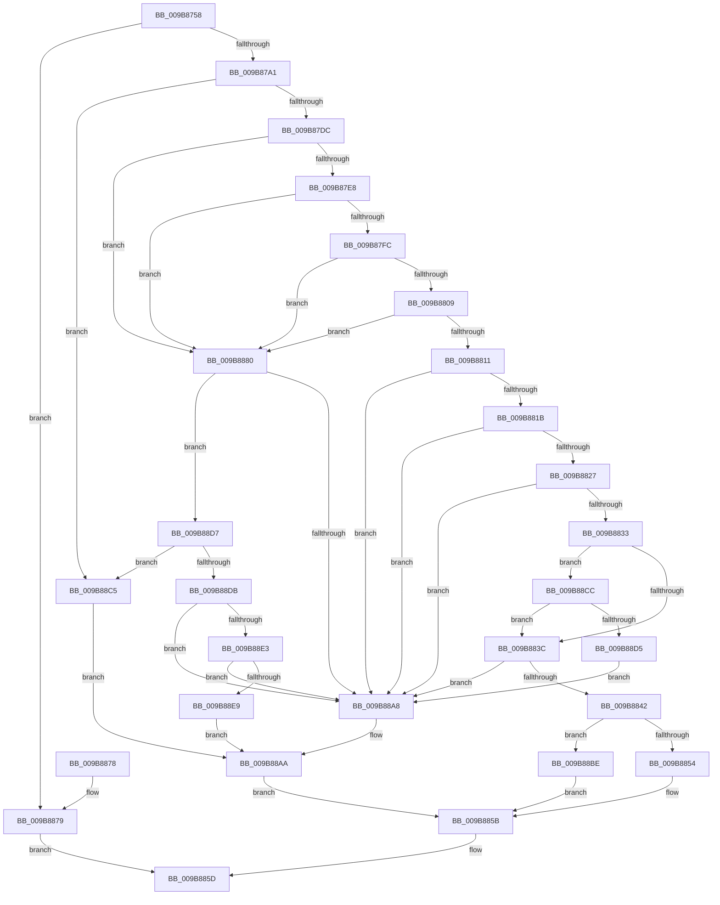

# HvpGetHiveHeader

- RVA: `0x009B8758`–`0x009B88F7` (길이 `415` bytes)
- VA: `0x00000001409B8758`
- 실행 섹션: `PAGE`
- PDB 이름 있음: `예`; PDB Function 태그: `아니요`
- unwind 정보 RVA: `0x0009E95C`
- 디코드: `112`개 명령, `415/415` bytes 표시
- 미해석 바이트: `0` (있으면 어셈블리에 `.byte`로 보존)

> 이 문서는 커널 이미지의 기계어와 PDB 기호를 분석해 생성했습니다. 4번과 5번은 함수 원형과 자료형을 바이너리 사용 방식에서 추정한 C 해석이며 원본 소스 복구 결과는 아닙니다.

## 1. Dependencies

- 직접 호출 지점: **6**; 고유 호출 대상: **3**
- 직접 호출자로 확인된 함수: **2**
- RIP 상대 이미지 참조: **0**

### Outgoing calls
- `0x009B8790` → [guard_dispatch_icall](../../text/6B/guard_dispatch_icall_function_006BAAD0.md) (function, `0x006BAAD0`)
- `0x009B87AE` → [memset](../../text/6C/memset_function_006C6C40.md) (function, `0x006C6C40`)
- `0x009B87CF` → [guard_dispatch_icall](../../text/6B/guard_dispatch_icall_function_006BAAD0.md) (function, `0x006BAAD0`)
- `0x009B87EB` → [HvpHeaderCheckSum](../../pagecmrc/BC/HvpHeaderCheckSum_function_00BC97A0.md) (function, `0x00BC97A0`)
- `0x009B889C` → [guard_dispatch_icall](../../text/6B/guard_dispatch_icall_function_006BAAD0.md) (function, `0x006BAAD0`)
- `0x009B88B7` → [guard_dispatch_icall](../../text/6B/guard_dispatch_icall_function_006BAAD0.md) (function, `0x006BAAD0`)

### Direct callers
- [HvRecoverFlushProtocolStateFromFiles](../7E/HvRecoverFlushProtocolStateFromFiles_function_007EF224.md) at `0x007EF2A3`
- [HvLoadHive](HvLoadHive_function_009B8138.md) at `0x009B81DF`

### Static image references
- 디코드된 RIP-relative 메모리 참조가 없습니다.

## 2. Other-region calls and transfers

- 다른 실행 섹션으로 향하는 call: **6**
  - `0x009B8790` → [guard_dispatch_icall](../../text/6B/guard_dispatch_icall_function_006BAAD0.md) (`PAGE` → `.text`)
  - `0x009B87AE` → [memset](../../text/6C/memset_function_006C6C40.md) (`PAGE` → `.text`)
  - `0x009B87CF` → [guard_dispatch_icall](../../text/6B/guard_dispatch_icall_function_006BAAD0.md) (`PAGE` → `.text`)
  - `0x009B87EB` → [HvpHeaderCheckSum](../../pagecmrc/BC/HvpHeaderCheckSum_function_00BC97A0.md) (`PAGE` → `PAGECMRC`)
  - `0x009B889C` → [guard_dispatch_icall](../../text/6B/guard_dispatch_icall_function_006BAAD0.md) (`PAGE` → `.text`)
  - `0x009B88B7` → [guard_dispatch_icall](../../text/6B/guard_dispatch_icall_function_006BAAD0.md) (`PAGE` → `.text`)
- 별도 외부 분기/꼬리 이동을 확인하지 못했습니다.

## 3. Assembly (complete function range)

```asm
009B8758  48 8B C4                        mov rax, rsp
009B875B  48 89 58 08                     mov qword ptr [rax + 8], rbx
009B875F  48 89 70 10                     mov qword ptr [rax + 0x10], rsi
009B8763  48 89 78 18                     mov qword ptr [rax + 0x18], rdi
009B8767  4C 89 70 20                     mov qword ptr [rax + 0x20], r14
009B876B  41 57                           push r15
009B876D  48 83 EC 30                     sub rsp, 0x30
009B8771  48 83 22 00                     and qword ptr [rdx], 0
009B8775  4D 8B F0                        mov r14, r8
009B8778  48 8B 41 18                     mov rax, qword ptr [rcx + 0x18]
009B877C  4C 8B FA                        mov r15, rdx
009B877F  48 8B F1                        mov rsi, rcx
009B8782  41 B8 43 4D 33 32               mov r8d, 0x32334d43
009B8788  8B 89 84 00 00 00               mov ecx, dword ptr [rcx + 0x84]
009B878E  B2 01                           mov dl, 1
009B8790  E8 3B 23 D0 FF                  call 0x1406baad0
009B8795  48 8B D8                        mov rbx, rax
009B8798  48 85 C0                        test rax, rax
009B879B  0F 84 D8 00 00 00               je 0x1409b8879
009B87A1  BF 00 10 00 00                  mov edi, 0x1000
009B87A6  33 D2                           xor edx, edx
009B87A8  44 8B C7                        mov r8d, edi
009B87AB  48 8B C8                        mov rcx, rax
009B87AE  E8 8D E4 D0 FF                  call 0x1406c6c40
009B87B3  8B 8E 88 00 00 00               mov ecx, dword ptr [rsi + 0x88]
009B87B9  4C 8B CB                        mov r9, rbx
009B87BC  48 8B 46 30                     mov rax, qword ptr [rsi + 0x30]
009B87C0  45 33 C0                        xor r8d, r8d
009B87C3  C1 E1 09                        shl ecx, 9
009B87C6  33 D2                           xor edx, edx
009B87C8  89 4C 24 20                     mov dword ptr [rsp + 0x20], ecx
009B87CC  48 8B CE                        mov rcx, rsi
009B87CF  E8 FC 22 D0 FF                  call 0x1406baad0
009B87D4  85 C0                           test eax, eax
009B87D6  0F 88 E9 00 00 00               js 0x1409b88c5
009B87DC  81 3B 72 65 67 66               cmp dword ptr [rbx], 0x66676572
009B87E2  0F 85 98 00 00 00               jne 0x1409b8880
009B87E8  48 8B CB                        mov rcx, rbx
009B87EB  E8 B0 0F 21 00                  call 0x140bc97a0
009B87F0  39 83 FC 01 00 00               cmp dword ptr [rbx + 0x1fc], eax
009B87F6  0F 85 84 00 00 00               jne 0x1409b8880
009B87FC  8B 4B 28                        mov ecx, dword ptr [rbx + 0x28]
009B87FF  8D 41 FF                        lea eax, [rcx - 1]
009B8802  3D FF DF FF 7F                  cmp eax, 0x7fffdfff
009B8807  77 77                           ja 0x1409b8880
009B8809  F7 C1 FF 0F 00 00               test ecx, 0xfff
009B880F  75 6F                           jne 0x1409b8880
009B8811  83 7B 1C 00                     cmp dword ptr [rbx + 0x1c], 0
009B8815  0F 85 8D 00 00 00               jne 0x1409b88a8
009B881B  8B 43 14                        mov eax, dword ptr [rbx + 0x14]
009B881E  83 F8 01                        cmp eax, 1
009B8821  0F 87 81 00 00 00               ja 0x1409b88a8
009B8827  8B 4B 18                        mov ecx, dword ptr [rbx + 0x18]
009B882A  BF 03 00 00 00                  mov edi, 3
009B882F  3B CF                           cmp ecx, edi
009B8831  72 75                           jb 0x1409b88a8
009B8833  83 F9 06                        cmp ecx, 6
009B8836  0F 87 90 00 00 00               ja 0x1409b88cc
009B883C  83 7B 20 01                     cmp dword ptr [rbx + 0x20], 1
009B8840  75 66                           jne 0x1409b88a8
009B8842  48 8B 43 0C                     mov rax, qword ptr [rbx + 0xc]
009B8846  49 89 06                        mov qword ptr [r14], rax
009B8849  8B 43 08                        mov eax, dword ptr [rbx + 8]
009B884C  49 89 1F                        mov qword ptr [r15], rbx
009B884F  39 43 04                        cmp dword ptr [rbx + 4], eax
009B8852  75 6A                           jne 0x1409b88be
009B8854  C7 43 2C 01 00 00 00            mov dword ptr [rbx + 0x2c], 1
009B885B  8B C7                           mov eax, edi
009B885D  48 8B 5C 24 40                  mov rbx, qword ptr [rsp + 0x40]
009B8862  48 8B 74 24 48                  mov rsi, qword ptr [rsp + 0x48]
009B8867  48 8B 7C 24 50                  mov rdi, qword ptr [rsp + 0x50]
009B886C  4C 8B 74 24 58                  mov r14, qword ptr [rsp + 0x58]
009B8871  48 83 C4 30                     add rsp, 0x30
009B8875  41 5F                           pop r15
009B8877  C3                              ret
009B8878  CC                              int3
009B8879  B8 02 00 00 00                  mov eax, 2
009B887E  EB DD                           jmp 0x1409b885d
009B8880  8B 8E 88 00 00 00               mov ecx, dword ptr [rsi + 0x88]
009B8886  4C 8B CB                        mov r9, rbx
009B8889  48 8B 46 30                     mov rax, qword ptr [rsi + 0x30]
009B888D  44 8B C7                        mov r8d, edi
009B8890  C1 E1 09                        shl ecx, 9
009B8893  33 D2                           xor edx, edx
009B8895  89 4C 24 20                     mov dword ptr [rsp + 0x20], ecx
009B8899  48 8B CE                        mov rcx, rsi
009B889C  E8 2F 22 D0 FF                  call 0x1406baad0
009B88A1  3D 11 00 00 C0                  cmp eax, 0xc0000011
009B88A6  75 2F                           jne 0x1409b88d7
009B88A8  33 FF                           xor edi, edi
009B88AA  48 8B 46 20                     mov rax, qword ptr [rsi + 0x20]
009B88AE  48 8B CB                        mov rcx, rbx
009B88B1  8B 96 84 00 00 00               mov edx, dword ptr [rsi + 0x84]
009B88B7  E8 14 22 D0 FF                  call 0x1406baad0
009B88BC  EB 9D                           jmp 0x1409b885b
009B88BE  BF 05 00 00 00                  mov edi, 5
009B88C3  EB 96                           jmp 0x1409b885b
009B88C5  BF 07 00 00 00                  mov edi, 7
009B88CA  EB DE                           jmp 0x1409b88aa
009B88CC  83 F8 01                        cmp eax, 1
009B88CF  0F 85 67 FF FF FF               jne 0x1409b883c
009B88D5  EB D1                           jmp 0x1409b88a8
009B88D7  85 C0                           test eax, eax
009B88D9  78 EA                           js 0x1409b88c5
009B88DB  81 3B 68 62 69 6E               cmp dword ptr [rbx], 0x6e696268
009B88E1  75 C5                           jne 0x1409b88a8
009B88E3  83 7B 04 00                     cmp dword ptr [rbx + 4], 0
009B88E7  75 BF                           jne 0x1409b88a8
009B88E9  48 8B 43 14                     mov rax, qword ptr [rbx + 0x14]
009B88ED  BF 04 00 00 00                  mov edi, 4
009B88F2  49 89 06                        mov qword ptr [r14], rax
009B88F5  EB B3                           jmp 0x1409b88aa
```

## 4. C-style interpretation (structured pseudocode)

```c
__int64 __fastcall HvpGetHiveHeader(__int64 a1, __int64 a2, __int64 a3)
{
    __int64 result;
    __int64 v_rdi;
    __int64 v_rsp;
    unsigned int v_stack_m18;
    unsigned __int64 v_stack_p10;
    unsigned __int64 v_stack_p18;
    unsigned __int64 v_stack_p20;
    unsigned __int64 v_stack_p8;

    *(unsigned __int64 *)(v_rsp + 8) = v_rbx;
    *(unsigned __int64 *)(v_rsp + 16) = v_rsi;
    *(unsigned __int64 *)(v_rsp + 24) = v_rdi;
    *(unsigned __int64 *)(v_rsp + 32) = v_r14;
    v_rsp = (v_rsp) - (48);
    result = guard_dispatch_icall((unsigned int)(*(unsigned int *)(a1 + 132)), 1, (unsigned int)(0x32334D43ULL), a4);
    if (result == 0) goto loc_009B8879;
    a2 = 0;
    result = memset(result, a2, (unsigned int)((unsigned int)((unsigned int)(0x1000ULL))), a4);
    a3 = 0;
    a1 = (unsigned int)(((unsigned int)(*(unsigned int *)(a1 + 136))) << (9));
    a2 = 0;
    v_stack_m18 = (unsigned int)(a1);
    result = guard_dispatch_icall(a1, a2, a3, result);
    if (sign_flag) goto loc_009B88C5;
    if ((*(unsigned int *)(result)) != 0x66676572ULL) goto loc_009B8880;
    result = HvpHeaderCheckSum(result, a2, a3, result);
    if ((*(unsigned int *)(result + 508)) != ((unsigned int)(result))) goto loc_009B8880;
    if (((unsigned int)((unsigned int)(*(unsigned int *)(result + 40)) - 1)) > 0x7FFFDFFFULL) goto loc_009B8880;
    if ((((unsigned int)((unsigned int)(*(unsigned int *)(result + 40)))) & (0xFFFULL)) != 0) goto loc_009B8880;
    if ((*(unsigned int *)(result + 28)) != 0) goto loc_009B88A8;
    if (((unsigned int)((unsigned int)(*(unsigned int *)(result + 20)))) > 1) goto loc_009B88A8;
    if (((unsigned int)((unsigned int)(*(unsigned int *)(result + 24)))) < 3) goto loc_009B88A8;
    if (((unsigned int)((unsigned int)(*(unsigned int *)(result + 24)))) > 6) goto loc_009B88CC;
loc_009B883C:
    if ((*(unsigned int *)(result + 32)) != 1) goto loc_009B88A8;
    *(unsigned __int64 *)(a3) = *(unsigned __int64 *)(result + 12);
    *(unsigned __int64 *)(a2) = result;
    if ((*(unsigned int *)(result + 4)) != ((unsigned int)((unsigned int)(*(unsigned int *)(result + 8))))) goto loc_009B88BE;
    *(unsigned int *)(result + 44) = 1;
loc_009B885B:
loc_009B885D:
    v_rsp = (v_rsp) + (48);
    return 3;
loc_009B8879:
    goto loc_009B885D;
loc_009B8880:
    a1 = (unsigned int)(((unsigned int)(*(unsigned int *)(v_stack_p10 + 136))) << (9));
    a2 = 0;
    v_stack_p20 = (unsigned int)(a1);
    result = guard_dispatch_icall(v_stack_p10, a2, (unsigned int)((unsigned int)(v_stack_p18)), v_stack_p8);
    if (((unsigned int)(result)) != 0xC0000011ULL) goto loc_009B88D7;
loc_009B88A8:
    v_rdi = 0;
loc_009B88AA:
    result = guard_dispatch_icall(v_stack_p8, (unsigned int)(*(unsigned int *)(v_stack_p10 + 132)), (unsigned int)((unsigned int)(v_stack_p18)), v_stack_p8);
    goto loc_009B885B;
loc_009B88BE:
    goto loc_009B885B;
loc_009B88C5:
    goto loc_009B88AA;
loc_009B88CC:
    if (((unsigned int)(result)) != 1) goto loc_009B883C;
    goto loc_009B88A8;
loc_009B88D7:
    if (sign_flag) goto loc_009B88C5;
    if ((*(unsigned int *)(v_stack_p8)) != 0x6E696268ULL) goto loc_009B88A8;
    if ((*(unsigned int *)(v_stack_p8 + 4)) != 0) goto loc_009B88A8;
    *(unsigned __int64 *)(v_stack_p20) = *(unsigned __int64 *)(v_stack_p8 + 20);
    goto loc_009B88AA;
}
```

## 5. (Beta) C Style

```c
int64_t HvpGetHiveHeader(void *Arg1, void *Arg2, void *Arg3)
{
    uint8_t *arg1 = (uint8_t *)Arg1;
    uint8_t *arg2 = (uint8_t *)Arg2;
    uint8_t *arg3 = (uint8_t *)Arg3;

    int64_t result;
    int64_t local_rdi;
    int64_t local_rsp;
    uint32_t v_stack_m18;
    uint64_t v_stack_p10;
    uint64_t v_stack_p18;
    uint64_t v_stack_p20;
    uint64_t v_stack_p8;

    *(uint64_t *)(local_rsp + 0x8) = local_rbx;
    *(uint64_t *)(local_rsp + 0x10) = local_rsi;
    *(uint64_t *)(local_rsp + 0x18) = local_rdi;
    *(uint64_t *)(local_rsp + 0x20) = local_r14;
    local_rsp = (local_rsp) - (48);
    result = guard_dispatch_icall((uint32_t)(*(uint32_t *)(arg1 + 0x84)), 1, (uint32_t)(0x32334D43ULL), a4);
    if (result == 0) goto loc_009B8879;
    Arg2 = 0;
    result = memset(result, Arg2, (uint32_t)((uint32_t)((uint32_t)(0x1000ULL))), a4);
    Arg3 = 0;
    Arg1 = (uint32_t)(((uint32_t)(*(uint32_t *)(arg1 + 0x88))) << (9));
    Arg2 = 0;
    v_stack_m18 = (uint32_t)(Arg1);
    result = guard_dispatch_icall(Arg1, Arg2, Arg3, result);
    if (sign_flag) goto loc_009B88C5;
    if ((*(uint32_t *)(result)) != 0x66676572ULL) goto loc_009B8880;
    result = HvpHeaderCheckSum(result, Arg2, Arg3, result);
    if ((*(uint32_t *)(result + 0x1FC)) != ((uint32_t)(result))) goto loc_009B8880;
    if (((uint32_t)((uint32_t)(*(uint32_t *)(result + 0x28)) - 1)) > 0x7FFFDFFFULL) goto loc_009B8880;
    if ((((uint32_t)((uint32_t)(*(uint32_t *)(result + 0x28)))) & (0xFFFULL)) != 0) goto loc_009B8880;
    if ((*(uint32_t *)(result + 0x1C)) != 0) goto loc_009B88A8;
    if (((uint32_t)((uint32_t)(*(uint32_t *)(result + 0x14)))) > 1) goto loc_009B88A8;
    if (((uint32_t)((uint32_t)(*(uint32_t *)(result + 0x18)))) < 3) goto loc_009B88A8;
    if (((uint32_t)((uint32_t)(*(uint32_t *)(result + 0x18)))) > 6) goto loc_009B88CC;
loc_009B883C:
    if ((*(uint32_t *)(result + 0x20)) != 1) goto loc_009B88A8;
    *(uint64_t *)(arg3) = *(uint64_t *)(result + 0xC);
    *(uint64_t *)(arg2) = result;
    if ((*(uint32_t *)(result + 0x4)) != ((uint32_t)((uint32_t)(*(uint32_t *)(result + 0x8))))) goto loc_009B88BE;
    *(uint32_t *)(result + 0x2C) = 1;
loc_009B885B:
loc_009B885D:
    local_rsp = (local_rsp) + (48);
    return 3;
loc_009B8879:
    goto loc_009B885D;
loc_009B8880:
    Arg1 = (uint32_t)(((uint32_t)(*(uint32_t *)(v_stack_p10 + 0x88))) << (9));
    Arg2 = 0;
    v_stack_p20 = (uint32_t)(Arg1);
    result = guard_dispatch_icall(v_stack_p10, Arg2, (uint32_t)((uint32_t)(v_stack_p18)), v_stack_p8);
    if (((uint32_t)(result)) != 0xC0000011ULL) goto loc_009B88D7;
loc_009B88A8:
    local_rdi = 0;
loc_009B88AA:
    result = guard_dispatch_icall(v_stack_p8, (uint32_t)(*(uint32_t *)(v_stack_p10 + 0x84)), (uint32_t)((uint32_t)(v_stack_p18)), v_stack_p8);
    goto loc_009B885B;
loc_009B88BE:
    goto loc_009B885B;
loc_009B88C5:
    goto loc_009B88AA;
loc_009B88CC:
    if (((uint32_t)(result)) != 1) goto loc_009B883C;
    goto loc_009B88A8;
loc_009B88D7:
    if (sign_flag) goto loc_009B88C5;
    if ((*(uint32_t *)(v_stack_p8)) != 0x6E696268ULL) goto loc_009B88A8;
    if ((*(uint32_t *)(v_stack_p8 + 0x4)) != 0) goto loc_009B88A8;
    *(uint64_t *)(v_stack_p20) = *(uint64_t *)(v_stack_p8 + 0x14);
    goto loc_009B88AA;
}
```

### 관측된 메모리 오프셋

구조체 형식이 확인되지 않은 접근은 인자 기준의 오프셋으로만 기록했습니다.

| 기준 인자 | 오프셋 표현 | 폭 (bit) | 접근 |
|---|---:|---:|---|
| `Arg1` | `+ 0x18` | `64` | `R` |
| `Arg1` | `+ 0x20` | `64` | `R` |
| `Arg1` | `+ 0x30` | `64` | `R` |
| `Arg1` | `+ 0x84` | `32` | `R` |
| `Arg1` | `+ 0x88` | `32` | `R` |
| `Arg2` | `+ 0x0` | `64` | `R/W` |
| `Arg2` | `+ 0x0` | `64` | `W` |
| `Arg3` | `+ 0x0` | `64` | `W` |

## 6. Execution-region graph

[열기: 2D/3D 그래프와 함수 탐색 컨트롤 패널](../../../control-panel.html?section=page&rva=0x009B8758&view=graph)

- 2D 그래프는 위에서 아래로 흐르고, 3D 그래프는 빈 공간을 드래그해 회전합니다. Shift+드래그는 이동, 휠은 확대·축소, 함수 노드 선택은 대상 보고서 이동입니다.

### Static fallback


