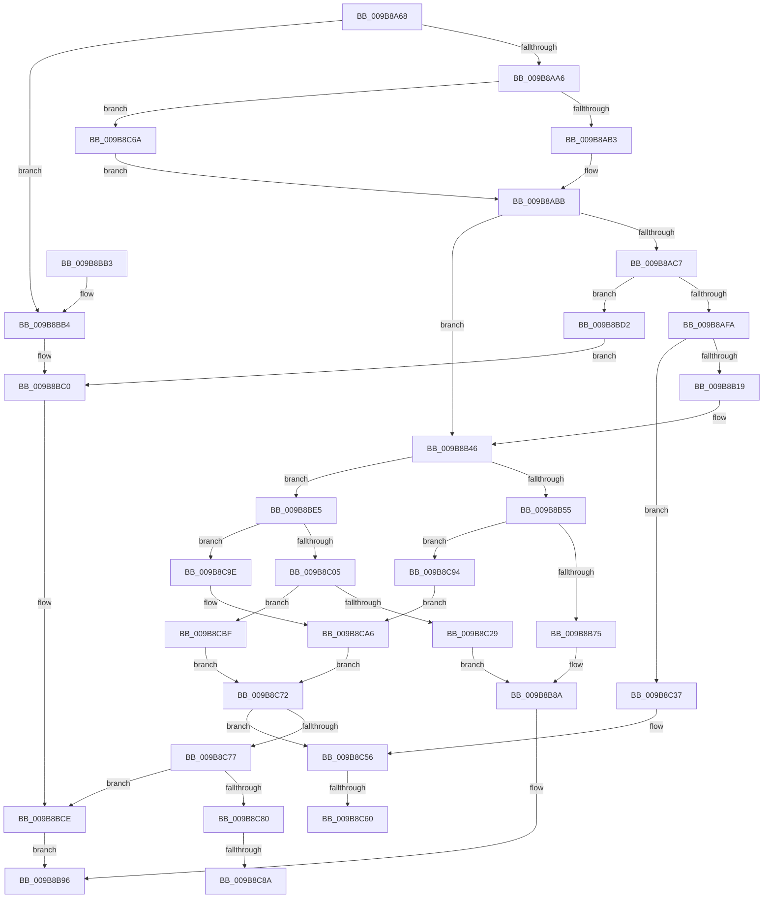

# HvpInitMap

- RVA: `0x009B8A68`–`0x009B8D05` (길이 `669` bytes)
- VA: `0x00000001409B8A68`
- 실행 섹션: `PAGE`
- PDB 이름 있음: `예`; PDB Function 태그: `예`
- unwind 정보 RVA: `0x0009E98C`
- 디코드: `173`개 명령, `669/669` bytes 표시
- 미해석 바이트: `0` (있으면 어셈블리에 `.byte`로 보존)

> 이 문서는 커널 이미지의 기계어와 PDB 기호를 분석해 생성했습니다. 4번과 5번은 함수 원형과 자료형을 바이너리 사용 방식에서 추정한 C 해석이며 원본 소스 복구 결과는 아닙니다.

## 1. Dependencies

- 직접 호출 지점: **15**; 고유 호출 대상: **5**
- 직접 호출자로 확인된 함수: **2**
- RIP 상대 이미지 참조: **0**

### Outgoing calls
- `0x009B8AE9` → [guard_dispatch_icall](../../text/6B/guard_dispatch_icall_function_006BAAD0.md) (function, `0x006BAAD0`)
- `0x009B8B06` → [guard_dispatch_icall](../../text/6B/guard_dispatch_icall_function_006BAAD0.md) (function, `0x006BAAD0`)
- `0x009B8B1F` → [memset](../../text/6C/memset_function_006C6C40.md) (function, `0x006C6C40`)
- `0x009B8B2C` → [memset](../../text/6C/memset_function_006C6C40.md) (function, `0x006C6C40`)
- `0x009B8B62` → [guard_dispatch_icall](../../text/6B/guard_dispatch_icall_function_006BAAD0.md) (function, `0x006BAAD0`)
- `0x009B8B7B` → [memset](../../text/6C/memset_function_006C6C40.md) (function, `0x006C6C40`)
- `0x009B8BC9` → [SetFailureLocation](../../text/46/SetFailureLocation_function_0046EF54.md) (function, `0x0046EF54`)
- `0x009B8BF2` → [guard_dispatch_icall](../../text/6B/guard_dispatch_icall_function_006BAAD0.md) (function, `0x006BAAD0`)
- `0x009B8C0B` → [memset](../../text/6C/memset_function_006C6C40.md) (function, `0x006C6C40`)
- `0x009B8C1C` → [HvpAllocateMap](HvpAllocateMap_function_009BA14C.md) (function, `0x009BA14C`)
- `0x009B8C51` → [SetFailureLocation](../../text/46/SetFailureLocation_function_0046EF54.md) (function, `0x0046EF54`)
- `0x009B8CB8` → [SetFailureLocation](../../text/46/SetFailureLocation_function_0046EF54.md) (function, `0x0046EF54`)
- `0x009B8CD9` → [SetFailureLocation](../../text/46/SetFailureLocation_function_0046EF54.md) (function, `0x0046EF54`)
- `0x009B8CEA` → [HvpFreeMap](../A6/HvpFreeMap_function_00A68674.md) (function, `0x00A68674`)
- `0x009B8CFB` → [guard_dispatch_icall](../../text/6B/guard_dispatch_icall_function_006BAAD0.md) (function, `0x006BAAD0`)

### Direct callers
- [HvpBuildMapForMemoryBackedHive](../7F/HvpBuildMapForMemoryBackedHive_function_007F3B4C.md) at `0x007F3B7C`
- [HvLoadHive](HvLoadHive_function_009B8138.md) at `0x009B8287`

### Static image references
- 디코드된 RIP-relative 메모리 참조가 없습니다.

## 2. Other-region calls and transfers

- 다른 실행 섹션으로 향하는 call: **13**
  - `0x009B8AE9` → [guard_dispatch_icall](../../text/6B/guard_dispatch_icall_function_006BAAD0.md) (`PAGE` → `.text`)
  - `0x009B8B06` → [guard_dispatch_icall](../../text/6B/guard_dispatch_icall_function_006BAAD0.md) (`PAGE` → `.text`)
  - `0x009B8B1F` → [memset](../../text/6C/memset_function_006C6C40.md) (`PAGE` → `.text`)
  - `0x009B8B2C` → [memset](../../text/6C/memset_function_006C6C40.md) (`PAGE` → `.text`)
  - `0x009B8B62` → [guard_dispatch_icall](../../text/6B/guard_dispatch_icall_function_006BAAD0.md) (`PAGE` → `.text`)
  - `0x009B8B7B` → [memset](../../text/6C/memset_function_006C6C40.md) (`PAGE` → `.text`)
  - `0x009B8BC9` → [SetFailureLocation](../../text/46/SetFailureLocation_function_0046EF54.md) (`PAGE` → `.text`)
  - `0x009B8BF2` → [guard_dispatch_icall](../../text/6B/guard_dispatch_icall_function_006BAAD0.md) (`PAGE` → `.text`)
  - `0x009B8C0B` → [memset](../../text/6C/memset_function_006C6C40.md) (`PAGE` → `.text`)
  - `0x009B8C51` → [SetFailureLocation](../../text/46/SetFailureLocation_function_0046EF54.md) (`PAGE` → `.text`)
  - `0x009B8CB8` → [SetFailureLocation](../../text/46/SetFailureLocation_function_0046EF54.md) (`PAGE` → `.text`)
  - `0x009B8CD9` → [SetFailureLocation](../../text/46/SetFailureLocation_function_0046EF54.md) (`PAGE` → `.text`)
  - `0x009B8CFB` → [guard_dispatch_icall](../../text/6B/guard_dispatch_icall_function_006BAAD0.md) (`PAGE` → `.text`)
- call이 아닌 외부 분기/꼬리 이동: **4**
  - `0x009B8C5A` → [sub_00B2E0C6](../B2/Unknown_function_00B2E0C6.md) (`tail-transfer`)
  - `0x009B8C65` → [sub_00B2E0C6](../B2/Unknown_function_00B2E0C6.md) (`tail-transfer`)
  - `0x009B8C84` → [sub_00B2E0C6 + 0x15](../B2/Unknown_function_00B2E0C6.md) (`tail-transfer`)
  - `0x009B8C8F` → [sub_00B2E0C6 + 0x15](../B2/Unknown_function_00B2E0C6.md) (`tail-transfer`)

## 3. Assembly (complete function range)

```asm
009B8A68  48 89 5C 24 08                  mov qword ptr [rsp + 8], rbx
009B8A6D  48 89 6C 24 10                  mov qword ptr [rsp + 0x10], rbp
009B8A72  48 89 74 24 18                  mov qword ptr [rsp + 0x18], rsi
009B8A77  57                              push rdi
009B8A78  41 54                           push r12
009B8A7A  41 55                           push r13
009B8A7C  41 56                           push r14
009B8A7E  41 57                           push r15
009B8A80  48 83 EC 30                     sub rsp, 0x30
009B8A84  48 8B 41 40                     mov rax, qword ptr [rcx + 0x40]
009B8A88  45 33 FF                        xor r15d, r15d
009B8A8B  4C 8B 61 38                     mov r12, qword ptr [rcx + 0x38]
009B8A8F  45 33 ED                        xor r13d, r13d
009B8A92  33 ED                           xor ebp, ebp
009B8A94  48 8B F9                        mov rdi, rcx
009B8A97  8B 70 28                        mov esi, dword ptr [rax + 0x28]
009B8A9A  F7 C6 FF 0F 00 00               test esi, 0xfff
009B8AA0  0F 85 0E 01 00 00               jne 0x1409b8bb4
009B8AA6  8B C6                           mov eax, esi
009B8AA8  C1 E8 0C                        shr eax, 0xc
009B8AAB  85 C0                           test eax, eax
009B8AAD  0F 84 B7 01 00 00               je 0x1409b8c6a
009B8AB3  44 8D 70 FF                     lea r14d, [rax - 1]
009B8AB7  41 C1 EE 09                     shr r14d, 9
009B8ABB  89 B1 18 01 00 00               mov dword ptr [rcx + 0x118], esi
009B8AC1  48 39 69 60                     cmp qword ptr [rcx + 0x60], rbp
009B8AC5  75 7F                           jne 0x1409b8b46
009B8AC7  44 8D 78 03                     lea r15d, [rax + 3]
009B8ACB  BB 43 4D 32 37                  mov ebx, 0x37324d43
009B8AD0  B8 04 00 00 00                  mov eax, 4
009B8AD5  41 83 E7 FC                     and r15d, 0xfffffffc
009B8AD9  44 8B C3                        mov r8d, ebx
009B8ADC  B2 01                           mov dl, 1
009B8ADE  44 0F 44 F8                     cmove r15d, eax
009B8AE2  48 8B 41 18                     mov rax, qword ptr [rcx + 0x18]
009B8AE6  41 8B CF                        mov ecx, r15d
009B8AE9  E8 E2 1F D0 FF                  call 0x1406baad0
009B8AEE  4C 8B E8                        mov r13, rax
009B8AF1  48 85 C0                        test rax, rax
009B8AF4  0F 84 D8 00 00 00               je 0x1409b8bd2
009B8AFA  48 8B 47 18                     mov rax, qword ptr [rdi + 0x18]
009B8AFE  44 8B C3                        mov r8d, ebx
009B8B01  B2 01                           mov dl, 1
009B8B03  41 8B CF                        mov ecx, r15d
009B8B06  E8 C5 1F D0 FF                  call 0x1406baad0
009B8B0B  33 D2                           xor edx, edx
009B8B0D  48 8B E8                        mov rbp, rax
009B8B10  48 85 C0                        test rax, rax
009B8B13  0F 84 1E 01 00 00               je 0x1409b8c37
009B8B19  45 8B C7                        mov r8d, r15d
009B8B1C  49 8B CD                        mov rcx, r13
009B8B1F  E8 1C E1 D0 FF                  call 0x1406c6c40
009B8B24  45 8B C7                        mov r8d, r15d
009B8B27  33 D2                           xor edx, edx
009B8B29  48 8B CD                        mov rcx, rbp
009B8B2C  E8 0F E1 D0 FF                  call 0x1406c6c40
009B8B31  4C 89 6F 60                     mov qword ptr [rdi + 0x60], r13
009B8B35  C1 EE 09                        shr esi, 9
009B8B38  89 77 58                        mov dword ptr [rdi + 0x58], esi
009B8B3B  89 77 70                        mov dword ptr [rdi + 0x70], esi
009B8B3E  48 89 6F 78                     mov qword ptr [rdi + 0x78], rbp
009B8B42  44 89 7F 6C                     mov dword ptr [rdi + 0x6c], r15d
009B8B46  48 8B 47 18                     mov rax, qword ptr [rdi + 0x18]
009B8B4A  33 D2                           xor edx, edx
009B8B4C  45 85 F6                        test r14d, r14d
009B8B4F  0F 85 90 00 00 00               jne 0x1409b8be5
009B8B55  BE 00 30 00 00                  mov esi, 0x3000
009B8B5A  41 B8 43 4D 32 36               mov r8d, 0x36324d43
009B8B60  8B CE                           mov ecx, esi
009B8B62  E8 69 1F D0 FF                  call 0x1406baad0
009B8B67  33 D2                           xor edx, edx
009B8B69  48 8B D8                        mov rbx, rax
009B8B6C  48 85 C0                        test rax, rax
009B8B6F  0F 84 1F 01 00 00               je 0x1409b8c94
009B8B75  44 8B C6                        mov r8d, esi
009B8B78  48 8B C8                        mov rcx, rax
009B8B7B  E8 C0 E0 D0 FF                  call 0x1406c6c40
009B8B80  48 8D 87 28 01 00 00            lea rax, [rdi + 0x128]
009B8B87  48 8B F0                        mov rsi, rax
009B8B8A  48 89 B7 20 01 00 00            mov qword ptr [rdi + 0x120], rsi
009B8B91  48 89 18                        mov qword ptr [rax], rbx
009B8B94  33 C0                           xor eax, eax
009B8B96  48 8B 5C 24 60                  mov rbx, qword ptr [rsp + 0x60]
009B8B9B  48 8B 6C 24 68                  mov rbp, qword ptr [rsp + 0x68]
009B8BA0  48 8B 74 24 70                  mov rsi, qword ptr [rsp + 0x70]
009B8BA5  48 83 C4 30                     add rsp, 0x30
009B8BA9  41 5F                           pop r15
009B8BAB  41 5E                           pop r14
009B8BAD  41 5D                           pop r13
009B8BAF  41 5C                           pop r12
009B8BB1  5F                              pop rdi
009B8BB2  C3                              ret
009B8BB3  CC                              int3
009B8BB4  21 6C 24 20                     and dword ptr [rsp + 0x20], ebp
009B8BB8  BB 4C 01 00 C0                  mov ebx, 0xc000014c
009B8BBD  44 8B CB                        mov r9d, ebx
009B8BC0  33 D2                           xor edx, edx
009B8BC2  49 8B CC                        mov rcx, r12
009B8BC5  44 8D 42 05                     lea r8d, [rdx + 5]
009B8BC9  E8 86 63 AB FF                  call 0x14046ef54
009B8BCE  8B C3                           mov eax, ebx
009B8BD0  EB C4                           jmp 0x1409b8b96
009B8BD2  41 B9 17 00 00 C0               mov r9d, 0xc0000017
009B8BD8  C7 44 24 20 10 00 00 00         mov dword ptr [rsp + 0x20], 0x10
009B8BE0  41 8B D9                        mov ebx, r9d
009B8BE3  EB DB                           jmp 0x1409b8bc0
009B8BE5  BB 00 20 00 00                  mov ebx, 0x2000
009B8BEA  41 B8 43 4D 32 38               mov r8d, 0x38324d43
009B8BF0  8B CB                           mov ecx, ebx
009B8BF2  E8 D9 1E D0 FF                  call 0x1406baad0
009B8BF7  33 D2                           xor edx, edx
009B8BF9  48 8B F0                        mov rsi, rax
009B8BFC  48 85 C0                        test rax, rax
009B8BFF  0F 84 99 00 00 00               je 0x1409b8c9e
009B8C05  44 8B C3                        mov r8d, ebx
009B8C08  48 8B C8                        mov rcx, rax
009B8C0B  E8 30 E0 D0 FF                  call 0x1406c6c40
009B8C10  45 8B CE                        mov r9d, r14d
009B8C13  45 33 C0                        xor r8d, r8d
009B8C16  48 8B D6                        mov rdx, rsi
009B8C19  48 8B CF                        mov rcx, rdi
009B8C1C  E8 2B 15 00 00                  call 0x1409ba14c
009B8C21  84 C0                           test al, al
009B8C23  0F 84 96 00 00 00               je 0x1409b8cbf
009B8C29  48 8D 87 28 01 00 00            lea rax, [rdi + 0x128]
009B8C30  33 DB                           xor ebx, ebx
009B8C32  E9 53 FF FF FF                  jmp 0x1409b8b8a
009B8C37  41 B9 17 00 00 C0               mov r9d, 0xc0000017
009B8C3D  C7 44 24 20 20 00 00 00         mov dword ptr [rsp + 0x20], 0x20
009B8C45  41 B8 05 00 00 00               mov r8d, 5
009B8C4B  49 8B CC                        mov rcx, r12
009B8C4E  41 8B D9                        mov ebx, r9d
009B8C51  E8 FE 62 AB FF                  call 0x14046ef54
009B8C56  4C 39 6F 60                     cmp qword ptr [rdi + 0x60], r13
009B8C5A  0F 85 66 54 17 00               jne 0x140b2e0c6
009B8C60  48 83 67 60 00                  and qword ptr [rdi + 0x60], 0
009B8C65  E9 5C 54 17 00                  jmp 0x140b2e0c6
009B8C6A  45 33 F6                        xor r14d, r14d
009B8C6D  E9 49 FE FF FF                  jmp 0x1409b8abb
009B8C72  4D 85 ED                        test r13, r13
009B8C75  75 DF                           jne 0x1409b8c56
009B8C77  48 85 ED                        test rbp, rbp
009B8C7A  0F 84 4E FF FF FF               je 0x1409b8bce
009B8C80  48 39 6F 78                     cmp qword ptr [rdi + 0x78], rbp
009B8C84  0F 85 51 54 17 00               jne 0x140b2e0db
009B8C8A  48 83 67 78 00                  and qword ptr [rdi + 0x78], 0
009B8C8F  E9 47 54 17 00                  jmp 0x140b2e0db
009B8C94  C7 44 24 20 20 00 00 00         mov dword ptr [rsp + 0x20], 0x20
009B8C9C  EB 08                           jmp 0x1409b8ca6
009B8C9E  C7 44 24 20 30 00 00 00         mov dword ptr [rsp + 0x20], 0x30
009B8CA6  41 B9 9A 00 00 C0               mov r9d, 0xc000009a
009B8CAC  41 B8 05 00 00 00               mov r8d, 5
009B8CB2  49 8B CC                        mov rcx, r12
009B8CB5  41 8B D9                        mov ebx, r9d
009B8CB8  E8 97 62 AB FF                  call 0x14046ef54
009B8CBD  EB B3                           jmp 0x1409b8c72
009B8CBF  33 D2                           xor edx, edx
009B8CC1  C7 44 24 20 40 00 00 00         mov dword ptr [rsp + 0x20], 0x40
009B8CC9  41 B9 9A 00 00 C0               mov r9d, 0xc000009a
009B8CCF  49 8B CC                        mov rcx, r12
009B8CD2  41 8B D9                        mov ebx, r9d
009B8CD5  44 8D 42 05                     lea r8d, [rdx + 5]
009B8CD9  E8 76 62 AB FF                  call 0x14046ef54
009B8CDE  45 8B CE                        mov r9d, r14d
009B8CE1  45 33 C0                        xor r8d, r8d
009B8CE4  48 8B D6                        mov rdx, rsi
009B8CE7  48 8B CF                        mov rcx, rdi
009B8CEA  E8 85 F9 0A 00                  call 0x140a68674
009B8CEF  48 8B 47 20                     mov rax, qword ptr [rdi + 0x20]
009B8CF3  BA 00 20 00 00                  mov edx, 0x2000
009B8CF8  48 8B CE                        mov rcx, rsi
009B8CFB  E8 D0 1D D0 FF                  call 0x1406baad0
009B8D00  E9 6D FF FF FF                  jmp 0x1409b8c72
```

## 4. C-style interpretation (structured pseudocode)

```c
__int64 __fastcall HvpInitMap(__int64 a1)
{
    __int64 result;
    __int64 v_r13;
    __int64 v_r14;
    __int64 v_r15;
    __int64 v_rbp;
    __int64 v_rbx;
    __int64 v_rsi;
    __int64 v_rsp;
    unsigned __int64 v_stack_p10;
    unsigned __int64 v_stack_p18;
    unsigned int v_stack_p20;
    unsigned __int64 v_stack_p8;

    v_stack_p8 = v_rbx;
    v_stack_p10 = v_rbp;
    v_stack_p18 = v_rsi;
    v_rsp = (v_rsp) - (48);
    v_r15 = 0;
    v_r13 = 0;
    v_rbp = 0;
    if ((((unsigned int)((unsigned int)(*(unsigned int *)(*(unsigned __int64 *)(a1 + 64) + 40)))) & (0xFFFULL)) != 0) goto loc_009B8BB4;
    result = (unsigned int)(((unsigned int)((unsigned int)((unsigned int)(*(unsigned int *)(*(unsigned __int64 *)(a1 + 64) + 40))))) >> (12));
    if ((unsigned int)(result) == 0) goto loc_009B8C6A;
    v_r14 = (unsigned int)((result - 1) >> (9));
loc_009B8ABB:
    *(unsigned int *)(a1 + 280) = (unsigned int)((unsigned int)(*(unsigned int *)(*(unsigned __int64 *)(a1 + 64) + 40)));
    if ((*(unsigned __int64 *)(a1 + 96)) != 0) goto loc_009B8B46;
    v_r15 = (unsigned int)((result + 3) & (0xFFFFFFFCULL));
    if (condition_is_equal) { v_r15 = 4; }
    result = guard_dispatch_icall((unsigned int)((unsigned int)(v_r15)), 1, (unsigned int)((unsigned int)((unsigned int)(0x37324D43ULL))), a4);
    if (result == 0) goto loc_009B8BD2;
    result = guard_dispatch_icall((unsigned int)((unsigned int)(v_r15)), 1, (unsigned int)((unsigned int)((unsigned int)(0x37324D43ULL))), a4);
    a2 = 0;
    if (result == 0) goto loc_009B8C37;
    result = memset(result, a2, (unsigned int)((unsigned int)(v_r15)), a4);
    a2 = 0;
    result = memset(result, a2, (unsigned int)((unsigned int)(v_r15)), a4);
    *(unsigned __int64 *)(a1 + 96) = result;
    v_rsi = (unsigned int)(((unsigned int)(*(unsigned int *)(*(unsigned __int64 *)(a1 + 64) + 40))) >> (9));
    *(unsigned int *)(a1 + 88) = (unsigned int)(v_rsi);
    *(unsigned int *)(a1 + 112) = (unsigned int)(v_rsi);
    *(unsigned __int64 *)(a1 + 120) = result;
    *(unsigned int *)(a1 + 108) = (unsigned int)(v_r15);
loc_009B8B46:
    a2 = 0;
    if ((unsigned int)(v_r14) != 0) goto loc_009B8BE5;
    result = guard_dispatch_icall((unsigned int)((unsigned int)((unsigned int)(0x3000ULL))), a2, (unsigned int)(0x36324D43ULL), a4);
    a2 = 0;
    if (result == 0) goto loc_009B8C94;
    result = memset(result, a2, (unsigned int)((unsigned int)((unsigned int)(0x3000ULL))), a4);
loc_009B8B8A:
    *(unsigned __int64 *)(a1 + 288) = a1 + 296;
    *(unsigned __int64 *)(a1 + 296) = result;
    result = 0;
loc_009B8B96:
    v_rsp = (v_rsp) + (48);
    return result;
loc_009B8BB4:
loc_009B8BC0:
    a2 = 0;
    result = SetFailureLocation(*(unsigned __int64 *)(a1 + 56), a2, a2 + 5, (unsigned int)((unsigned int)((unsigned int)(0xC000014CULL))));
loc_009B8BCE:
    goto loc_009B8B96;
loc_009B8BD2:
    v_stack_p20 = 16;
    goto loc_009B8BC0;
loc_009B8BE5:
    result = guard_dispatch_icall((unsigned int)((unsigned int)((unsigned int)(0x2000ULL))), a2, (unsigned int)(0x38324D43ULL), (unsigned int)(0xC0000017ULL));
    a2 = 0;
    if (result == 0) goto loc_009B8C9E;
    result = memset(result, a2, (unsigned int)((unsigned int)((unsigned int)(0x2000ULL))), (unsigned int)(0xC0000017ULL));
    a3 = 0;
    result = HvpAllocateMap(a1, result, a3, (unsigned int)((unsigned int)(v_r14)));
    if ((unsigned __int8)(result) == 0) goto loc_009B8CBF;
    v_rbx = 0;
    goto loc_009B8B8A;
loc_009B8C37:
    v_stack_p20 = 32;
    result = SetFailureLocation(*(unsigned __int64 *)(a1 + 56), result, 5, (unsigned int)(0xC0000017ULL));
loc_009B8C56:
loc_009B8C6A:
    v_r14 = 0;
    goto loc_009B8ABB;
loc_009B8C72:
    if (result != 0) goto loc_009B8C56;
    if (v_stack_p10 == 0) goto loc_009B8BCE;
loc_009B8C94:
    v_stack_p20 = 32;
    goto loc_009B8CA6;
loc_009B8C9E:
    v_stack_p20 = 48;
loc_009B8CA6:
    result = SetFailureLocation(*(unsigned __int64 *)(a1 + 56), result, 5, (unsigned int)(0xC000009AULL));
    goto loc_009B8C72;
loc_009B8CBF:
    a2 = 0;
    v_stack_p20 = 64;
    result = SetFailureLocation(*(unsigned __int64 *)(a1 + 56), a2, a2 + 5, (unsigned int)(0xC000009AULL));
    a3 = 0;
    result = HvpFreeMap(a1, result, a3, 0);
    result = guard_dispatch_icall(result, (unsigned int)(0x2000ULL), a3, 0);
    goto loc_009B8C72;
}
```

## 5. (Beta) C Style

```c
int64_t HvpInitMap(void *Arg1)
{
    uint8_t *arg1 = (uint8_t *)Arg1;

    int64_t result;
    int64_t local_r13;
    int64_t local_r14;
    int64_t local_r15;
    int64_t local_rbp;
    int64_t local_rbx;
    int64_t local_rsi;
    int64_t local_rsp;
    uint64_t v_stack_p10;
    uint64_t v_stack_p18;
    uint32_t v_stack_p20;
    uint64_t v_stack_p8;

    v_stack_p8 = local_rbx;
    v_stack_p10 = local_rbp;
    v_stack_p18 = local_rsi;
    local_rsp = (local_rsp) - (48);
    local_r15 = 0;
    local_r13 = 0;
    local_rbp = 0;
    if ((((uint32_t)((uint32_t)(*(uint32_t *)(*(uint64_t *)(arg1 + 0x40) + 0x28)))) & (0xFFFULL)) != 0) goto loc_009B8BB4;
    result = (uint32_t)(((uint32_t)((uint32_t)((uint32_t)(*(uint32_t *)(*(uint64_t *)(arg1 + 0x40) + 0x28))))) >> (12));
    if ((uint32_t)(result) == 0) goto loc_009B8C6A;
    local_r14 = (uint32_t)((result - 1) >> (9));
loc_009B8ABB:
    *(uint32_t *)(arg1 + 0x118) = (uint32_t)((uint32_t)(*(uint32_t *)(*(uint64_t *)(arg1 + 0x40) + 0x28)));
    if ((*(uint64_t *)(arg1 + 0x60)) != 0) goto loc_009B8B46;
    local_r15 = (uint32_t)((result + 3) & (0xFFFFFFFCULL));
    if (condition_is_equal) { local_r15 = 4; }
    result = guard_dispatch_icall((uint32_t)((uint32_t)(local_r15)), 1, (uint32_t)((uint32_t)((uint32_t)(0x37324D43ULL))), a4);
    if (result == 0) goto loc_009B8BD2;
    result = guard_dispatch_icall((uint32_t)((uint32_t)(local_r15)), 1, (uint32_t)((uint32_t)((uint32_t)(0x37324D43ULL))), a4);
    a2 = 0;
    if (result == 0) goto loc_009B8C37;
    result = memset(result, a2, (uint32_t)((uint32_t)(local_r15)), a4);
    a2 = 0;
    result = memset(result, a2, (uint32_t)((uint32_t)(local_r15)), a4);
    *(uint64_t *)(arg1 + 0x60) = result;
    local_rsi = (uint32_t)(((uint32_t)(*(uint32_t *)(*(uint64_t *)(arg1 + 0x40) + 0x28))) >> (9));
    *(uint32_t *)(arg1 + 0x58) = (uint32_t)(local_rsi);
    *(uint32_t *)(arg1 + 0x70) = (uint32_t)(local_rsi);
    *(uint64_t *)(arg1 + 0x78) = result;
    *(uint32_t *)(arg1 + 0x6C) = (uint32_t)(local_r15);
loc_009B8B46:
    a2 = 0;
    if ((uint32_t)(local_r14) != 0) goto loc_009B8BE5;
    result = guard_dispatch_icall((uint32_t)((uint32_t)((uint32_t)(0x3000ULL))), a2, (uint32_t)(0x36324D43ULL), a4);
    a2 = 0;
    if (result == 0) goto loc_009B8C94;
    result = memset(result, a2, (uint32_t)((uint32_t)((uint32_t)(0x3000ULL))), a4);
loc_009B8B8A:
    *(void **)(arg1 + 0x120) = Arg1 + 296;
    *(uint64_t *)(arg1 + 0x128) = result;
    result = 0;
loc_009B8B96:
    local_rsp = (local_rsp) + (48);
    return result;
loc_009B8BB4:
loc_009B8BC0:
    a2 = 0;
    result = SetFailureLocation(*(uint64_t *)(arg1 + 0x38), a2, a2 + 5, (uint32_t)((uint32_t)((uint32_t)(0xC000014CULL))));
loc_009B8BCE:
    goto loc_009B8B96;
loc_009B8BD2:
    v_stack_p20 = 16;
    goto loc_009B8BC0;
loc_009B8BE5:
    result = guard_dispatch_icall((uint32_t)((uint32_t)((uint32_t)(0x2000ULL))), a2, (uint32_t)(0x38324D43ULL), (uint32_t)(0xC0000017ULL));
    a2 = 0;
    if (result == 0) goto loc_009B8C9E;
    result = memset(result, a2, (uint32_t)((uint32_t)((uint32_t)(0x2000ULL))), (uint32_t)(0xC0000017ULL));
    a3 = 0;
    result = HvpAllocateMap(Arg1, result, a3, (uint32_t)((uint32_t)(local_r14)));
    if ((uint8_t)(result) == 0) goto loc_009B8CBF;
    local_rbx = 0;
    goto loc_009B8B8A;
loc_009B8C37:
    v_stack_p20 = 32;
    result = SetFailureLocation(*(uint64_t *)(arg1 + 0x38), result, 5, (uint32_t)(0xC0000017ULL));
loc_009B8C56:
loc_009B8C6A:
    local_r14 = 0;
    goto loc_009B8ABB;
loc_009B8C72:
    if (result != 0) goto loc_009B8C56;
    if (v_stack_p10 == 0) goto loc_009B8BCE;
loc_009B8C94:
    v_stack_p20 = 32;
    goto loc_009B8CA6;
loc_009B8C9E:
    v_stack_p20 = 48;
loc_009B8CA6:
    result = SetFailureLocation(*(uint64_t *)(arg1 + 0x38), result, 5, (uint32_t)(0xC000009AULL));
    goto loc_009B8C72;
loc_009B8CBF:
    a2 = 0;
    v_stack_p20 = 64;
    result = SetFailureLocation(*(uint64_t *)(arg1 + 0x38), a2, a2 + 5, (uint32_t)(0xC000009AULL));
    a3 = 0;
    result = HvpFreeMap(Arg1, result, a3, 0);
    result = guard_dispatch_icall(result, (uint32_t)(0x2000ULL), a3, 0);
    goto loc_009B8C72;
}
```

### 관측된 메모리 오프셋

구조체 형식이 확인되지 않은 접근은 인자 기준의 오프셋으로만 기록했습니다.

| 기준 인자 | 오프셋 표현 | 폭 (bit) | 접근 |
|---|---:|---:|---|
| `Arg1` | `+ 0x0` | `64` | `W` |
| `Arg1` | `+ 0x18` | `64` | `R` |
| `Arg1` | `+ 0x20` | `64` | `R` |
| `Arg1` | `+ 0x38` | `64` | `R` |
| `Arg1` | `+ 0x40` | `64` | `R` |
| `Arg1` | `+ 0x58` | `32` | `W` |
| `Arg1` | `+ 0x60` | `64` | `R` |
| `Arg1` | `+ 0x60` | `64` | `R/W` |
| `Arg1` | `+ 0x60` | `64` | `W` |
| `Arg1` | `+ 0x6C` | `32` | `W` |
| `Arg1` | `+ 0x70` | `32` | `W` |
| `Arg1` | `+ 0x78` | `64` | `R` |
| `Arg1` | `+ 0x78` | `64` | `R/W` |
| `Arg1` | `+ 0x78` | `64` | `W` |
| `Arg1` | `+ 0x118` | `32` | `W` |
| `Arg1` | `+ 0x120` | `64` | `W` |
| `Arg1` | `+ 0x128` | `64` | `R` |

## 6. Execution-region graph

[열기: 2D/3D 그래프와 함수 탐색 컨트롤 패널](../../../control-panel.html?section=page&rva=0x009B8A68&view=graph)

- 2D 그래프는 위에서 아래로 흐르고, 3D 그래프는 빈 공간을 드래그해 회전합니다. Shift+드래그는 이동, 휠은 확대·축소, 함수 노드 선택은 대상 보고서 이동입니다.

### Static fallback


