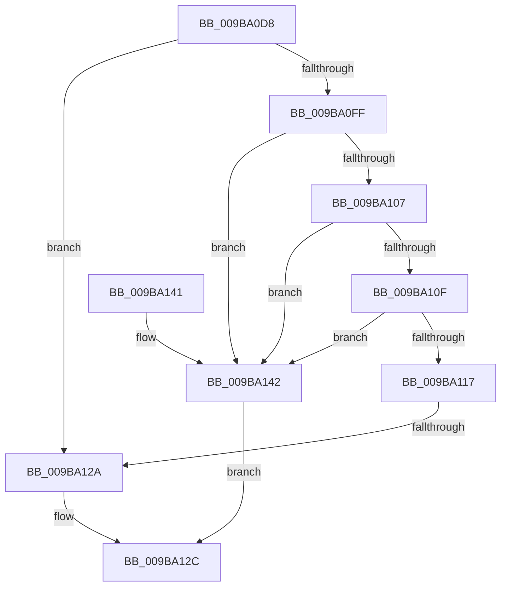

# HvpIsReadErrorTransient

- RVA: `0x009BA0D8`–`0x009BA146` (길이 `110` bytes)
- VA: `0x00000001409BA0D8`
- 실행 섹션: `PAGE`
- PDB 이름 있음: `예`; PDB Function 태그: `예`
- unwind 정보 RVA: `0x0009EAC4`
- 디코드: `28`개 명령, `110/110` bytes 표시
- 미해석 바이트: `0` (있으면 어셈블리에 `.byte`로 보존)

> 이 문서는 커널 이미지의 기계어와 PDB 기호를 분석해 생성했습니다. 4번과 5번은 함수 원형과 자료형을 바이너리 사용 방식에서 추정한 C 해석이며 원본 소스 복구 결과는 아닙니다.

## 1. Dependencies

- 직접 호출 지점: **1**; 고유 호출 대상: **1**
- 직접 호출자로 확인된 함수: **1**
- RIP 상대 이미지 참조: **2**

### Outgoing calls
- `0x009BA133` → [_security_check_cookie](../../text/6A/_security_check_cookie_function_006AC640.md) (function, `0x006AC640`)

### Direct callers
- [HvAnalyzeLogFiles](HvAnalyzeLogFiles_function_009B9A9C.md) at `0x009B9B52`

### Static image references
- `0x009BA0E6` → RVA `0x00E0A740` (`.data`; read)
- `0x009BA11D` → RVA `0x00E09F58` (`.data`; read)

## 2. Other-region calls and transfers

- 다른 실행 섹션으로 향하는 call: **1**
  - `0x009BA133` → [_security_check_cookie](../../text/6A/_security_check_cookie_function_006AC640.md) (`PAGE` → `.text`)
- call이 아닌 외부 분기/꼬리 이동: **1**
  - `0x009BA124` → [sub_00B2E53E](../B2/Unknown_function_00B2E53E.md) (`tail-transfer`)

## 3. Assembly (complete function range)

```asm
009BA0D8  40 55                           push rbp
009BA0DA  48 8D 6C 24 A9                  lea rbp, [rsp - 0x57]
009BA0DF  48 81 EC B0 00 00 00            sub rsp, 0xb0
009BA0E6  48 8B 05 53 06 45 00            mov rax, qword ptr [rip + 0x450653]
009BA0ED  48 33 C4                        xor rax, rsp
009BA0F0  48 89 45 47                     mov qword ptr [rbp + 0x47], rax
009BA0F4  44 8B C1                        mov r8d, ecx
009BA0F7  81 F9 11 00 00 C0               cmp ecx, 0xc0000011
009BA0FD  74 2B                           je 0x1409ba12a
009BA0FF  81 F9 17 00 00 C0               cmp ecx, 0xc0000017
009BA105  74 3B                           je 0x1409ba142
009BA107  81 F9 9A 00 00 C0               cmp ecx, 0xc000009a
009BA10D  74 33                           je 0x1409ba142
009BA10F  81 F9 A1 00 00 C0               cmp ecx, 0xc00000a1
009BA115  74 2B                           je 0x1409ba142
009BA117  41 B9 05 00 00 00               mov r9d, 5
009BA11D  44 39 0D 34 FE 44 00            cmp dword ptr [rip + 0x44fe34], r9d
009BA124  0F 87 14 44 17 00               ja 0x140b2e53e
009BA12A  32 C0                           xor al, al
009BA12C  48 8B 4D 47                     mov rcx, qword ptr [rbp + 0x47]
009BA130  48 33 CC                        xor rcx, rsp
009BA133  E8 08 25 CF FF                  call 0x1406ac640
009BA138  48 81 C4 B0 00 00 00            add rsp, 0xb0
009BA13F  5D                              pop rbp
009BA140  C3                              ret
009BA141  CC                              int3
009BA142  B0 01                           mov al, 1
009BA144  EB E6                           jmp 0x1409ba12c
```

## 4. C-style interpretation (structured pseudocode)

```c
__int64 __fastcall HvpIsReadErrorTransient(int a1)
{
    __int64 result;
    __int64 v_rsp;
    unsigned __int64 v_stack_m18;
    unsigned __int64 v_stack_m5F;

    v_rsp = (v_rsp) - (176);
    result = (*(unsigned __int64 *)(v_rip + 4523603)) ^ (v_rsp);
    v_stack_m18 = result;
    if (a1 == 0xC0000011ULL) goto loc_009BA12A;
    if (a1 == 0xC0000017ULL) goto loc_009BA142;
    if (a1 == 0xC000009AULL) goto loc_009BA142;
    if (a1 == 0xC00000A1ULL) goto loc_009BA142;
loc_009BA12A:
    result = 0;
loc_009BA12C:
    a1 = (v_stack_m18) ^ (v_rsp);
    result = _security_check_cookie(a1, a2, (unsigned int)(a1), 5);
    v_rsp = (v_rsp) + (176);
    return result;
loc_009BA142:
    goto loc_009BA12C;
}
```

## 5. (Beta) C Style

```c
int64_t HvpIsReadErrorTransient(int32_t Arg1)
{
    int64_t result;
    int64_t local_rsp;
    uint64_t v_stack_m18;
    uint64_t v_stack_m5F;

    local_rsp = (local_rsp) - (176);
    result = (*(uint64_t *)(v_rip + 0x450653)) ^ (local_rsp);
    v_stack_m18 = result;
    if (Arg1 == 0xC0000011ULL) goto loc_009BA12A;
    if (Arg1 == 0xC0000017ULL) goto loc_009BA142;
    if (Arg1 == 0xC000009AULL) goto loc_009BA142;
    if (Arg1 == 0xC00000A1ULL) goto loc_009BA142;
loc_009BA12A:
    result = 0;
loc_009BA12C:
    Arg1 = (v_stack_m18) ^ (local_rsp);
    result = _security_check_cookie(Arg1, a2, (uint32_t)(Arg1), 5);
    local_rsp = (local_rsp) + (176);
    return result;
loc_009BA142:
    goto loc_009BA12C;
}
```

## 6. Execution-region graph

[열기: 2D/3D 그래프와 함수 탐색 컨트롤 패널](../../../control-panel.html?section=page&rva=0x009BA0D8&view=graph)

- 2D 그래프는 위에서 아래로 흐르고, 3D 그래프는 빈 공간을 드래그해 회전합니다. Shift+드래그는 이동, 휠은 확대·축소, 함수 노드 선택은 대상 보고서 이동입니다.

### Static fallback


