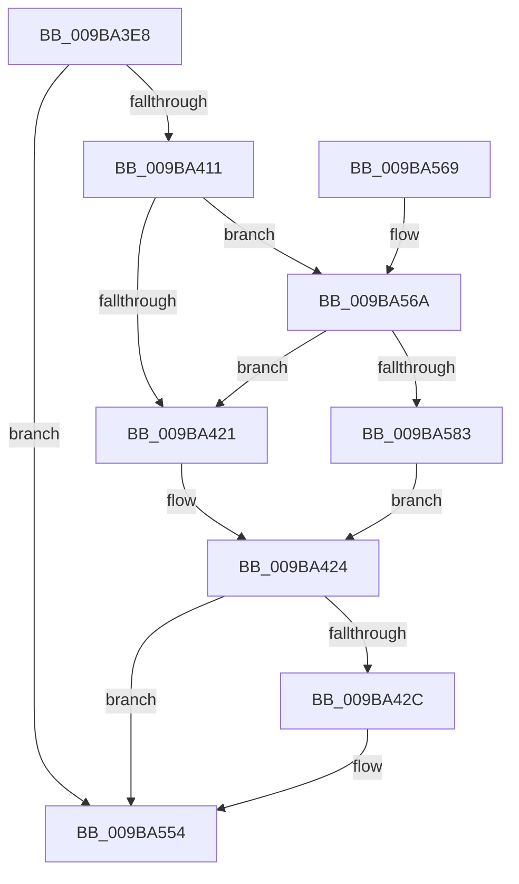

# HvpLogInvalidLogHeader

- RVA: `0x009BA3E8`–`0x009BA588` (길이 `416` bytes)
- VA: `0x00000001409BA3E8`
- 실행 섹션: `PAGE`
- PDB 이름 있음: `예`; PDB Function 태그: `아니요`
- unwind 정보 RVA: `0x0009EB18`
- 디코드: `85`개 명령, `416/416` bytes 표시
- 미해석 바이트: `0` (있으면 어셈블리에 `.byte`로 보존)

> 이 문서는 커널 이미지의 기계어와 PDB 기호를 분석해 생성했습니다. 4번과 5번은 함수 원형과 자료형을 바이너리 사용 방식에서 추정한 C 해석이며 원본 소스 복구 결과는 아닙니다.

## 1. Dependencies

- 직접 호출 지점: **3**; 고유 호출 대상: **3**
- 직접 호출자로 확인된 함수: **1**
- RIP 상대 이미지 참조: **5**

### Outgoing calls
- `0x009BA50F` → [HvpHeaderCheckSum](../../pagecmrc/BC/HvpHeaderCheckSum_function_00BC97A0.md) (function, `0x00BC97A0`)
- `0x009BA54F` → [tlgWriteTransfer_EtwWriteTransfer](../../text/42/tlgWriteTransfer_EtwWriteTransfer_function_004260E0.md) (function, `0x004260E0`)
- `0x009BA55B` → [_security_check_cookie](../../text/6A/_security_check_cookie_function_006AC640.md) (function, `0x006AC640`)

### Direct callers
- [HvAnalyzeLogFiles](HvAnalyzeLogFiles_function_009B9A9C.md) at `0x009B9D36`

### Static image references
- `0x009BA3F6` → RVA `0x00E0A740` (`.data`; read)
- `0x009BA404` → RVA `0x00E09F58` (`.data`; read)
- `0x009BA414` → RVA `0x00E09F68` (`.data`; read)
- `0x009BA518` → RVA `0x0005779B` (`.rdata`; read)
- `0x009BA56A` → RVA `0x00E09F70` (`.data`; read)

## 2. Other-region calls and transfers

- 다른 실행 섹션으로 향하는 call: **3**
  - `0x009BA50F` → [HvpHeaderCheckSum](../../pagecmrc/BC/HvpHeaderCheckSum_function_00BC97A0.md) (`PAGE` → `PAGECMRC`)
  - `0x009BA54F` → [tlgWriteTransfer_EtwWriteTransfer](../../text/42/tlgWriteTransfer_EtwWriteTransfer_function_004260E0.md) (`PAGE` → `.text`)
  - `0x009BA55B` → [_security_check_cookie](../../text/6A/_security_check_cookie_function_006AC640.md) (`PAGE` → `.text`)
- 별도 외부 분기/꼬리 이동을 확인하지 못했습니다.

## 3. Assembly (complete function range)

```asm
009BA3E8  40 55                           push rbp
009BA3EA  48 8D 6C 24 D0                  lea rbp, [rsp - 0x30]
009BA3EF  48 81 EC 30 01 00 00            sub rsp, 0x130
009BA3F6  48 8B 05 43 03 45 00            mov rax, qword ptr [rip + 0x450343]
009BA3FD  48 33 C4                        xor rax, rsp
009BA400  48 89 45 20                     mov qword ptr [rbp + 0x20], rax
009BA404  83 3D 4D FB 44 00 05            cmp dword ptr [rip + 0x44fb4d], 5
009BA40B  0F 86 43 01 00 00               jbe 0x1409ba554
009BA411  45 33 DB                        xor r11d, r11d
009BA414  F6 05 4D FB 44 00 08            test byte ptr [rip + 0x44fb4d], 8
009BA41B  0F 85 49 01 00 00               jne 0x1409ba56a
009BA421  41 8A C3                        mov al, r11b
009BA424  84 C0                           test al, al
009BA426  0F 84 28 01 00 00               je 0x1409ba554
009BA42C  48 8D 44 24 30                  lea rax, [rsp + 0x30]
009BA431  88 54 24 30                     mov byte ptr [rsp + 0x30], dl
009BA435  48 89 45 80                     mov qword ptr [rbp - 0x80], rax
009BA439  41 8B 00                        mov eax, dword ptr [r8]
009BA43C  89 44 24 34                     mov dword ptr [rsp + 0x34], eax
009BA440  48 8D 44 24 34                  lea rax, [rsp + 0x34]
009BA445  48 89 45 90                     mov qword ptr [rbp - 0x70], rax
009BA449  41 8B 40 04                     mov eax, dword ptr [r8 + 4]
009BA44D  89 44 24 38                     mov dword ptr [rsp + 0x38], eax
009BA451  48 8D 44 24 38                  lea rax, [rsp + 0x38]
009BA456  48 89 45 A0                     mov qword ptr [rbp - 0x60], rax
009BA45A  41 8B 40 08                     mov eax, dword ptr [r8 + 8]
009BA45E  89 44 24 3C                     mov dword ptr [rsp + 0x3c], eax
009BA462  48 8D 44 24 3C                  lea rax, [rsp + 0x3c]
009BA467  48 89 45 B0                     mov qword ptr [rbp - 0x50], rax
009BA46B  49 8B 40 0C                     mov rax, qword ptr [r8 + 0xc]
009BA46F  48 89 44 24 50                  mov qword ptr [rsp + 0x50], rax
009BA474  48 8D 44 24 50                  lea rax, [rsp + 0x50]
009BA479  48 89 45 C0                     mov qword ptr [rbp - 0x40], rax
009BA47D  48 8B 01                        mov rax, qword ptr [rcx]
009BA480  49 8B C8                        mov rcx, r8
009BA483  48 89 44 24 58                  mov qword ptr [rsp + 0x58], rax
009BA488  48 8D 44 24 58                  lea rax, [rsp + 0x58]
009BA48D  48 89 45 D0                     mov qword ptr [rbp - 0x30], rax
009BA491  41 8B 40 1C                     mov eax, dword ptr [r8 + 0x1c]
009BA495  89 44 24 40                     mov dword ptr [rsp + 0x40], eax
009BA499  48 8D 44 24 40                  lea rax, [rsp + 0x40]
009BA49E  48 89 45 E0                     mov qword ptr [rbp - 0x20], rax
009BA4A2  41 8B 40 28                     mov eax, dword ptr [r8 + 0x28]
009BA4A6  89 44 24 44                     mov dword ptr [rsp + 0x44], eax
009BA4AA  48 8D 44 24 44                  lea rax, [rsp + 0x44]
009BA4AF  48 89 45 F0                     mov qword ptr [rbp - 0x10], rax
009BA4B3  41 8B 80 FC 01 00 00            mov eax, dword ptr [r8 + 0x1fc]
009BA4BA  89 44 24 48                     mov dword ptr [rsp + 0x48], eax
009BA4BE  48 8D 44 24 48                  lea rax, [rsp + 0x48]
009BA4C3  48 89 45 00                     mov qword ptr [rbp], rax
009BA4C7  48 C7 45 88 01 00 00 00         mov qword ptr [rbp - 0x78], 1
009BA4CF  48 C7 45 98 04 00 00 00         mov qword ptr [rbp - 0x68], 4
009BA4D7  48 C7 45 A8 04 00 00 00         mov qword ptr [rbp - 0x58], 4
009BA4DF  48 C7 45 B8 04 00 00 00         mov qword ptr [rbp - 0x48], 4
009BA4E7  48 C7 45 C8 08 00 00 00         mov qword ptr [rbp - 0x38], 8
009BA4EF  48 C7 45 D8 08 00 00 00         mov qword ptr [rbp - 0x28], 8
009BA4F7  48 C7 45 E8 04 00 00 00         mov qword ptr [rbp - 0x18], 4
009BA4FF  48 C7 45 F8 04 00 00 00         mov qword ptr [rbp - 8], 4
009BA507  48 C7 45 08 04 00 00 00         mov qword ptr [rbp + 8], 4
009BA50F  E8 8C F2 20 00                  call 0x140bc97a0
009BA514  89 44 24 4C                     mov dword ptr [rsp + 0x4c], eax
009BA518  48 8D 15 7C D2 69 FF            lea rdx, [rip - 0x962d84]
009BA51F  48 8D 44 24 4C                  lea rax, [rsp + 0x4c]
009BA524  48 C7 45 18 04 00 00 00         mov qword ptr [rbp + 0x18], 4
009BA52C  48 89 45 10                     mov qword ptr [rbp + 0x10], rax
009BA530  48 8D 0D 21 FA 44 00            lea rcx, [rip + 0x44fa21]
009BA537  48 8D 44 24 60                  lea rax, [rsp + 0x60]
009BA53C  45 33 C9                        xor r9d, r9d
009BA53F  48 89 44 24 28                  mov qword ptr [rsp + 0x28], rax
009BA544  45 33 C0                        xor r8d, r8d
009BA547  C7 44 24 20 0C 00 00 00         mov dword ptr [rsp + 0x20], 0xc
009BA54F  E8 8C BB A6 FF                  call 0x1404260e0
009BA554  48 8B 4D 20                     mov rcx, qword ptr [rbp + 0x20]
009BA558  48 33 CC                        xor rcx, rsp
009BA55B  E8 E0 20 CF FF                  call 0x1406ac640
009BA560  48 81 C4 30 01 00 00            add rsp, 0x130
009BA567  5D                              pop rbp
009BA568  C3                              ret
009BA569  CC                              int3
009BA56A  48 8B 05 FF F9 44 00            mov rax, qword ptr [rip + 0x44f9ff]
009BA571  83 E0 08                        and eax, 8
009BA574  48 3B 05 F5 F9 44 00            cmp rax, qword ptr [rip + 0x44f9f5]
009BA57B  B0 01                           mov al, 1
009BA57D  0F 85 9E FE FF FF               jne 0x1409ba421
009BA583  E9 9C FE FF FF                  jmp 0x1409ba424
```

## 4. C-style interpretation (structured pseudocode)

```c
__int64 __fastcall HvpLogInvalidLogHeader(__int64 a1, unsigned __int8 a2, __int64 a3, int a4)
{
    __int64 result;
    __int64 v_r11;
    __int64 v_rsp;
    unsigned int v_stack_m100;
    unsigned int v_stack_m104;
    unsigned __int64 v_stack_m108;
    unsigned __int64 v_stack_m110;
    unsigned int v_stack_m118;
    unsigned __int64 v_stack_m18;
    unsigned __int64 v_stack_m20;
    unsigned __int64 v_stack_m28;
    unsigned __int64 v_stack_m30;
    unsigned __int64 v_stack_m38;
    unsigned __int64 v_stack_m40;
    unsigned __int64 v_stack_m48;
    unsigned __int64 v_stack_m50;
    unsigned __int64 v_stack_m58;
    unsigned __int64 v_stack_m60;
    unsigned __int64 v_stack_m68;
    unsigned __int64 v_stack_m70;
    unsigned __int64 v_stack_m78;
    unsigned __int64 v_stack_m80;
    unsigned __int64 v_stack_m88;
    unsigned __int64 v_stack_m90;
    unsigned __int64 v_stack_m98;
    unsigned __int64 v_stack_mA0;
    unsigned __int64 v_stack_mA8;
    unsigned __int64 v_stack_mB0;
    unsigned __int64 v_stack_mB8;
    unsigned __int64 v_stack_mD8;
    unsigned __int64 v_stack_mE0;
    unsigned __int64 v_stack_mE8;
    unsigned int v_stack_mEC;
    unsigned int v_stack_mF0;
    unsigned int v_stack_mF4;
    unsigned int v_stack_mF8;
    unsigned int v_stack_mFC;

    v_rsp = (v_rsp) - (304);
    result = (*(unsigned __int64 *)(v_rip + 4522819)) ^ (v_rsp);
    v_stack_m18 = result;
    if ((*(unsigned int *)(v_rip + 4520781)) <= 5) goto loc_009BA554;
    v_r11 = 0;
    if (((*(unsigned __int8 *)(v_rip + 4520781)) & (8)) != 0) goto loc_009BA56A;
loc_009BA421:
loc_009BA424:
    result = 0;
    if (0 != 0) {
        result = v_stack_m108;
        v_stack_m108 = a2;
        v_stack_mB8 = result;
        result = *(unsigned int *)(a3);
        v_stack_m104 = (unsigned int)(result);
        result = v_stack_m104;
        v_stack_mA8 = result;
        result = *(unsigned int *)(a3 + 4);
        v_stack_m100 = (unsigned int)(result);
        result = v_stack_m100;
        v_stack_m98 = result;
        result = *(unsigned int *)(a3 + 8);
        v_stack_mFC = (unsigned int)(result);
        result = v_stack_mFC;
        v_stack_m88 = result;
        result = *(unsigned __int64 *)(a3 + 12);
        v_stack_mE8 = result;
        result = v_stack_mE8;
        v_stack_m78 = result;
        result = *(unsigned __int64 *)(a1);
        a1 = a3;
        v_stack_mE0 = result;
        result = v_stack_mE0;
        v_stack_m68 = result;
        result = *(unsigned int *)(a3 + 28);
        v_stack_mF8 = (unsigned int)(result);
        result = v_stack_mF8;
        v_stack_m58 = result;
        result = *(unsigned int *)(a3 + 40);
        v_stack_mF4 = (unsigned int)(result);
        result = v_stack_mF4;
        v_stack_m48 = result;
        result = *(unsigned int *)(a3 + 508);
        v_stack_mF0 = (unsigned int)(result);
        result = v_stack_mF0;
        v_stack_m38 = result;
        v_stack_mB0 = 1;
        v_stack_mA0 = 4;
        v_stack_m90 = 4;
        v_stack_m80 = 4;
        v_stack_m70 = 8;
        v_stack_m60 = 8;
        v_stack_m50 = 4;
        v_stack_m40 = 4;
        v_stack_m30 = 4;
        result = HvpHeaderCheckSum(a1, a2, a3, a4);
        v_stack_mEC = (unsigned int)(result);
        a2 = v_rip - 9842052;
        result = v_stack_mEC;
        v_stack_m20 = 4;
        v_stack_m28 = result;
        a1 = v_rip + 4520481;
        result = v_stack_mD8;
        a4 = 0;
        v_stack_m110 = result;
        a3 = 0;
        v_stack_m118 = 12;
        result = tlgWriteTransfer_EtwWriteTransfer(a1, a2, a3, a4);
    }
    a1 = (v_stack_m18) ^ (v_rsp);
    result = _security_check_cookie(a1, a2, a3, a4);
    v_rsp = (v_rsp) + (304);
    return result;
loc_009BA56A:
    result = (unsigned int)((*(unsigned __int64 *)(v_rip + 4520447)) & (8));
    if (result != (*(unsigned __int64 *)(v_rip + 4520437))) goto loc_009BA421;
    goto loc_009BA424;
}
```

## 5. (Beta) C Style

```c
int64_t HvpLogInvalidLogHeader(void *Arg1, uint8_t Arg2, void *Arg3, int32_t Arg4)
{
    uint8_t *arg1 = (uint8_t *)Arg1;
    uint8_t *arg3 = (uint8_t *)Arg3;

    int64_t result;
    int64_t local_r11;
    int64_t local_rsp;
    uint32_t v_stack_m100;
    uint32_t v_stack_m104;
    uint64_t v_stack_m108;
    uint64_t v_stack_m110;
    uint32_t v_stack_m118;
    uint64_t v_stack_m18;
    uint64_t v_stack_m20;
    uint64_t v_stack_m28;
    uint64_t v_stack_m30;
    uint64_t v_stack_m38;
    uint64_t v_stack_m40;
    uint64_t v_stack_m48;
    uint64_t v_stack_m50;
    uint64_t v_stack_m58;
    uint64_t v_stack_m60;
    uint64_t v_stack_m68;
    uint64_t v_stack_m70;
    uint64_t v_stack_m78;
    uint64_t v_stack_m80;
    uint64_t v_stack_m88;
    uint64_t v_stack_m90;
    uint64_t v_stack_m98;
    uint64_t v_stack_mA0;
    uint64_t v_stack_mA8;
    uint64_t v_stack_mB0;
    uint64_t v_stack_mB8;
    uint64_t v_stack_mD8;
    uint64_t v_stack_mE0;
    uint64_t v_stack_mE8;
    uint32_t v_stack_mEC;
    uint32_t v_stack_mF0;
    uint32_t v_stack_mF4;
    uint32_t v_stack_mF8;
    uint32_t v_stack_mFC;

    local_rsp = (local_rsp) - (304);
    result = (*(uint64_t *)(v_rip + 0x450343)) ^ (local_rsp);
    v_stack_m18 = result;
    if ((*(uint32_t *)(v_rip + 0x44FB4D)) <= 5) goto loc_009BA554;
    local_r11 = 0;
    if (((*(uint8_t *)(v_rip + 0x44FB4D)) & (8)) != 0) goto loc_009BA56A;
loc_009BA421:
loc_009BA424:
    result = 0;
    if (0 != 0) {
        result = v_stack_m108;
        v_stack_m108 = Arg2;
        v_stack_mB8 = result;
        result = *(uint32_t *)(arg3);
        v_stack_m104 = (uint32_t)(result);
        result = v_stack_m104;
        v_stack_mA8 = result;
        result = *(uint32_t *)(arg3 + 0x4);
        v_stack_m100 = (uint32_t)(result);
        result = v_stack_m100;
        v_stack_m98 = result;
        result = *(uint32_t *)(arg3 + 0x8);
        v_stack_mFC = (uint32_t)(result);
        result = v_stack_mFC;
        v_stack_m88 = result;
        result = *(uint64_t *)(arg3 + 0xC);
        v_stack_mE8 = result;
        result = v_stack_mE8;
        v_stack_m78 = result;
        result = *(uint64_t *)(arg1);
        Arg1 = Arg3;
        v_stack_mE0 = result;
        result = v_stack_mE0;
        v_stack_m68 = result;
        result = *(uint32_t *)(arg3 + 0x1C);
        v_stack_mF8 = (uint32_t)(result);
        result = v_stack_mF8;
        v_stack_m58 = result;
        result = *(uint32_t *)(arg3 + 0x28);
        v_stack_mF4 = (uint32_t)(result);
        result = v_stack_mF4;
        v_stack_m48 = result;
        result = *(uint32_t *)(arg3 + 0x1FC);
        v_stack_mF0 = (uint32_t)(result);
        result = v_stack_mF0;
        v_stack_m38 = result;
        v_stack_mB0 = 1;
        v_stack_mA0 = 4;
        v_stack_m90 = 4;
        v_stack_m80 = 4;
        v_stack_m70 = 8;
        v_stack_m60 = 8;
        v_stack_m50 = 4;
        v_stack_m40 = 4;
        v_stack_m30 = 4;
        result = HvpHeaderCheckSum(Arg1, Arg2, Arg3, Arg4);
        v_stack_mEC = (uint32_t)(result);
        Arg2 = v_rip - 9842052;
        result = v_stack_mEC;
        v_stack_m20 = 4;
        v_stack_m28 = result;
        Arg1 = v_rip + 4520481;
        result = v_stack_mD8;
        Arg4 = 0;
        v_stack_m110 = result;
        Arg3 = 0;
        v_stack_m118 = 12;
        result = tlgWriteTransfer_EtwWriteTransfer(Arg1, Arg2, Arg3, Arg4);
    }
    Arg1 = (v_stack_m18) ^ (local_rsp);
    result = _security_check_cookie(Arg1, Arg2, Arg3, Arg4);
    local_rsp = (local_rsp) + (304);
    return result;
loc_009BA56A:
    result = (uint32_t)((*(uint64_t *)(v_rip + 0x44F9FF)) & (8));
    if (result != (*(uint64_t *)(v_rip + 0x44F9F5))) goto loc_009BA421;
    goto loc_009BA424;
}
```

### 관측된 메모리 오프셋

구조체 형식이 확인되지 않은 접근은 인자 기준의 오프셋으로만 기록했습니다.

| 기준 인자 | 오프셋 표현 | 폭 (bit) | 접근 |
|---|---:|---:|---|
| `Arg1` | `+ 0x0` | `64` | `R` |
| `Arg3` | `+ 0x0` | `32` | `R` |
| `Arg3` | `+ 0x4` | `32` | `R` |
| `Arg3` | `+ 0x8` | `32` | `R` |
| `Arg3` | `+ 0xC` | `64` | `R` |
| `Arg3` | `+ 0x1C` | `32` | `R` |
| `Arg3` | `+ 0x28` | `32` | `R` |
| `Arg3` | `+ 0x1FC` | `32` | `R` |

## 6. Execution-region graph

[열기: 2D/3D 그래프와 함수 탐색 컨트롤 패널](../../../control-panel.html?section=page&rva=0x009BA3E8&view=graph)

- 2D 그래프는 위에서 아래로 흐르고, 3D 그래프는 빈 공간을 드래그해 회전합니다. Shift+드래그는 이동, 휠은 확대·축소, 함수 노드 선택은 대상 보고서 이동입니다.

### Static fallback


