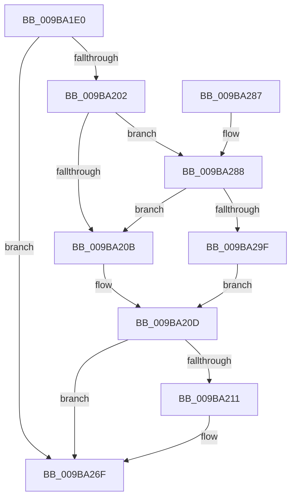

# HvpLogUnreadableLog

- RVA: `0x009BA1E0`–`0x009BA2A6` (길이 `198` bytes)
- VA: `0x00000001409BA1E0`
- 실행 섹션: `PAGE`
- PDB 이름 있음: `예`; PDB Function 태그: `아니요`
- unwind 정보 RVA: `0x0009EAEC`
- 디코드: `42`개 명령, `198/198` bytes 표시
- 미해석 바이트: `0` (있으면 어셈블리에 `.byte`로 보존)

> 이 문서는 커널 이미지의 기계어와 PDB 기호를 분석해 생성했습니다. 4번과 5번은 함수 원형과 자료형을 바이너리 사용 방식에서 추정한 C 해석이며 원본 소스 복구 결과는 아닙니다.

## 1. Dependencies

- 직접 호출 지점: **2**; 고유 호출 대상: **2**
- 직접 호출자로 확인된 함수: **1**
- RIP 상대 이미지 참조: **5**

### Outgoing calls
- `0x009BA26A` → [tlgWriteTransfer_EtwWriteTransfer](../../text/42/tlgWriteTransfer_EtwWriteTransfer_function_004260E0.md) (function, `0x004260E0`)
- `0x009BA27A` → [_security_check_cookie](../../text/6A/_security_check_cookie_function_006AC640.md) (function, `0x006AC640`)

### Direct callers
- [HvAnalyzeLogFiles](HvAnalyzeLogFiles_function_009B9A9C.md) at `0x009B9C0A`

### Static image references
- `0x009BA1E7` → RVA `0x00E0A740` (`.data`; read)
- `0x009BA1F9` → RVA `0x00E09F58` (`.data`; read)
- `0x009BA202` → RVA `0x00E09F68` (`.data`; read)
- `0x009BA24C` → RVA `0x00057830` (`.rdata`; read)
- `0x009BA288` → RVA `0x00E09F70` (`.data`; read)

## 2. Other-region calls and transfers

- 다른 실행 섹션으로 향하는 call: **2**
  - `0x009BA26A` → [tlgWriteTransfer_EtwWriteTransfer](../../text/42/tlgWriteTransfer_EtwWriteTransfer_function_004260E0.md) (`PAGE` → `.text`)
  - `0x009BA27A` → [_security_check_cookie](../../text/6A/_security_check_cookie_function_006AC640.md) (`PAGE` → `.text`)
- 별도 외부 분기/꼬리 이동을 확인하지 못했습니다.

## 3. Assembly (complete function range)

```asm
009BA1E0  48 81 EC 98 00 00 00            sub rsp, 0x98
009BA1E7  48 8B 05 52 05 45 00            mov rax, qword ptr [rip + 0x450552]
009BA1EE  48 33 C4                        xor rax, rsp
009BA1F1  48 89 84 24 80 00 00 00         mov qword ptr [rsp + 0x80], rax
009BA1F9  83 3D 58 FD 44 00 05            cmp dword ptr [rip + 0x44fd58], 5
009BA200  76 6D                           jbe 0x1409ba26f
009BA202  F6 05 5F FD 44 00 08            test byte ptr [rip + 0x44fd5f], 8
009BA209  75 7D                           jne 0x1409ba288
009BA20B  32 C0                           xor al, al
009BA20D  84 C0                           test al, al
009BA20F  74 5E                           je 0x1409ba26f
009BA211  83 64 24 6C 00                  and dword ptr [rsp + 0x6c], 0
009BA216  48 8D 44 24 30                  lea rax, [rsp + 0x30]
009BA21B  83 64 24 7C 00                  and dword ptr [rsp + 0x7c], 0
009BA220  45 33 C9                        xor r9d, r9d
009BA223  48 89 44 24 60                  mov qword ptr [rsp + 0x60], rax
009BA228  45 33 C0                        xor r8d, r8d
009BA22B  88 4C 24 30                     mov byte ptr [rsp + 0x30], cl
009BA22F  48 8D 44 24 34                  lea rax, [rsp + 0x34]
009BA234  B9 04 00 00 00                  mov ecx, 4
009BA239  48 89 44 24 70                  mov qword ptr [rsp + 0x70], rax
009BA23E  48 8D 44 24 40                  lea rax, [rsp + 0x40]
009BA243  89 54 24 34                     mov dword ptr [rsp + 0x34], edx
009BA247  48 89 44 24 28                  mov qword ptr [rsp + 0x28], rax
009BA24C  48 8D 15 DD D5 69 FF            lea rdx, [rip - 0x962a23]
009BA253  89 4C 24 20                     mov dword ptr [rsp + 0x20], ecx
009BA257  89 4C 24 78                     mov dword ptr [rsp + 0x78], ecx
009BA25B  48 8D 0D F6 FC 44 00            lea rcx, [rip + 0x44fcf6]
009BA262  C7 44 24 68 01 00 00 00         mov dword ptr [rsp + 0x68], 1
009BA26A  E8 71 BE A6 FF                  call 0x1404260e0
009BA26F  48 8B 8C 24 80 00 00 00         mov rcx, qword ptr [rsp + 0x80]
009BA277  48 33 CC                        xor rcx, rsp
009BA27A  E8 C1 23 CF FF                  call 0x1406ac640
009BA27F  48 81 C4 98 00 00 00            add rsp, 0x98
009BA286  C3                              ret
009BA287  CC                              int3
009BA288  48 8B 05 E1 FC 44 00            mov rax, qword ptr [rip + 0x44fce1]
009BA28F  83 E0 08                        and eax, 8
009BA292  48 3B 05 D7 FC 44 00            cmp rax, qword ptr [rip + 0x44fcd7]
009BA299  0F 85 6C FF FF FF               jne 0x1409ba20b
009BA29F  B0 01                           mov al, 1
009BA2A1  E9 67 FF FF FF                  jmp 0x1409ba20d
```

## 4. C-style interpretation (structured pseudocode)

```c
__int64 __fastcall HvpLogUnreadableLog(unsigned __int8 a1, int a2, int a3, int a4)
{
    __int64 result;
    __int64 v_rsp;
    unsigned __int64 v_stack_m18;
    unsigned int v_stack_m1C;
    unsigned int v_stack_m20;
    unsigned __int64 v_stack_m28;
    unsigned int v_stack_m2C;
    unsigned int v_stack_m30;
    unsigned __int64 v_stack_m38;
    unsigned __int64 v_stack_m58;
    unsigned __int64 v_stack_m64;
    unsigned __int64 v_stack_m68;
    unsigned __int64 v_stack_m70;
    unsigned int v_stack_m78;

    v_rsp = (v_rsp) - (152);
    result = (*(unsigned __int64 *)(v_rip + 4523346)) ^ (v_rsp);
    v_stack_m18 = result;
    if ((*(unsigned int *)(v_rip + 4521304)) <= 5) goto loc_009BA26F;
    if (((*(unsigned __int8 *)(v_rip + 4521311)) & (8)) != 0) goto loc_009BA288;
loc_009BA20B:
    result = 0;
loc_009BA20D:
    if (0 != 0) {
        result = v_stack_m68;
        a4 = 0;
        v_stack_m38 = result;
        a3 = 0;
        v_stack_m68 = a1;
        result = v_stack_m64;
        a1 = 4;
        v_stack_m28 = result;
        result = v_stack_m58;
        v_stack_m64 = a2;
        v_stack_m70 = result;
        a2 = v_rip - 9841187;
        v_stack_m78 = a1;
        v_stack_m20 = a1;
        a1 = v_rip + 4521206;
        v_stack_m30 = 1;
        result = tlgWriteTransfer_EtwWriteTransfer(a1, a2, a3, a4);
    }
    a1 = (v_stack_m18) ^ (v_rsp);
    result = _security_check_cookie(a1, a2, a3, a4);
    v_rsp = (v_rsp) + (152);
    return result;
loc_009BA288:
    result = (unsigned int)((*(unsigned __int64 *)(v_rip + 4521185)) & (8));
    if (result != (*(unsigned __int64 *)(v_rip + 4521175))) goto loc_009BA20B;
    goto loc_009BA20D;
}
```

## 5. (Beta) C Style

```c
int64_t HvpLogUnreadableLog(uint8_t Arg1, int32_t Arg2, int32_t Arg3, int32_t Arg4)
{
    int64_t result;
    int64_t local_rsp;
    uint64_t v_stack_m18;
    uint32_t v_stack_m1C;
    uint32_t v_stack_m20;
    uint64_t v_stack_m28;
    uint32_t v_stack_m2C;
    uint32_t v_stack_m30;
    uint64_t v_stack_m38;
    uint64_t v_stack_m58;
    uint64_t v_stack_m64;
    uint64_t v_stack_m68;
    uint64_t v_stack_m70;
    uint32_t v_stack_m78;

    local_rsp = (local_rsp) - (152);
    result = (*(uint64_t *)(v_rip + 0x450552)) ^ (local_rsp);
    v_stack_m18 = result;
    if ((*(uint32_t *)(v_rip + 0x44FD58)) <= 5) goto loc_009BA26F;
    if (((*(uint8_t *)(v_rip + 0x44FD5F)) & (8)) != 0) goto loc_009BA288;
loc_009BA20B:
    result = 0;
loc_009BA20D:
    if (0 != 0) {
        result = v_stack_m68;
        Arg4 = 0;
        v_stack_m38 = result;
        Arg3 = 0;
        v_stack_m68 = Arg1;
        result = v_stack_m64;
        Arg1 = 4;
        v_stack_m28 = result;
        result = v_stack_m58;
        v_stack_m64 = Arg2;
        v_stack_m70 = result;
        Arg2 = v_rip - 9841187;
        v_stack_m78 = Arg1;
        v_stack_m20 = Arg1;
        Arg1 = v_rip + 4521206;
        v_stack_m30 = 1;
        result = tlgWriteTransfer_EtwWriteTransfer(Arg1, Arg2, Arg3, Arg4);
    }
    Arg1 = (v_stack_m18) ^ (local_rsp);
    result = _security_check_cookie(Arg1, Arg2, Arg3, Arg4);
    local_rsp = (local_rsp) + (152);
    return result;
loc_009BA288:
    result = (uint32_t)((*(uint64_t *)(v_rip + 0x44FCE1)) & (8));
    if (result != (*(uint64_t *)(v_rip + 0x44FCD7))) goto loc_009BA20B;
    goto loc_009BA20D;
}
```

## 6. Execution-region graph

[열기: 2D/3D 그래프와 함수 탐색 컨트롤 패널](../../../control-panel.html?section=page&rva=0x009BA1E0&view=graph)

- 2D 그래프는 위에서 아래로 흐르고, 3D 그래프는 빈 공간을 드래그해 회전합니다. Shift+드래그는 이동, 휠은 확대·축소, 함수 노드 선택은 대상 보고서 이동입니다.

### Static fallback


