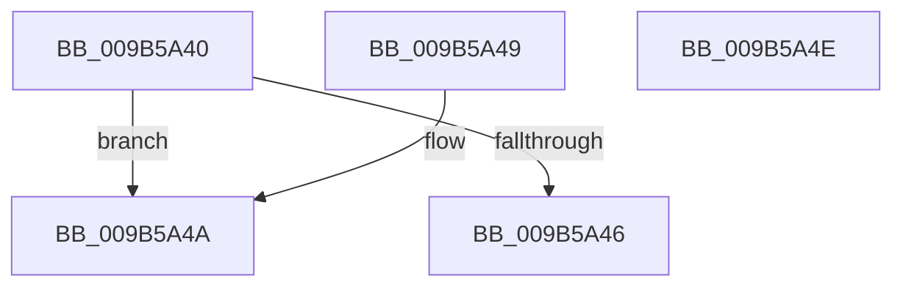

# HvpMapEntryGetFreeBin

- RVA: `0x009B5A40`–`0x009B5A4F` (길이 `15` bytes)
- VA: `0x00000001409B5A40`
- 실행 섹션: `PAGE`
- PDB 이름 있음: `예`; PDB Function 태그: `아니요`
- unwind 정보 RVA: `0x000DB714`
- 디코드: `8`개 명령, `15/15` bytes 표시
- 미해석 바이트: `0` (있으면 어셈블리에 `.byte`로 보존)

> 이 문서는 커널 이미지의 기계어와 PDB 기호를 분석해 생성했습니다. 4번과 5번은 함수 원형과 자료형을 바이너리 사용 방식에서 추정한 C 해석이며 원본 소스 복구 결과는 아닙니다.

## 1. Dependencies

- 직접 호출 지점: **0**; 고유 호출 대상: **0**
- 직접 호출자로 확인된 함수: **6**
- RIP 상대 이미지 참조: **0**

### Outgoing calls
- 직접 디코드된 call 명령이 없습니다.

### Direct callers
- [sub_00859517](../85/Unknown_function_00859517.md) at `0x00859624`
- [HvpFindNextDirtyBlock](HvpFindNextDirtyBlock_function_009B5540.md) at `0x009B55FB`
- [HvpFindNextDirtyBlock](HvpFindNextDirtyBlock_function_009B5540.md) at `0x009B56EB`
- [HvpSetRangeProtection](HvpSetRangeProtection_function_009B58C0.md) at `0x009B594B`
- [HvpTruncateBins](HvpTruncateBins_function_009B64F0.md) at `0x009B655A`
- [HvpDropPagedBins](HvpDropPagedBins_function_009B7168.md) at `0x009B727F`
- [sub_00B3E78C](../B3/Unknown_function_00B3E78C.md) at `0x00B3E7A9`

### Static image references
- 디코드된 RIP-relative 메모리 참조가 없습니다.

## 2. Other-region calls and transfers

- 다른 실행 섹션으로 향하는 call: **0**
- 별도 외부 분기/꼬리 이동을 확인하지 못했습니다.

## 3. Assembly (complete function range)

```asm
009B5A40  F6 41 08 02                     test byte ptr [rcx + 8], 2
009B5A44  75 04                           jne 0x1409b5a4a
009B5A46  33 C0                           xor eax, eax
009B5A48  C3                              ret
009B5A49  CC                              int3
009B5A4A  48 8B 01                        mov rax, qword ptr [rcx]
009B5A4D  C3                              ret
009B5A4E  CC                              int3
```

## 4. C-style interpretation (structured pseudocode)

```c
__int64 __fastcall HvpMapEntryGetFreeBin(__int64 a1)
{
    __int64 result;

    if (((*(unsigned __int8 *)(a1 + 8)) & (2)) != 0) goto loc_009B5A4A;
    result = 0;
    return result;
loc_009B5A4A:
    return *(unsigned __int64 *)(a1);
}
```

## 5. (Beta) C Style

```c
int64_t HvpMapEntryGetFreeBin(void *Arg1)
{
    uint8_t *arg1 = (uint8_t *)Arg1;

    int64_t result;

    if (((*(uint8_t *)(arg1 + 0x8)) & (2)) != 0) goto loc_009B5A4A;
    result = 0;
    return result;
loc_009B5A4A:
    return *(uint64_t *)(arg1);
}
```

### 관측된 메모리 오프셋

구조체 형식이 확인되지 않은 접근은 인자 기준의 오프셋으로만 기록했습니다.

| 기준 인자 | 오프셋 표현 | 폭 (bit) | 접근 |
|---|---:|---:|---|
| `Arg1` | `+ 0x0` | `64` | `R` |
| `Arg1` | `+ 0x8` | `8` | `R` |

## 6. Execution-region graph

[열기: 2D/3D 그래프와 함수 탐색 컨트롤 패널](../../../control-panel.html?section=page&rva=0x009B5A40&view=graph)

- 2D 그래프는 위에서 아래로 흐르고, 3D 그래프는 빈 공간을 드래그해 회전합니다. Shift+드래그는 이동, 휠은 확대·축소, 함수 노드 선택은 대상 보고서 이동입니다.

### Static fallback


