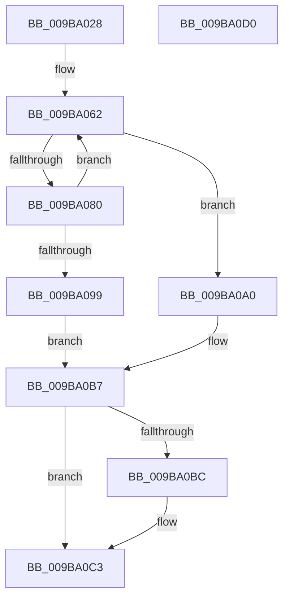

# HvpMapHiveImageFromFile

- RVA: `0x009BA028`–`0x009BA0D1` (길이 `169` bytes)
- VA: `0x00000001409BA028`
- 실행 섹션: `PAGE`
- PDB 이름 있음: `예`; PDB Function 태그: `아니요`
- unwind 정보 RVA: `0x0009EAB4`
- 디코드: `48`개 명령, `169/169` bytes 표시
- 미해석 바이트: `0` (있으면 어셈블리에 `.byte`로 보존)

> 이 문서는 커널 이미지의 기계어와 PDB 기호를 분석해 생성했습니다. 4번과 5번은 함수 원형과 자료형을 바이너리 사용 방식에서 추정한 C 해석이며 원본 소스 복구 결과는 아닙니다.

## 1. Dependencies

- 직접 호출 지점: **3**; 고유 호출 대상: **3**
- 직접 호출자로 확인된 함수: **1**
- RIP 상대 이미지 참조: **0**

### Outgoing calls
- `0x009BA06F` → [ExAllocatePool2](../../poolcode/B8/ExAllocatePool2_function_00B820F0.md) (function, `0x00B820F0`)
- `0x009BA0AC` → [HvpMapHiveImage](../7E/HvpMapHiveImage_function_007EF8D0.md) (function, `0x007EF8D0`)
- `0x009BA0BE` → [ExFreePoolWithTag](../../poolcode/B8/ExFreePoolWithTag_function_00B82870.md) (function, `0x00B82870`)

### Direct callers
- [HvLoadHive](HvLoadHive_function_009B8138.md) at `0x009B8475`

### Static image references
- 디코드된 RIP-relative 메모리 참조가 없습니다.

## 2. Other-region calls and transfers

- 다른 실행 섹션으로 향하는 call: **2**
  - `0x009BA06F` → [ExAllocatePool2](../../poolcode/B8/ExAllocatePool2_function_00B820F0.md) (`PAGE` → `POOLCODE`)
  - `0x009BA0BE` → [ExFreePoolWithTag](../../poolcode/B8/ExFreePoolWithTag_function_00B82870.md) (`PAGE` → `POOLCODE`)
- 별도 외부 분기/꼬리 이동을 확인하지 못했습니다.

## 3. Assembly (complete function range)

```asm
009BA028  48 89 5C 24 08                  mov qword ptr [rsp + 8], rbx
009BA02D  55                              push rbp
009BA02E  48 8B EC                        mov rbp, rsp
009BA031  48 83 EC 60                     sub rsp, 0x60
009BA035  83 65 F4 00                     and dword ptr [rbp - 0xc], 0
009BA039  B8 00 00 20 00                  mov eax, 0x200000
009BA03E  83 65 D8 00                     and dword ptr [rbp - 0x28], 0
009BA042  48 8B D9                        mov rbx, rcx
009BA045  83 65 EC 00                     and dword ptr [rbp - 0x14], 0
009BA049  44 3B C8                        cmp r9d, eax
009BA04C  48 89 4D D0                     mov qword ptr [rbp - 0x30], rcx
009BA050  C7 45 DC 00 10 00 00            mov dword ptr [rbp - 0x24], 0x1000
009BA057  41 0F 42 C1                     cmovb eax, r9d
009BA05B  44 89 4D F0                     mov dword ptr [rbp - 0x10], r9d
009BA05F  89 45 E8                        mov dword ptr [rbp - 0x18], eax
009BA062  8B D0                           mov edx, eax
009BA064  B9 00 01 00 00                  mov ecx, 0x100
009BA069  41 B8 43 4D 49 6F               mov r8d, 0x6f494d43
009BA06F  E8 7C 80 1C 00                  call 0x140b820f0
009BA074  48 89 45 E0                     mov qword ptr [rbp - 0x20], rax
009BA078  48 8B C8                        mov rcx, rax
009BA07B  48 85 C0                        test rax, rax
009BA07E  75 20                           jne 0x1409ba0a0
009BA080  8B 45 E8                        mov eax, dword ptr [rbp - 0x18]
009BA083  D1 E8                           shr eax, 1
009BA085  05 FF 0F 00 00                  add eax, 0xfff
009BA08A  25 00 F0 FF FF                  and eax, 0xfffff000
009BA08F  89 45 E8                        mov dword ptr [rbp - 0x18], eax
009BA092  3D 00 00 01 00                  cmp eax, 0x10000
009BA097  73 C9                           jae 0x1409ba062
009BA099  BB 17 00 00 C0                  mov ebx, 0xc0000017
009BA09E  EB 17                           jmp 0x1409ba0b7
009BA0A0  48 8D 45 D0                     lea rax, [rbp - 0x30]
009BA0A4  48 8B CB                        mov rcx, rbx
009BA0A7  48 89 44 24 20                  mov qword ptr [rsp + 0x20], rax
009BA0AC  E8 1F 58 E3 FF                  call 0x1407ef8d0
009BA0B1  48 8B 4D E0                     mov rcx, qword ptr [rbp - 0x20]
009BA0B5  8B D8                           mov ebx, eax
009BA0B7  48 85 C9                        test rcx, rcx
009BA0BA  74 07                           je 0x1409ba0c3
009BA0BC  33 D2                           xor edx, edx
009BA0BE  E8 AD 87 1C 00                  call 0x140b82870
009BA0C3  8B C3                           mov eax, ebx
009BA0C5  48 8B 5C 24 70                  mov rbx, qword ptr [rsp + 0x70]
009BA0CA  48 83 C4 60                     add rsp, 0x60
009BA0CE  5D                              pop rbp
009BA0CF  C3                              ret
009BA0D0  CC                              int3
```

## 4. C-style interpretation (structured pseudocode)

```c
__int64 __fastcall HvpMapHiveImageFromFile(__int64 a1, __int64 a2, __int64 a3, int a4)
{
    __int64 result;
    __int64 v_rsp;
    unsigned int v_stack_m14;
    unsigned int v_stack_m18;
    unsigned int v_stack_m1C;
    unsigned int v_stack_m20;
    unsigned __int64 v_stack_m28;
    unsigned int v_stack_m2C;
    unsigned int v_stack_m30;
    unsigned __int64 v_stack_m38;
    unsigned __int64 v_stack_m48;
    unsigned __int64 v_stack_p8;

    v_stack_p8 = v_rbx;
    v_rsp = (v_rsp) - (96);
    v_stack_m38 = a1;
    v_stack_m2C = 0x1000ULL;
    result = (unsigned int)(0x200000ULL);
    if (a4 < ((unsigned int)((unsigned int)(0x200000ULL)))) { result = a4; }
    v_stack_m18 = a4;
    v_stack_m20 = (unsigned int)(result);
loc_009BA062:
    result = ExAllocatePool2(256, (unsigned int)((unsigned int)(result)), (unsigned int)(0x6F494D43ULL), a4);
    v_stack_m28 = result;
    if (result != 0) goto loc_009BA0A0;
    result = (unsigned int)(((unsigned int)(v_stack_m20)) >> (1));
    result = (unsigned int)((result) + (0xFFFULL));
    result = (unsigned int)((result) & (0xFFFFF000ULL));
    v_stack_m20 = (unsigned int)(result);
    if (((unsigned int)(result)) >= 0x10000ULL) goto loc_009BA062;
    goto loc_009BA0B7;
loc_009BA0A0:
    v_stack_m48 = v_stack_m38;
    result = HvpMapHiveImage((unsigned int)(0xC0000017ULL), (unsigned int)((unsigned int)(result)), (unsigned int)(0x6F494D43ULL), a4);
loc_009BA0B7:
    if (v_stack_m28 != 0) {
        a2 = 0;
        result = ExFreePoolWithTag(v_stack_m28, a2, (unsigned int)(0x6F494D43ULL), a4);
    }
    v_rsp = (v_rsp) + (96);
    return (unsigned int)((unsigned int)((unsigned int)((unsigned int)(result))));
}
```

## 5. (Beta) C Style

```c
int64_t HvpMapHiveImageFromFile(int64_t Arg1, int64_t Arg2, int64_t Arg3, int32_t Arg4)
{
    int64_t result;
    int64_t local_rsp;
    uint32_t v_stack_m14;
    uint32_t v_stack_m18;
    uint32_t v_stack_m1C;
    uint32_t v_stack_m20;
    uint64_t v_stack_m28;
    uint32_t v_stack_m2C;
    uint32_t v_stack_m30;
    uint64_t v_stack_m38;
    uint64_t v_stack_m48;
    uint64_t v_stack_p8;

    v_stack_p8 = local_rbx;
    local_rsp = (local_rsp) - (96);
    v_stack_m38 = Arg1;
    v_stack_m2C = 0x1000ULL;
    result = (uint32_t)(0x200000ULL);
    if (Arg4 < ((uint32_t)((uint32_t)(0x200000ULL)))) { result = Arg4; }
    v_stack_m18 = Arg4;
    v_stack_m20 = (uint32_t)(result);
loc_009BA062:
    result = ExAllocatePool2(256, (uint32_t)((uint32_t)(result)), (uint32_t)(0x6F494D43ULL), Arg4);
    v_stack_m28 = result;
    if (result != 0) goto loc_009BA0A0;
    result = (uint32_t)(((uint32_t)(v_stack_m20)) >> (1));
    result = (uint32_t)((result) + (0xFFFULL));
    result = (uint32_t)((result) & (0xFFFFF000ULL));
    v_stack_m20 = (uint32_t)(result);
    if (((uint32_t)(result)) >= 0x10000ULL) goto loc_009BA062;
    goto loc_009BA0B7;
loc_009BA0A0:
    v_stack_m48 = v_stack_m38;
    result = HvpMapHiveImage((uint32_t)(0xC0000017ULL), (uint32_t)((uint32_t)(result)), (uint32_t)(0x6F494D43ULL), Arg4);
loc_009BA0B7:
    if (v_stack_m28 != 0) {
        Arg2 = 0;
        result = ExFreePoolWithTag(v_stack_m28, Arg2, (uint32_t)(0x6F494D43ULL), Arg4);
    }
    local_rsp = (local_rsp) + (96);
    return (uint32_t)((uint32_t)((uint32_t)((uint32_t)(result))));
}
```

## 6. Execution-region graph

[열기: 2D/3D 그래프와 함수 탐색 컨트롤 패널](../../../control-panel.html?section=page&rva=0x009BA028&view=graph)

- 2D 그래프는 위에서 아래로 흐르고, 3D 그래프는 빈 공간을 드래그해 회전합니다. Shift+드래그는 이동, 휠은 확대·축소, 함수 노드 선택은 대상 보고서 이동입니다.

### Static fallback


