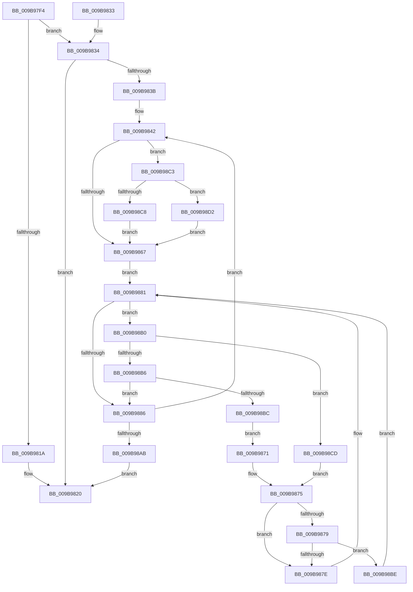

# HvpMapHiveImageFromViewMap

- RVA: `0x009B97F4`–`0x009B98D7` (길이 `227` bytes)
- VA: `0x00000001409B97F4`
- 실행 섹션: `PAGE`
- PDB 이름 있음: `예`; PDB Function 태그: `아니요`
- unwind 정보 RVA: `0x0009EA28`
- 디코드: `71`개 명령, `227/227` bytes 표시
- 미해석 바이트: `0` (있으면 어셈블리에 `.byte`로 보존)

> 이 문서는 커널 이미지의 기계어와 PDB 기호를 분석해 생성했습니다. 4번과 5번은 함수 원형과 자료형을 바이너리 사용 방식에서 추정한 C 해석이며 원본 소스 복구 결과는 아닙니다.

## 1. Dependencies

- 직접 호출 지점: **2**; 고유 호출 대상: **2**
- 직접 호출자로 확인된 함수: **2**
- RIP 상대 이미지 참조: **0**

### Outgoing calls
- `0x009B980E` → [CmpClaimGlobalQuota](../84/CmpClaimGlobalQuota_function_0084DDAC.md) (function, `0x0084DDAC`)
- `0x009B9848` → [HvpGetCellMap](../../pagecmrc/BC/HvpGetCellMap_function_00BC9710.md) (function, `0x00BC9710`)

### Direct callers
- [HvpPerformLogFileRecovery](HvpPerformLogFileRecovery_function_009B7994.md) at `0x009B7B0B`
- [HvLoadHive](HvLoadHive_function_009B8138.md) at `0x009B830A`

### Static image references
- 디코드된 RIP-relative 메모리 참조가 없습니다.

## 2. Other-region calls and transfers

- 다른 실행 섹션으로 향하는 call: **1**
  - `0x009B9848` → [HvpGetCellMap](../../pagecmrc/BC/HvpGetCellMap_function_00BC9710.md) (`PAGE` → `PAGECMRC`)
- 별도 외부 분기/꼬리 이동을 확인하지 못했습니다.

## 3. Assembly (complete function range)

```asm
009B97F4  48 89 5C 24 08                  mov qword ptr [rsp + 8], rbx
009B97F9  48 89 74 24 10                  mov qword ptr [rsp + 0x10], rsi
009B97FE  57                              push rdi
009B97FF  48 83 EC 20                     sub rsp, 0x20
009B9803  48 8B F1                        mov rsi, rcx
009B9806  41 8B D8                        mov ebx, r8d
009B9809  41 8B C8                        mov ecx, r8d
009B980C  8B FA                           mov edi, edx
009B980E  E8 99 45 E9 FF                  call 0x14084ddac
009B9813  45 33 D2                        xor r10d, r10d
009B9816  84 C0                           test al, al
009B9818  75 1A                           jne 0x1409b9834
009B981A  41 BA 9A 00 00 C0               mov r10d, 0xc000009a
009B9820  48 8B 5C 24 30                  mov rbx, qword ptr [rsp + 0x30]
009B9825  41 8B C2                        mov eax, r10d
009B9828  48 8B 74 24 38                  mov rsi, qword ptr [rsp + 0x38]
009B982D  48 83 C4 20                     add rsp, 0x20
009B9831  5F                              pop rdi
009B9832  C3                              ret
009B9833  CC                              int3
009B9834  45 8B DA                        mov r11d, r10d
009B9837  03 DF                           add ebx, edi
009B9839  74 E5                           je 0x1409b9820
009B983B  4C 8D 86 08 01 00 00            lea r8, [rsi + 0x108]
009B9842  41 8B D3                        mov edx, r11d
009B9845  48 8B CE                        mov rcx, rsi
009B9848  E8 C3 FE 20 00                  call 0x140bc9710
009B984D  41 F6 40 08 01                  test byte ptr [r8 + 8], 1
009B9852  41 8D 8B 00 10 00 00            lea ecx, [r11 + 0x1000]
009B9859  44 8B D9                        mov r11d, ecx
009B985C  44 8B C9                        mov r9d, ecx
009B985F  49 8B 08                        mov rcx, qword ptr [r8]
009B9862  48 8B F8                        mov rdi, rax
009B9865  75 5C                           jne 0x1409b98c3
009B9867  41 0F B6 50 08                  movzx edx, byte ptr [r8 + 8]
009B986C  83 E2 01                        and edx, 1
009B986F  EB 10                           jmp 0x1409b9881
009B9871  48 8B 41 08                     mov rax, qword ptr [rcx + 8]
009B9875  85 D2                           test edx, edx
009B9877  74 05                           je 0x1409b987e
009B9879  48 85 C0                        test rax, rax
009B987C  75 40                           jne 0x1409b98be
009B987E  48 8B C8                        mov rcx, rax
009B9881  48 85 C9                        test rcx, rcx
009B9884  75 2A                           jne 0x1409b98b0
009B9886  48 8B 41 18                     mov rax, qword ptr [rcx + 0x18]
009B988A  48 8B 49 38                     mov rcx, qword ptr [rcx + 0x38]
009B988E  48 2B C8                        sub rcx, rax
009B9891  4C 89 17                        mov qword ptr [rdi], r10
009B9894  49 03 C9                        add rcx, r9
009B9897  C7 47 10 00 10 00 00            mov dword ptr [rdi + 0x10], 0x1000
009B989E  48 83 C9 01                     or rcx, 1
009B98A2  48 89 4F 08                     mov qword ptr [rdi + 8], rcx
009B98A6  44 3B DB                        cmp r11d, ebx
009B98A9  72 97                           jb 0x1409b9842
009B98AB  E9 70 FF FF FF                  jmp 0x1409b9820
009B98B0  4C 3B 49 28                     cmp r9, qword ptr [rcx + 0x28]
009B98B4  7C 17                           jl 0x1409b98cd
009B98B6  4C 3B 49 30                     cmp r9, qword ptr [rcx + 0x30]
009B98BA  7C CA                           jl 0x1409b9886
009B98BC  EB B3                           jmp 0x1409b9871
009B98BE  48 33 C8                        xor rcx, rax
009B98C1  EB BE                           jmp 0x1409b9881
009B98C3  48 85 C9                        test rcx, rcx
009B98C6  74 0A                           je 0x1409b98d2
009B98C8  49 33 C8                        xor rcx, r8
009B98CB  EB 9A                           jmp 0x1409b9867
009B98CD  48 8B 01                        mov rax, qword ptr [rcx]
009B98D0  EB A3                           jmp 0x1409b9875
009B98D2  49 8B CA                        mov rcx, r10
009B98D5  EB 90                           jmp 0x1409b9867
```

## 4. C-style interpretation (structured pseudocode)

```c
__int64 __fastcall HvpMapHiveImageFromViewMap(__int64 a1, int a2, int a3)
{
    __int64 result;
    __int64 v_r10;
    __int64 v_rbx;
    __int64 v_rsp;
    unsigned __int64 v_stack_p10;
    unsigned __int64 v_stack_p8;

    v_stack_p8 = v_rbx;
    v_stack_p10 = v_rsi;
    v_rsp = (v_rsp) - (32);
    result = CmpClaimGlobalQuota((unsigned int)(a3), a2, a3, a4);
    v_r10 = 0;
    if ((unsigned __int8)(result) != 0) goto loc_009B9834;
loc_009B9820:
    v_rsp = (v_rsp) + (32);
    return (unsigned int)((unsigned int)((unsigned int)(0xC000009AULL)));
loc_009B9834:
    v_rbx = (unsigned int)((v_stack_p8) + ((unsigned int)((unsigned int)(a2))));
    if (condition_is_equal) goto loc_009B9820;
loc_009B9842:
    result = HvpGetCellMap(v_stack_p10, (unsigned int)((unsigned int)((unsigned int)((unsigned int)((unsigned int)(0xC000009AULL))))), v_stack_p10 + 264, a4);
    if (((*(unsigned __int8 *)(v_stack_p10 + 264 + 8)) & (1)) != 0) goto loc_009B98C3;
loc_009B9867:
    a2 = (unsigned int)((*(unsigned __int8 *)(v_stack_p10 + 264 + 8)) & (1));
    goto loc_009B9881;
loc_009B9871:
loc_009B9875:
    if (a2 == 0) goto loc_009B987E;
    if (*(unsigned __int64 *)(*(unsigned __int64 *)(v_stack_p10 + 264) + 8) != 0) goto loc_009B98BE;
loc_009B987E:
loc_009B9881:
    if (*(unsigned __int64 *)(*(unsigned __int64 *)(v_stack_p10 + 264) + 8) != 0) goto loc_009B98B0;
loc_009B9886:
    a1 = (*(unsigned __int64 *)(*(unsigned __int64 *)(*(unsigned __int64 *)(v_stack_p10 + 264) + 8) + 56)) - (*(unsigned __int64 *)(*(unsigned __int64 *)(*(unsigned __int64 *)(v_stack_p10 + 264) + 8) + 24));
    *(unsigned __int64 *)(result) = (unsigned int)(0xC000009AULL);
    a1 = (a1) + ((unsigned int)((unsigned int)((unsigned int)((unsigned int)((unsigned int)(0xC000009AULL))) + 4096)));
    *(unsigned int *)(result + 16) = 0x1000ULL;
    a1 = (a1) | (1);
    *(unsigned __int64 *)(result + 8) = a1;
    if (((unsigned int)((unsigned int)((unsigned int)((unsigned int)((unsigned int)((unsigned int)(0xC000009AULL))) + 4096)))) < ((unsigned int)(v_rbx))) goto loc_009B9842;
    goto loc_009B9820;
loc_009B98B0:
    if (((unsigned int)((unsigned int)((unsigned int)((unsigned int)((unsigned int)(0xC000009AULL))) + 4096))) < (*(unsigned __int64 *)(a1 + 40))) goto loc_009B98CD;
    if (((unsigned int)((unsigned int)((unsigned int)((unsigned int)((unsigned int)(0xC000009AULL))) + 4096))) < (*(unsigned __int64 *)(a1 + 48))) goto loc_009B9886;
    goto loc_009B9871;
loc_009B98BE:
    a1 = (a1) ^ (*(unsigned __int64 *)(*(unsigned __int64 *)(*(unsigned __int64 *)(v_stack_p10 + 264) + 8) + 24));
    goto loc_009B9881;
loc_009B98C3:
    if (a1 == 0) goto loc_009B98D2;
    a1 = (a1) ^ (v_stack_p10 + 264);
    goto loc_009B9867;
loc_009B98CD:
    goto loc_009B9875;
loc_009B98D2:
    goto loc_009B9867;
}
```

## 5. (Beta) C Style

```c
int64_t HvpMapHiveImageFromViewMap(void *Arg1, int32_t Arg2, int32_t Arg3)
{
    uint8_t *arg1 = (uint8_t *)Arg1;

    int64_t result;
    int64_t local_r10;
    int64_t local_rbx;
    int64_t local_rsp;
    uint64_t v_stack_p10;
    uint64_t v_stack_p8;

    v_stack_p8 = local_rbx;
    v_stack_p10 = local_rsi;
    local_rsp = (local_rsp) - (32);
    result = CmpClaimGlobalQuota((uint32_t)(Arg3), Arg2, Arg3, a4);
    local_r10 = 0;
    if ((uint8_t)(result) != 0) goto loc_009B9834;
loc_009B9820:
    local_rsp = (local_rsp) + (32);
    return (uint32_t)((uint32_t)((uint32_t)(0xC000009AULL)));
loc_009B9834:
    local_rbx = (uint32_t)((v_stack_p8) + ((uint32_t)((uint32_t)(Arg2))));
    if (condition_is_equal) goto loc_009B9820;
loc_009B9842:
    result = HvpGetCellMap(v_stack_p10, (uint32_t)((uint32_t)((uint32_t)((uint32_t)((uint32_t)(0xC000009AULL))))), v_stack_p10 + 264, a4);
    if (((*(uint8_t *)(v_stack_p10 + 0x108 + 0x8)) & (1)) != 0) goto loc_009B98C3;
loc_009B9867:
    Arg2 = (uint32_t)((*(uint8_t *)(v_stack_p10 + 0x108 + 0x8)) & (1));
    goto loc_009B9881;
loc_009B9871:
loc_009B9875:
    if (Arg2 == 0) goto loc_009B987E;
    if (*(uint64_t *)(*(uint64_t *)(v_stack_p10 + 0x108) + 0x8) != 0) goto loc_009B98BE;
loc_009B987E:
loc_009B9881:
    if (*(uint64_t *)(*(uint64_t *)(v_stack_p10 + 0x108) + 0x8) != 0) goto loc_009B98B0;
loc_009B9886:
    Arg1 = (*(uint64_t *)(*(uint64_t *)(*(uint64_t *)(v_stack_p10 + 0x108) + 0x8) + 0x38)) - (*(uint64_t *)(*(uint64_t *)(*(uint64_t *)(v_stack_p10 + 0x108) + 0x8) + 0x18));
    *(uint64_t *)(result) = (uint32_t)(0xC000009AULL);
    Arg1 = (Arg1) + ((uint32_t)((uint32_t)((uint32_t)((uint32_t)((uint32_t)(0xC000009AULL))) + 4096)));
    *(uint32_t *)(result + 0x10) = 0x1000ULL;
    Arg1 = (Arg1) | (1);
    *(void **)(result + 0x8) = Arg1;
    if (((uint32_t)((uint32_t)((uint32_t)((uint32_t)((uint32_t)((uint32_t)(0xC000009AULL))) + 4096)))) < ((uint32_t)(local_rbx))) goto loc_009B9842;
    goto loc_009B9820;
loc_009B98B0:
    if (((uint32_t)((uint32_t)((uint32_t)((uint32_t)((uint32_t)(0xC000009AULL))) + 4096))) < (*(uint64_t *)(arg1 + 0x28))) goto loc_009B98CD;
    if (((uint32_t)((uint32_t)((uint32_t)((uint32_t)((uint32_t)(0xC000009AULL))) + 4096))) < (*(uint64_t *)(arg1 + 0x30))) goto loc_009B9886;
    goto loc_009B9871;
loc_009B98BE:
    Arg1 = (Arg1) ^ (*(uint64_t *)(*(uint64_t *)(*(uint64_t *)(v_stack_p10 + 0x108) + 0x8) + 0x18));
    goto loc_009B9881;
loc_009B98C3:
    if (Arg1 == NULL) goto loc_009B98D2;
    Arg1 = (Arg1) ^ (v_stack_p10 + 264);
    goto loc_009B9867;
loc_009B98CD:
    goto loc_009B9875;
loc_009B98D2:
    goto loc_009B9867;
}
```

### 관측된 메모리 오프셋

구조체 형식이 확인되지 않은 접근은 인자 기준의 오프셋으로만 기록했습니다.

| 기준 인자 | 오프셋 표현 | 폭 (bit) | 접근 |
|---|---:|---:|---|
| `Arg1` | `+ 0x108` | `64` | `R` |

## 6. Execution-region graph

[열기: 2D/3D 그래프와 함수 탐색 컨트롤 패널](../../../control-panel.html?section=page&rva=0x009B97F4&view=graph)

- 2D 그래프는 위에서 아래로 흐르고, 3D 그래프는 빈 공간을 드래그해 회전합니다. Shift+드래그는 이동, 휠은 확대·축소, 함수 노드 선택은 대상 보고서 이동입니다.

### Static fallback


