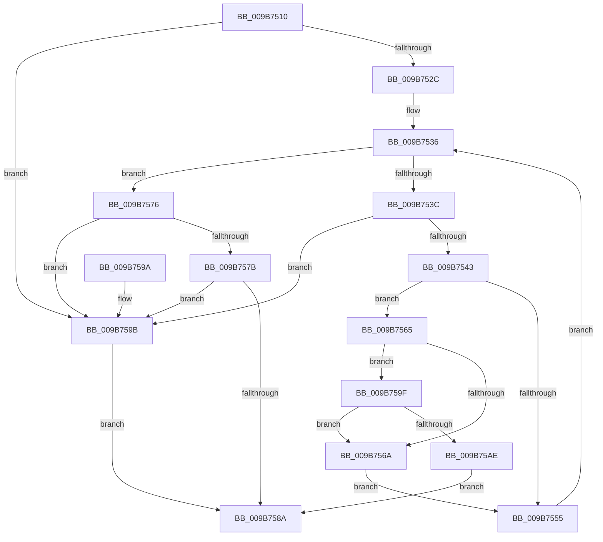

# HvpMappedViewConvertLockedPagesToCOWByPolicy

- RVA: `0x009B7510`–`0x009B75B0` (길이 `160` bytes)
- VA: `0x00000001409B7510`
- 실행 섹션: `PAGE`
- PDB 이름 있음: `예`; PDB Function 태그: `아니요`
- unwind 정보 RVA: `0x0009E850`
- 디코드: `49`개 명령, `160/160` bytes 표시
- 미해석 바이트: `0` (있으면 어셈블리에 `.byte`로 보존)

> 이 문서는 커널 이미지의 기계어와 PDB 기호를 분석해 생성했습니다. 4번과 5번은 함수 원형과 자료형을 바이너리 사용 방식에서 추정한 C 해석이며 원본 소스 복구 결과는 아닙니다.

## 1. Dependencies

- 직접 호출 지점: **2**; 고유 호출 대상: **1**
- 직접 호출자로 확인된 함수: **1**
- RIP 상대 이미지 참조: **0**

### Outgoing calls
- `0x009B7581` → [HvpMappedViewConvertRegionFromLockedToCOWByPolicy](HvpMappedViewConvertRegionFromLockedToCOWByPolicy_function_009B75B8.md) (function, `0x009B75B8`)
- `0x009B75A5` → [HvpMappedViewConvertRegionFromLockedToCOWByPolicy](HvpMappedViewConvertRegionFromLockedToCOWByPolicy_function_009B75B8.md) (function, `0x009B75B8`)

### Direct callers
- [HvpViewMapConvertLockedPagesToCOWByPolicy](HvpViewMapConvertLockedPagesToCOWByPolicy_function_009B74C0.md) at `0x009B74E9`

### Static image references
- 디코드된 RIP-relative 메모리 참조가 없습니다.

## 2. Other-region calls and transfers

- 다른 실행 섹션으로 향하는 call: **0**
- 별도 외부 분기/꼬리 이동을 확인하지 못했습니다.

## 3. Assembly (complete function range)

```asm
009B7510  48 89 5C 24 08                  mov qword ptr [rsp + 8], rbx
009B7515  48 89 74 24 10                  mov qword ptr [rsp + 0x10], rsi
009B751A  57                              push rdi
009B751B  48 83 EC 20                     sub rsp, 0x20
009B751F  48 83 7A 40 00                  cmp qword ptr [rdx + 0x40], 0
009B7524  48 8B DA                        mov rbx, rdx
009B7527  48 8B F1                        mov rsi, rcx
009B752A  74 6F                           je 0x1409b759b
009B752C  4C 8B 42 28                     mov r8, qword ptr [rdx + 0x28]
009B7530  4D 8B C8                        mov r9, r8
009B7533  49 8B F8                        mov rdi, r8
009B7536  48 3B 7B 30                     cmp rdi, qword ptr [rbx + 0x30]
009B753A  7D 3A                           jge 0x1409b7576
009B753C  48 83 7B 40 00                  cmp qword ptr [rbx + 0x40], 0
009B7541  74 58                           je 0x1409b759b
009B7543  48 8B C7                        mov rax, rdi
009B7546  48 2B 43 18                     sub rax, qword ptr [rbx + 0x18]
009B754A  48 C1 E8 0C                     shr rax, 0xc
009B754E  F6 44 18 48 10                  test byte ptr [rax + rbx + 0x48], 0x10
009B7553  74 10                           je 0x1409b7565
009B7555  48 81 C7 00 10 00 00            add rdi, 0x1000
009B755C  49 81 C1 00 10 00 00            add r9, 0x1000
009B7563  EB D1                           jmp 0x1409b7536
009B7565  4D 3B C1                        cmp r8, r9
009B7568  75 35                           jne 0x1409b759f
009B756A  4C 8D 87 00 10 00 00            lea r8, [rdi + 0x1000]
009B7571  4C 8B CF                        mov r9, rdi
009B7574  EB DF                           jmp 0x1409b7555
009B7576  4D 3B C1                        cmp r8, r9
009B7579  74 20                           je 0x1409b759b
009B757B  48 8B D3                        mov rdx, rbx
009B757E  48 8B CE                        mov rcx, rsi
009B7581  E8 32 00 00 00                  call 0x1409b75b8
009B7586  85 C0                           test eax, eax
009B7588  79 11                           jns 0x1409b759b
009B758A  48 8B 5C 24 30                  mov rbx, qword ptr [rsp + 0x30]
009B758F  48 8B 74 24 38                  mov rsi, qword ptr [rsp + 0x38]
009B7594  48 83 C4 20                     add rsp, 0x20
009B7598  5F                              pop rdi
009B7599  C3                              ret
009B759A  CC                              int3
009B759B  33 C0                           xor eax, eax
009B759D  EB EB                           jmp 0x1409b758a
009B759F  48 8B D3                        mov rdx, rbx
009B75A2  48 8B CE                        mov rcx, rsi
009B75A5  E8 0E 00 00 00                  call 0x1409b75b8
009B75AA  85 C0                           test eax, eax
009B75AC  79 BC                           jns 0x1409b756a
009B75AE  EB DA                           jmp 0x1409b758a
```

## 4. C-style interpretation (structured pseudocode)

```c
__int64 __fastcall HvpMappedViewConvertLockedPagesToCOWByPolicy(__int64 a1, __int64 a2)
{
    __int64 result;
    __int64 v_rdi;
    __int64 v_rsp;
    unsigned __int64 v_stack_p10;
    unsigned __int64 v_stack_p8;

    v_stack_p8 = v_rbx;
    v_stack_p10 = v_rsi;
    v_rsp = (v_rsp) - (32);
    if ((*(unsigned __int64 *)(a2 + 64)) == 0) goto loc_009B759B;
loc_009B7536:
    if ((*(unsigned __int64 *)(a2 + 40)) >= (*(unsigned __int64 *)(a2 + 48))) goto loc_009B7576;
    if ((*(unsigned __int64 *)(a2 + 64)) == 0) goto loc_009B759B;
    result = (*(unsigned __int64 *)(a2 + 40)) - (*(unsigned __int64 *)(a2 + 24));
    result = (result) >> (12);
    if (((*(unsigned __int8 *)(result + a2 * 1 + 72)) & (16)) == 0) goto loc_009B7565;
loc_009B7555:
    v_rdi = (*(unsigned __int64 *)(a2 + 40)) + (0x1000ULL);
    a4 = (*(unsigned __int64 *)(a2 + 40)) + (0x1000ULL);
    goto loc_009B7536;
loc_009B7565:
    if ((*(unsigned __int64 *)(a2 + 40)) != a4) goto loc_009B759F;
loc_009B756A:
    goto loc_009B7555;
loc_009B7576:
    if ((v_rdi + 4096) == v_rdi) goto loc_009B759B;
    result = HvpMappedViewConvertRegionFromLockedToCOWByPolicy(a1, a2, v_rdi + 4096, v_rdi);
    if (!sign_flag) goto loc_009B759B;
loc_009B758A:
    v_rsp = (v_rsp) + (32);
    return result;
loc_009B759B:
    result = 0;
    goto loc_009B758A;
loc_009B759F:
    result = HvpMappedViewConvertRegionFromLockedToCOWByPolicy(v_stack_p10, v_stack_p8, v_rdi + 4096, v_rdi);
    if (!sign_flag) goto loc_009B756A;
    goto loc_009B758A;
}
```

## 5. (Beta) C Style

```c
int64_t HvpMappedViewConvertLockedPagesToCOWByPolicy(int64_t Arg1, void *Arg2)
{
    uint8_t *arg2 = (uint8_t *)Arg2;

    int64_t result;
    int64_t local_rdi;
    int64_t local_rsp;
    uint64_t v_stack_p10;
    uint64_t v_stack_p8;

    v_stack_p8 = local_rbx;
    v_stack_p10 = local_rsi;
    local_rsp = (local_rsp) - (32);
    if ((*(uint64_t *)(arg2 + 0x40)) == 0) goto loc_009B759B;
loc_009B7536:
    if ((*(uint64_t *)(arg2 + 0x28)) >= (*(uint64_t *)(arg2 + 0x30))) goto loc_009B7576;
    if ((*(uint64_t *)(arg2 + 0x40)) == 0) goto loc_009B759B;
    result = (*(uint64_t *)(arg2 + 0x28)) - (*(uint64_t *)(arg2 + 0x18));
    result = (result) >> (12);
    if (((*(uint8_t *)(result + arg2 * 1 + 0x48)) & (16)) == 0) goto loc_009B7565;
loc_009B7555:
    local_rdi = (*(uint64_t *)(arg2 + 0x28)) + (0x1000ULL);
    a4 = (*(uint64_t *)(arg2 + 0x28)) + (0x1000ULL);
    goto loc_009B7536;
loc_009B7565:
    if ((*(uint64_t *)(arg2 + 0x28)) != a4) goto loc_009B759F;
loc_009B756A:
    goto loc_009B7555;
loc_009B7576:
    if ((local_rdi + 4096) == local_rdi) goto loc_009B759B;
    result = HvpMappedViewConvertRegionFromLockedToCOWByPolicy(Arg1, Arg2, local_rdi + 4096, local_rdi);
    if (!sign_flag) goto loc_009B759B;
loc_009B758A:
    local_rsp = (local_rsp) + (32);
    return result;
loc_009B759B:
    result = 0;
    goto loc_009B758A;
loc_009B759F:
    result = HvpMappedViewConvertRegionFromLockedToCOWByPolicy(v_stack_p10, v_stack_p8, local_rdi + 4096, local_rdi);
    if (!sign_flag) goto loc_009B756A;
    goto loc_009B758A;
}
```

### 관측된 메모리 오프셋

구조체 형식이 확인되지 않은 접근은 인자 기준의 오프셋으로만 기록했습니다.

| 기준 인자 | 오프셋 표현 | 폭 (bit) | 접근 |
|---|---:|---:|---|
| `Arg2` | `+ 0x18` | `64` | `R` |
| `Arg2` | `+ 0x28` | `64` | `R` |
| `Arg2` | `+ 0x30` | `64` | `R` |
| `Arg2` | `+ 0x40` | `64` | `R` |

## 6. Execution-region graph

[열기: 2D/3D 그래프와 함수 탐색 컨트롤 패널](../../../control-panel.html?section=page&rva=0x009B7510&view=graph)

- 2D 그래프는 위에서 아래로 흐르고, 3D 그래프는 빈 공간을 드래그해 회전합니다. Shift+드래그는 이동, 휠은 확대·축소, 함수 노드 선택은 대상 보고서 이동입니다.

### Static fallback


