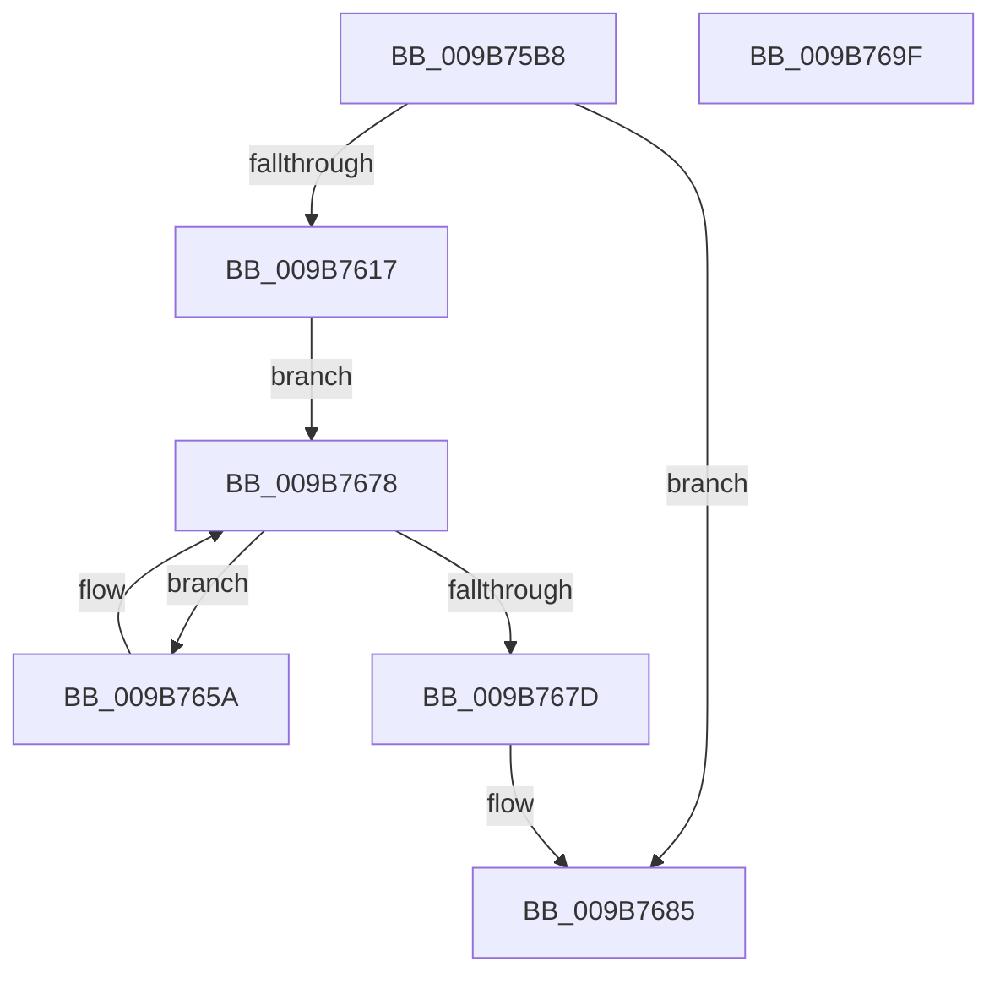

# HvpMappedViewConvertRegionFromLockedToCOWByPolicy

- RVA: `0x009B75B8`–`0x009B76A0` (길이 `232` bytes)
- VA: `0x00000001409B75B8`
- 실행 섹션: `PAGE`
- PDB 이름 있음: `예`; PDB Function 태그: `아니요`
- unwind 정보 RVA: `0x0009E864`
- 디코드: `69`개 명령, `232/232` bytes 표시
- 미해석 바이트: `0` (있으면 어셈블리에 `.byte`로 보존)

> 이 문서는 커널 이미지의 기계어와 PDB 기호를 분석해 생성했습니다. 4번과 5번은 함수 원형과 자료형을 바이너리 사용 방식에서 추정한 C 해석이며 원본 소스 복구 결과는 아닙니다.

## 1. Dependencies

- 직접 호출 지점: **4**; 고유 호출 대상: **3**
- 직접 호출자로 확인된 함수: **1**
- RIP 상대 이미지 참조: **0**

### Outgoing calls
- `0x009B760B` → [CmSiProtectViewOfSection](../../text/47/CmSiProtectViewOfSection_function_004746B8.md) (function, `0x004746B8`)
- `0x009B7620` → [HvpViewMapTouchPages](HvpViewMapTouchPages_function_009B5D30.md) (function, `0x009B5D30`)
- `0x009B7641` → [CmSiProtectViewOfSection](../../text/47/CmSiProtectViewOfSection_function_004746B8.md) (function, `0x004746B8`)
- `0x009B7653` → [HvpViewMapReleaseChargesAndUnlockViewPages](HvpViewMapReleaseChargesAndUnlockViewPages_function_009B7870.md) (function, `0x009B7870`)

### Direct callers
- [HvpMappedViewConvertLockedPagesToCOWByPolicy](HvpMappedViewConvertLockedPagesToCOWByPolicy_function_009B7510.md) at `0x009B7581`
- [HvpMappedViewConvertLockedPagesToCOWByPolicy](HvpMappedViewConvertLockedPagesToCOWByPolicy_function_009B7510.md) at `0x009B75A5`

### Static image references
- 디코드된 RIP-relative 메모리 참조가 없습니다.

## 2. Other-region calls and transfers

- 다른 실행 섹션으로 향하는 call: **2**
  - `0x009B760B` → [CmSiProtectViewOfSection](../../text/47/CmSiProtectViewOfSection_function_004746B8.md) (`PAGE` → `.text`)
  - `0x009B7641` → [CmSiProtectViewOfSection](../../text/47/CmSiProtectViewOfSection_function_004746B8.md) (`PAGE` → `.text`)
- 별도 외부 분기/꼬리 이동을 확인하지 못했습니다.

## 3. Assembly (complete function range)

```asm
009B75B8  48 8B C4                        mov rax, rsp
009B75BB  48 89 58 10                     mov qword ptr [rax + 0x10], rbx
009B75BF  48 89 68 18                     mov qword ptr [rax + 0x18], rbp
009B75C3  56                              push rsi
009B75C4  57                              push rdi
009B75C5  41 55                           push r13
009B75C7  41 56                           push r14
009B75C9  41 57                           push r15
009B75CB  48 83 EC 30                     sub rsp, 0x30
009B75CF  48 8B 6A 38                     mov rbp, qword ptr [rdx + 0x38]
009B75D3  49 8B D9                        mov rbx, r9
009B75D6  48 2B 6A 18                     sub rbp, qword ptr [rdx + 0x18]
009B75DA  49 2B D8                        sub rbx, r8
009B75DD  83 60 08 00                     and dword ptr [rax + 8], 0
009B75E1  48 8D 40 08                     lea rax, [rax + 8]
009B75E5  49 03 E8                        add rbp, r8
009B75E8  48 89 44 24 28                  mov qword ptr [rsp + 0x28], rax
009B75ED  4D 8B F9                        mov r15, r9
009B75F0  C7 44 24 20 08 00 00 00         mov dword ptr [rsp + 0x20], 8
009B75F8  49 8B F0                        mov rsi, r8
009B75FB  48 8B FA                        mov rdi, rdx
009B75FE  48 8B 51 18                     mov rdx, qword ptr [rcx + 0x18]
009B7602  4C 8B C5                        mov r8, rbp
009B7605  4C 8B CB                        mov r9, rbx
009B7608  4C 8B E9                        mov r13, rcx
009B760B  E8 A8 D0 AB FF                  call 0x1404746b8
009B7610  44 8B F0                        mov r14d, eax
009B7613  85 C0                           test eax, eax
009B7615  78 6E                           js 0x1409b7685
009B7617  41 B0 01                        mov r8b, 1
009B761A  48 8B D3                        mov rdx, rbx
009B761D  48 8B CD                        mov rcx, rbp
009B7620  E8 0B E7 FF FF                  call 0x1409b5d30
009B7625  49 8B 55 18                     mov rdx, qword ptr [r13 + 0x18]
009B7629  48 8D 44 24 60                  lea rax, [rsp + 0x60]
009B762E  48 89 44 24 28                  mov qword ptr [rsp + 0x28], rax
009B7633  4C 8B CB                        mov r9, rbx
009B7636  4C 8B C5                        mov r8, rbp
009B7639  C7 44 24 20 02 00 00 00         mov dword ptr [rsp + 0x20], 2
009B7641  E8 72 D0 AB FF                  call 0x1404746b8
009B7646  49 8B 55 18                     mov rdx, qword ptr [r13 + 0x18]
009B764A  4C 8B CB                        mov r9, rbx
009B764D  4C 8B C5                        mov r8, rbp
009B7650  44 8B F0                        mov r14d, eax
009B7653  E8 18 02 00 00                  call 0x1409b7870
009B7658  EB 1E                           jmp 0x1409b7678
009B765A  48 8B CE                        mov rcx, rsi
009B765D  48 2B 4F 18                     sub rcx, qword ptr [rdi + 0x18]
009B7661  48 C1 E9 0C                     shr rcx, 0xc
009B7665  8A 44 39 48                     mov al, byte ptr [rcx + rdi + 0x48]
009B7669  24 EF                           and al, 0xef
009B766B  0C 04                           or al, 4
009B766D  88 44 39 48                     mov byte ptr [rcx + rdi + 0x48], al
009B7671  48 81 C6 00 10 00 00            add rsi, 0x1000
009B7678  49 3B F7                        cmp rsi, r15
009B767B  7C DD                           jl 0x1409b765a
009B767D  48 C1 EB 0C                     shr rbx, 0xc
009B7681  48 29 5F 40                     sub qword ptr [rdi + 0x40], rbx
009B7685  48 8B 5C 24 68                  mov rbx, qword ptr [rsp + 0x68]
009B768A  41 8B C6                        mov eax, r14d
009B768D  48 8B 6C 24 70                  mov rbp, qword ptr [rsp + 0x70]
009B7692  48 83 C4 30                     add rsp, 0x30
009B7696  41 5F                           pop r15
009B7698  41 5E                           pop r14
009B769A  41 5D                           pop r13
009B769C  5F                              pop rdi
009B769D  5E                              pop rsi
009B769E  C3                              ret
009B769F  CC                              int3
```

## 4. C-style interpretation (structured pseudocode)

```c
__int64 __fastcall HvpMappedViewConvertRegionFromLockedToCOWByPolicy(__int64 a1, __int64 a2, __int64 a3, __int64 a4)
{
    __int64 result;
    __int64 v_rbp;
    __int64 v_rbx;
    __int64 v_rsi;
    __int64 v_rsp;
    unsigned __int64 v_stack_m30;
    unsigned int v_stack_m38;
    unsigned __int64 v_stack_p10;
    unsigned __int64 v_stack_p18;
    unsigned __int64 v_stack_p8;

    *(unsigned __int64 *)(v_rsp + 16) = v_rbx;
    *(unsigned __int64 *)(v_rsp + 24) = v_rbp;
    v_rsp = (v_rsp) - (48);
    v_rbp = (*(unsigned __int64 *)(a2 + 56)) - (*(unsigned __int64 *)(a2 + 24));
    v_rbx = (a4) - (a3);
    v_rbp = (v_rbp) + (a3);
    v_stack_m30 = v_rsp + 8;
    v_stack_m38 = 8;
    result = CmSiProtectViewOfSection(a1, *(unsigned __int64 *)(a1 + 24), v_rbp, v_rbx);
    if (sign_flag) goto loc_009B7685;
    result = HvpViewMapTouchPages(v_rbp, v_rbx, 1, v_rbx);
    v_stack_m30 = v_stack_p8;
    v_stack_m38 = 2;
    result = CmSiProtectViewOfSection(v_rbp, *(unsigned __int64 *)(a1 + 24), v_rbp, v_rbx);
    result = HvpViewMapReleaseChargesAndUnlockViewPages(v_rbp, *(unsigned __int64 *)(a1 + 24), v_rbp, v_rbx);
    goto loc_009B7678;
loc_009B765A:
    a1 = (a3) - (*(unsigned __int64 *)(a2 + 24));
    a1 = (a1) >> (12);
    result = (unsigned __int8)((*(unsigned __int8 *)(a1 + a2 * 1 + 72)) & (239));
    result = (unsigned __int8)((result) | (4));
    *(unsigned __int8 *)(a1 + a2 * 1 + 72) = (unsigned __int8)(result);
    v_rsi = (a3) + (0x1000ULL);
loc_009B7678:
    if (v_rsi < a4) goto loc_009B765A;
    v_rbx = (v_rbx) >> (12);
loc_009B7685:
    v_rsp = (v_rsp) + (48);
    return (unsigned int)((unsigned int)((unsigned int)((unsigned int)(result))));
}
```

## 5. (Beta) C Style

```c
int64_t HvpMappedViewConvertRegionFromLockedToCOWByPolicy(void *Arg1, void *Arg2, int64_t Arg3, int64_t Arg4)
{
    uint8_t *arg1 = (uint8_t *)Arg1;
    uint8_t *arg2 = (uint8_t *)Arg2;

    int64_t result;
    int64_t local_rbp;
    int64_t local_rbx;
    int64_t local_rsi;
    int64_t local_rsp;
    uint64_t v_stack_m30;
    uint32_t v_stack_m38;
    uint64_t v_stack_p10;
    uint64_t v_stack_p18;
    uint64_t v_stack_p8;

    *(uint64_t *)(local_rsp + 0x10) = local_rbx;
    *(uint64_t *)(local_rsp + 0x18) = local_rbp;
    local_rsp = (local_rsp) - (48);
    local_rbp = (*(uint64_t *)(arg2 + 0x38)) - (*(uint64_t *)(arg2 + 0x18));
    local_rbx = (Arg4) - (Arg3);
    local_rbp = (local_rbp) + (Arg3);
    v_stack_m30 = local_rsp + 8;
    v_stack_m38 = 8;
    result = CmSiProtectViewOfSection(Arg1, *(uint64_t *)(arg1 + 0x18), local_rbp, local_rbx);
    if (sign_flag) goto loc_009B7685;
    result = HvpViewMapTouchPages(local_rbp, local_rbx, 1, local_rbx);
    v_stack_m30 = v_stack_p8;
    v_stack_m38 = 2;
    result = CmSiProtectViewOfSection(local_rbp, *(uint64_t *)(arg1 + 0x18), local_rbp, local_rbx);
    result = HvpViewMapReleaseChargesAndUnlockViewPages(local_rbp, *(uint64_t *)(arg1 + 0x18), local_rbp, local_rbx);
    goto loc_009B7678;
loc_009B765A:
    Arg1 = (Arg3) - (*(uint64_t *)(arg2 + 0x18));
    Arg1 = (Arg1) >> (12);
    result = (uint8_t)((*(uint8_t *)(arg1 + arg2 * 1 + 0x48)) & (239));
    result = (uint8_t)((result) | (4));
    *(uint8_t *)(arg1 + arg2 * 1 + 0x48) = (uint8_t)(result);
    local_rsi = (Arg3) + (0x1000ULL);
loc_009B7678:
    if (local_rsi < Arg4) goto loc_009B765A;
    local_rbx = (local_rbx) >> (12);
loc_009B7685:
    local_rsp = (local_rsp) + (48);
    return (uint32_t)((uint32_t)((uint32_t)((uint32_t)(result))));
}
```

### 관측된 메모리 오프셋

구조체 형식이 확인되지 않은 접근은 인자 기준의 오프셋으로만 기록했습니다.

| 기준 인자 | 오프셋 표현 | 폭 (bit) | 접근 |
|---|---:|---:|---|
| `Arg1` | `+ 0x18` | `64` | `R` |
| `Arg2` | `+ 0x18` | `64` | `R` |
| `Arg2` | `+ 0x38` | `64` | `R` |
| `Arg2` | `+ 0x40` | `64` | `R/W` |

## 6. Execution-region graph

[열기: 2D/3D 그래프와 함수 탐색 컨트롤 패널](../../../control-panel.html?section=page&rva=0x009B75B8&view=graph)

- 2D 그래프는 위에서 아래로 흐르고, 3D 그래프는 빈 공간을 드래그해 회전합니다. Shift+드래그는 이동, 휠은 확대·축소, 함수 노드 선택은 대상 보고서 이동입니다.

### Static fallback


