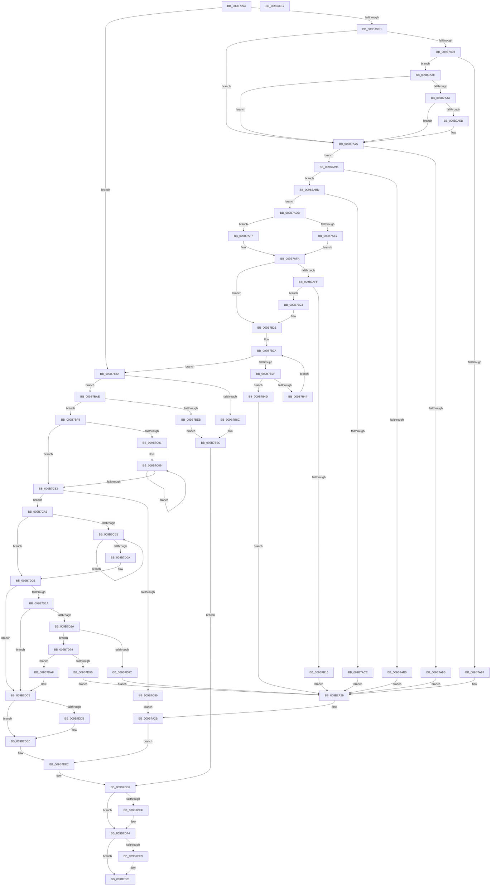

# HvpPerformLogFileRecovery

- RVA: `0x009B7994`–`0x009B7E18` (길이 `1,156` bytes)
- VA: `0x00000001409B7994`
- 실행 섹션: `PAGE`
- PDB 이름 있음: `예`; PDB Function 태그: `아니요`
- unwind 정보 RVA: `0x0009E8C8`
- 디코드: `301`개 명령, `1,156/1,156` bytes 표시
- 미해석 바이트: `0` (있으면 어셈블리에 `.byte`로 보존)

> 이 문서는 커널 이미지의 기계어와 PDB 기호를 분석해 생성했습니다. 4번과 5번은 함수 원형과 자료형을 바이너리 사용 방식에서 추정한 C 해석이며 원본 소스 복구 결과는 아닙니다.

## 1. Dependencies

- 직접 호출 지점: **27**; 고유 호출 대상: **21**
- 직접 호출자로 확인된 함수: **1**
- RIP 상대 이미지 참조: **0**

### Outgoing calls
- `0x009B7A19` → [CmpDoFileSetSizeEx](CmpDoFileSetSizeEx_function_009B2A4C.md) (function, `0x009B2A4C`)
- `0x009B7A34` → [SetFailureLocation](../../text/46/SetFailureLocation_function_0046EF54.md) (function, `0x0046EF54`)
- `0x009B7A54` → [HvpViewMapExtendStorage](HvpViewMapExtendStorage_function_009B4EF8.md) (function, `0x009B4EF8`)
- `0x009B7A70` → [SetFailureLocation](../../text/46/SetFailureLocation_function_0046EF54.md) (function, `0x0046EF54`)
- `0x009B7A80` → [HvpExpandMap](../A5/HvpExpandMap_function_00A56B90.md) (function, `0x00A56B90`)
- `0x009B7AA5` → [HvpAdjustHiveFreeDisplay](../84/HvpAdjustHiveFreeDisplay_function_0084DB80.md) (function, `0x0084DB80`)
- `0x009B7AC3` → [HvpGrowDirtyVectors](../../text/3E/HvpGrowDirtyVectors_function_003E2028.md) (function, `0x003E2028`)
- `0x009B7B0B` → [HvpMapHiveImageFromViewMap](HvpMapHiveImageFromViewMap_function_009B97F4.md) (function, `0x009B97F4`)
- `0x009B7B39` → [HvpAddDummyBinToHive](../7E/HvpAddDummyBinToHive_function_007EF80C.md) (function, `0x007EF80C`)
- `0x009B7B7B` → [CmpAllocatePool](../../text/3C/CmpAllocatePool_function_003CD504.md) (function, `0x003CD504`)
- `0x009B7BA4` → [SetFailureLocation](../../text/46/SetFailureLocation_function_0046EF54.md) (function, `0x0046EF54`)
- `0x009B7BE0` → [HvApplyLogFiles](../7F/HvApplyLogFiles_function_007F65E8.md) (function, `0x007F65E8`)
- `0x009B7C66` → [HvpSetRangeProtection](HvpSetRangeProtection_function_009B58C0.md) (function, `0x009B58C0`)
- `0x009B7C76` → [RtlMergeBitMaps](../../text/43/RtlMergeBitMaps_function_0043DF30.md) (function, `0x0043DF30`)
- `0x009B7C7E` → [RtlNumberOfSetBits](../../text/43/RtlNumberOfSetBits_function_00433F70.md) (function, `0x00433F70`)
- `0x009B7C8C` → [HvCheckAndUpdateHiveBackupTimeStamp](../87/HvCheckAndUpdateHiveBackupTimeStamp_function_0087BE90.md) (function, `0x0087BE90`)
- `0x009B7CF3` → [HvpLogTypeToLogArrayIndex](HvpLogTypeToLogArrayIndex_function_009B2DFC.md) (function, `0x009B2DFC`)
- `0x009B7D31` → [RtlMergeBitMaps](../../text/43/RtlMergeBitMaps_function_0043DF30.md) (function, `0x0043DF30`)
- `0x009B7D39` → [RtlNumberOfSetBits](../../text/43/RtlNumberOfSetBits_function_00433F70.md) (function, `0x00433F70`)
- `0x009B7D48` → [RtlClearAllBits](../../text/45/RtlClearAllBits_function_00450230.md) (function, `0x00450230`)
- `0x009B7D61` → [HvWriteHivePrimaryFile](HvWriteHivePrimaryFile_function_009B2374.md) (function, `0x009B2374`)
- `0x009B7D90` → [HvValidateOrInvalidatePrimaryFileHeader](HvValidateOrInvalidatePrimaryFileHeader_function_009B27A8.md) (function, `0x009B27A8`)
- `0x009B7DAB` → [RtlClearAllBits](../../text/45/RtlClearAllBits_function_00450230.md) (function, `0x00450230`)
- `0x009B7DBA` → [HvResetLogFileStatusAll](../A9/HvResetLogFileStatusAll_function_00A9EB5C.md) (function, `0x00A9EB5C`)
- `0x009B7DDB` → [HvFreeHivePartial](../A6/HvFreeHivePartial_function_00A66994.md) (function, `0x00A66994`)
- `0x009B7DEF` → [CmSiFreeMemory](../../text/47/CmSiFreeMemory_function_00475D80.md) (function, `0x00475D80`)
- `0x009B7DFC` → [CmSiFreeMemory](../../text/47/CmSiFreeMemory_function_00475D80.md) (function, `0x00475D80`)

### Direct callers
- [HvLoadHive](HvLoadHive_function_009B8138.md) at `0x009B85E6`

### Static image references
- 디코드된 RIP-relative 메모리 참조가 없습니다.

## 2. Other-region calls and transfers

- 다른 실행 섹션으로 향하는 call: **13**
  - `0x009B7A34` → [SetFailureLocation](../../text/46/SetFailureLocation_function_0046EF54.md) (`PAGE` → `.text`)
  - `0x009B7A70` → [SetFailureLocation](../../text/46/SetFailureLocation_function_0046EF54.md) (`PAGE` → `.text`)
  - `0x009B7AC3` → [HvpGrowDirtyVectors](../../text/3E/HvpGrowDirtyVectors_function_003E2028.md) (`PAGE` → `.text`)
  - `0x009B7B7B` → [CmpAllocatePool](../../text/3C/CmpAllocatePool_function_003CD504.md) (`PAGE` → `.text`)
  - `0x009B7BA4` → [SetFailureLocation](../../text/46/SetFailureLocation_function_0046EF54.md) (`PAGE` → `.text`)
  - `0x009B7C76` → [RtlMergeBitMaps](../../text/43/RtlMergeBitMaps_function_0043DF30.md) (`PAGE` → `.text`)
  - `0x009B7C7E` → [RtlNumberOfSetBits](../../text/43/RtlNumberOfSetBits_function_00433F70.md) (`PAGE` → `.text`)
  - `0x009B7D31` → [RtlMergeBitMaps](../../text/43/RtlMergeBitMaps_function_0043DF30.md) (`PAGE` → `.text`)
  - `0x009B7D39` → [RtlNumberOfSetBits](../../text/43/RtlNumberOfSetBits_function_00433F70.md) (`PAGE` → `.text`)
  - `0x009B7D48` → [RtlClearAllBits](../../text/45/RtlClearAllBits_function_00450230.md) (`PAGE` → `.text`)
  - `0x009B7DAB` → [RtlClearAllBits](../../text/45/RtlClearAllBits_function_00450230.md) (`PAGE` → `.text`)
  - `0x009B7DEF` → [CmSiFreeMemory](../../text/47/CmSiFreeMemory_function_00475D80.md) (`PAGE` → `.text`)
  - `0x009B7DFC` → [CmSiFreeMemory](../../text/47/CmSiFreeMemory_function_00475D80.md) (`PAGE` → `.text`)
- 별도 외부 분기/꼬리 이동을 확인하지 못했습니다.

## 3. Assembly (complete function range)

```asm
009B7994  44 89 44 24 18                  mov dword ptr [rsp + 0x18], r8d
009B7999  48 89 54 24 10                  mov qword ptr [rsp + 0x10], rdx
009B799E  55                              push rbp
009B799F  53                              push rbx
009B79A0  56                              push rsi
009B79A1  57                              push rdi
009B79A2  41 54                           push r12
009B79A4  41 55                           push r13
009B79A6  41 56                           push r14
009B79A8  41 57                           push r15
009B79AA  48 8D 6C 24 E9                  lea rbp, [rsp - 0x17]
009B79AF  48 81 EC 88 00 00 00            sub rsp, 0x88
009B79B6  45 8B 61 40                     mov r12d, dword ptr [r9 + 0x40]
009B79BA  48 8B F9                        mov rdi, rcx
009B79BD  4C 8B 75 7F                     mov r14, qword ptr [rbp + 0x7f]
009B79C1  33 C9                           xor ecx, ecx
009B79C3  0F 57 C0                        xorps xmm0, xmm0
009B79C6  48 89 4D 77                     mov qword ptr [rbp + 0x77], rcx
009B79CA  4D 8B E9                        mov r13, r9
009B79CD  48 89 4D DF                     mov qword ptr [rbp - 0x21], rcx
009B79D1  48 8B 47 40                     mov rax, qword ptr [rdi + 0x40]
009B79D5  48 89 4D E7                     mov qword ptr [rbp - 0x19], rcx
009B79D9  8D 71 1B                        lea esi, [rcx + 0x1b]
009B79DC  48 89 4D 5F                     mov qword ptr [rbp + 0x5f], rcx
009B79E0  0F 11 45 EF                     movups xmmword ptr [rbp - 0x11], xmm0
009B79E4  44 8B 78 28                     mov r15d, dword ptr [rax + 0x28]
009B79E8  45 3B E7                        cmp r12d, r15d
009B79EB  45 0F 46 E7                     cmovbe r12d, r15d
009B79EF  44 89 65 6F                     mov dword ptr [rbp + 0x6f], r12d
009B79F3  45 3B E7                        cmp r12d, r15d
009B79F6  0F 86 5E 01 00 00               jbe 0x1409b7b5a
009B79FC  F7 87 A0 00 00 00 01 80 00 00   test dword ptr [rdi + 0xa0], 0x8001
009B7A06  75 6D                           jne 0x1409b7a75
009B7A08  44 8D 49 01                     lea r9d, [rcx + 1]
009B7A0C  33 D2                           xor edx, edx
009B7A0E  48 8B CF                        mov rcx, rdi
009B7A11  45 8D 84 24 00 10 00 00         lea r8d, [r12 + 0x1000]
009B7A19  E8 2E B0 FF FF                  call 0x1409b2a4c
009B7A1E  8B D8                           mov ebx, eax
009B7A20  85 C0                           test eax, eax
009B7A22  79 1A                           jns 0x1409b7a3e
009B7A24  83 64 24 20 00                  and dword ptr [rsp + 0x20], 0
009B7A29  33 D2                           xor edx, edx
009B7A2B  44 8B C8                        mov r9d, eax
009B7A2E  44 8B C6                        mov r8d, esi
009B7A31  49 8B CE                        mov rcx, r14
009B7A34  E8 1B 75 AB FF                  call 0x14046ef54
009B7A39  E9 A4 03 00 00                  jmp 0x1409b7de2
009B7A3E  F7 87 A0 00 00 00 00 00 02 00   test dword ptr [rdi + 0xa0], 0x20000
009B7A48  74 2B                           je 0x1409b7a75
009B7A4A  48 8D 8F E0 00 00 00            lea rcx, [rdi + 0xe0]
009B7A51  41 8B D4                        mov edx, r12d
009B7A54  E8 9F D4 FF FF                  call 0x1409b4ef8
009B7A59  85 C0                           test eax, eax
009B7A5B  79 18                           jns 0x1409b7a75
009B7A5D  44 8B C8                        mov r9d, eax
009B7A60  C7 44 24 20 10 00 00 00         mov dword ptr [rsp + 0x20], 0x10
009B7A68  44 8B C6                        mov r8d, esi
009B7A6B  33 D2                           xor edx, edx
009B7A6D  49 8B CE                        mov rcx, r14
009B7A70  E8 DF 74 AB FF                  call 0x14046ef54
009B7A75  45 8B CC                        mov r9d, r12d
009B7A78  45 8B C7                        mov r8d, r15d
009B7A7B  33 D2                           xor edx, edx
009B7A7D  48 8B CF                        mov rcx, rdi
009B7A80  E8 0B F1 09 00                  call 0x140a56b90
009B7A85  8B D8                           mov ebx, eax
009B7A87  85 C0                           test eax, eax
009B7A89  79 0A                           jns 0x1409b7a95
009B7A8B  C7 44 24 20 20 00 00 00         mov dword ptr [rsp + 0x20], 0x20
009B7A93  EB 94                           jmp 0x1409b7a29
009B7A95  45 33 C0                        xor r8d, r8d
009B7A98  44 89 A7 18 01 00 00            mov dword ptr [rdi + 0x118], r12d
009B7A9F  41 8B D4                        mov edx, r12d
009B7AA2  48 8B CF                        mov rcx, rdi
009B7AA5  E8 D6 60 E9 FF                  call 0x14084db80
009B7AAA  8B D8                           mov ebx, eax
009B7AAC  85 C0                           test eax, eax
009B7AAE  79 0D                           jns 0x1409b7abd
009B7AB0  C7 44 24 20 30 00 00 00         mov dword ptr [rsp + 0x20], 0x30
009B7AB8  E9 6C FF FF FF                  jmp 0x1409b7a29
009B7ABD  41 8B D4                        mov edx, r12d
009B7AC0  48 8B CF                        mov rcx, rdi
009B7AC3  E8 60 A5 A2 FF                  call 0x1403e2028
009B7AC8  8B D8                           mov ebx, eax
009B7ACA  85 C0                           test eax, eax
009B7ACC  79 0D                           jns 0x1409b7adb
009B7ACE  C7 44 24 20 40 00 00 00         mov dword ptr [rsp + 0x20], 0x40
009B7AD6  E9 4E FF FF FF                  jmp 0x1409b7a29
009B7ADB  F7 87 A0 00 00 00 00 00 02 00   test dword ptr [rdi + 0xa0], 0x20000
009B7AE5  74 10                           je 0x1409b7af7
009B7AE7  44 8B A7 E8 00 00 00            mov r12d, dword ptr [rdi + 0xe8]
009B7AEE  41 81 EC 00 10 00 00            sub r12d, 0x1000
009B7AF5  EB 03                           jmp 0x1409b7afa
009B7AF7  45 33 E4                        xor r12d, r12d
009B7AFA  45 3B FC                        cmp r15d, r12d
009B7AFD  73 27                           jae 0x1409b7b26
009B7AFF  45 8B C4                        mov r8d, r12d
009B7B02  41 8B D7                        mov edx, r15d
009B7B05  45 2B C7                        sub r8d, r15d
009B7B08  48 8B CF                        mov rcx, rdi
009B7B0B  E8 E4 1C 00 00                  call 0x1409b97f4
009B7B10  8B D8                           mov ebx, eax
009B7B12  85 C0                           test eax, eax
009B7B14  79 0D                           jns 0x1409b7b23
009B7B16  C7 44 24 20 50 00 00 00         mov dword ptr [rsp + 0x20], 0x50
009B7B1E  E9 06 FF FF FF                  jmp 0x1409b7a29
009B7B23  45 8B FC                        mov r15d, r12d
009B7B26  44 8B 65 6F                     mov r12d, dword ptr [rbp + 0x6f]
009B7B2A  45 3B FC                        cmp r15d, r12d
009B7B2D  73 2B                           jae 0x1409b7b5a
009B7B2F  4C 8D 45 77                     lea r8, [rbp + 0x77]
009B7B33  41 8B D7                        mov edx, r15d
009B7B36  48 8B CF                        mov rcx, rdi
009B7B39  E8 CE 7C E3 FF                  call 0x1407ef80c
009B7B3E  8B D8                           mov ebx, eax
009B7B40  85 C0                           test eax, eax
009B7B42  78 09                           js 0x1409b7b4d
009B7B44  41 81 C7 00 10 00 00            add r15d, 0x1000
009B7B4B  EB DD                           jmp 0x1409b7b2a
009B7B4D  C7 44 24 20 60 00 00 00         mov dword ptr [rsp + 0x20], 0x60
009B7B55  E9 CF FE FF FF                  jmp 0x1409b7a29
009B7B5A  B9 FC FF FF FF                  mov ecx, 0xfffffffc
009B7B5F  41 8B DC                        mov ebx, r12d
009B7B62  C1 EB 09                        shr ebx, 9
009B7B65  41 B8 43 4D 33 38               mov r8d, 0x38334d43
009B7B6B  8B D3                           mov edx, ebx
009B7B6D  C1 EA 03                        shr edx, 3
009B7B70  83 C2 03                        add edx, 3
009B7B73  48 23 D1                        and rdx, rcx
009B7B76  B9 00 01 00 00                  mov ecx, 0x100
009B7B7B  E8 84 59 A1 FF                  call 0x1403cd504
009B7B80  48 89 45 5F                     mov qword ptr [rbp + 0x5f], rax
009B7B84  4C 8B F8                        mov r15, rax
009B7B87  48 85 C0                        test rax, rax
009B7B8A  75 22                           jne 0x1409b7bae
009B7B8C  BB 9A 00 00 C0                  mov ebx, 0xc000009a
009B7B91  C7 44 24 20 70 00 00 00         mov dword ptr [rsp + 0x20], 0x70
009B7B99  44 8B CB                        mov r9d, ebx
009B7B9C  44 8B C6                        mov r8d, esi
009B7B9F  33 D2                           xor edx, edx
009B7BA1  49 8B CE                        mov rcx, r14
009B7BA4  E8 AB 73 AB FF                  call 0x14046ef54
009B7BA9  E9 38 02 00 00                  jmp 0x1409b7de6
009B7BAE  48 8B 55 67                     mov rdx, qword ptr [rbp + 0x67]
009B7BB2  4D 8B CD                        mov r9, r13
009B7BB5  48 8B 4F 40                     mov rcx, qword ptr [rdi + 0x40]
009B7BB9  48 89 45 E7                     mov qword ptr [rbp - 0x19], rax
009B7BBD  48 8D 45 DF                     lea rax, [rbp - 0x21]
009B7BC1  48 89 44 24 40                  mov qword ptr [rsp + 0x40], rax
009B7BC6  48 8B 47 20                     mov rax, qword ptr [rdi + 0x20]
009B7BCA  48 89 44 24 38                  mov qword ptr [rsp + 0x38], rax
009B7BCF  48 8B 47 18                     mov rax, qword ptr [rdi + 0x18]
009B7BD3  48 89 44 24 30                  mov qword ptr [rsp + 0x30], rax
009B7BD8  48 89 7C 24 28                  mov qword ptr [rsp + 0x28], rdi
009B7BDD  89 5D DF                        mov dword ptr [rbp - 0x21], ebx
009B7BE0  E8 03 EA E3 FF                  call 0x1407f65e8
009B7BE5  8B D8                           mov ebx, eax
009B7BE7  85 C0                           test eax, eax
009B7BE9  79 0D                           jns 0x1409b7bf8
009B7BEB  C7 44 24 20 80 00 00 00         mov dword ptr [rsp + 0x20], 0x80
009B7BF3  44 8B C8                        mov r9d, eax
009B7BF6  EB A4                           jmp 0x1409b7b9c
009B7BF8  45 33 D2                        xor r10d, r10d
009B7BFB  45 39 55 3C                     cmp dword ptr [r13 + 0x3c], r10d
009B7BFF  76 52                           jbe 0x1409b7c53
009B7C01  45 33 DB                        xor r11d, r11d
009B7C04  BB FF 00 00 00                  mov ebx, 0xff
009B7C09  47 8B 4C 95 34                  mov r9d, dword ptr [r13 + r10*4 + 0x34]
009B7C0E  41 8B CB                        mov ecx, r11d
009B7C11  4B 8D 14 49                     lea rdx, [r9 + r9*2]
009B7C15  41 0F B7 44 D5 08               movzx eax, word ptr [r13 + rdx*8 + 8]
009B7C1B  66 D3 E0                        shl ax, cl
009B7C1E  8B CB                           mov ecx, ebx
009B7C20  66 09 87 D0 00 00 00            or word ptr [rdi + 0xd0], ax
009B7C27  45 8B 44 D5 10                  mov r8d, dword ptr [r13 + rdx*8 + 0x10]
009B7C2C  45 2B 44 D5 0C                  sub r8d, dword ptr [r13 + rdx*8 + 0xc]
009B7C31  41 FF C0                        inc r8d
009B7C34  44 3B C3                        cmp r8d, ebx
009B7C37  41 0F B6 C0                     movzx eax, r8b
009B7C3B  0F 42 C8                        cmovb ecx, eax
009B7C3E  41 FF C2                        inc r10d
009B7C41  41 83 C3 03                     add r11d, 3
009B7C45  41 88 8C 39 D2 00 00 00         mov byte ptr [r9 + rdi + 0xd2], cl
009B7C4D  45 3B 55 3C                     cmp r10d, dword ptr [r13 + 0x3c]
009B7C51  72 B6                           jb 0x1409b7c09
009B7C53  4C 8B 47 40                     mov r8, qword ptr [rdi + 0x40]
009B7C57  41 B9 02 00 00 00               mov r9d, 2
009B7C5D  33 D2                           xor edx, edx
009B7C5F  48 8B CF                        mov rcx, rdi
009B7C62  45 8B 40 28                     mov r8d, dword ptr [r8 + 0x28]
009B7C66  E8 55 DC FF FF                  call 0x1409b58c0
009B7C6B  4C 8D 7F 70                     lea r15, [rdi + 0x70]
009B7C6F  49 8B CF                        mov rcx, r15
009B7C72  48 8D 55 DF                     lea rdx, [rbp - 0x21]
009B7C76  E8 B5 62 A8 FF                  call 0x14043df30
009B7C7B  49 8B CF                        mov rcx, r15
009B7C7E  E8 ED C2 A7 FF                  call 0x140433f70
009B7C83  48 8B CF                        mov rcx, rdi
009B7C86  89 87 80 00 00 00               mov dword ptr [rdi + 0x80], eax
009B7C8C  E8 FF 41 EC FF                  call 0x14087be90
009B7C91  33 D2                           xor edx, edx
009B7C93  8B D8                           mov ebx, eax
009B7C95  85 C0                           test eax, eax
009B7C97  79 0D                           jns 0x1409b7ca6
009B7C99  C7 44 24 20 90 00 00 00         mov dword ptr [rsp + 0x20], 0x90
009B7CA1  E9 85 FD FF FF                  jmp 0x1409b7a2b
009B7CA6  C6 87 C2 00 00 00 00            mov byte ptr [rdi + 0xc2], 0
009B7CAD  41 8B 45 44                     mov eax, dword ptr [r13 + 0x44]
009B7CB1  89 87 B8 00 00 00               mov dword ptr [rdi + 0xb8], eax
009B7CB7  41 8B 45 48                     mov eax, dword ptr [r13 + 0x48]
009B7CBB  89 87 A8 00 00 00               mov dword ptr [rdi + 0xa8], eax
009B7CC1  41 8B 45 50                     mov eax, dword ptr [r13 + 0x50]
009B7CC5  89 87 AC 00 00 00               mov dword ptr [rdi + 0xac], eax
009B7CCB  41 8B 45 4C                     mov eax, dword ptr [r13 + 0x4c]
009B7CCF  89 87 B0 00 00 00               mov dword ptr [rdi + 0xb0], eax
009B7CD5  41 8B 45 54                     mov eax, dword ptr [r13 + 0x54]
009B7CD9  89 87 B4 00 00 00               mov dword ptr [rdi + 0xb4], eax
009B7CDF  41 39 55 3C                     cmp dword ptr [r13 + 0x3c], edx
009B7CE3  76 29                           jbe 0x1409b7d0e
009B7CE5  41 8B 4C 95 34                  mov ecx, dword ptr [r13 + rdx*4 + 0x34]
009B7CEA  48 8D 0C 49                     lea rcx, [rcx + rcx*2]
009B7CEE  41 8B 4C CD 08                  mov ecx, dword ptr [r13 + rcx*8 + 8]
009B7CF3  E8 04 B1 FF FF                  call 0x1409b2dfc
009B7CF8  8B C8                           mov ecx, eax
009B7CFA  FF C2                           inc edx
009B7CFC  C6 84 39 C0 00 00 00 01         mov byte ptr [rcx + rdi + 0xc0], 1
009B7D04  41 3B 55 3C                     cmp edx, dword ptr [r13 + 0x3c]
009B7D08  72 DB                           jb 0x1409b7ce5
009B7D0A  4C 8D 7F 70                     lea r15, [rdi + 0x70]
009B7D0E  41 8B 45 58                     mov eax, dword ptr [r13 + 0x58]
009B7D12  A8 01                           test al, 1
009B7D14  0F 84 AF 00 00 00               je 0x1409b7dc9
009B7D1A  F7 87 A0 00 00 00 01 80 00 00   test dword ptr [rdi + 0xa0], 0x8001
009B7D24  0F 85 9F 00 00 00               jne 0x1409b7dc9
009B7D2A  48 8D 57 58                     lea rdx, [rdi + 0x58]
009B7D2E  49 8B CF                        mov rcx, r15
009B7D31  E8 FA 61 A8 FF                  call 0x14043df30
009B7D36  49 8B CF                        mov rcx, r15
009B7D39  E8 32 C2 A7 FF                  call 0x140433f70
009B7D3E  48 8D 4F 58                     lea rcx, [rdi + 0x58]
009B7D42  89 87 80 00 00 00               mov dword ptr [rdi + 0x80], eax
009B7D48  E8 E3 84 A9 FF                  call 0x140450230
009B7D4D  83 67 68 00                     and dword ptr [rdi + 0x68], 0
009B7D51  45 33 C0                        xor r8d, r8d
009B7D54  0F BA AF A0 00 00 00 08         bts dword ptr [rdi + 0xa0], 8
009B7D5C  33 D2                           xor edx, edx
009B7D5E  48 8B CF                        mov rcx, rdi
009B7D61  E8 0E A6 FF FF                  call 0x1409b2374
009B7D66  8B D8                           mov ebx, eax
009B7D68  85 C0                           test eax, eax
009B7D6A  79 0D                           jns 0x1409b7d79
009B7D6C  C7 44 24 20 00 01 00 00         mov dword ptr [rsp + 0x20], 0x100
009B7D74  E9 B0 FC FF FF                  jmp 0x1409b7a29
009B7D79  8B 87 AC 00 00 00               mov eax, dword ptr [rdi + 0xac]
009B7D7F  45 33 C9                        xor r9d, r9d
009B7D82  45 33 C0                        xor r8d, r8d
009B7D85  89 87 B8 00 00 00               mov dword ptr [rdi + 0xb8], eax
009B7D8B  B2 01                           mov dl, 1
009B7D8D  48 8B CF                        mov rcx, rdi
009B7D90  E8 13 AA FF FF                  call 0x1409b27a8
009B7D95  8B D8                           mov ebx, eax
009B7D97  85 C0                           test eax, eax
009B7D99  79 0D                           jns 0x1409b7da8
009B7D9B  C7 44 24 20 10 01 00 00         mov dword ptr [rsp + 0x20], 0x110
009B7DA3  E9 81 FC FF FF                  jmp 0x1409b7a29
009B7DA8  49 8B CF                        mov rcx, r15
009B7DAB  E8 80 84 A9 FF                  call 0x140450230
009B7DB0  83 A7 80 00 00 00 00            and dword ptr [rdi + 0x80], 0
009B7DB7  48 8B CF                        mov rcx, rdi
009B7DBA  E8 9D 6D 0E 00                  call 0x140a9eb5c
009B7DBF  C7 87 A8 00 00 00 01 00 00 00   mov dword ptr [rdi + 0xa8], 1
009B7DC9  48 8B 47 40                     mov rax, qword ptr [rdi + 0x40]
009B7DCD  8B 50 28                        mov edx, dword ptr [rax + 0x28]
009B7DD0  41 3B D4                        cmp edx, r12d
009B7DD3  73 0B                           jae 0x1409b7de0
009B7DD5  45 33 C0                        xor r8d, r8d
009B7DD8  48 8B CF                        mov rcx, rdi
009B7DDB  E8 B4 EB 0A 00                  call 0x140a66994
009B7DE0  33 DB                           xor ebx, ebx
009B7DE2  4C 8B 7D 5F                     mov r15, qword ptr [rbp + 0x5f]
009B7DE6  48 8B 4D F7                     mov rcx, qword ptr [rbp - 9]
009B7DEA  48 85 C9                        test rcx, rcx
009B7DED  74 05                           je 0x1409b7df4
009B7DEF  E8 8C DF AB FF                  call 0x140475d80
009B7DF4  4D 85 FF                        test r15, r15
009B7DF7  74 08                           je 0x1409b7e01
009B7DF9  49 8B CF                        mov rcx, r15
009B7DFC  E8 7F DF AB FF                  call 0x140475d80
009B7E01  8B C3                           mov eax, ebx
009B7E03  48 81 C4 88 00 00 00            add rsp, 0x88
009B7E0A  41 5F                           pop r15
009B7E0C  41 5E                           pop r14
009B7E0E  41 5D                           pop r13
009B7E10  41 5C                           pop r12
009B7E12  5F                              pop rdi
009B7E13  5E                              pop rsi
009B7E14  5B                              pop rbx
009B7E15  5D                              pop rbp
009B7E16  C3                              ret
009B7E17  CC                              int3
```

## 4. C-style interpretation (structured pseudocode)

```c
__int64 __fastcall HvpPerformLogFileRecovery(__int64 a1, __int64 a2, int a3, __int64 a4, __int64 a5)
{
    __int64 result;
    __int64 v_r10;
    __int64 v_r11;
    __int64 v_r12;
    __int64 v_r15;
    __int64 v_rbx;
    __int64 v_rsp;
    unsigned __int64 v_stack_m57;
    unsigned __int64 v_stack_m60;
    unsigned __int64 v_stack_m68;
    unsigned __int64 v_stack_m70;
    unsigned __int64 v_stack_m78;
    unsigned __int64 v_stack_m88;
    unsigned __int64 v_stack_m90;
    unsigned __int64 v_stack_m98;
    unsigned __int64 v_stack_mA0;
    unsigned int v_stack_mA8;
    unsigned __int64 v_stack_p10;
    unsigned int v_stack_p18;
    unsigned __int64 v_stack_p20;
    unsigned __int64 v_stack_p8;

    v_stack_p18 = a3;
    v_stack_p10 = a2;
    v_rsp = (v_rsp) - (136);
    a1 = 0;
    v_stack_p20 = 0;
    v_stack_m78 = 0;
    v_stack_m70 = 0;
    v_stack_p8 = 0;
    v_stack_m68 = v_xmm0;
    v_r12 = (unsigned int)(*(unsigned int *)(a4 + 64));
    if (((unsigned int)((unsigned int)(*(unsigned int *)(a4 + 64)))) <= ((unsigned int)((unsigned int)(*(unsigned int *)(*(unsigned __int64 *)(a1 + 64) + 40))))) { v_r12 = (unsigned int)((unsigned int)(*(unsigned int *)(*(unsigned __int64 *)(a1 + 64) + 40))); }
    v_stack_p18 = (unsigned int)(v_r12);
    if (((unsigned int)(v_r12)) <= ((unsigned int)((unsigned int)(*(unsigned int *)(*(unsigned __int64 *)(a1 + 64) + 40))))) goto loc_009B7B5A;
    if (((*(unsigned int *)(a1 + 160)) & (0x8001ULL)) != 0) goto loc_009B7A75;
    a2 = 0;
    result = CmpDoFileSetSizeEx(0, a2, v_r12 + 4096, a1 + 1);
    if (!sign_flag) goto loc_009B7A3E;
loc_009B7A29:
    a2 = 0;
loc_009B7A2B:
    result = SetFailureLocation(a5, a2, (unsigned int)((unsigned int)(a1 + 27)), (unsigned int)((unsigned int)(result)));
    goto loc_009B7DE2;
loc_009B7A3E:
    if (((*(unsigned int *)(a1 + 160)) & (0x20000ULL)) == 0) goto loc_009B7A75;
    result = HvpViewMapExtendStorage(a1 + 224, (unsigned int)((unsigned int)(v_r12)), (unsigned int)((unsigned int)(a1 + 27)), (unsigned int)((unsigned int)(result)));
    if (sign_flag) {
        a4 = (unsigned int)(result);
        v_stack_mA8 = 16;
        a3 = (unsigned int)(a1 + 27);
        a2 = 0;
        a1 = a5;
        result = SetFailureLocation(a1, a2, a3, a4);
    }
    a2 = 0;
    result = HvpExpandMap(a1, a2, (unsigned int)((unsigned int)((unsigned int)(*(unsigned int *)(*(unsigned __int64 *)(a1 + 64) + 40)))), (unsigned int)((unsigned int)(v_r12)));
    if (!sign_flag) goto loc_009B7A95;
    v_stack_mA8 = 32;
    goto loc_009B7A29;
loc_009B7A95:
    a3 = 0;
    *(unsigned int *)(a1 + 280) = (unsigned int)(v_r12);
    result = HvpAdjustHiveFreeDisplay(a1, (unsigned int)((unsigned int)(v_r12)), a3, (unsigned int)((unsigned int)(v_r12)));
    if (!sign_flag) goto loc_009B7ABD;
    v_stack_mA8 = 48;
    goto loc_009B7A29;
loc_009B7ABD:
    result = HvpGrowDirtyVectors(a1, (unsigned int)((unsigned int)(v_r12)), a3, (unsigned int)((unsigned int)(v_r12)));
    if (!sign_flag) goto loc_009B7ADB;
    v_stack_mA8 = 64;
    goto loc_009B7A29;
loc_009B7ADB:
    if (((*(unsigned int *)(a1 + 160)) & (0x20000ULL)) == 0) goto loc_009B7AF7;
    v_r12 = (unsigned int)(((unsigned int)(*(unsigned int *)(a1 + 232))) - (0x1000ULL));
    goto loc_009B7AFA;
loc_009B7AF7:
    v_r12 = 0;
loc_009B7AFA:
    if (((unsigned int)((unsigned int)(*(unsigned int *)(*(unsigned __int64 *)(a1 + 64) + 40)))) >= 0) goto loc_009B7B26;
    a3 = (unsigned int)((0) - ((unsigned int)((unsigned int)(*(unsigned int *)(*(unsigned __int64 *)(a1 + 64) + 40)))));
    result = HvpMapHiveImageFromViewMap(a1, (unsigned int)((unsigned int)((unsigned int)(*(unsigned int *)(*(unsigned __int64 *)(a1 + 64) + 40)))), a3, (unsigned int)((unsigned int)(v_r12)));
    if (!sign_flag) goto loc_009B7B23;
    v_stack_mA8 = 80;
    goto loc_009B7A29;
loc_009B7B23:
loc_009B7B26:
loc_009B7B2A:
    if (0 >= ((unsigned int)((unsigned int)(v_stack_p18)))) goto loc_009B7B5A;
    result = HvpAddDummyBinToHive(a1, 0, v_stack_p20, (unsigned int)((unsigned int)(v_r12)));
    if (sign_flag) goto loc_009B7B4D;
    v_r15 = (unsigned int)((0) + (0x1000ULL));
    goto loc_009B7B2A;
loc_009B7B4D:
    v_stack_mA8 = 96;
    goto loc_009B7A29;
loc_009B7B5A:
    v_rbx = (unsigned int)(((unsigned int)((unsigned int)((unsigned int)(v_stack_p18)))) >> (9));
    a2 = (unsigned int)(((unsigned int)((unsigned int)(v_rbx))) >> (3));
    a2 = (unsigned int)((a2) + (3));
    a2 = (a2) & ((unsigned int)(0xFFFFFFFCULL));
    result = CmpAllocatePool(256, a2, (unsigned int)(0x38334D43ULL), (unsigned int)((unsigned int)(v_r12)));
    v_stack_p8 = result;
    if (result != 0) goto loc_009B7BAE;
    v_stack_mA8 = 112;
loc_009B7B9C:
    a2 = 0;
    result = SetFailureLocation(a5, a2, (unsigned int)((unsigned int)(a1 + 27)), (unsigned int)((unsigned int)((unsigned int)(0xC000009AULL))));
    goto loc_009B7DE6;
loc_009B7BAE:
    v_stack_m70 = result;
    v_stack_m88 = v_stack_m78;
    v_stack_m90 = *(unsigned __int64 *)(a1 + 32);
    v_stack_m98 = *(unsigned __int64 *)(a1 + 24);
    v_stack_mA0 = a1;
    v_stack_m78 = (unsigned int)((unsigned int)(0xC000009AULL));
    result = HvApplyLogFiles(*(unsigned __int64 *)(a1 + 64), v_stack_p10, (unsigned int)((unsigned int)(a1 + 27)), a4);
    if (!sign_flag) goto loc_009B7BF8;
    v_stack_mA8 = 128;
    goto loc_009B7B9C;
loc_009B7BF8:
    v_r10 = 0;
    if ((*(unsigned int *)(a4 + 60)) <= 0) goto loc_009B7C53;
    v_r11 = 0;
loc_009B7C09:
    result = (unsigned __int16)((*(unsigned __int16 *)(a4 + (unsigned int)(*(unsigned int *)(a4 + v_r10 * 4 + 52)) + (unsigned int)(*(unsigned int *)(a4 + v_r10 * 4 + 52)) * 2 * 8 + 8)) << (0));
    a3 = (unsigned int)(((unsigned int)(*(unsigned int *)(a4 + (unsigned int)(*(unsigned int *)(a4 + v_r10 * 4 + 52)) + (unsigned int)(*(unsigned int *)(a4 + v_r10 * 4 + 52)) * 2 * 8 + 16))) - (*(unsigned int *)(a4 + (unsigned int)(*(unsigned int *)(a4 + v_r10 * 4 + 52)) + (unsigned int)(*(unsigned int *)(a4 + v_r10 * 4 + 52)) * 2 * 8 + 12)));
    a3 = (unsigned int)((a3) + 1);
    a1 = 255;
    if (a3 < 255) { a1 = (unsigned int)((unsigned __int8)(a3)); }
    v_r10 = (unsigned int)((v_r10) + 1);
    v_r11 = (unsigned int)((v_r11) + (3));
    *(unsigned __int8 *)((unsigned int)(*(unsigned int *)(a4 + v_r10 * 4 + 52)) + a1 * 1 + 210) = (unsigned __int8)(a1);
    if (((unsigned int)(v_r10)) < (*(unsigned int *)(a4 + 60))) goto loc_009B7C09;
loc_009B7C53:
    a2 = 0;
    result = HvpSetRangeProtection(a1, a2, (unsigned int)(*(unsigned int *)(*(unsigned __int64 *)(a1 + 64) + 40)), 2);
    result = RtlMergeBitMaps(a1 + 112, v_stack_m78, (unsigned int)(*(unsigned int *)(*(unsigned __int64 *)(a1 + 64) + 40)), 2);
    result = RtlNumberOfSetBits(a1 + 112, v_stack_m78, (unsigned int)(*(unsigned int *)(*(unsigned __int64 *)(a1 + 64) + 40)), 2);
    *(unsigned int *)(a1 + 128) = (unsigned int)(result);
    result = HvCheckAndUpdateHiveBackupTimeStamp(a1, v_stack_m78, (unsigned int)(*(unsigned int *)(*(unsigned __int64 *)(a1 + 64) + 40)), 2);
    a2 = 0;
    if (!sign_flag) goto loc_009B7CA6;
    v_stack_mA8 = 144;
    goto loc_009B7A2B;
loc_009B7CA6:
    *(unsigned __int8 *)(a1 + 194) = 0;
    *(unsigned int *)(a1 + 184) = (unsigned int)((unsigned int)(*(unsigned int *)(a4 + 68)));
    *(unsigned int *)(a1 + 168) = (unsigned int)((unsigned int)(*(unsigned int *)(a4 + 72)));
    *(unsigned int *)(a1 + 172) = (unsigned int)((unsigned int)(*(unsigned int *)(a4 + 80)));
    *(unsigned int *)(a1 + 176) = (unsigned int)((unsigned int)(*(unsigned int *)(a4 + 76)));
    *(unsigned int *)(a1 + 180) = (unsigned int)((unsigned int)(*(unsigned int *)(a4 + 84)));
    if ((*(unsigned int *)(a4 + 60)) <= 0) goto loc_009B7D0E;
loc_009B7CE5:
    result = HvpLogTypeToLogArrayIndex((unsigned int)(*(unsigned int *)(a4 + (unsigned int)(*(unsigned int *)(a4 + a2 * 4 + 52)) + (unsigned int)(*(unsigned int *)(a4 + a2 * 4 + 52)) * 2 * 8 + 8)), a2, (unsigned int)(*(unsigned int *)(*(unsigned __int64 *)(a1 + 64) + 40)), 2);
    a2 = (unsigned int)((a2) + 1);
    *(unsigned __int8 *)((unsigned int)((unsigned int)(result)) + a1 * 1 + 192) = 1;
    if (((unsigned int)(a2)) < (*(unsigned int *)(a4 + 60))) goto loc_009B7CE5;
loc_009B7D0E:
    if ((((unsigned __int8)((unsigned int)(*(unsigned int *)(a4 + 88)))) & (1)) == 0) goto loc_009B7DC9;
    if (((*(unsigned int *)(a1 + 160)) & (0x8001ULL)) != 0) goto loc_009B7DC9;
    result = RtlMergeBitMaps(a1 + 112, a1 + 88, (unsigned int)(*(unsigned int *)(*(unsigned __int64 *)(a1 + 64) + 40)), 2);
    result = RtlNumberOfSetBits(a1 + 112, a1 + 88, (unsigned int)(*(unsigned int *)(*(unsigned __int64 *)(a1 + 64) + 40)), 2);
    *(unsigned int *)(a1 + 128) = (unsigned int)(result);
    result = RtlClearAllBits(a1 + 88, a1 + 88, (unsigned int)(*(unsigned int *)(*(unsigned __int64 *)(a1 + 64) + 40)), 2);
    a3 = 0;
    a2 = 0;
    result = HvWriteHivePrimaryFile(a1, a2, a3, 2);
    if (!sign_flag) goto loc_009B7D79;
    v_stack_mA8 = 256;
    goto loc_009B7A29;
loc_009B7D79:
    a4 = 0;
    a3 = 0;
    *(unsigned int *)(a1 + 184) = (unsigned int)((unsigned int)(*(unsigned int *)(a1 + 172)));
    result = HvValidateOrInvalidatePrimaryFileHeader(a1, 1, a3, a4);
    if (!sign_flag) goto loc_009B7DA8;
    v_stack_mA8 = 272;
    goto loc_009B7A29;
loc_009B7DA8:
    result = RtlClearAllBits(a1 + 112, 1, a3, a4);
    result = HvResetLogFileStatusAll(a1, 1, a3, a4);
    *(unsigned int *)(a1 + 168) = 1;
loc_009B7DC9:
    result = *(unsigned __int64 *)(a1 + 64);
    if (((unsigned int)((unsigned int)(*(unsigned int *)(*(unsigned __int64 *)(a1 + 64) + 40)))) < ((unsigned int)((unsigned int)(v_stack_p18)))) {
        a3 = 0;
        a1 = a1;
        result = HvFreeHivePartial(a1, (unsigned int)(*(unsigned int *)(*(unsigned __int64 *)(a1 + 64) + 40)), a3, a4);
    }
    v_rbx = 0;
loc_009B7DE2:
loc_009B7DE6:
    if (v_stack_m60 != 0) {
        result = CmSiFreeMemory(v_stack_m60, (unsigned int)(*(unsigned int *)(*(unsigned __int64 *)(a1 + 64) + 40)), a3, a4);
    }
    if (v_stack_p8 != 0) {
        a1 = v_stack_p8;
        result = CmSiFreeMemory(a1, (unsigned int)(*(unsigned int *)(*(unsigned __int64 *)(a1 + 64) + 40)), a3, a4);
    }
    v_rsp = (v_rsp) + (136);
    return 0;
}
```

## 5. (Beta) C Style

```c
int64_t HvpPerformLogFileRecovery(void *Arg1, int64_t Arg2, int32_t Arg3, void *Arg4, int64_t Arg5)
{
    uint8_t *arg1 = (uint8_t *)Arg1;
    uint8_t *arg4 = (uint8_t *)Arg4;

    int64_t result;
    int64_t local_r10;
    int64_t local_r11;
    int64_t local_r12;
    int64_t local_r15;
    int64_t local_rbx;
    int64_t local_rsp;
    uint64_t v_stack_m57;
    uint64_t v_stack_m60;
    uint64_t v_stack_m68;
    uint64_t v_stack_m70;
    uint64_t v_stack_m78;
    uint64_t v_stack_m88;
    uint64_t v_stack_m90;
    uint64_t v_stack_m98;
    uint64_t v_stack_mA0;
    uint32_t v_stack_mA8;
    uint64_t v_stack_p10;
    uint32_t v_stack_p18;
    uint64_t v_stack_p20;
    uint64_t v_stack_p8;

    v_stack_p18 = Arg3;
    v_stack_p10 = Arg2;
    local_rsp = (local_rsp) - (136);
    Arg1 = 0;
    v_stack_p20 = 0;
    v_stack_m78 = 0;
    v_stack_m70 = 0;
    v_stack_p8 = 0;
    v_stack_m68 = v_xmm0;
    local_r12 = (uint32_t)(*(uint32_t *)(arg4 + 0x40));
    if (((uint32_t)((uint32_t)(*(uint32_t *)(arg4 + 0x40)))) <= ((uint32_t)((uint32_t)(*(uint32_t *)(*(uint64_t *)(arg1 + 0x40) + 0x28))))) { local_r12 = (uint32_t)((uint32_t)(*(uint32_t *)(*(uint64_t *)(arg1 + 0x40) + 0x28))); }
    v_stack_p18 = (uint32_t)(local_r12);
    if (((uint32_t)(local_r12)) <= ((uint32_t)((uint32_t)(*(uint32_t *)(*(uint64_t *)(arg1 + 0x40) + 0x28))))) goto loc_009B7B5A;
    if (((*(uint32_t *)(arg1 + 0xA0)) & (0x8001ULL)) != 0) goto loc_009B7A75;
    Arg2 = 0;
    result = CmpDoFileSetSizeEx(0, Arg2, local_r12 + 4096, Arg1 + 1);
    if (!sign_flag) goto loc_009B7A3E;
loc_009B7A29:
    Arg2 = 0;
loc_009B7A2B:
    result = SetFailureLocation(Arg5, Arg2, (uint32_t)((uint32_t)(Arg1 + 27)), (uint32_t)((uint32_t)(result)));
    goto loc_009B7DE2;
loc_009B7A3E:
    if (((*(uint32_t *)(arg1 + 0xA0)) & (0x20000ULL)) == 0) goto loc_009B7A75;
    result = HvpViewMapExtendStorage(Arg1 + 224, (uint32_t)((uint32_t)(local_r12)), (uint32_t)((uint32_t)(Arg1 + 27)), (uint32_t)((uint32_t)(result)));
    if (sign_flag) {
        Arg4 = (uint32_t)(result);
        v_stack_mA8 = 16;
        Arg3 = (uint32_t)(Arg1 + 27);
        Arg2 = 0;
        Arg1 = Arg5;
        result = SetFailureLocation(Arg1, Arg2, Arg3, Arg4);
    }
    Arg2 = 0;
    result = HvpExpandMap(Arg1, Arg2, (uint32_t)((uint32_t)((uint32_t)(*(uint32_t *)(*(uint64_t *)(arg1 + 0x40) + 0x28)))), (uint32_t)((uint32_t)(local_r12)));
    if (!sign_flag) goto loc_009B7A95;
    v_stack_mA8 = 32;
    goto loc_009B7A29;
loc_009B7A95:
    Arg3 = 0;
    *(uint32_t *)(arg1 + 0x118) = (uint32_t)(local_r12);
    result = HvpAdjustHiveFreeDisplay(Arg1, (uint32_t)((uint32_t)(local_r12)), Arg3, (uint32_t)((uint32_t)(local_r12)));
    if (!sign_flag) goto loc_009B7ABD;
    v_stack_mA8 = 48;
    goto loc_009B7A29;
loc_009B7ABD:
    result = HvpGrowDirtyVectors(Arg1, (uint32_t)((uint32_t)(local_r12)), Arg3, (uint32_t)((uint32_t)(local_r12)));
    if (!sign_flag) goto loc_009B7ADB;
    v_stack_mA8 = 64;
    goto loc_009B7A29;
loc_009B7ADB:
    if (((*(uint32_t *)(arg1 + 0xA0)) & (0x20000ULL)) == 0) goto loc_009B7AF7;
    local_r12 = (uint32_t)(((uint32_t)(*(uint32_t *)(arg1 + 0xE8))) - (0x1000ULL));
    goto loc_009B7AFA;
loc_009B7AF7:
    local_r12 = 0;
loc_009B7AFA:
    if (((uint32_t)((uint32_t)(*(uint32_t *)(*(uint64_t *)(arg1 + 0x40) + 0x28)))) >= 0) goto loc_009B7B26;
    Arg3 = (uint32_t)((0) - ((uint32_t)((uint32_t)(*(uint32_t *)(*(uint64_t *)(arg1 + 0x40) + 0x28)))));
    result = HvpMapHiveImageFromViewMap(Arg1, (uint32_t)((uint32_t)((uint32_t)(*(uint32_t *)(*(uint64_t *)(arg1 + 0x40) + 0x28)))), Arg3, (uint32_t)((uint32_t)(local_r12)));
    if (!sign_flag) goto loc_009B7B23;
    v_stack_mA8 = 80;
    goto loc_009B7A29;
loc_009B7B23:
loc_009B7B26:
loc_009B7B2A:
    if (0 >= ((uint32_t)((uint32_t)(v_stack_p18)))) goto loc_009B7B5A;
    result = HvpAddDummyBinToHive(Arg1, 0, v_stack_p20, (uint32_t)((uint32_t)(local_r12)));
    if (sign_flag) goto loc_009B7B4D;
    local_r15 = (uint32_t)((0) + (0x1000ULL));
    goto loc_009B7B2A;
loc_009B7B4D:
    v_stack_mA8 = 96;
    goto loc_009B7A29;
loc_009B7B5A:
    local_rbx = (uint32_t)(((uint32_t)((uint32_t)((uint32_t)(v_stack_p18)))) >> (9));
    Arg2 = (uint32_t)(((uint32_t)((uint32_t)(local_rbx))) >> (3));
    Arg2 = (uint32_t)((Arg2) + (3));
    Arg2 = (Arg2) & ((uint32_t)(0xFFFFFFFCULL));
    result = CmpAllocatePool(256, Arg2, (uint32_t)(0x38334D43ULL), (uint32_t)((uint32_t)(local_r12)));
    v_stack_p8 = result;
    if (result != 0) goto loc_009B7BAE;
    v_stack_mA8 = 112;
loc_009B7B9C:
    Arg2 = 0;
    result = SetFailureLocation(Arg5, Arg2, (uint32_t)((uint32_t)(Arg1 + 27)), (uint32_t)((uint32_t)((uint32_t)(0xC000009AULL))));
    goto loc_009B7DE6;
loc_009B7BAE:
    v_stack_m70 = result;
    v_stack_m88 = v_stack_m78;
    v_stack_m90 = *(uint64_t *)(arg1 + 0x20);
    v_stack_m98 = *(uint64_t *)(arg1 + 0x18);
    v_stack_mA0 = Arg1;
    v_stack_m78 = (uint32_t)((uint32_t)(0xC000009AULL));
    result = HvApplyLogFiles(*(uint64_t *)(arg1 + 0x40), v_stack_p10, (uint32_t)((uint32_t)(Arg1 + 27)), Arg4);
    if (!sign_flag) goto loc_009B7BF8;
    v_stack_mA8 = 128;
    goto loc_009B7B9C;
loc_009B7BF8:
    local_r10 = 0;
    if ((*(uint32_t *)(arg4 + 0x3C)) <= 0) goto loc_009B7C53;
    local_r11 = 0;
loc_009B7C09:
    result = (uint16_t)((*(uint16_t *)(arg4 + (uint32_t)(*(uint32_t *)(arg4 + local_r10 * 4 + 0x34)) + (uint32_t)(*(uint32_t *)(arg4 + local_r10 * 4 + 0x34)) * 2 * 8 + 0x8)) << (0));
    Arg3 = (uint32_t)(((uint32_t)(*(uint32_t *)(arg4 + (uint32_t)(*(uint32_t *)(arg4 + local_r10 * 4 + 0x34)) + (uint32_t)(*(uint32_t *)(arg4 + local_r10 * 4 + 0x34)) * 2 * 8 + 0x10))) - (*(uint32_t *)(arg4 + (uint32_t)(*(uint32_t *)(arg4 + local_r10 * 4 + 0x34)) + (uint32_t)(*(uint32_t *)(arg4 + local_r10 * 4 + 0x34)) * 2 * 8 + 0xC)));
    Arg3 = (uint32_t)((Arg3) + 1);
    Arg1 = 255;
    if (Arg3 < 255) { Arg1 = (uint32_t)((uint8_t)(Arg3)); }
    local_r10 = (uint32_t)((local_r10) + 1);
    local_r11 = (uint32_t)((local_r11) + (3));
    *(uint8_t *)((uint32_t)(*(uint32_t *)(arg4 + local_r10 * 4 + 0x34)) + arg1 * 1 + 0xD2) = (uint8_t)(Arg1);
    if (((uint32_t)(local_r10)) < (*(uint32_t *)(arg4 + 0x3C))) goto loc_009B7C09;
loc_009B7C53:
    Arg2 = 0;
    result = HvpSetRangeProtection(Arg1, Arg2, (uint32_t)(*(uint32_t *)(*(uint64_t *)(arg1 + 0x40) + 0x28)), 2);
    result = RtlMergeBitMaps(Arg1 + 112, v_stack_m78, (uint32_t)(*(uint32_t *)(*(uint64_t *)(arg1 + 0x40) + 0x28)), 2);
    result = RtlNumberOfSetBits(Arg1 + 112, v_stack_m78, (uint32_t)(*(uint32_t *)(*(uint64_t *)(arg1 + 0x40) + 0x28)), 2);
    *(uint32_t *)(arg1 + 0x80) = (uint32_t)(result);
    result = HvCheckAndUpdateHiveBackupTimeStamp(Arg1, v_stack_m78, (uint32_t)(*(uint32_t *)(*(uint64_t *)(arg1 + 0x40) + 0x28)), 2);
    Arg2 = 0;
    if (!sign_flag) goto loc_009B7CA6;
    v_stack_mA8 = 144;
    goto loc_009B7A2B;
loc_009B7CA6:
    *(uint8_t *)(arg1 + 0xC2) = 0;
    *(uint32_t *)(arg1 + 0xB8) = (uint32_t)((uint32_t)(*(uint32_t *)(arg4 + 0x44)));
    *(uint32_t *)(arg1 + 0xA8) = (uint32_t)((uint32_t)(*(uint32_t *)(arg4 + 0x48)));
    *(uint32_t *)(arg1 + 0xAC) = (uint32_t)((uint32_t)(*(uint32_t *)(arg4 + 0x50)));
    *(uint32_t *)(arg1 + 0xB0) = (uint32_t)((uint32_t)(*(uint32_t *)(arg4 + 0x4C)));
    *(uint32_t *)(arg1 + 0xB4) = (uint32_t)((uint32_t)(*(uint32_t *)(arg4 + 0x54)));
    if ((*(uint32_t *)(arg4 + 0x3C)) <= 0) goto loc_009B7D0E;
loc_009B7CE5:
    result = HvpLogTypeToLogArrayIndex((uint32_t)(*(uint32_t *)(arg4 + (uint32_t)(*(uint32_t *)(arg4 + Arg2 * 4 + 0x34)) + (uint32_t)(*(uint32_t *)(arg4 + Arg2 * 4 + 0x34)) * 2 * 8 + 0x8)), Arg2, (uint32_t)(*(uint32_t *)(*(uint64_t *)(arg1 + 0x40) + 0x28)), 2);
    Arg2 = (uint32_t)((Arg2) + 1);
    *(uint8_t *)((uint32_t)((uint32_t)(result)) + arg1 * 1 + 0xC0) = 1;
    if (((uint32_t)(Arg2)) < (*(uint32_t *)(arg4 + 0x3C))) goto loc_009B7CE5;
loc_009B7D0E:
    if ((((uint8_t)((uint32_t)(*(uint32_t *)(arg4 + 0x58)))) & (1)) == 0) goto loc_009B7DC9;
    if (((*(uint32_t *)(arg1 + 0xA0)) & (0x8001ULL)) != 0) goto loc_009B7DC9;
    result = RtlMergeBitMaps(Arg1 + 112, Arg1 + 88, (uint32_t)(*(uint32_t *)(*(uint64_t *)(arg1 + 0x40) + 0x28)), 2);
    result = RtlNumberOfSetBits(Arg1 + 112, Arg1 + 88, (uint32_t)(*(uint32_t *)(*(uint64_t *)(arg1 + 0x40) + 0x28)), 2);
    *(uint32_t *)(arg1 + 0x80) = (uint32_t)(result);
    result = RtlClearAllBits(Arg1 + 88, Arg1 + 88, (uint32_t)(*(uint32_t *)(*(uint64_t *)(arg1 + 0x40) + 0x28)), 2);
    Arg3 = 0;
    Arg2 = 0;
    result = HvWriteHivePrimaryFile(Arg1, Arg2, Arg3, 2);
    if (!sign_flag) goto loc_009B7D79;
    v_stack_mA8 = 256;
    goto loc_009B7A29;
loc_009B7D79:
    Arg4 = 0;
    Arg3 = 0;
    *(uint32_t *)(arg1 + 0xB8) = (uint32_t)((uint32_t)(*(uint32_t *)(arg1 + 0xAC)));
    result = HvValidateOrInvalidatePrimaryFileHeader(Arg1, 1, Arg3, Arg4);
    if (!sign_flag) goto loc_009B7DA8;
    v_stack_mA8 = 272;
    goto loc_009B7A29;
loc_009B7DA8:
    result = RtlClearAllBits(Arg1 + 112, 1, Arg3, Arg4);
    result = HvResetLogFileStatusAll(Arg1, 1, Arg3, Arg4);
    *(uint32_t *)(arg1 + 0xA8) = 1;
loc_009B7DC9:
    result = *(uint64_t *)(arg1 + 0x40);
    if (((uint32_t)((uint32_t)(*(uint32_t *)(*(uint64_t *)(arg1 + 0x40) + 0x28)))) < ((uint32_t)((uint32_t)(v_stack_p18)))) {
        Arg3 = 0;
        Arg1 = Arg1;
        result = HvFreeHivePartial(Arg1, (uint32_t)(*(uint32_t *)(*(uint64_t *)(arg1 + 0x40) + 0x28)), Arg3, Arg4);
    }
    local_rbx = 0;
loc_009B7DE2:
loc_009B7DE6:
    if (v_stack_m60 != 0) {
        result = CmSiFreeMemory(v_stack_m60, (uint32_t)(*(uint32_t *)(*(uint64_t *)(arg1 + 0x40) + 0x28)), Arg3, Arg4);
    }
    if (v_stack_p8 != 0) {
        Arg1 = v_stack_p8;
        result = CmSiFreeMemory(Arg1, (uint32_t)(*(uint32_t *)(*(uint64_t *)(arg1 + 0x40) + 0x28)), Arg3, Arg4);
    }
    local_rsp = (local_rsp) + (136);
    return 0;
}
```

### 관측된 메모리 오프셋

구조체 형식이 확인되지 않은 접근은 인자 기준의 오프셋으로만 기록했습니다.

| 기준 인자 | 오프셋 표현 | 폭 (bit) | 접근 |
|---|---:|---:|---|
| `Arg1` | `+ 0x18` | `64` | `R` |
| `Arg1` | `+ 0x20` | `64` | `R` |
| `Arg1` | `+ 0x40` | `64` | `R` |
| `Arg1` | `+ 0x58` | `64` | `R` |
| `Arg1` | `+ 0x68` | `32` | `R/W` |
| `Arg1` | `+ 0x70` | `64` | `R` |
| `Arg1` | `+ 0x80` | `32` | `R/W` |
| `Arg1` | `+ 0x80` | `32` | `W` |
| `Arg1` | `+ 0xA0` | `32` | `R` |
| `Arg1` | `+ 0xA0` | `32` | `R/W` |
| `Arg1` | `+ 0xA8` | `32` | `W` |
| `Arg1` | `+ 0xAC` | `32` | `R` |
| `Arg1` | `+ 0xAC` | `32` | `W` |
| `Arg1` | `+ 0xB0` | `32` | `W` |
| `Arg1` | `+ 0xB4` | `32` | `W` |
| `Arg1` | `+ 0xB8` | `32` | `W` |
| `Arg1` | `+ 0xC2` | `8` | `W` |
| `Arg1` | `+ 0xD0` | `16` | `R/W` |
| `Arg1` | `+ 0xE0` | `64` | `R` |
| `Arg1` | `+ 0xE8` | `32` | `R` |
| `Arg1` | `+ 0x118` | `32` | `W` |
| `Arg4` | `+ 0x8 + rcx*8` | `32` | `R` |
| `Arg4` | `+ 0x8 + rdx*8` | `16` | `R` |
| `Arg4` | `+ 0xC + rdx*8` | `32` | `R` |
| `Arg4` | `+ 0x10 + rdx*8` | `32` | `R` |
| `Arg4` | `+ 0x34 + r10*4` | `32` | `R` |
| `Arg4` | `+ 0x34 + rdx*4` | `32` | `R` |
| `Arg4` | `+ 0x3C` | `32` | `R` |
| `Arg4` | `+ 0x40` | `32` | `R` |
| `Arg4` | `+ 0x44` | `32` | `R` |
| `Arg4` | `+ 0x48` | `32` | `R` |
| `Arg4` | `+ 0x4C` | `32` | `R` |

추가 오프셋 3개는 표에서 생략했습니다.

## 6. Execution-region graph

[열기: 2D/3D 그래프와 함수 탐색 컨트롤 패널](../../../control-panel.html?section=page&rva=0x009B7994&view=graph)

- 2D 그래프는 위에서 아래로 흐르고, 3D 그래프는 빈 공간을 드래그해 회전합니다. Shift+드래그는 이동, 휠은 확대·축소, 함수 노드 선택은 대상 보고서 이동입니다.

### Static fallback


