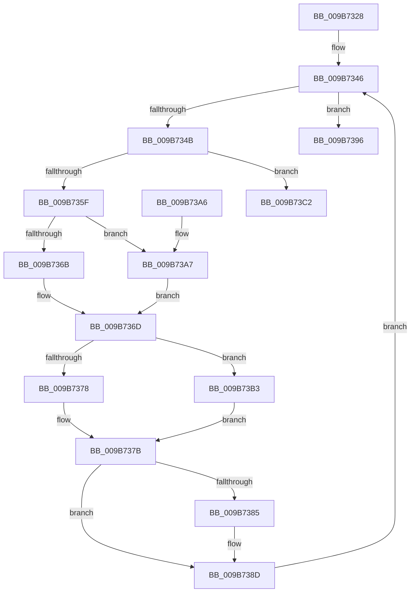

# HvpPointMapEntriesToBuffer

- RVA: `0x009B7328`–`0x009B73DF` (길이 `183` bytes)
- VA: `0x00000001409B7328`
- 실행 섹션: `PAGE`
- PDB 이름 있음: `예`; PDB Function 태그: `아니요`
- unwind 정보 RVA: `0x0009E83C`
- 디코드: `54`개 명령, `183/183` bytes 표시
- 미해석 바이트: `0` (있으면 어셈블리에 `.byte`로 보존)

> 이 문서는 커널 이미지의 기계어와 PDB 기호를 분석해 생성했습니다. 4번과 5번은 함수 원형과 자료형을 바이너리 사용 방식에서 추정한 C 해석이며 원본 소스 복구 결과는 아닙니다.

## 1. Dependencies

- 직접 호출 지점: **2**; 고유 호출 대상: **2**
- 직접 호출자로 확인된 함수: **6**
- RIP 상대 이미지 참조: **0**

### Outgoing calls
- `0x009B7355` → [HvpGetCellMap](../../pagecmrc/BC/HvpGetCellMap_function_00BC9710.md) (function, `0x00BC9710`)
- `0x009B73D9` → [KeBugCheckEx](../../text/4F/KeBugCheckEx_function_004FD660.md) (function, `0x004FD660`)

### Direct callers
- [HvpAddDummyBinToHive](../7E/HvpAddDummyBinToHive_function_007EF80C.md) at `0x007EF88C`
- [HvpMapHiveImage](../7E/HvpMapHiveImage_function_007EF8D0.md) at `0x007EF9AC`
- [HvpBuildMapForMemoryBackedHive](../7F/HvpBuildMapForMemoryBackedHive_function_007F3B4C.md) at `0x007F3C98`
- [HvpDropPagedBins](HvpDropPagedBins_function_009B7168.md) at `0x009B729A`
- [HvpAddBin](../AF/HvpAddBin_function_00AF7D48.md) at `0x00AF83D8`
- [HvpAddBin](../AF/HvpAddBin_function_00AF7D48.md) at `0x00AF842F`
- [sub_00B2E0F0](../B2/Unknown_function_00B2E0F0.md) at `0x00B2E361`

### Static image references
- 디코드된 RIP-relative 메모리 참조가 없습니다.

## 2. Other-region calls and transfers

- 다른 실행 섹션으로 향하는 call: **2**
  - `0x009B7355` → [HvpGetCellMap](../../pagecmrc/BC/HvpGetCellMap_function_00BC9710.md) (`PAGE` → `PAGECMRC`)
  - `0x009B73D9` → [KeBugCheckEx](../../text/4F/KeBugCheckEx_function_004FD660.md) (`PAGE` → `.text`)
- 별도 외부 분기/꼬리 이동을 확인하지 못했습니다.

## 3. Assembly (complete function range)

```asm
009B7328  48 89 5C 24 08                  mov qword ptr [rsp + 8], rbx
009B732D  48 89 6C 24 10                  mov qword ptr [rsp + 0x10], rbp
009B7332  57                              push rdi
009B7333  48 83 EC 30                     sub rsp, 0x30
009B7337  41 8B E9                        mov ebp, r9d
009B733A  41 8B F8                        mov edi, r8d
009B733D  4C 8B DA                        mov r11, rdx
009B7340  48 8B D9                        mov rbx, rcx
009B7343  45 33 D2                        xor r10d, r10d
009B7346  44 3B D7                        cmp r10d, edi
009B7349  73 4B                           jae 0x1409b7396
009B734B  45 8D 04 2A                     lea r8d, [r10 + rbp]
009B734F  48 8B CB                        mov rcx, rbx
009B7352  41 8B D0                        mov edx, r8d
009B7355  E8 B6 23 21 00                  call 0x140bc9710
009B735A  48 85 C0                        test rax, rax
009B735D  74 63                           je 0x1409b73c2
009B735F  4C 89 58 08                     mov qword ptr [rax + 8], r11
009B7363  49 8B CB                        mov rcx, r11
009B7366  45 85 D2                        test r10d, r10d
009B7369  74 3C                           je 0x1409b73a7
009B736B  33 D2                           xor edx, edx
009B736D  48 83 7C 24 68 00               cmp qword ptr [rsp + 0x68], 0
009B7373  89 50 10                        mov dword ptr [rax + 0x10], edx
009B7376  75 3B                           jne 0x1409b73b3
009B7378  41 8B D2                        mov edx, r10d
009B737B  80 7C 24 60 00                  cmp byte ptr [rsp + 0x60], 0
009B7380  48 89 10                        mov qword ptr [rax], rdx
009B7383  74 08                           je 0x1409b738d
009B7385  48 83 C9 08                     or rcx, 8
009B7389  48 89 48 08                     mov qword ptr [rax + 8], rcx
009B738D  41 81 C2 00 10 00 00            add r10d, 0x1000
009B7394  EB B0                           jmp 0x1409b7346
009B7396  48 8B 5C 24 40                  mov rbx, qword ptr [rsp + 0x40]
009B739B  48 8B 6C 24 48                  mov rbp, qword ptr [rsp + 0x48]
009B73A0  48 83 C4 30                     add rsp, 0x30
009B73A4  5F                              pop rdi
009B73A5  C3                              ret
009B73A6  CC                              int3
009B73A7  48 83 C9 01                     or rcx, 1
009B73AB  8B D7                           mov edx, edi
009B73AD  48 89 48 08                     mov qword ptr [rax + 8], rcx
009B73B1  EB BA                           jmp 0x1409b736d
009B73B3  48 8B 54 24 68                  mov rdx, qword ptr [rsp + 0x68]
009B73B8  48 83 C9 02                     or rcx, 2
009B73BC  48 89 48 08                     mov qword ptr [rax + 8], rcx
009B73C0  EB B9                           jmp 0x1409b737b
009B73C2  BA 01 00 00 00                  mov edx, 1
009B73C7  45 8B C8                        mov r9d, r8d
009B73CA  4C 8B C3                        mov r8, rbx
009B73CD  48 C7 44 24 20 28 04 00 00      mov qword ptr [rsp + 0x20], 0x428
009B73D6  8D 4A 50                        lea ecx, [rdx + 0x50]
009B73D9  E8 82 62 B4 FF                  call 0x1404fd660
009B73DE  CC                              int3
```

## 4. C-style interpretation (structured pseudocode)

```c
__int64 __fastcall HvpPointMapEntriesToBuffer(__int64 a1, __int64 a2, int a3, int a4, unsigned __int8 a5, __int64 a6)
{
    __int64 result;
    __int64 v_r10;
    __int64 v_rsp;
    unsigned __int64 v_stack_p10;
    unsigned __int64 v_stack_p20;
    unsigned __int64 v_stack_p8;

    v_stack_p8 = v_rbx;
    v_stack_p10 = v_rbp;
    v_rsp = (v_rsp) - (48);
    v_r10 = 0;
loc_009B7346:
    if (0 >= ((unsigned int)((unsigned int)(a3)))) goto loc_009B7396;
    result = HvpGetCellMap(a1, (unsigned int)((unsigned int)(v_r10 + (unsigned int)(a4) * 1)), v_r10 + (unsigned int)(a4) * 1, a4);
    if (result == 0) goto loc_009B73C2;
    *(unsigned __int64 *)(result + 8) = a2;
    if (0 == 0) goto loc_009B73A7;
    a2 = 0;
loc_009B736D:
    *(unsigned int *)(result + 16) = 0;
    if (a6 != 0) goto loc_009B73B3;
loc_009B737B:
    *(unsigned __int64 *)(result) = 0;
    if (a5 != 0) {
        a1 = (a2) | (8);
        *(unsigned __int64 *)(result + 8) = a1;
    }
    v_r10 = (unsigned int)((v_r10) + (0x1000ULL));
    goto loc_009B7346;
loc_009B7396:
    v_rsp = (v_rsp) + (48);
    return result;
loc_009B73A7:
    a1 = (a1) | (1);
    *(unsigned __int64 *)(result + 8) = a1;
    goto loc_009B736D;
loc_009B73B3:
    a1 = (a1) | (2);
    *(unsigned __int64 *)(result + 8) = a1;
    goto loc_009B737B;
loc_009B73C2:
    v_stack_p20 = 0x428ULL;
    result = KeBugCheckEx(1 + 80, 1, v_stack_p8, (unsigned int)((unsigned int)(v_r10 + (unsigned int)(a4) * 1)));
    return result;
}
```

## 5. (Beta) C Style

```c
int64_t HvpPointMapEntriesToBuffer(int64_t Arg1, int64_t Arg2, int32_t Arg3, int32_t Arg4, uint8_t Arg5, int64_t Arg6)
{
    int64_t result;
    int64_t local_r10;
    int64_t local_rsp;
    uint64_t v_stack_p10;
    uint64_t v_stack_p20;
    uint64_t v_stack_p8;

    v_stack_p8 = local_rbx;
    v_stack_p10 = local_rbp;
    local_rsp = (local_rsp) - (48);
    local_r10 = 0;
loc_009B7346:
    if (0 >= ((uint32_t)((uint32_t)(Arg3)))) goto loc_009B7396;
    result = HvpGetCellMap(Arg1, (uint32_t)((uint32_t)(local_r10 + (uint32_t)(Arg4) * 1)), local_r10 + (uint32_t)(Arg4) * 1, Arg4);
    if (result == 0) goto loc_009B73C2;
    *(uint64_t *)(result + 0x8) = Arg2;
    if (0 == 0) goto loc_009B73A7;
    Arg2 = 0;
loc_009B736D:
    *(uint32_t *)(result + 0x10) = 0;
    if (Arg6 != 0) goto loc_009B73B3;
loc_009B737B:
    *(uint64_t *)(result) = 0;
    if (Arg5 != 0) {
        Arg1 = (Arg2) | (8);
        *(uint64_t *)(result + 0x8) = Arg1;
    }
    local_r10 = (uint32_t)((local_r10) + (0x1000ULL));
    goto loc_009B7346;
loc_009B7396:
    local_rsp = (local_rsp) + (48);
    return result;
loc_009B73A7:
    Arg1 = (Arg1) | (1);
    *(uint64_t *)(result + 0x8) = Arg1;
    goto loc_009B736D;
loc_009B73B3:
    Arg1 = (Arg1) | (2);
    *(uint64_t *)(result + 0x8) = Arg1;
    goto loc_009B737B;
loc_009B73C2:
    v_stack_p20 = 0x428ULL;
    result = KeBugCheckEx(1 + 80, 1, v_stack_p8, (uint32_t)((uint32_t)(local_r10 + (uint32_t)(Arg4) * 1)));
    return result;
}
```

## 6. Execution-region graph

[열기: 2D/3D 그래프와 함수 탐색 컨트롤 패널](../../../control-panel.html?section=page&rva=0x009B7328&view=graph)

- 2D 그래프는 위에서 아래로 흐르고, 3D 그래프는 빈 공간을 드래그해 회전합니다. Shift+드래그는 이동, 휠은 확대·축소, 함수 노드 선택은 대상 보고서 이동입니다.

### Static fallback


