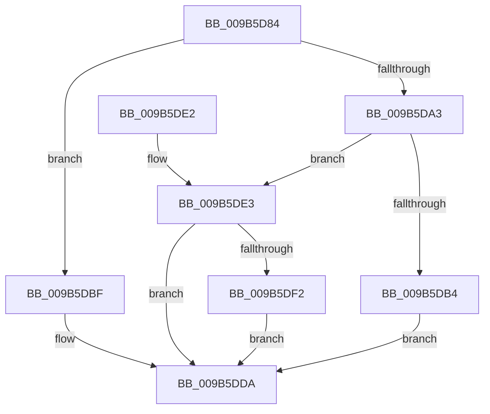

# HvpProtectBinPartial

- RVA: `0x009B5D84`–`0x009B5DF9` (길이 `117` bytes)
- VA: `0x00000001409B5D84`
- 실행 섹션: `PAGE`
- PDB 이름 있음: `예`; PDB Function 태그: `아니요`
- unwind 정보 RVA: `0x00068804`
- 디코드: `36`개 명령, `117/117` bytes 표시
- 미해석 바이트: `0` (있으면 어셈블리에 `.byte`로 보존)

> 이 문서는 커널 이미지의 기계어와 PDB 기호를 분석해 생성했습니다. 4번과 5번은 함수 원형과 자료형을 바이너리 사용 방식에서 추정한 C 해석이며 원본 소스 복구 결과는 아닙니다.

## 1. Dependencies

- 직접 호출 지점: **3**; 고유 호출 대상: **2**
- 직접 호출자로 확인된 함수: **5**
- RIP 상대 이미지 참조: **0**

### Outgoing calls
- `0x009B5DB8` → [CmpProtectPoolEx](../../text/26/CmpProtectPoolEx_function_00267AA8.md) (function, `0x00267AA8`)
- `0x009B5DD3` → [MmSetPageProtection](../../text/4E/MmSetPageProtection_function_004E1580.md) (function, `0x004E1580`)
- `0x009B5DE9` → [CmpProtectPoolEx](../../text/26/CmpProtectPoolEx_function_00267AA8.md) (function, `0x00267AA8`)

### Direct callers
- [HvpMapHiveImage](../7E/HvpMapHiveImage_function_007EF8D0.md) at `0x007EF985`
- [sub_00859517](../85/Unknown_function_00859517.md) at `0x008596AB`
- [HvpSetRangeProtection](HvpSetRangeProtection_function_009B58C0.md) at `0x009B59CE`
- [HvpAddBin](../AF/HvpAddBin_function_00AF7D48.md) at `0x00AF8256`
- [HvpAddBin](../AF/HvpAddBin_function_00AF7D48.md) at `0x00AF8369`
- [sub_00B2E0F0](../B2/Unknown_function_00B2E0F0.md) at `0x00B2E33E`

### Static image references
- 디코드된 RIP-relative 메모리 참조가 없습니다.

## 2. Other-region calls and transfers

- 다른 실행 섹션으로 향하는 call: **3**
  - `0x009B5DB8` → [CmpProtectPoolEx](../../text/26/CmpProtectPoolEx_function_00267AA8.md) (`PAGE` → `.text`)
  - `0x009B5DD3` → [MmSetPageProtection](../../text/4E/MmSetPageProtection_function_004E1580.md) (`PAGE` → `.text`)
  - `0x009B5DE9` → [CmpProtectPoolEx](../../text/26/CmpProtectPoolEx_function_00267AA8.md) (`PAGE` → `.text`)
- 별도 외부 분기/꼬리 이동을 확인하지 못했습니다.

## 3. Assembly (complete function range)

```asm
009B5D84  40 53                           push rbx
009B5D86  48 83 EC 20                     sub rsp, 0x20
009B5D8A  45 8B D1                        mov r10d, r9d
009B5D8D  4C 8B DA                        mov r11, rdx
009B5D90  4C 03 D2                        add r10, rdx
009B5D93  8B 54 24 50                     mov edx, dword ptr [rsp + 0x50]
009B5D97  F7 81 A0 00 00 00 00 00 00 02   test dword ptr [rcx + 0xa0], 0x2000000
009B5DA1  75 1C                           jne 0x1409b5dbf
009B5DA3  33 DB                           xor ebx, ebx
009B5DA5  44 8B C2                        mov r8d, edx
009B5DA8  49 8B CB                        mov rcx, r11
009B5DAB  49 8B D2                        mov rdx, r10
009B5DAE  38 5C 24 58                     cmp byte ptr [rsp + 0x58], bl
009B5DB2  75 2F                           jne 0x1409b5de3
009B5DB4  44 8D 4B 02                     lea r9d, [rbx + 2]
009B5DB8  E8 EB 1C 8B FF                  call 0x140267aa8
009B5DBD  EB 1B                           jmp 0x1409b5dda
009B5DBF  8A 44 24 58                     mov al, byte ptr [rsp + 0x58]
009B5DC3  49 8B CA                        mov rcx, r10
009B5DC6  F6 D8                           neg al
009B5DC8  45 1B C0                        sbb r8d, r8d
009B5DCB  41 83 E0 02                     and r8d, 2
009B5DCF  41 83 C0 02                     add r8d, 2
009B5DD3  E8 A8 B7 B2 FF                  call 0x1404e1580
009B5DD8  33 DB                           xor ebx, ebx
009B5DDA  8B C3                           mov eax, ebx
009B5DDC  48 83 C4 20                     add rsp, 0x20
009B5DE0  5B                              pop rbx
009B5DE1  C3                              ret
009B5DE2  CC                              int3
009B5DE3  41 B9 04 00 00 00               mov r9d, 4
009B5DE9  E8 BA 1C 8B FF                  call 0x140267aa8
009B5DEE  85 C0                           test eax, eax
009B5DF0  75 E8                           jne 0x1409b5dda
009B5DF2  BB 9A 00 00 C0                  mov ebx, 0xc000009a
009B5DF7  EB E1                           jmp 0x1409b5dda
```

## 4. C-style interpretation (structured pseudocode)

```c
__int64 __fastcall HvpProtectBinPartial(__int64 a1, __int64 a2, __int64 a3, int a4, unsigned int a5, unsigned __int8 a6)
{
    __int64 result;
    __int64 v_r10;
    __int64 v_rbx;
    __int64 v_rsp;

    v_rsp = (v_rsp) - (32);
    v_r10 = ((unsigned int)(a4)) + (a2);
    if (((*(unsigned int *)(a1 + 160)) & (0x2000000ULL)) != 0) goto loc_009B5DBF;
    v_rbx = 0;
    if (a6 != 0) goto loc_009B5DE3;
    result = CmpProtectPoolEx(a2, v_r10, (unsigned int)((unsigned int)((unsigned int)(a5))), v_rbx + 2);
    goto loc_009B5DDA;
loc_009B5DBF:
    result = (unsigned __int8)(-(a6));
    a3 = (unsigned int)(((unsigned int)((unsigned int)((unsigned int)(a5)))) & (2));
    a3 = (unsigned int)((a3) + (2));
    result = MmSetPageProtection(v_r10, v_r10, a3, v_rbx + 2);
    v_rbx = 0;
loc_009B5DDA:
    v_rsp = (v_rsp) + (32);
    return 0;
loc_009B5DE3:
    result = CmpProtectPoolEx(v_r10, v_r10, a3, 4);
    if ((unsigned int)(result) != 0) goto loc_009B5DDA;
    goto loc_009B5DDA;
}
```

## 5. (Beta) C Style

```c
int64_t HvpProtectBinPartial(void *Arg1, int64_t Arg2, int64_t Arg3, int32_t Arg4, uint32_t Arg5, uint8_t Arg6)
{
    uint8_t *arg1 = (uint8_t *)Arg1;

    int64_t result;
    int64_t local_r10;
    int64_t local_rbx;
    int64_t local_rsp;

    local_rsp = (local_rsp) - (32);
    local_r10 = ((uint32_t)(Arg4)) + (Arg2);
    if (((*(uint32_t *)(arg1 + 0xA0)) & (0x2000000ULL)) != 0) goto loc_009B5DBF;
    local_rbx = 0;
    if (Arg6 != 0) goto loc_009B5DE3;
    result = CmpProtectPoolEx(Arg2, local_r10, (uint32_t)((uint32_t)((uint32_t)(Arg5))), local_rbx + 2);
    goto loc_009B5DDA;
loc_009B5DBF:
    result = (uint8_t)(-(Arg6));
    Arg3 = (uint32_t)(((uint32_t)((uint32_t)((uint32_t)(Arg5)))) & (2));
    Arg3 = (uint32_t)((Arg3) + (2));
    result = MmSetPageProtection(local_r10, local_r10, Arg3, local_rbx + 2);
    local_rbx = 0;
loc_009B5DDA:
    local_rsp = (local_rsp) + (32);
    return 0;
loc_009B5DE3:
    result = CmpProtectPoolEx(local_r10, local_r10, Arg3, 4);
    if ((uint32_t)(result) != 0) goto loc_009B5DDA;
    goto loc_009B5DDA;
}
```

### 관측된 메모리 오프셋

구조체 형식이 확인되지 않은 접근은 인자 기준의 오프셋으로만 기록했습니다.

| 기준 인자 | 오프셋 표현 | 폭 (bit) | 접근 |
|---|---:|---:|---|
| `Arg1` | `+ 0xA0` | `32` | `R` |

## 6. Execution-region graph

[열기: 2D/3D 그래프와 함수 탐색 컨트롤 패널](../../../control-panel.html?section=page&rva=0x009B5D84&view=graph)

- 2D 그래프는 위에서 아래로 흐르고, 3D 그래프는 빈 공간을 드래그해 회전합니다. Shift+드래그는 이동, 휠은 확대·축소, 함수 노드 선택은 대상 보고서 이동입니다.

### Static fallback


