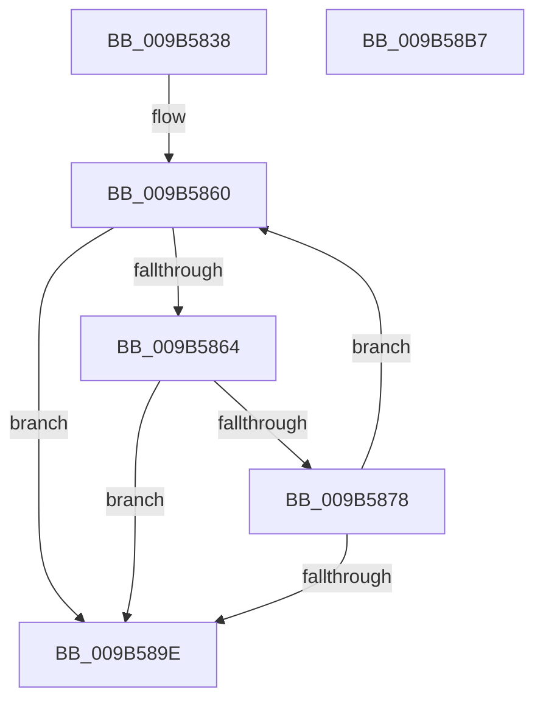

# HvpResetPageProtection

- RVA: `0x009B5838`–`0x009B58B8` (길이 `128` bytes)
- VA: `0x00000001409B5838`
- 실행 섹션: `PAGE`
- PDB 이름 있음: `예`; PDB Function 태그: `아니요`
- unwind 정보 RVA: `0x0006B074`
- 디코드: `41`개 명령, `128/128` bytes 표시
- 미해석 바이트: `0` (있으면 어셈블리에 `.byte`로 보존)

> 이 문서는 커널 이미지의 기계어와 PDB 기호를 분석해 생성했습니다. 4번과 5번은 함수 원형과 자료형을 바이너리 사용 방식에서 추정한 C 해석이며 원본 소스 복구 결과는 아닙니다.

## 1. Dependencies

- 직접 호출 지점: **2**; 고유 호출 대상: **2**
- 직접 호출자로 확인된 함수: **1**
- RIP 상대 이미지 참조: **0**

### Outgoing calls
- `0x009B586D` → [RtlFindNextForwardRunSet](../../text/43/RtlFindNextForwardRunSet_function_0043F230.md) (function, `0x0043F230`)
- `0x009B5891` → [HvpSetRangeProtection](HvpSetRangeProtection_function_009B58C0.md) (function, `0x009B58C0`)

### Direct callers
- [HvResetDirtyData](HvResetDirtyData_function_009B3D84.md) at `0x009B3D94`

### Static image references
- 디코드된 RIP-relative 메모리 참조가 없습니다.

## 2. Other-region calls and transfers

- 다른 실행 섹션으로 향하는 call: **1**
  - `0x009B586D` → [RtlFindNextForwardRunSet](../../text/43/RtlFindNextForwardRunSet_function_0043F230.md) (`PAGE` → `.text`)
- 별도 외부 분기/꼬리 이동을 확인하지 못했습니다.

## 3. Assembly (complete function range)

```asm
009B5838  48 8B C4                        mov rax, rsp
009B583B  48 89 58 10                     mov qword ptr [rax + 0x10], rbx
009B583F  48 89 68 18                     mov qword ptr [rax + 0x18], rbp
009B5843  48 89 70 20                     mov qword ptr [rax + 0x20], rsi
009B5847  57                              push rdi
009B5848  41 56                           push r14
009B584A  41 57                           push r15
009B584C  48 83 EC 20                     sub rsp, 0x20
009B5850  83 60 08 00                     and dword ptr [rax + 8], 0
009B5854  48 8B F9                        mov rdi, rcx
009B5857  8B 69 58                        mov ebp, dword ptr [rcx + 0x58]
009B585A  33 D2                           xor edx, edx
009B585C  44 8B 79 68                     mov r15d, dword ptr [rcx + 0x68]
009B5860  3B D5                           cmp edx, ebp
009B5862  73 3A                           jae 0x1409b589e
009B5864  4C 8D 44 24 40                  lea r8, [rsp + 0x40]
009B5869  48 8D 4F 58                     lea rcx, [rdi + 0x58]
009B586D  E8 BE 99 A8 FF                  call 0x14043f230
009B5872  8B F0                           mov esi, eax
009B5874  85 C0                           test eax, eax
009B5876  74 26                           je 0x1409b589e
009B5878  8B 5C 24 40                     mov ebx, dword ptr [rsp + 0x40]
009B587C  44 8B C0                        mov r8d, eax
009B587F  8B D3                           mov edx, ebx
009B5881  41 C1 E0 09                     shl r8d, 9
009B5885  C1 E2 09                        shl edx, 9
009B5888  41 B9 02 00 00 00               mov r9d, 2
009B588E  48 8B CF                        mov rcx, rdi
009B5891  E8 2A 00 00 00                  call 0x1409b58c0
009B5896  8D 14 1E                        lea edx, [rsi + rbx]
009B5899  44 2B FE                        sub r15d, esi
009B589C  75 C2                           jne 0x1409b5860
009B589E  48 8B 5C 24 48                  mov rbx, qword ptr [rsp + 0x48]
009B58A3  48 8B 6C 24 50                  mov rbp, qword ptr [rsp + 0x50]
009B58A8  48 8B 74 24 58                  mov rsi, qword ptr [rsp + 0x58]
009B58AD  48 83 C4 20                     add rsp, 0x20
009B58B1  41 5F                           pop r15
009B58B3  41 5E                           pop r14
009B58B5  5F                              pop rdi
009B58B6  C3                              ret
009B58B7  CC                              int3
```

## 4. C-style interpretation (structured pseudocode)

```c
__int64 __fastcall HvpResetPageProtection(__int64 a1, int a2)
{
    __int64 result;
    __int64 v_r15;
    __int64 v_rsp;
    unsigned __int64 v_stack_p10;
    unsigned __int64 v_stack_p18;
    unsigned __int64 v_stack_p20;
    unsigned __int64 v_stack_p8;

    *(unsigned __int64 *)(v_rsp + 16) = v_rbx;
    *(unsigned __int64 *)(v_rsp + 24) = v_rbp;
    *(unsigned __int64 *)(v_rsp + 32) = v_rsi;
    v_rsp = (v_rsp) - (32);
    a2 = 0;
loc_009B5860:
    if (0 >= ((unsigned int)((unsigned int)(*(unsigned int *)(a1 + 88))))) goto loc_009B589E;
    result = RtlFindNextForwardRunSet(a1 + 88, a2, v_stack_p8, a4);
    if ((unsigned int)(result) == 0) goto loc_009B589E;
    a3 = (unsigned int)(((unsigned int)((unsigned int)(result))) << (9));
    a2 = (unsigned int)(((unsigned int)((unsigned int)((unsigned int)(v_stack_p8)))) << (9));
    result = HvpSetRangeProtection(a1, a2, a3, 2);
    v_r15 = (unsigned int)(((unsigned int)(*(unsigned int *)(a1 + 104))) - ((unsigned int)((unsigned int)((unsigned int)(result)))));
    if (condition_is_not_equal) goto loc_009B5860;
loc_009B589E:
    v_rsp = (v_rsp) + (32);
    return result;
}
```

## 5. (Beta) C Style

```c
int64_t HvpResetPageProtection(void *Arg1, int32_t Arg2)
{
    uint8_t *arg1 = (uint8_t *)Arg1;

    int64_t result;
    int64_t local_r15;
    int64_t local_rsp;
    uint64_t v_stack_p10;
    uint64_t v_stack_p18;
    uint64_t v_stack_p20;
    uint64_t v_stack_p8;

    *(uint64_t *)(local_rsp + 0x10) = local_rbx;
    *(uint64_t *)(local_rsp + 0x18) = local_rbp;
    *(uint64_t *)(local_rsp + 0x20) = local_rsi;
    local_rsp = (local_rsp) - (32);
    Arg2 = 0;
loc_009B5860:
    if (0 >= ((uint32_t)((uint32_t)(*(uint32_t *)(arg1 + 0x58))))) goto loc_009B589E;
    result = RtlFindNextForwardRunSet(Arg1 + 88, Arg2, v_stack_p8, a4);
    if ((uint32_t)(result) == 0) goto loc_009B589E;
    a3 = (uint32_t)(((uint32_t)((uint32_t)(result))) << (9));
    Arg2 = (uint32_t)(((uint32_t)((uint32_t)((uint32_t)(v_stack_p8)))) << (9));
    result = HvpSetRangeProtection(Arg1, Arg2, a3, 2);
    local_r15 = (uint32_t)(((uint32_t)(*(uint32_t *)(arg1 + 0x68))) - ((uint32_t)((uint32_t)((uint32_t)(result)))));
    if (condition_is_not_equal) goto loc_009B5860;
loc_009B589E:
    local_rsp = (local_rsp) + (32);
    return result;
}
```

### 관측된 메모리 오프셋

구조체 형식이 확인되지 않은 접근은 인자 기준의 오프셋으로만 기록했습니다.

| 기준 인자 | 오프셋 표현 | 폭 (bit) | 접근 |
|---|---:|---:|---|
| `Arg1` | `+ 0x58` | `32` | `R` |
| `Arg1` | `+ 0x58` | `64` | `R` |
| `Arg1` | `+ 0x68` | `32` | `R` |

## 6. Execution-region graph

[열기: 2D/3D 그래프와 함수 탐색 컨트롤 패널](../../../control-panel.html?section=page&rva=0x009B5838&view=graph)

- 2D 그래프는 위에서 아래로 흐르고, 3D 그래프는 빈 공간을 드래그해 회전합니다. Shift+드래그는 이동, 휠은 확대·축소, 함수 노드 선택은 대상 보고서 이동입니다.

### Static fallback


